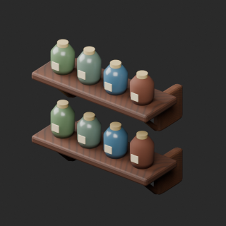
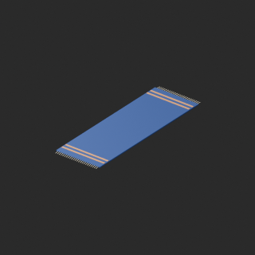

# quality-fw020-in007-v1

[Quality57–76 overview](quality-57-76.md) · [International catalogue](international/README.md)

FW021 zero cleanup; FW022 remains over budget. IN007 color variant only; no cloth simulation.

Existing distribution revisions and material variants only; zero new base records. Models/embedded materials only CC0; images are separate catalogue artwork. [License](../LICENSE.md).

Producer final-ZIP numerical reimports passed; independent public-download match pending. No publication-side Blender rerun. No gameplay, collision, load, fluid, mechanism or Blender4.3.2 approval. Images compare fixed camera/light per model; layouts differ by batch, source and final panels must not be interchanged.

## FW021__repair

**Wall apothecary shelf** · Wall apothecary shelf

Remove exact-zero world-area faces only; preserve all positive surfaces/materials/UV/colors. No new base model.

[ZIP · BLEND/GLB](https://raw.githubusercontent.com/k3peta/tales-on-a-table/main/distributions/quality-fw020-in007-v1/FW021__repair_CC0.zip) · [Enlarge](../previews/quality-fw020-in007-v1/FW021__repair_full.png) · [overview comparison](../previews/quality-fw020-in007-v1/FW021__repair_overview_comparison.png) · [close comparison](../previews/quality-fw020-in007-v1/FW021__repair_close_comparison.png)

Variant/revision dimensions, pivot/facing and triangle count: not independently measured by publisher; refer to the base record and validation scope.

## IN007__blue_wool

**Woven runner** · Woven runner

Blue wool UV color; trim and roughness preserved. No new base model.

[ZIP · BLEND/GLB](https://raw.githubusercontent.com/k3peta/tales-on-a-table/main/distributions/quality-fw020-in007-v1/IN007__blue_wool_CC0.zip) · [Enlarge](../previews/quality-fw020-in007-v1/IN007__blue_wool_full.png) · [overview comparison](../previews/quality-fw020-in007-v1/IN007__blue_wool_overview_comparison.png) · [close comparison](../previews/quality-fw020-in007-v1/IN007__blue_wool_close_comparison.png)

Variant/revision dimensions, pivot/facing and triangle count: not independently measured by publisher; refer to the base record and validation scope.

[Exact ZIP/image bindings](../distributions/quality-fw020-in007-v1/image-bindings.json) · [Validation scope](../distributions/quality-fw020-in007-v1/validation.json).
