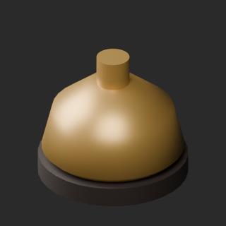
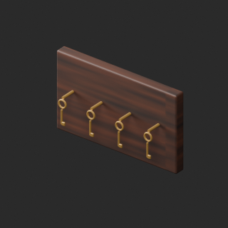
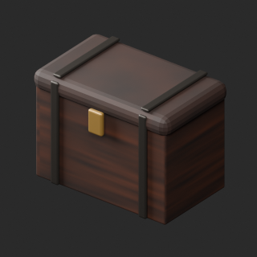
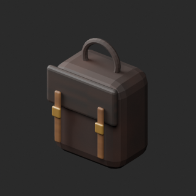
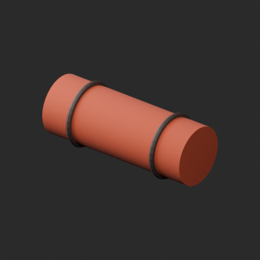
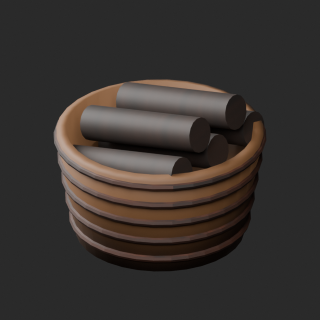
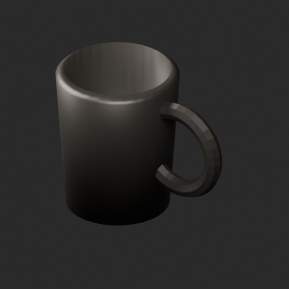
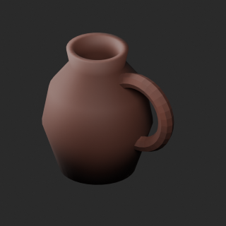
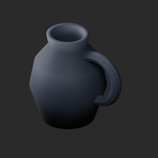

# quality-in008-017-v1

[Quality57–76 overview](quality-57-76.md) · [International catalogue](international/README.md)

Zero-face cleanup and blue ceramic/rust wool variants. IN016 inner-wall/handle shading diagnosis remains unresolved; not a full geometry-quality approval.

Existing distribution revisions and material variants only; zero new base records. Models/embedded materials only CC0; images are separate catalogue artwork. [License](../LICENSE.md).

Producer final-ZIP numerical reimports passed; all adopted public ZIP/member and image hashes independently matched. No publication-side Blender rerun. No gameplay, collision, load, fluid, mechanism or Blender4.3.2 approval. Images compare fixed camera/light per model; layouts differ by batch, source and final panels must not be interchanged.

## IN009__repair

**Counter bell** · Counter bell

Remove exact-zero world-area faces only; preserve all positive surfaces/materials/UV/colors. No new base model.

[ZIP · BLEND/GLB](https://raw.githubusercontent.com/k3peta/tales-on-a-table/main/distributions/quality-in008-017-v1/IN009__repair_CC0.zip) · [Enlarge](../previews/quality-in008-017-v1/IN009__repair_full.png) · [overview comparison](../previews/quality-in008-017-v1/IN009__repair_overview_comparison.png) · [close comparison](../previews/quality-in008-017-v1/IN009__repair_close_comparison.png)

Variant/revision dimensions, pivot/facing and triangle count: not independently measured by publisher; refer to the base record and validation scope.

## IN010__repair

**Room key rack** · Room key rack

Remove exact-zero world-area faces only; preserve all positive surfaces/materials/UV/colors. No new base model.

[ZIP · BLEND/GLB](https://raw.githubusercontent.com/k3peta/tales-on-a-table/main/distributions/quality-in008-017-v1/IN010__repair_CC0.zip) · [Enlarge](../previews/quality-in008-017-v1/IN010__repair_full.png) · [overview comparison](../previews/quality-in008-017-v1/IN010__repair_overview_comparison.png) · [close comparison](../previews/quality-in008-017-v1/IN010__repair_close_comparison.png)

Variant/revision dimensions, pivot/facing and triangle count: not independently measured by publisher; refer to the base record and validation scope.

## IN011__repair

**Travel chest** · Travel chest

Remove exact-zero world-area faces only; preserve all positive surfaces/materials/UV/colors. No new base model.

[ZIP · BLEND/GLB](https://raw.githubusercontent.com/k3peta/tales-on-a-table/main/distributions/quality-in008-017-v1/IN011__repair_CC0.zip) · [Enlarge](../previews/quality-in008-017-v1/IN011__repair_full.png) · [overview comparison](../previews/quality-in008-017-v1/IN011__repair_overview_comparison.png) · [close comparison](../previews/quality-in008-017-v1/IN011__repair_close_comparison.png)

Variant/revision dimensions, pivot/facing and triangle count: not independently measured by publisher; refer to the base record and validation scope.

## IN012__repair

**Travel satchel** · Travel satchel

Remove exact-zero world-area faces only; preserve all positive surfaces/materials/UV/colors. No new base model.

[ZIP · BLEND/GLB](https://raw.githubusercontent.com/k3peta/tales-on-a-table/main/distributions/quality-in008-017-v1/IN012__repair_CC0.zip) · [Enlarge](../previews/quality-in008-017-v1/IN012__repair_full.png) · [overview comparison](../previews/quality-in008-017-v1/IN012__repair_overview_comparison.png) · [close comparison](../previews/quality-in008-017-v1/IN012__repair_close_comparison.png)

Variant/revision dimensions, pivot/facing and triangle count: not independently measured by publisher; refer to the base record and validation scope.

## IN013__rust_wool

**Rolled blanket** · Rolled blanket

UV color variant with unchanged baseline geometry/UV; alpha, roughness and other materials preserved. No new base model or wear simulation.

[ZIP · BLEND/GLB](https://raw.githubusercontent.com/k3peta/tales-on-a-table/main/distributions/quality-in008-017-v1/IN013__rust_wool_CC0.zip) · [Enlarge](../previews/quality-in008-017-v1/IN013__rust_wool_full.png) · [overview comparison](../previews/quality-in008-017-v1/IN013__rust_wool_overview_comparison.png) · [close comparison](../previews/quality-in008-017-v1/IN013__rust_wool_close_comparison.png)

Variant/revision dimensions, pivot/facing and triangle count: not independently measured by publisher; refer to the base record and validation scope.

## IN014__repair

**Log basket** · Log basket

Remove exact-zero world-area faces only; preserve all positive surfaces/materials/UV/colors. No new base model.

[ZIP · BLEND/GLB](https://raw.githubusercontent.com/k3peta/tales-on-a-table/main/distributions/quality-in008-017-v1/IN014__repair_CC0.zip) · [Enlarge](../previews/quality-in008-017-v1/IN014__repair_full.png) · [overview comparison](../previews/quality-in008-017-v1/IN014__repair_overview_comparison.png) · [close comparison](../previews/quality-in008-017-v1/IN014__repair_close_comparison.png)

Variant/revision dimensions, pivot/facing and triangle count: not independently measured by publisher; refer to the base record and validation scope.

## IN016__repair

**Pewter tankard** · Pewter tankard

Remove exact-zero world-area faces only; preserve all positive surfaces/materials/UV/colors. No new base model. Known limitation: inner-wall protrusion-like feature near handle remains undiagnosed; this revision only removes exact-zero faces, not a full visual repair.

[ZIP · BLEND/GLB](https://raw.githubusercontent.com/k3peta/tales-on-a-table/main/distributions/quality-in008-017-v1/IN016__repair_CC0.zip) · [Enlarge](../previews/quality-in008-017-v1/IN016__repair_full.png) · [overview comparison](../previews/quality-in008-017-v1/IN016__repair_overview_comparison.png) · [close comparison](../previews/quality-in008-017-v1/IN016__repair_close_comparison.png)

Variant/revision dimensions, pivot/facing and triangle count: not independently measured by publisher; refer to the base record and validation scope.

## IN017__repair

**Ceramic pitcher** · Ceramic pitcher

Remove exact-zero world-area faces only; preserve all positive surfaces/materials/UV/colors. No new base model.

[ZIP · BLEND/GLB](https://raw.githubusercontent.com/k3peta/tales-on-a-table/main/distributions/quality-in008-017-v1/IN017__repair_CC0.zip) · [Enlarge](../previews/quality-in008-017-v1/IN017__repair_full.png) · [overview comparison](../previews/quality-in008-017-v1/IN017__repair_overview_comparison.png) · [close comparison](../previews/quality-in008-017-v1/IN017__repair_close_comparison.png)

Variant/revision dimensions, pivot/facing and triangle count: not independently measured by publisher; refer to the base record and validation scope.

## IN017__blue_ceramic

**Ceramic pitcher** · Ceramic pitcher

UV color variant with unchanged baseline geometry/UV; alpha, roughness and other materials preserved. No new base model or wear simulation.

[ZIP · BLEND/GLB](https://raw.githubusercontent.com/k3peta/tales-on-a-table/main/distributions/quality-in008-017-v1/IN017__blue_ceramic_CC0.zip) · [Enlarge](../previews/quality-in008-017-v1/IN017__blue_ceramic_full.png) · [overview comparison](../previews/quality-in008-017-v1/IN017__blue_ceramic_overview_comparison.png) · [close comparison](../previews/quality-in008-017-v1/IN017__blue_ceramic_close_comparison.png)

Variant/revision dimensions, pivot/facing and triangle count: not independently measured by publisher; refer to the base record and validation scope.

[Exact ZIP/image bindings](../distributions/quality-in008-017-v1/image-bindings.json) · [Validation scope](../distributions/quality-in008-017-v1/validation.json).
