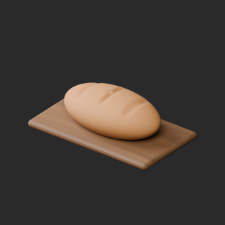
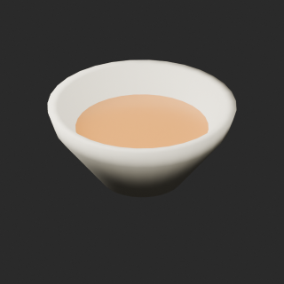
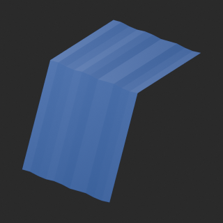
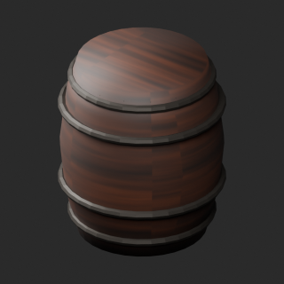
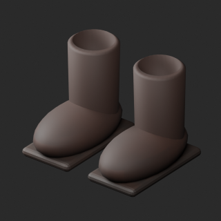
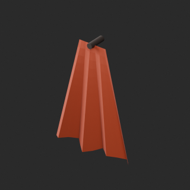

# quality-in018-oc010-v1

[Quality57–76 overview](quality-57-76.md) · [International catalogue](international/README.md)

Boot pair is one record. Tablecloth and cloak are static shapes. OC modules are checked separately, not a complete building assembly.

Existing distribution revisions and material variants only; zero new base records. Models/embedded materials only CC0; images are separate catalogue artwork. [License](../LICENSE.md).

Producer final-ZIP numerical reimports passed; independent public-download match pending. No publication-side Blender rerun. No gameplay, collision, load, fluid, mechanism or Blender4.3.2 approval. Images compare fixed camera/light per model; layouts differ by batch, source and final panels must not be interchanged.

## IN018__repair

**Bread board** · Bread board

Remove exact-zero world-area faces only; preserve all positive surfaces/materials/UV/colors. No new base model.

[ZIP · BLEND/GLB](https://raw.githubusercontent.com/k3peta/tales-on-a-table/main/distributions/quality-in018-oc010-v1/IN018__repair_CC0.zip) · [Enlarge](../previews/quality-in018-oc010-v1/IN018__repair_full.png) · [overview comparison](../previews/quality-in018-oc010-v1/IN018__repair_overview_comparison.png) · [close comparison](../previews/quality-in018-oc010-v1/IN018__repair_close_comparison.png)

Variant/revision dimensions, pivot/facing and triangle count: not independently measured by publisher; refer to the base record and validation scope.

## IN019__repair

**Soup bowl** · Soup bowl

Remove exact-zero world-area faces only; preserve all positive surfaces/materials/UV/colors. No new base model.

[ZIP · BLEND/GLB](https://raw.githubusercontent.com/k3peta/tales-on-a-table/main/distributions/quality-in018-oc010-v1/IN019__repair_CC0.zip) · [Enlarge](../previews/quality-in018-oc010-v1/IN019__repair_full.png) · [overview comparison](../previews/quality-in018-oc010-v1/IN019__repair_overview_comparison.png) · [close comparison](../previews/quality-in018-oc010-v1/IN019__repair_close_comparison.png)

Variant/revision dimensions, pivot/facing and triangle count: not independently measured by publisher; refer to the base record and validation scope.

## IN020__blue_linen

**Table linen** · Table linen

UV color variant with unchanged baseline geometry/UV; alpha, roughness and other materials preserved. No new base model or wear simulation.

[ZIP · BLEND/GLB](https://raw.githubusercontent.com/k3peta/tales-on-a-table/main/distributions/quality-in018-oc010-v1/IN020__blue_linen_CC0.zip) · [Enlarge](../previews/quality-in018-oc010-v1/IN020__blue_linen_full.png) · [overview comparison](../previews/quality-in018-oc010-v1/IN020__blue_linen_overview_comparison.png) · [close comparison](../previews/quality-in018-oc010-v1/IN020__blue_linen_close_comparison.png)

Variant/revision dimensions, pivot/facing and triangle count: not independently measured by publisher; refer to the base record and validation scope.

## IN022__repair

**Ale barrel** · Ale barrel

Remove exact-zero world-area faces only; preserve all positive surfaces/materials/UV/colors. No new base model.

[ZIP · BLEND/GLB](https://raw.githubusercontent.com/k3peta/tales-on-a-table/main/distributions/quality-in018-oc010-v1/IN022__repair_CC0.zip) · [Enlarge](../previews/quality-in018-oc010-v1/IN022__repair_full.png) · [overview comparison](../previews/quality-in018-oc010-v1/IN022__repair_overview_comparison.png) · [close comparison](../previews/quality-in018-oc010-v1/IN022__repair_close_comparison.png)

Variant/revision dimensions, pivot/facing and triangle count: not independently measured by publisher; refer to the base record and validation scope.

## IN023__repair

**Travel boots** · Travel boots

Remove exact-zero world-area faces only; preserve all positive surfaces/materials/UV/colors. No new base model.

[ZIP · BLEND/GLB](https://raw.githubusercontent.com/k3peta/tales-on-a-table/main/distributions/quality-in018-oc010-v1/IN023__repair_CC0.zip) · [Enlarge](../previews/quality-in018-oc010-v1/IN023__repair_full.png) · [overview comparison](../previews/quality-in018-oc010-v1/IN023__repair_overview_comparison.png) · [close comparison](../previews/quality-in018-oc010-v1/IN023__repair_close_comparison.png)

Variant/revision dimensions, pivot/facing and triangle count: not independently measured by publisher; refer to the base record and validation scope.

## IN024__rust_wool

**Hanging cloak** · Hanging cloak

UV color variant with unchanged baseline geometry/UV; alpha, roughness and other materials preserved. No new base model or wear simulation.

[ZIP · BLEND/GLB](https://raw.githubusercontent.com/k3peta/tales-on-a-table/main/distributions/quality-in018-oc010-v1/IN024__rust_wool_CC0.zip) · [Enlarge](../previews/quality-in018-oc010-v1/IN024__rust_wool_full.png) · [overview comparison](../previews/quality-in018-oc010-v1/IN024__rust_wool_overview_comparison.png) · [close comparison](../previews/quality-in018-oc010-v1/IN024__rust_wool_close_comparison.png)

Variant/revision dimensions, pivot/facing and triangle count: not independently measured by publisher; refer to the base record and validation scope.

[Exact ZIP/image bindings](../distributions/quality-in018-oc010-v1/image-bindings.json) · [Validation scope](../distributions/quality-in018-oc010-v1/validation.json).
