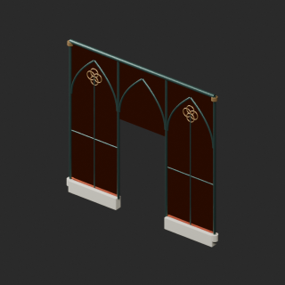

# quality-oc011-pa001-v1

[Quality57–76 overview](quality-57-76.md) · [International catalogue](international/README.md)

Amber glass-shell color only, no liquid added. Gothic-wall transforms retained for assembly.

Existing distribution revisions and material variants only; zero new base records. Models/embedded materials only CC0; images are separate catalogue artwork. [License](../LICENSE.md).

Producer final-ZIP numerical reimports passed; all adopted public ZIP/member and image hashes independently matched. No publication-side Blender rerun. No gameplay, collision, load, fluid, mechanism or Blender4.3.2 approval. Images compare fixed camera/light per model; layouts differ by batch, source and final panels must not be interchanged.

## OC015__amber_glass

**Gothic wall sector (entrance / south)** · Gothic wall sector (entrance / south)

Architectural glazing amber color on unchanged geometry/UV; transmission/IOR/roughness and structural materials preserved. No emission, liquid edit or optical portability guarantee.

[ZIP · BLEND/GLB](https://raw.githubusercontent.com/k3peta/tales-on-a-table/main/distributions/quality-oc011-pa001-v1/OC015__amber_glass_CC0.zip) · [Enlarge](../previews/quality-oc011-pa001-v1/OC015__amber_glass_full.png) · [overview comparison](../previews/quality-oc011-pa001-v1/OC015__amber_glass_overview_comparison.png) · [close comparison](../previews/quality-oc011-pa001-v1/OC015__amber_glass_close_comparison.png)

Variant/revision dimensions, pivot/facing and triangle count: not independently measured by publisher; refer to the base record and validation scope.

[Exact ZIP/image bindings](../distributions/quality-oc011-pa001-v1/image-bindings.json) · [Validation scope](../distributions/quality-oc011-pa001-v1/validation.json).
