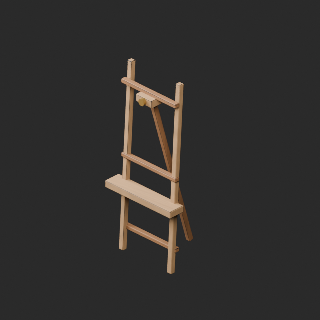
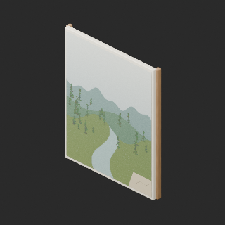
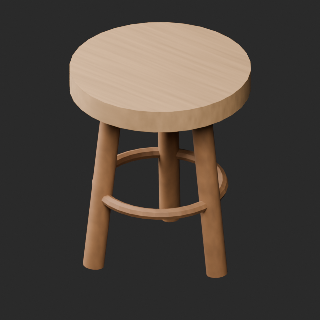
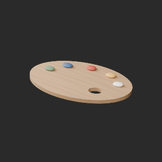
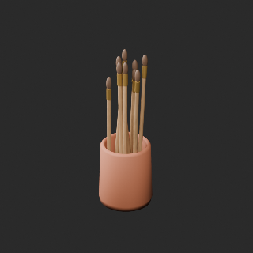
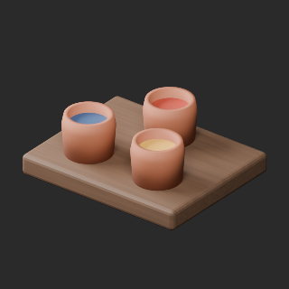
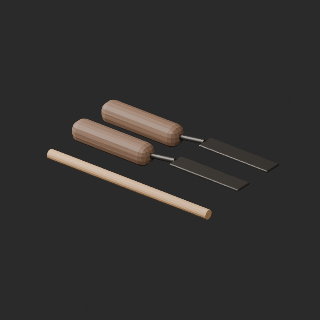

# quality-pa-wood-repair-v1

[Quality57–76 overview](quality-57-76.md) · [International catalogue](international/README.md)

PA002/003/004/005/006/008/010: source BLEND procedural wood baked to1024px base-color/normal maps. Original UV0 retained; bake UV added. Replaces unpublished pale GLB candidates. Finite sampled bake, not pixel-identical procedural reproduction.

Existing distribution revisions and material variants only; zero new base records. Models/embedded materials only CC0; images are separate catalogue artwork. [License](../LICENSE.md).

Producer final-ZIP numerical reimports passed; all adopted public ZIP/member and image hashes independently matched. No publication-side Blender rerun. No gameplay, collision, load, fluid, mechanism or Blender4.3.2 approval. Images compare fixed camera/light per model; layouts differ by batch, source and final panels must not be interchanged.

## PA002__repair

**Adjustable studio easel** · Adjustable studio easel

Original source-BLEND procedural wood baked to embedded 1024px base-color and tangent-normal textures. Original UV0 retained, nonoverlapping UV1 added. Existing exact-zero cleanup retained where applicable. Material/UV repair, not a new base or color variant. Visual seam and source-appearance validation recorded separately.

[ZIP · BLEND/GLB](https://raw.githubusercontent.com/k3peta/tales-on-a-table/main/distributions/quality-pa-wood-repair-v1/PA002__repair_CC0.zip) · [Enlarge](../previews/quality-pa-wood-repair-v1/PA002__repair_full.png) · [comparison](../previews/quality-pa-wood-repair-v1/PA002__repair_comparison.png)

Variant/revision dimensions, pivot/facing and triangle count: not independently measured by publisher; refer to the base record and validation scope.

## PA003__repair

**Unfinished original river landscape** · Unfinished original river landscape

Original source-BLEND procedural wood baked to embedded 1024px base-color and tangent-normal textures. Original UV0 retained, nonoverlapping UV1 added. Existing exact-zero cleanup retained where applicable. Material/UV repair, not a new base or color variant. Visual seam and source-appearance validation recorded separately.

[ZIP · BLEND/GLB](https://raw.githubusercontent.com/k3peta/tales-on-a-table/main/distributions/quality-pa-wood-repair-v1/PA003__repair_CC0.zip) · [Enlarge](../previews/quality-pa-wood-repair-v1/PA003__repair_full.png) · [comparison](../previews/quality-pa-wood-repair-v1/PA003__repair_comparison.png)

Variant/revision dimensions, pivot/facing and triangle count: not independently measured by publisher; refer to the base record and validation scope.

## PA004__repair

**Round painters stool** · Round painters stool

Original source-BLEND procedural wood baked to embedded 1024px base-color and tangent-normal textures. Original UV0 retained, nonoverlapping UV1 added. Existing exact-zero cleanup retained where applicable. Material/UV repair, not a new base or color variant. Visual seam and source-appearance validation recorded separately.

[ZIP · BLEND/GLB](https://raw.githubusercontent.com/k3peta/tales-on-a-table/main/distributions/quality-pa-wood-repair-v1/PA004__repair_CC0.zip) · [Enlarge](../previews/quality-pa-wood-repair-v1/PA004__repair_full.png) · [comparison](../previews/quality-pa-wood-repair-v1/PA004__repair_comparison.png)

Variant/revision dimensions, pivot/facing and triangle count: not independently measured by publisher; refer to the base record and validation scope.

## PA005__repair

**Oval loaded palette** · Oval loaded palette

Original source-BLEND procedural wood baked to embedded 1024px base-color and tangent-normal textures. Original UV0 retained, nonoverlapping UV1 added. Existing exact-zero cleanup retained where applicable. Material/UV repair, not a new base or color variant. Visual seam and source-appearance validation recorded separately.

[ZIP · BLEND/GLB](https://raw.githubusercontent.com/k3peta/tales-on-a-table/main/distributions/quality-pa-wood-repair-v1/PA005__repair_CC0.zip) · [Enlarge](../previews/quality-pa-wood-repair-v1/PA005__repair_full.png) · [comparison](../previews/quality-pa-wood-repair-v1/PA005__repair_comparison.png)

Variant/revision dimensions, pivot/facing and triangle count: not independently measured by publisher; refer to the base record and validation scope.

## PA006__repair

**Brush crock** · Brush crock

Original source-BLEND procedural wood baked to embedded 1024px base-color and tangent-normal textures. Original UV0 retained, nonoverlapping UV1 added. Existing exact-zero cleanup retained where applicable. Material/UV repair, not a new base or color variant. Visual seam and source-appearance validation recorded separately.

[ZIP · BLEND/GLB](https://raw.githubusercontent.com/k3peta/tales-on-a-table/main/distributions/quality-pa-wood-repair-v1/PA006__repair_CC0.zip) · [Enlarge](../previews/quality-pa-wood-repair-v1/PA006__repair_full.png) · [comparison](../previews/quality-pa-wood-repair-v1/PA006__repair_comparison.png)

Variant/revision dimensions, pivot/facing and triangle count: not independently measured by publisher; refer to the base record and validation scope.

## PA008__repair

**Pigment jars on tray** · Pigment jars on tray

Original source-BLEND procedural wood baked to embedded 1024px base-color and tangent-normal textures. Original UV0 retained, nonoverlapping UV1 added. Existing exact-zero cleanup retained where applicable. Material/UV repair, not a new base or color variant. Visual seam and source-appearance validation recorded separately.

[ZIP · BLEND/GLB](https://raw.githubusercontent.com/k3peta/tales-on-a-table/main/distributions/quality-pa-wood-repair-v1/PA008__repair_CC0.zip) · [Enlarge](../previews/quality-pa-wood-repair-v1/PA008__repair_full.png) · [comparison](../previews/quality-pa-wood-repair-v1/PA008__repair_comparison.png)

Variant/revision dimensions, pivot/facing and triangle count: not independently measured by publisher; refer to the base record and validation scope.

## PA010__repair

**Palette knives** · Palette knives

Original source-BLEND procedural wood baked to embedded 1024px base-color and tangent-normal textures. Original UV0 retained, nonoverlapping UV1 added. Existing exact-zero cleanup retained where applicable. Material/UV repair, not a new base or color variant. Visual seam and source-appearance validation recorded separately.

[ZIP · BLEND/GLB](https://raw.githubusercontent.com/k3peta/tales-on-a-table/main/distributions/quality-pa-wood-repair-v1/PA010__repair_CC0.zip) · [Enlarge](../previews/quality-pa-wood-repair-v1/PA010__repair_full.png) · [comparison](../previews/quality-pa-wood-repair-v1/PA010__repair_comparison.png)

Variant/revision dimensions, pivot/facing and triangle count: not independently measured by publisher; refer to the base record and validation scope.

[Exact ZIP/image bindings](../distributions/quality-pa-wood-repair-v1/image-bindings.json) · [Validation scope](../distributions/quality-pa-wood-repair-v1/validation.json).
