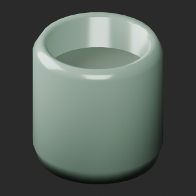
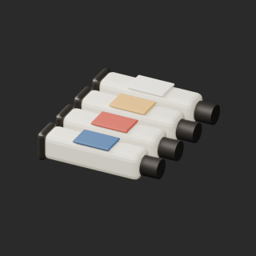

# quality-pa002-011-v1

[Quality57–76 overview](quality-57-76.md) · [International catalogue](international/README.md)

Only PA007 and PA009 from this batch are distributed here. PA006/008/010 old candidates are superseded by the wood correction below. PA007 surface remains opaque.

Existing distribution revisions and material variants only; zero new base records. Models/embedded materials only CC0; images are separate catalogue artwork. [License](../LICENSE.md).

Producer final-ZIP numerical reimports passed; all adopted public ZIP/member and image hashes independently matched. No publication-side Blender rerun. No gameplay, collision, load, fluid, mechanism or Blender4.3.2 approval. Images compare fixed camera/light per model; layouts differ by batch, source and final panels must not be interchanged.

## PA007__repair

**Rinsing jar** · Rinsing jar

Remove exact-zero world-area faces only; preserve all positive surfaces/materials/UV/colors. No new base model.

[ZIP · BLEND/GLB](https://raw.githubusercontent.com/k3peta/tales-on-a-table/main/distributions/quality-pa002-011-v1/PA007__repair_CC0.zip) · [Enlarge](../previews/quality-pa002-011-v1/PA007__repair_full.png) · [overview comparison](../previews/quality-pa002-011-v1/PA007__repair_overview_comparison.png) · [close comparison](../previews/quality-pa002-011-v1/PA007__repair_close_comparison.png)

Variant/revision dimensions, pivot/facing and triangle count: not independently measured by publisher; refer to the base record and validation scope.

## PA009__repair

**Paint tubes** · Paint tubes

Remove exact-zero world-area faces only; preserve all positive surfaces/materials/UV/colors. No new base model.

[ZIP · BLEND/GLB](https://raw.githubusercontent.com/k3peta/tales-on-a-table/main/distributions/quality-pa002-011-v1/PA009__repair_CC0.zip) · [Enlarge](../previews/quality-pa002-011-v1/PA009__repair_full.png) · [overview comparison](../previews/quality-pa002-011-v1/PA009__repair_overview_comparison.png) · [close comparison](../previews/quality-pa002-011-v1/PA009__repair_close_comparison.png)

Variant/revision dimensions, pivot/facing and triangle count: not independently measured by publisher; refer to the base record and validation scope.

[Exact ZIP/image bindings](../distributions/quality-pa002-011-v1/image-bindings.json) · [Validation scope](../distributions/quality-pa002-011-v1/validation.json).
