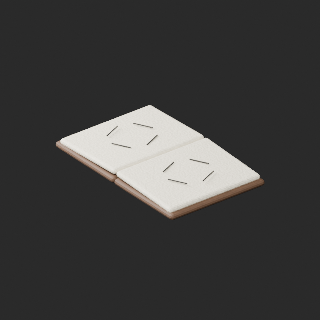
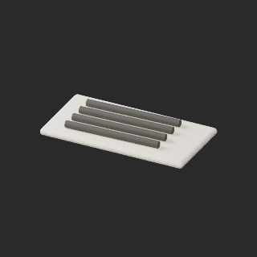
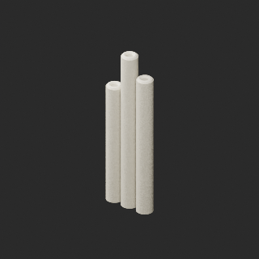
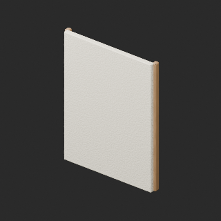
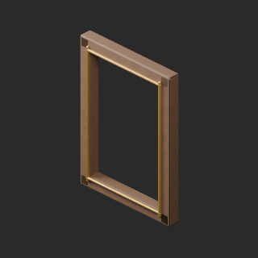
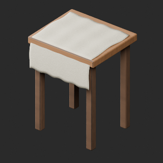
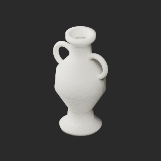
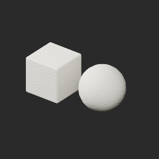
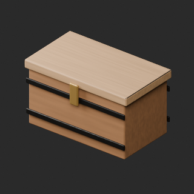
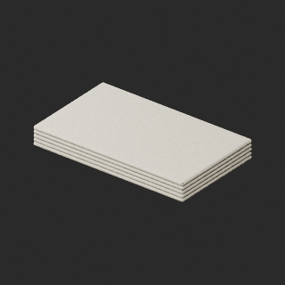

# quality-pa012-021-v1

[Quality57–76 overview](quality-57-76.md) · [International catalogue](international/README.md)

Ten material/UV revisions, five also exact-zero cleanup. Original UV0 retained; bake atlas added. PA020 atlas-edge limitations remain.

Existing distribution revisions and material variants only; zero new base records. Models/embedded materials only CC0; images are separate catalogue artwork. [License](../LICENSE.md).

Producer final-ZIP numerical reimports passed; all adopted public ZIP/member and image hashes independently matched. No publication-side Blender rerun. No gameplay, collision, load, fluid, mechanism or Blender4.3.2 approval. Images compare fixed camera/light per model; layouts differ by batch, source and final panels must not be interchanged.

## PA012__repair

**Open sketchbook** · Open sketchbook

Original source-BLEND procedural materials (wood, paper, linen, plaster or iron as applicable) baked to embedded 1024px base-color and tangent-normal textures. Original UV0 retained, nonoverlapping UV1 added. 496 exact-zero faces removed across five affected assets; positive surfaces retained. Material/UV repair, not a new base or color variant. Visual seam and source-appearance validation recorded separately.

[ZIP · BLEND/GLB](https://raw.githubusercontent.com/k3peta/tales-on-a-table/main/distributions/quality-pa012-021-v1/PA012__repair_CC0.zip) · [Enlarge](../previews/quality-pa012-021-v1/PA012__repair_full.png) · [comparison](../previews/quality-pa012-021-v1/PA012__repair_comparison.png)

Variant/revision dimensions, pivot/facing and triangle count: not independently measured by publisher; refer to the base record and validation scope.

## PA013__repair

**Charcoal sticks** · Charcoal sticks

Original source-BLEND procedural materials (wood, paper, linen, plaster or iron as applicable) baked to embedded 1024px base-color and tangent-normal textures. Original UV0 retained, nonoverlapping UV1 added. 496 exact-zero faces removed across five affected assets; positive surfaces retained. Material/UV repair, not a new base or color variant. Visual seam and source-appearance validation recorded separately.

[ZIP · BLEND/GLB](https://raw.githubusercontent.com/k3peta/tales-on-a-table/main/distributions/quality-pa012-021-v1/PA013__repair_CC0.zip) · [Enlarge](../previews/quality-pa012-021-v1/PA013__repair_full.png) · [comparison](../previews/quality-pa012-021-v1/PA013__repair_comparison.png)

Variant/revision dimensions, pivot/facing and triangle count: not independently measured by publisher; refer to the base record and validation scope.

## PA014__repair

**Canvas rolls** · Canvas rolls

Original source-BLEND procedural materials (wood, paper, linen, plaster or iron as applicable) baked to embedded 1024px base-color and tangent-normal textures. Original UV0 retained, nonoverlapping UV1 added. 496 exact-zero faces removed across five affected assets; positive surfaces retained. Material/UV repair, not a new base or color variant. Visual seam and source-appearance validation recorded separately.

[ZIP · BLEND/GLB](https://raw.githubusercontent.com/k3peta/tales-on-a-table/main/distributions/quality-pa012-021-v1/PA014__repair_CC0.zip) · [Enlarge](../previews/quality-pa012-021-v1/PA014__repair_full.png) · [comparison](../previews/quality-pa012-021-v1/PA014__repair_comparison.png)

Variant/revision dimensions, pivot/facing and triangle count: not independently measured by publisher; refer to the base record and validation scope.

## PA015__repair

**Blank stretched canvas** · Blank stretched canvas

Original source-BLEND procedural materials (wood, paper, linen, plaster or iron as applicable) baked to embedded 1024px base-color and tangent-normal textures. Original UV0 retained, nonoverlapping UV1 added. 496 exact-zero faces removed across five affected assets; positive surfaces retained. Material/UV repair, not a new base or color variant. Visual seam and source-appearance validation recorded separately.

[ZIP · BLEND/GLB](https://raw.githubusercontent.com/k3peta/tales-on-a-table/main/distributions/quality-pa012-021-v1/PA015__repair_CC0.zip) · [Enlarge](../previews/quality-pa012-021-v1/PA015__repair_full.png) · [comparison](../previews/quality-pa012-021-v1/PA015__repair_comparison.png)

Variant/revision dimensions, pivot/facing and triangle count: not independently measured by publisher; refer to the base record and validation scope.

## PA016__repair

**Empty carved picture frame** · Empty carved picture frame

Original source-BLEND procedural materials (wood, paper, linen, plaster or iron as applicable) baked to embedded 1024px base-color and tangent-normal textures. Original UV0 retained, nonoverlapping UV1 added. 496 exact-zero faces removed across five affected assets; positive surfaces retained. Material/UV repair, not a new base or color variant. Visual seam and source-appearance validation recorded separately.

[ZIP · BLEND/GLB](https://raw.githubusercontent.com/k3peta/tales-on-a-table/main/distributions/quality-pa012-021-v1/PA016__repair_CC0.zip) · [Enlarge](../previews/quality-pa012-021-v1/PA016__repair_full.png) · [comparison](../previews/quality-pa012-021-v1/PA016__repair_comparison.png)

Variant/revision dimensions, pivot/facing and triangle count: not independently measured by publisher; refer to the base record and validation scope.

## PA017__repair

**Plaster stilllife stand** · Plaster stilllife stand

Original source-BLEND procedural materials (wood, paper, linen, plaster or iron as applicable) baked to embedded 1024px base-color and tangent-normal textures. Original UV0 retained, nonoverlapping UV1 added. 496 exact-zero faces removed across five affected assets; positive surfaces retained. Material/UV repair, not a new base or color variant. Visual seam and source-appearance validation recorded separately.

[ZIP · BLEND/GLB](https://raw.githubusercontent.com/k3peta/tales-on-a-table/main/distributions/quality-pa012-021-v1/PA017__repair_CC0.zip) · [Enlarge](../previews/quality-pa012-021-v1/PA017__repair_full.png) · [comparison](../previews/quality-pa012-021-v1/PA017__repair_comparison.png)

Variant/revision dimensions, pivot/facing and triangle count: not independently measured by publisher; refer to the base record and validation scope.

## PA018__repair

**Plaster classical vessel** · Plaster classical vessel

Original source-BLEND procedural materials (wood, paper, linen, plaster or iron as applicable) baked to embedded 1024px base-color and tangent-normal textures. Original UV0 retained, nonoverlapping UV1 added. 496 exact-zero faces removed across five affected assets; positive surfaces retained. Material/UV repair, not a new base or color variant. Visual seam and source-appearance validation recorded separately.

[ZIP · BLEND/GLB](https://raw.githubusercontent.com/k3peta/tales-on-a-table/main/distributions/quality-pa012-021-v1/PA018__repair_CC0.zip) · [Enlarge](../previews/quality-pa012-021-v1/PA018__repair_full.png) · [comparison](../previews/quality-pa012-021-v1/PA018__repair_comparison.png)

Variant/revision dimensions, pivot/facing and triangle count: not independently measured by publisher; refer to the base record and validation scope.

## PA019__repair

**Plaster geometric studies** · Plaster geometric studies

Original source-BLEND procedural materials (wood, paper, linen, plaster or iron as applicable) baked to embedded 1024px base-color and tangent-normal textures. Original UV0 retained, nonoverlapping UV1 added. 496 exact-zero faces removed across five affected assets; positive surfaces retained. Material/UV repair, not a new base or color variant. Visual seam and source-appearance validation recorded separately.

[ZIP · BLEND/GLB](https://raw.githubusercontent.com/k3peta/tales-on-a-table/main/distributions/quality-pa012-021-v1/PA019__repair_CC0.zip) · [Enlarge](../previews/quality-pa012-021-v1/PA019__repair_full.png) · [comparison](../previews/quality-pa012-021-v1/PA019__repair_comparison.png)

Variant/revision dimensions, pivot/facing and triangle count: not independently measured by publisher; refer to the base record and validation scope.

## PA020__repair

**Wooden supply chest** · Wooden supply chest

Original source-BLEND procedural materials (wood, paper, linen, plaster or iron as applicable) baked to embedded 1024px base-color and tangent-normal textures. Original UV0 retained, nonoverlapping UV1 added. 496 exact-zero faces removed across five affected assets; positive surfaces retained. Material/UV repair, not a new base or color variant. Visual seam and source-appearance validation recorded separately.

[ZIP · BLEND/GLB](https://raw.githubusercontent.com/k3peta/tales-on-a-table/main/distributions/quality-pa012-021-v1/PA020__repair_CC0.zip) · [Enlarge](../previews/quality-pa012-021-v1/PA020__repair_full.png) · [comparison](../previews/quality-pa012-021-v1/PA020__repair_comparison.png)

Variant/revision dimensions, pivot/facing and triangle count: not independently measured by publisher; refer to the base record and validation scope.

## PA021__repair

**Folded dropcloth** · Folded dropcloth

Original source-BLEND procedural materials (wood, paper, linen, plaster or iron as applicable) baked to embedded 1024px base-color and tangent-normal textures. Original UV0 retained, nonoverlapping UV1 added. 496 exact-zero faces removed across five affected assets; positive surfaces retained. Material/UV repair, not a new base or color variant. Visual seam and source-appearance validation recorded separately.

[ZIP · BLEND/GLB](https://raw.githubusercontent.com/k3peta/tales-on-a-table/main/distributions/quality-pa012-021-v1/PA021__repair_CC0.zip) · [Enlarge](../previews/quality-pa012-021-v1/PA021__repair_full.png) · [comparison](../previews/quality-pa012-021-v1/PA021__repair_comparison.png)

Variant/revision dimensions, pivot/facing and triangle count: not independently measured by publisher; refer to the base record and validation scope.

[Exact ZIP/image bindings](../distributions/quality-pa012-021-v1/image-bindings.json) · [Validation scope](../distributions/quality-pa012-021-v1/validation.json).
