# quality-pa022-tr007-v1

[Quality57–76 overview](quality-57-76.md) · [International catalogue](international/README.md)

17 contained models across10 distribution records: PA022–024 plus TR001–007 HQ/LITE. HQ/LITE not counted as independent base records. Original terrain colors retained; baked normal atlas added.

Existing distribution revisions and material variants only; zero new base records. Models/embedded materials only CC0; images are separate catalogue artwork. [License](../LICENSE.md).

Producer final-ZIP numerical reimports passed; all adopted public ZIP/member and image hashes independently matched. No publication-side Blender rerun. No gameplay, collision, load, fluid, mechanism or Blender4.3.2 approval. Images compare fixed camera/light per model; layouts differ by batch, source and final panels must not be interchanged.

## PA022__repair

**Small ceramic pitcher** · Small ceramic pitcher

Original procedural color/bump baked to embedded1024px base-color and tangent-normal. All original UV layers retained, one separate bake layer added (UV1 orUV2). Exact-zero faces removed: 64. Positive surfaces retained. Sampled bake fidelity/seams evaluated separately from attribute pass. Revision of existing model, not new base or variant.

[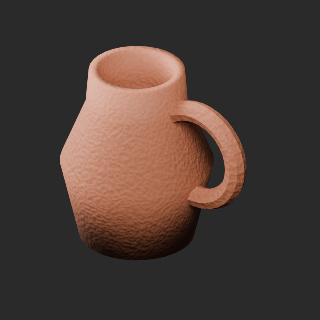](../previews/quality-pa022-tr007-v1/PA022__repair_full.png)

[ZIP · BLEND/GLB](https://raw.githubusercontent.com/k3peta/tales-on-a-table/main/distributions/quality-pa022-tr007-v1/PA022__repair_CC0.zip) · [Enlarge](../previews/quality-pa022-tr007-v1/PA022__repair_full.png) · [comparison](../previews/quality-pa022-tr007-v1/PA022__repair_comparison.png)

Variant/revision dimensions, pivot/facing and triangle count: not independently measured by publisher; refer to the base record and validation scope.

## PA023__repair

**Wall shelf with drawing papers** · Wall shelf with drawing papers

Original procedural color/bump baked to embedded1024px base-color and tangent-normal. All original UV layers retained, one separate bake layer added (UV1 orUV2). Exact-zero faces removed: 0. Positive surfaces retained. Sampled bake fidelity/seams evaluated separately from attribute pass. Revision of existing model, not new base or variant.

[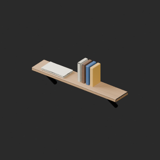](../previews/quality-pa022-tr007-v1/PA023__repair_full.png)

[ZIP · BLEND/GLB](https://raw.githubusercontent.com/k3peta/tales-on-a-table/main/distributions/quality-pa022-tr007-v1/PA023__repair_CC0.zip) · [Enlarge](../previews/quality-pa022-tr007-v1/PA023__repair_full.png) · [comparison](../previews/quality-pa022-tr007-v1/PA023__repair_comparison.png)

Variant/revision dimensions, pivot/facing and triangle count: not independently measured by publisher; refer to the base record and validation scope.

## PA024__repair

**Pinboard and reference sketches** · Pinboard and reference sketches

Original procedural color/bump baked to embedded1024px base-color and tangent-normal. All original UV layers retained, one separate bake layer added (UV1 orUV2). Exact-zero faces removed: 0. Positive surfaces retained. Sampled bake fidelity/seams evaluated separately from attribute pass. Revision of existing model, not new base or variant.

[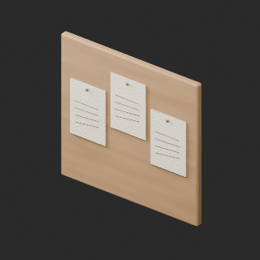](../previews/quality-pa022-tr007-v1/PA024__repair_full.png)

[ZIP · BLEND/GLB](https://raw.githubusercontent.com/k3peta/tales-on-a-table/main/distributions/quality-pa022-tr007-v1/PA024__repair_CC0.zip) · [Enlarge](../previews/quality-pa022-tr007-v1/PA024__repair_full.png) · [comparison](../previews/quality-pa022-tr007-v1/PA024__repair_comparison.png)

Variant/revision dimensions, pivot/facing and triangle count: not independently measured by publisher; refer to the base record and validation scope.

## TR001_HQ__repair

**grass short meadow** · grass short meadow

Original procedural bump baked to embedded2048px tangent-normal; original base-color textures unchanged. All original UV layers retained, one separate bake layer added (UV1 orUV2). Exact-zero faces removed: 1. Positive surfaces retained. Sampled bake fidelity/seams evaluated separately from attribute pass. Revision of existing model, not new base or variant.

[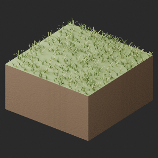](../previews/quality-pa022-tr007-v1/TR001_HQ__repair_full.png)

[ZIP · BLEND/GLB](https://raw.githubusercontent.com/k3peta/tales-on-a-table/main/distributions/quality-pa022-tr007-v1/TR001_HQ__repair_CC0.zip) · [Enlarge](../previews/quality-pa022-tr007-v1/TR001_HQ__repair_full.png) · [comparison](../previews/quality-pa022-tr007-v1/TR001_HQ__repair_comparison.png)

Variant/revision dimensions, pivot/facing and triangle count: not independently measured by publisher; refer to the base record and validation scope.

## TR001_LITE__repair

**grass short meadow** · grass short meadow

Original procedural bump baked to embedded2048px tangent-normal; original base-color textures unchanged. All original UV layers retained, one separate bake layer added (UV1 orUV2). Exact-zero faces removed: 1. Positive surfaces retained. Sampled bake fidelity/seams evaluated separately from attribute pass. Revision of existing model, not new base or variant.

[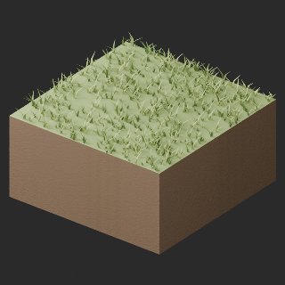](../previews/quality-pa022-tr007-v1/TR001_LITE__repair_full.png)

[ZIP · BLEND/GLB](https://raw.githubusercontent.com/k3peta/tales-on-a-table/main/distributions/quality-pa022-tr007-v1/TR001_LITE__repair_CC0.zip) · [Enlarge](../previews/quality-pa022-tr007-v1/TR001_LITE__repair_full.png) · [comparison](../previews/quality-pa022-tr007-v1/TR001_LITE__repair_comparison.png)

Variant/revision dimensions, pivot/facing and triangle count: not independently measured by publisher; refer to the base record and validation scope.

## TR002_HQ__repair

**grass long meadow** · grass long meadow

Original procedural bump baked to embedded2048px tangent-normal; original base-color textures unchanged. All original UV layers retained, one separate bake layer added (UV1 orUV2). Exact-zero faces removed: 1. Positive surfaces retained. Sampled bake fidelity/seams evaluated separately from attribute pass. Revision of existing model, not new base or variant.

[ZIP · BLEND/GLB](https://raw.githubusercontent.com/k3peta/tales-on-a-table/main/distributions/quality-pa022-tr007-v1/TR002_HQ__repair_CC0.zip) · [Enlarge](../previews/quality-pa022-tr007-v1/TR002_HQ__repair_full.png) · [comparison](../previews/quality-pa022-tr007-v1/TR002_HQ__repair_comparison.png)

Variant/revision dimensions, pivot/facing and triangle count: not independently measured by publisher; refer to the base record and validation scope.

## TR002_LITE__repair

**grass long meadow** · grass long meadow

Original procedural bump baked to embedded2048px tangent-normal; original base-color textures unchanged. All original UV layers retained, one separate bake layer added (UV1 orUV2). Exact-zero faces removed: 1. Positive surfaces retained. Sampled bake fidelity/seams evaluated separately from attribute pass. Revision of existing model, not new base or variant.

[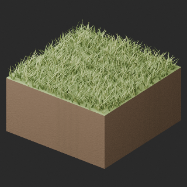](../previews/quality-pa022-tr007-v1/TR002_LITE__repair_full.png)

[ZIP · BLEND/GLB](https://raw.githubusercontent.com/k3peta/tales-on-a-table/main/distributions/quality-pa022-tr007-v1/TR002_LITE__repair_CC0.zip) · [Enlarge](../previews/quality-pa022-tr007-v1/TR002_LITE__repair_full.png) · [comparison](../previews/quality-pa022-tr007-v1/TR002_LITE__repair_comparison.png)

Variant/revision dimensions, pivot/facing and triangle count: not independently measured by publisher; refer to the base record and validation scope.

## TR003_HQ__repair

**grass wildflowers** · grass wildflowers

Original procedural bump baked to embedded2048px tangent-normal; original base-color textures unchanged. All original UV layers retained, one separate bake layer added (UV1 orUV2). Exact-zero faces removed: 3. Positive surfaces retained. Sampled bake fidelity/seams evaluated separately from attribute pass. Revision of existing model, not new base or variant.

[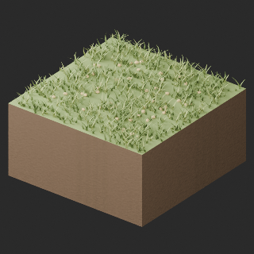](../previews/quality-pa022-tr007-v1/TR003_HQ__repair_full.png)

[ZIP · BLEND/GLB](https://raw.githubusercontent.com/k3peta/tales-on-a-table/main/distributions/quality-pa022-tr007-v1/TR003_HQ__repair_CC0.zip) · [Enlarge](../previews/quality-pa022-tr007-v1/TR003_HQ__repair_full.png) · [comparison](../previews/quality-pa022-tr007-v1/TR003_HQ__repair_comparison.png)

Variant/revision dimensions, pivot/facing and triangle count: not independently measured by publisher; refer to the base record and validation scope.

## TR003_LITE__repair

**grass wildflowers** · grass wildflowers

Original procedural bump baked to embedded2048px tangent-normal; original base-color textures unchanged. All original UV layers retained, one separate bake layer added (UV1 orUV2). Exact-zero faces removed: 1. Positive surfaces retained. Sampled bake fidelity/seams evaluated separately from attribute pass. Revision of existing model, not new base or variant.

[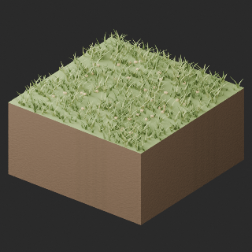](../previews/quality-pa022-tr007-v1/TR003_LITE__repair_full.png)

[ZIP · BLEND/GLB](https://raw.githubusercontent.com/k3peta/tales-on-a-table/main/distributions/quality-pa022-tr007-v1/TR003_LITE__repair_CC0.zip) · [Enlarge](../previews/quality-pa022-tr007-v1/TR003_LITE__repair_full.png) · [comparison](../previews/quality-pa022-tr007-v1/TR003_LITE__repair_comparison.png)

Variant/revision dimensions, pivot/facing and triangle count: not independently measured by publisher; refer to the base record and validation scope.

## TR004_HQ__repair

**grass dry tussocks** · grass dry tussocks

Original procedural bump baked to embedded2048px tangent-normal; original base-color textures unchanged. All original UV layers retained, one separate bake layer added (UV1 orUV2). Exact-zero faces removed: 0. Positive surfaces retained. Sampled bake fidelity/seams evaluated separately from attribute pass. Revision of existing model, not new base or variant.

[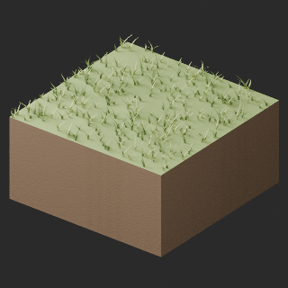](../previews/quality-pa022-tr007-v1/TR004_HQ__repair_full.png)

[ZIP · BLEND/GLB](https://raw.githubusercontent.com/k3peta/tales-on-a-table/main/distributions/quality-pa022-tr007-v1/TR004_HQ__repair_CC0.zip) · [Enlarge](../previews/quality-pa022-tr007-v1/TR004_HQ__repair_full.png) · [comparison](../previews/quality-pa022-tr007-v1/TR004_HQ__repair_comparison.png)

Variant/revision dimensions, pivot/facing and triangle count: not independently measured by publisher; refer to the base record and validation scope.

## TR004_LITE__repair

**grass dry tussocks** · grass dry tussocks

Original procedural bump baked to embedded2048px tangent-normal; original base-color textures unchanged. All original UV layers retained, one separate bake layer added (UV1 orUV2). Exact-zero faces removed: 0. Positive surfaces retained. Sampled bake fidelity/seams evaluated separately from attribute pass. Revision of existing model, not new base or variant.

[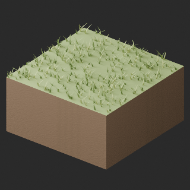](../previews/quality-pa022-tr007-v1/TR004_LITE__repair_full.png)

[ZIP · BLEND/GLB](https://raw.githubusercontent.com/k3peta/tales-on-a-table/main/distributions/quality-pa022-tr007-v1/TR004_LITE__repair_CC0.zip) · [Enlarge](../previews/quality-pa022-tr007-v1/TR004_LITE__repair_full.png) · [comparison](../previews/quality-pa022-tr007-v1/TR004_LITE__repair_comparison.png)

Variant/revision dimensions, pivot/facing and triangle count: not independently measured by publisher; refer to the base record and validation scope.

## TR005_HQ__repair

**grass moss patches** · grass moss patches

Original procedural bump baked to embedded2048px tangent-normal; original base-color textures unchanged. All original UV layers retained, one separate bake layer added (UV1 orUV2). Exact-zero faces removed: 0. Positive surfaces retained. Sampled bake fidelity/seams evaluated separately from attribute pass. Revision of existing model, not new base or variant.

[ZIP · BLEND/GLB](https://raw.githubusercontent.com/k3peta/tales-on-a-table/main/distributions/quality-pa022-tr007-v1/TR005_HQ__repair_CC0.zip) · [Enlarge](../previews/quality-pa022-tr007-v1/TR005_HQ__repair_full.png) · [comparison](../previews/quality-pa022-tr007-v1/TR005_HQ__repair_comparison.png)

Variant/revision dimensions, pivot/facing and triangle count: not independently measured by publisher; refer to the base record and validation scope.

## TR005_LITE__repair

**grass moss patches** · grass moss patches

Original procedural bump baked to embedded2048px tangent-normal; original base-color textures unchanged. All original UV layers retained, one separate bake layer added (UV1 orUV2). Exact-zero faces removed: 0. Positive surfaces retained. Sampled bake fidelity/seams evaluated separately from attribute pass. Revision of existing model, not new base or variant.

[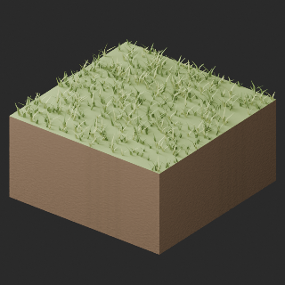](../previews/quality-pa022-tr007-v1/TR005_LITE__repair_full.png)

[ZIP · BLEND/GLB](https://raw.githubusercontent.com/k3peta/tales-on-a-table/main/distributions/quality-pa022-tr007-v1/TR005_LITE__repair_CC0.zip) · [Enlarge](../previews/quality-pa022-tr007-v1/TR005_LITE__repair_full.png) · [comparison](../previews/quality-pa022-tr007-v1/TR005_LITE__repair_comparison.png)

Variant/revision dimensions, pivot/facing and triangle count: not independently measured by publisher; refer to the base record and validation scope.

## TR006_HQ__repair

**grass forest transition** · grass forest transition

Original procedural bump baked to embedded2048px tangent-normal; original base-color textures unchanged. All original UV layers retained, one separate bake layer added (UV1 orUV2). Exact-zero faces removed: 0. Positive surfaces retained. Sampled bake fidelity/seams evaluated separately from attribute pass. Revision of existing model, not new base or variant.

[ZIP · BLEND/GLB](https://raw.githubusercontent.com/k3peta/tales-on-a-table/main/distributions/quality-pa022-tr007-v1/TR006_HQ__repair_CC0.zip) · [Enlarge](../previews/quality-pa022-tr007-v1/TR006_HQ__repair_full.png) · [comparison](../previews/quality-pa022-tr007-v1/TR006_HQ__repair_comparison.png)

Variant/revision dimensions, pivot/facing and triangle count: not independently measured by publisher; refer to the base record and validation scope.

## TR006_LITE__repair

**grass forest transition** · grass forest transition

Original procedural bump baked to embedded2048px tangent-normal; original base-color textures unchanged. All original UV layers retained, one separate bake layer added (UV1 orUV2). Exact-zero faces removed: 0. Positive surfaces retained. Sampled bake fidelity/seams evaluated separately from attribute pass. Revision of existing model, not new base or variant.

[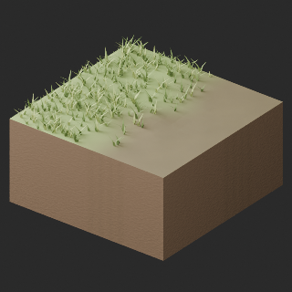](../previews/quality-pa022-tr007-v1/TR006_LITE__repair_full.png)

[ZIP · BLEND/GLB](https://raw.githubusercontent.com/k3peta/tales-on-a-table/main/distributions/quality-pa022-tr007-v1/TR006_LITE__repair_CC0.zip) · [Enlarge](../previews/quality-pa022-tr007-v1/TR006_LITE__repair_full.png) · [comparison](../previews/quality-pa022-tr007-v1/TR006_LITE__repair_comparison.png)

Variant/revision dimensions, pivot/facing and triangle count: not independently measured by publisher; refer to the base record and validation scope.

## TR007_HQ__repair

**grass rock transition** · grass rock transition

Original procedural bump baked to embedded2048px tangent-normal; original base-color textures unchanged. All original UV layers retained, one separate bake layer added (UV1 orUV2). Exact-zero faces removed: 0. Positive surfaces retained. Sampled bake fidelity/seams evaluated separately from attribute pass. Revision of existing model, not new base or variant.

[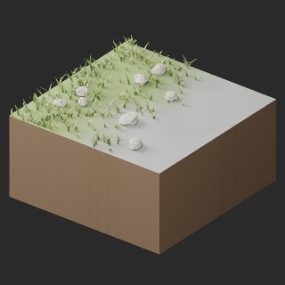](../previews/quality-pa022-tr007-v1/TR007_HQ__repair_full.png)

[ZIP · BLEND/GLB](https://raw.githubusercontent.com/k3peta/tales-on-a-table/main/distributions/quality-pa022-tr007-v1/TR007_HQ__repair_CC0.zip) · [Enlarge](../previews/quality-pa022-tr007-v1/TR007_HQ__repair_full.png) · [comparison](../previews/quality-pa022-tr007-v1/TR007_HQ__repair_comparison.png)

Variant/revision dimensions, pivot/facing and triangle count: not independently measured by publisher; refer to the base record and validation scope.

## TR007_LITE__repair

**grass rock transition** · grass rock transition

Original procedural bump baked to embedded2048px tangent-normal; original base-color textures unchanged. All original UV layers retained, one separate bake layer added (UV1 orUV2). Exact-zero faces removed: 0. Positive surfaces retained. Sampled bake fidelity/seams evaluated separately from attribute pass. Revision of existing model, not new base or variant.

[ZIP · BLEND/GLB](https://raw.githubusercontent.com/k3peta/tales-on-a-table/main/distributions/quality-pa022-tr007-v1/TR007_LITE__repair_CC0.zip) · [Enlarge](../previews/quality-pa022-tr007-v1/TR007_LITE__repair_full.png) · [comparison](../previews/quality-pa022-tr007-v1/TR007_LITE__repair_comparison.png)

Variant/revision dimensions, pivot/facing and triangle count: not independently measured by publisher; refer to the base record and validation scope.

[Exact ZIP/image bindings](../distributions/quality-pa022-tr007-v1/image-bindings.json) · [Validation scope](../distributions/quality-pa022-tr007-v1/validation.json).
