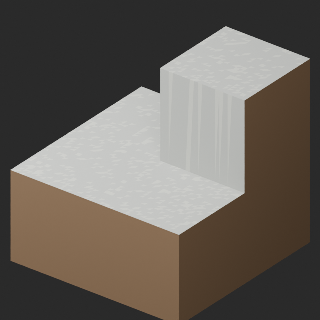
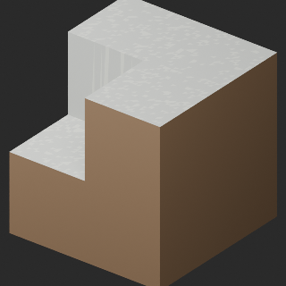
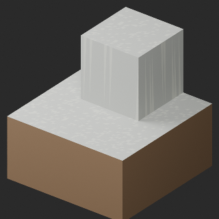
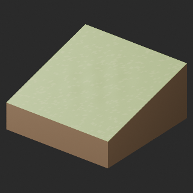
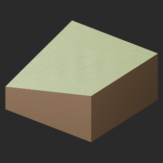
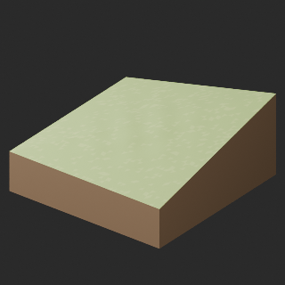

# quality-tg008-017-v1

[Quality80 overview](quality-80.md) · [International catalogue](international/README.md)

TG008/009/010/015/016/017:6 single-model geometry-cleanup revisions remove40 exact-zero-area faces only. All positive surfaces, original material parameters and intentional absence of UV/color attributes retained. No textures, bake or new UV. TG011–014 originals retained and not repackaged. Existing material facets and silhouette limitations remain; no full-shape quality approval. Connection, assembled traversal, walking and collision untested. Prior TR041–048 water16 and TR013 two HQ/LITE candidates remain held;152 budget issues and other recorded diagnostics remain.

Existing distribution revisions and material variants only; zero new base records. Models/embedded materials only CC0; images are separate catalogue artwork. [License](../LICENSE.md).

Producer final-ZIP numerical reimports passed; independent public-download match pending. No publication-side Blender rerun. No gameplay, collision, load, fluid, mechanism or Blender4.3.2 approval. Images compare fixed camera/light per model; layouts differ by batch, source and final panels must not be interchanged.

## TG008__repair

**cliff outer** · cliff outer

Geometry cleanup only: 4 exact-zero-area faces removed. All positive surfaces, original material parameters and original absence of UV/color attributes preserved. No bake or new UV. Existing procedural-looking triangle material facets retained; not a full surface redesign. Existing model revision, not new base or variant.

[ZIP · BLEND/GLB](https://raw.githubusercontent.com/k3peta/tales-on-a-table/main/distributions/quality-tg008-017-v1/TG008__repair_CC0.zip) · [Enlarge](../previews/quality-tg008-017-v1/TG008__repair_full.png) · [comparison](../previews/quality-tg008-017-v1/TG008__repair_comparison.png)

Variant/revision dimensions, pivot/facing and triangle count: not independently measured by publisher; refer to the base record and validation scope.

## TG009__repair

**cliff inner** · cliff inner

Geometry cleanup only: 4 exact-zero-area faces removed. All positive surfaces, original material parameters and original absence of UV/color attributes preserved. No bake or new UV. Existing procedural-looking triangle material facets retained; not a full surface redesign. Existing model revision, not new base or variant.

[ZIP · BLEND/GLB](https://raw.githubusercontent.com/k3peta/tales-on-a-table/main/distributions/quality-tg008-017-v1/TG009__repair_CC0.zip) · [Enlarge](../previews/quality-tg008-017-v1/TG009__repair_full.png) · [comparison](../previews/quality-tg008-017-v1/TG009__repair_comparison.png)

Variant/revision dimensions, pivot/facing and triangle count: not independently measured by publisher; refer to the base record and validation scope.

## TG010__repair

**cliff nose** · cliff nose

Geometry cleanup only: 4 exact-zero-area faces removed. All positive surfaces, original material parameters and original absence of UV/color attributes preserved. No bake or new UV. Existing procedural-looking triangle material facets retained; not a full surface redesign. Existing model revision, not new base or variant.

[ZIP · BLEND/GLB](https://raw.githubusercontent.com/k3peta/tales-on-a-table/main/distributions/quality-tg008-017-v1/TG010__repair_CC0.zip) · [Enlarge](../previews/quality-tg008-017-v1/TG010__repair_full.png) · [comparison](../previews/quality-tg008-017-v1/TG010__repair_comparison.png)

Variant/revision dimensions, pivot/facing and triangle count: not independently measured by publisher; refer to the base record and validation scope.

## TG015__repair

**pit rim** · pit rim

Geometry cleanup only: 4 exact-zero-area faces removed. All positive surfaces, original material parameters and original absence of UV/color attributes preserved. No bake or new UV. Existing procedural-looking triangle material facets retained; not a full surface redesign. Existing model revision, not new base or variant.

[ZIP · BLEND/GLB](https://raw.githubusercontent.com/k3peta/tales-on-a-table/main/distributions/quality-tg008-017-v1/TG015__repair_CC0.zip) · [Enlarge](../previews/quality-tg008-017-v1/TG015__repair_full.png) · [comparison](../previews/quality-tg008-017-v1/TG015__repair_comparison.png)

Variant/revision dimensions, pivot/facing and triangle count: not independently measured by publisher; refer to the base record and validation scope.

## TG016__repair

**pit outer** · pit outer

Geometry cleanup only: 12 exact-zero-area faces removed. All positive surfaces, original material parameters and original absence of UV/color attributes preserved. No bake or new UV. Existing procedural-looking triangle material facets retained; not a full surface redesign. Existing model revision, not new base or variant.

[ZIP · BLEND/GLB](https://raw.githubusercontent.com/k3peta/tales-on-a-table/main/distributions/quality-tg008-017-v1/TG016__repair_CC0.zip) · [Enlarge](../previews/quality-tg008-017-v1/TG016__repair_full.png) · [comparison](../previews/quality-tg008-017-v1/TG016__repair_comparison.png)

Variant/revision dimensions, pivot/facing and triangle count: not independently measured by publisher; refer to the base record and validation scope.

## TG017__repair

**pit inner** · pit inner

Geometry cleanup only: 12 exact-zero-area faces removed. All positive surfaces, original material parameters and original absence of UV/color attributes preserved. No bake or new UV. Existing procedural-looking triangle material facets retained; not a full surface redesign. Existing model revision, not new base or variant.

[ZIP · BLEND/GLB](https://raw.githubusercontent.com/k3peta/tales-on-a-table/main/distributions/quality-tg008-017-v1/TG017__repair_CC0.zip) · [Enlarge](../previews/quality-tg008-017-v1/TG017__repair_full.png) · [comparison](../previews/quality-tg008-017-v1/TG017__repair_comparison.png)

Variant/revision dimensions, pivot/facing and triangle count: not independently measured by publisher; refer to the base record and validation scope.

[Exact ZIP/image bindings](../distributions/quality-tg008-017-v1/image-bindings.json) · [Validation scope](../distributions/quality-tg008-017-v1/validation.json).
