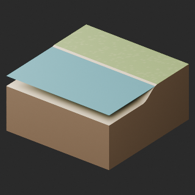
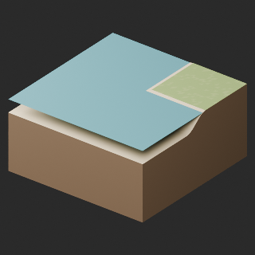
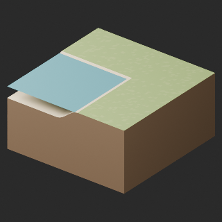
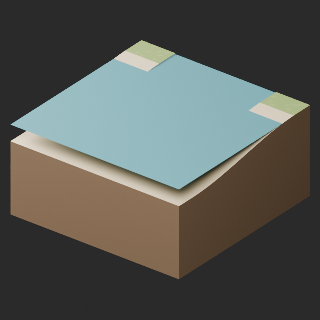
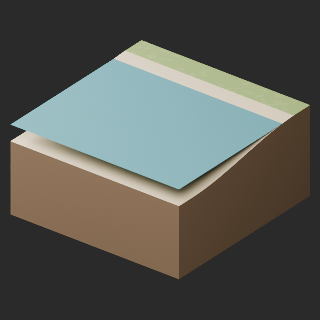
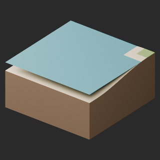
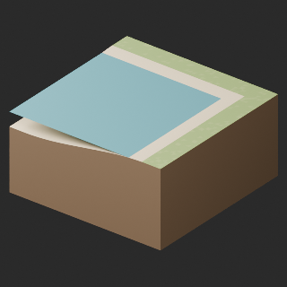

# quality-tg018-027-v1

[Quality81 overview](quality-81.md) · [International catalogue](international/README.md)

TG020–026:7 geometry-cleanup revisions remove48 exact-zero-area faces only. All positive surfaces, original materials and intentional absence of UV/color attributes retained. No texture bake or new UV. TG018/019/027 originals retained and not repackaged. Exposed water tile edges still look like suspended planar sheets: fixed -0.01m water is the original generator design, not export omission; no edge-closure repair. Repeated grass facets remain. No holistic shape-quality approval or connection/walking/collision/Blender4.3.2 test. Prior TR041–048 water16 and TR013 two HQ/LITE candidates held;152 budget issues and other diagnostics remain.

Existing distribution revisions and material variants only; zero new base records. Models/embedded materials only CC0; images are separate catalogue artwork. [License](../LICENSE.md).

Producer final-ZIP numerical reimports passed; independent public-download match pending. No publication-side Blender rerun. No gameplay, collision, load, fluid, mechanism or Blender4.3.2 approval. Images compare fixed camera/light per model; layouts differ by batch, source and final panels must not be interchanged.

## TG020__repair

**shore** · shore

Geometry cleanup only: 4 exact-zero-area faces removed. All positive surfaces, original material parameters and original absence of UV/color attributes preserved. No bake or new UV. Existing procedural-looking triangle material facets retained; not a full surface redesign. Existing model revision, not new base or variant. Exposed water tile edges retain an open planar-sheet appearance; no water volume or edge-closure repair.

[ZIP · BLEND/GLB](https://raw.githubusercontent.com/k3peta/tales-on-a-table/main/distributions/quality-tg018-027-v1/TG020__repair_CC0.zip) · [Enlarge](../previews/quality-tg018-027-v1/TG020__repair_full.png) · [comparison](../previews/quality-tg018-027-v1/TG020__repair_comparison.png)

Variant/revision dimensions, pivot/facing and triangle count: not independently measured by publisher; refer to the base record and validation scope.

## TG021__repair

**shore outer** · shore outer

Geometry cleanup only: 4 exact-zero-area faces removed. All positive surfaces, original material parameters and original absence of UV/color attributes preserved. No bake or new UV. Existing procedural-looking triangle material facets retained; not a full surface redesign. Existing model revision, not new base or variant. Exposed water tile edges retain an open planar-sheet appearance; no water volume or edge-closure repair.

[ZIP · BLEND/GLB](https://raw.githubusercontent.com/k3peta/tales-on-a-table/main/distributions/quality-tg018-027-v1/TG021__repair_CC0.zip) · [Enlarge](../previews/quality-tg018-027-v1/TG021__repair_full.png) · [comparison](../previews/quality-tg018-027-v1/TG021__repair_comparison.png)

Variant/revision dimensions, pivot/facing and triangle count: not independently measured by publisher; refer to the base record and validation scope.

## TG022__repair

**shore inner** · shore inner

Geometry cleanup only: 4 exact-zero-area faces removed. All positive surfaces, original material parameters and original absence of UV/color attributes preserved. No bake or new UV. Existing procedural-looking triangle material facets retained; not a full surface redesign. Existing model revision, not new base or variant. Exposed water tile edges retain an open planar-sheet appearance; no water volume or edge-closure repair.

[ZIP · BLEND/GLB](https://raw.githubusercontent.com/k3peta/tales-on-a-table/main/distributions/quality-tg018-027-v1/TG022__repair_CC0.zip) · [Enlarge](../previews/quality-tg018-027-v1/TG022__repair_full.png) · [comparison](../previews/quality-tg018-027-v1/TG022__repair_comparison.png)

Variant/revision dimensions, pivot/facing and triangle count: not independently measured by publisher; refer to the base record and validation scope.

## TG023__repair

**estuary** · estuary

Geometry cleanup only: 8 exact-zero-area faces removed. All positive surfaces, original material parameters and original absence of UV/color attributes preserved. No bake or new UV. Existing procedural-looking triangle material facets retained; not a full surface redesign. Existing model revision, not new base or variant. Exposed water tile edges retain an open planar-sheet appearance; no water volume or edge-closure repair.

[ZIP · BLEND/GLB](https://raw.githubusercontent.com/k3peta/tales-on-a-table/main/distributions/quality-tg018-027-v1/TG023__repair_CC0.zip) · [Enlarge](../previews/quality-tg018-027-v1/TG023__repair_full.png) · [comparison](../previews/quality-tg018-027-v1/TG023__repair_comparison.png)

Variant/revision dimensions, pivot/facing and triangle count: not independently measured by publisher; refer to the base record and validation scope.

## TG024__repair

**beach** · beach

Geometry cleanup only: 4 exact-zero-area faces removed. All positive surfaces, original material parameters and original absence of UV/color attributes preserved. No bake or new UV. Existing procedural-looking triangle material facets retained; not a full surface redesign. Existing model revision, not new base or variant. Exposed water tile edges retain an open planar-sheet appearance; no water volume or edge-closure repair.

[ZIP · BLEND/GLB](https://raw.githubusercontent.com/k3peta/tales-on-a-table/main/distributions/quality-tg018-027-v1/TG024__repair_CC0.zip) · [Enlarge](../previews/quality-tg018-027-v1/TG024__repair_full.png) · [comparison](../previews/quality-tg018-027-v1/TG024__repair_comparison.png)

Variant/revision dimensions, pivot/facing and triangle count: not independently measured by publisher; refer to the base record and validation scope.

## TG025__repair

**beach outer** · beach outer

Geometry cleanup only: 12 exact-zero-area faces removed. All positive surfaces, original material parameters and original absence of UV/color attributes preserved. No bake or new UV. Existing procedural-looking triangle material facets retained; not a full surface redesign. Existing model revision, not new base or variant. Exposed water tile edges retain an open planar-sheet appearance; no water volume or edge-closure repair.

[ZIP · BLEND/GLB](https://raw.githubusercontent.com/k3peta/tales-on-a-table/main/distributions/quality-tg018-027-v1/TG025__repair_CC0.zip) · [Enlarge](../previews/quality-tg018-027-v1/TG025__repair_full.png) · [comparison](../previews/quality-tg018-027-v1/TG025__repair_comparison.png)

Variant/revision dimensions, pivot/facing and triangle count: not independently measured by publisher; refer to the base record and validation scope.

## TG026__repair

**beach inner** · beach inner

Geometry cleanup only: 12 exact-zero-area faces removed. All positive surfaces, original material parameters and original absence of UV/color attributes preserved. No bake or new UV. Existing procedural-looking triangle material facets retained; not a full surface redesign. Existing model revision, not new base or variant. Exposed water tile edges retain an open planar-sheet appearance; no water volume or edge-closure repair.

[ZIP · BLEND/GLB](https://raw.githubusercontent.com/k3peta/tales-on-a-table/main/distributions/quality-tg018-027-v1/TG026__repair_CC0.zip) · [Enlarge](../previews/quality-tg018-027-v1/TG026__repair_full.png) · [comparison](../previews/quality-tg018-027-v1/TG026__repair_comparison.png)

Variant/revision dimensions, pivot/facing and triangle count: not independently measured by publisher; refer to the base record and validation scope.

[Exact ZIP/image bindings](../distributions/quality-tg018-027-v1/image-bindings.json) · [Validation scope](../distributions/quality-tg018-027-v1/validation.json).
