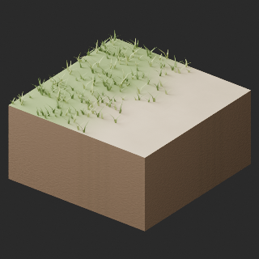
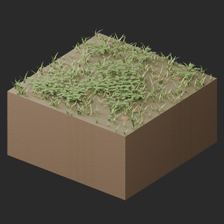
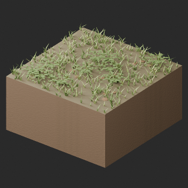
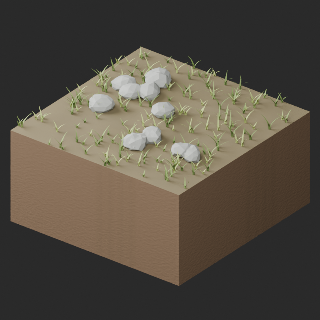
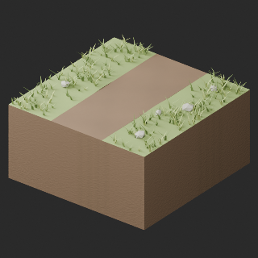

# quality-tr008-017-v1

[Quality57–76 overview](quality-57-76.md) · [International catalogue](international/README.md)

Only TR008/011/014/017 HQ/LITE adopted in this batch. Other accepted corrections are listed in the v2 batch. TR013 remains held due to dark stump seam. Finite normal bake is not exact source shading.

Existing distribution revisions and material variants only; zero new base records. Models/embedded materials only CC0; images are separate catalogue artwork. [License](../LICENSE.md).

Producer final-ZIP numerical reimports passed; all adopted public ZIP/member and image hashes independently matched. No publication-side Blender rerun. No gameplay, collision, load, fluid, mechanism or Blender4.3.2 approval. Images compare fixed camera/light per model; layouts differ by batch, source and final panels must not be interchanged.

## TR008_HQ__repair

**grass sand transition** · grass sand transition

Original procedural bump baked to embedded2048px tangent-normal; original base-color textures unchanged. All original UV layers retained, one separate bake layer added (UV1 orUV2). Exact-zero faces removed: 1. Positive surfaces retained. Sampled bake fidelity/seams evaluated separately from attribute pass. Revision of existing model, not new base or variant.

[ZIP · BLEND/GLB](https://raw.githubusercontent.com/k3peta/tales-on-a-table/main/distributions/quality-tr008-017-v1/TR008_HQ__repair_CC0.zip) · [Enlarge](../previews/quality-tr008-017-v1/TR008_HQ__repair_full.png) · [comparison](../previews/quality-tr008-017-v1/TR008_HQ__repair_comparison.png)

Variant/revision dimensions, pivot/facing and triangle count: not independently measured by publisher; refer to the base record and validation scope.

## TR008_LITE__repair

**grass sand transition** · grass sand transition

Original procedural bump baked to embedded2048px tangent-normal; original base-color textures unchanged. All original UV layers retained, one separate bake layer added (UV1 orUV2). Exact-zero faces removed: 1. Positive surfaces retained. Sampled bake fidelity/seams evaluated separately from attribute pass. Revision of existing model, not new base or variant.

[ZIP · BLEND/GLB](https://raw.githubusercontent.com/k3peta/tales-on-a-table/main/distributions/quality-tr008-017-v1/TR008_LITE__repair_CC0.zip) · [Enlarge](../previews/quality-tr008-017-v1/TR008_LITE__repair_full.png) · [comparison](../previews/quality-tr008-017-v1/TR008_LITE__repair_comparison.png)

Variant/revision dimensions, pivot/facing and triangle count: not independently measured by publisher; refer to the base record and validation scope.

## TR011_HQ__repair

**forest fern floor** · forest fern floor

Original procedural bump baked to embedded2048px tangent-normal; original base-color textures unchanged. All original UV layers retained, one separate bake layer added (UV1 orUV2). Exact-zero faces removed: 1. Positive surfaces retained. Sampled bake fidelity/seams evaluated separately from attribute pass. Revision of existing model, not new base or variant.

[ZIP · BLEND/GLB](https://raw.githubusercontent.com/k3peta/tales-on-a-table/main/distributions/quality-tr008-017-v1/TR011_HQ__repair_CC0.zip) · [Enlarge](../previews/quality-tr008-017-v1/TR011_HQ__repair_full.png) · [comparison](../previews/quality-tr008-017-v1/TR011_HQ__repair_comparison.png)

Variant/revision dimensions, pivot/facing and triangle count: not independently measured by publisher; refer to the base record and validation scope.

## TR011_LITE__repair

**forest fern floor** · forest fern floor

Original procedural bump baked to embedded2048px tangent-normal; original base-color textures unchanged. All original UV layers retained, one separate bake layer added (UV1 orUV2). Exact-zero faces removed: 1. Positive surfaces retained. Sampled bake fidelity/seams evaluated separately from attribute pass. Revision of existing model, not new base or variant.

[ZIP · BLEND/GLB](https://raw.githubusercontent.com/k3peta/tales-on-a-table/main/distributions/quality-tr008-017-v1/TR011_LITE__repair_CC0.zip) · [Enlarge](../previews/quality-tr008-017-v1/TR011_LITE__repair_full.png) · [comparison](../previews/quality-tr008-017-v1/TR011_LITE__repair_comparison.png)

Variant/revision dimensions, pivot/facing and triangle count: not independently measured by publisher; refer to the base record and validation scope.

## TR014_HQ__repair

**forest stone moss** · forest stone moss

Original procedural bump baked to embedded2048px tangent-normal; original base-color textures unchanged. All original UV layers retained, one separate bake layer added (UV1 orUV2). Exact-zero faces removed: 0. Positive surfaces retained. Sampled bake fidelity/seams evaluated separately from attribute pass. Revision of existing model, not new base or variant.

[ZIP · BLEND/GLB](https://raw.githubusercontent.com/k3peta/tales-on-a-table/main/distributions/quality-tr008-017-v1/TR014_HQ__repair_CC0.zip) · [Enlarge](../previews/quality-tr008-017-v1/TR014_HQ__repair_full.png) · [comparison](../previews/quality-tr008-017-v1/TR014_HQ__repair_comparison.png)

Variant/revision dimensions, pivot/facing and triangle count: not independently measured by publisher; refer to the base record and validation scope.

## TR014_LITE__repair

**forest stone moss** · forest stone moss

Original procedural bump baked to embedded2048px tangent-normal; original base-color textures unchanged. All original UV layers retained, one separate bake layer added (UV1 orUV2). Exact-zero faces removed: 0. Positive surfaces retained. Sampled bake fidelity/seams evaluated separately from attribute pass. Revision of existing model, not new base or variant.

[ZIP · BLEND/GLB](https://raw.githubusercontent.com/k3peta/tales-on-a-table/main/distributions/quality-tr008-017-v1/TR014_LITE__repair_CC0.zip) · [Enlarge](../previews/quality-tr008-017-v1/TR014_LITE__repair_full.png) · [comparison](../previews/quality-tr008-017-v1/TR014_LITE__repair_comparison.png)

Variant/revision dimensions, pivot/facing and triangle count: not independently measured by publisher; refer to the base record and validation scope.

## TR017_HQ__repair

**path straight NS** · path straight NS

Original procedural bump baked to embedded2048px tangent-normal; original base-color textures unchanged. All original UV layers retained, one separate bake layer added (UV1 orUV2). Exact-zero faces removed: 792. Positive surfaces retained. Sampled bake fidelity/seams evaluated separately from attribute pass. Revision of existing model, not new base or variant.

[ZIP · BLEND/GLB](https://raw.githubusercontent.com/k3peta/tales-on-a-table/main/distributions/quality-tr008-017-v1/TR017_HQ__repair_CC0.zip) · [Enlarge](../previews/quality-tr008-017-v1/TR017_HQ__repair_full.png) · [comparison](../previews/quality-tr008-017-v1/TR017_HQ__repair_comparison.png)

Variant/revision dimensions, pivot/facing and triangle count: not independently measured by publisher; refer to the base record and validation scope.

## TR017_LITE__repair

**path straight NS** · path straight NS

Original procedural bump baked to embedded2048px tangent-normal; original base-color textures unchanged. All original UV layers retained, one separate bake layer added (UV1 orUV2). Exact-zero faces removed: 408. Positive surfaces retained. Sampled bake fidelity/seams evaluated separately from attribute pass. Revision of existing model, not new base or variant.

[ZIP · BLEND/GLB](https://raw.githubusercontent.com/k3peta/tales-on-a-table/main/distributions/quality-tr008-017-v1/TR017_LITE__repair_CC0.zip) · [Enlarge](../previews/quality-tr008-017-v1/TR017_LITE__repair_full.png) · [comparison](../previews/quality-tr008-017-v1/TR017_LITE__repair_comparison.png)

Variant/revision dimensions, pivot/facing and triangle count: not independently measured by publisher; refer to the base record and validation scope.

[Exact ZIP/image bindings](../distributions/quality-tr008-017-v1/image-bindings.json) · [Validation scope](../distributions/quality-tr008-017-v1/validation.json).
