# quality-tr018-027-v1

[Quality57–76 overview](quality-57-76.md) · [International catalogue](international/README.md)

TR018–027 HQ/LITE: normal restoration and exact-zero cleanup; retained original UV layers plus atlas/padding. HQ/LITE remain parts of existing records.

Existing distribution revisions and material variants only; zero new base records. Models/embedded materials only CC0; images are separate catalogue artwork. [License](../LICENSE.md).

Producer final-ZIP numerical reimports passed; all adopted public ZIP/member and image hashes independently matched. No publication-side Blender rerun. No gameplay, collision, load, fluid, mechanism or Blender4.3.2 approval. Images compare fixed camera/light per model; layouts differ by batch, source and final panels must not be interchanged.

## TR018_HQ__repair

**path bend NE** · path bend NE

Original procedural bump baked to embedded2048px tangent-normal; original base-color textures unchanged. All original UV layers and baked atlas retained; UV0-copy padding added only where required to place baked atlas at UV2 uniformly. Uniform normalUV2 prevents UV-index-dependent material duplication; strict verifier unchanged. Exact-zero faces removed: 34. Positive surfaces retained. Sampled bake fidelity/seams evaluated separately from attribute pass. Revision of existing model, not new base or variant.

[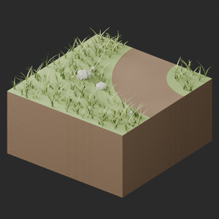](../previews/quality-tr018-027-v1/TR018_HQ__repair_full.png)

[ZIP · BLEND/GLB](https://raw.githubusercontent.com/k3peta/tales-on-a-table/main/distributions/quality-tr018-027-v1/TR018_HQ__repair_CC0.zip) · [Enlarge](../previews/quality-tr018-027-v1/TR018_HQ__repair_full.png) · [comparison](../previews/quality-tr018-027-v1/TR018_HQ__repair_comparison.png)

Variant/revision dimensions, pivot/facing and triangle count: not independently measured by publisher; refer to the base record and validation scope.

## TR018_LITE__repair

**path bend NE** · path bend NE

Original procedural bump baked to embedded2048px tangent-normal; original base-color textures unchanged. All original UV layers and baked atlas retained; UV0-copy padding added only where required to place baked atlas at UV2 uniformly. Uniform normalUV2 prevents UV-index-dependent material duplication; strict verifier unchanged. Exact-zero faces removed: 34. Positive surfaces retained. Sampled bake fidelity/seams evaluated separately from attribute pass. Revision of existing model, not new base or variant.

[ZIP · BLEND/GLB](https://raw.githubusercontent.com/k3peta/tales-on-a-table/main/distributions/quality-tr018-027-v1/TR018_LITE__repair_CC0.zip) · [Enlarge](../previews/quality-tr018-027-v1/TR018_LITE__repair_full.png) · [comparison](../previews/quality-tr018-027-v1/TR018_LITE__repair_comparison.png)

Variant/revision dimensions, pivot/facing and triangle count: not independently measured by publisher; refer to the base record and validation scope.

## TR019_HQ__repair

**path junction NES** · path junction NES

Original procedural bump baked to embedded2048px tangent-normal; original base-color textures unchanged. All original UV layers and baked atlas retained; UV0-copy padding added only where required to place baked atlas at UV2 uniformly. Uniform normalUV2 prevents UV-index-dependent material duplication; strict verifier unchanged. Exact-zero faces removed: 898. Positive surfaces retained. Sampled bake fidelity/seams evaluated separately from attribute pass. Revision of existing model, not new base or variant.

[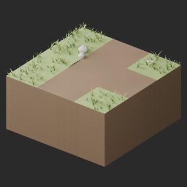](../previews/quality-tr018-027-v1/TR019_HQ__repair_full.png)

[ZIP · BLEND/GLB](https://raw.githubusercontent.com/k3peta/tales-on-a-table/main/distributions/quality-tr018-027-v1/TR019_HQ__repair_CC0.zip) · [Enlarge](../previews/quality-tr018-027-v1/TR019_HQ__repair_full.png) · [comparison](../previews/quality-tr018-027-v1/TR019_HQ__repair_comparison.png)

Variant/revision dimensions, pivot/facing and triangle count: not independently measured by publisher; refer to the base record and validation scope.

## TR019_LITE__repair

**path junction NES** · path junction NES

Original procedural bump baked to embedded2048px tangent-normal; original base-color textures unchanged. All original UV layers and baked atlas retained; UV0-copy padding added only where required to place baked atlas at UV2 uniformly. Uniform normalUV2 prevents UV-index-dependent material duplication; strict verifier unchanged. Exact-zero faces removed: 466. Positive surfaces retained. Sampled bake fidelity/seams evaluated separately from attribute pass. Revision of existing model, not new base or variant.

[ZIP · BLEND/GLB](https://raw.githubusercontent.com/k3peta/tales-on-a-table/main/distributions/quality-tr018-027-v1/TR019_LITE__repair_CC0.zip) · [Enlarge](../previews/quality-tr018-027-v1/TR019_LITE__repair_full.png) · [comparison](../previews/quality-tr018-027-v1/TR019_LITE__repair_comparison.png)

Variant/revision dimensions, pivot/facing and triangle count: not independently measured by publisher; refer to the base record and validation scope.

## TR020_HQ__repair

**path cross NESW** · path cross NESW

Original procedural bump baked to embedded2048px tangent-normal; original base-color textures unchanged. All original UV layers and baked atlas retained; UV0-copy padding added only where required to place baked atlas at UV2 uniformly. Uniform normalUV2 prevents UV-index-dependent material duplication; strict verifier unchanged. Exact-zero faces removed: 1003. Positive surfaces retained. Sampled bake fidelity/seams evaluated separately from attribute pass. Revision of existing model, not new base or variant.

[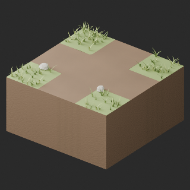](../previews/quality-tr018-027-v1/TR020_HQ__repair_full.png)

[ZIP · BLEND/GLB](https://raw.githubusercontent.com/k3peta/tales-on-a-table/main/distributions/quality-tr018-027-v1/TR020_HQ__repair_CC0.zip) · [Enlarge](../previews/quality-tr018-027-v1/TR020_HQ__repair_full.png) · [comparison](../previews/quality-tr018-027-v1/TR020_HQ__repair_comparison.png)

Variant/revision dimensions, pivot/facing and triangle count: not independently measured by publisher; refer to the base record and validation scope.

## TR020_LITE__repair

**path cross NESW** · path cross NESW

Original procedural bump baked to embedded2048px tangent-normal; original base-color textures unchanged. All original UV layers and baked atlas retained; UV0-copy padding added only where required to place baked atlas at UV2 uniformly. Uniform normalUV2 prevents UV-index-dependent material duplication; strict verifier unchanged. Exact-zero faces removed: 523. Positive surfaces retained. Sampled bake fidelity/seams evaluated separately from attribute pass. Revision of existing model, not new base or variant.

[ZIP · BLEND/GLB](https://raw.githubusercontent.com/k3peta/tales-on-a-table/main/distributions/quality-tr018-027-v1/TR020_LITE__repair_CC0.zip) · [Enlarge](../previews/quality-tr018-027-v1/TR020_LITE__repair_full.png) · [comparison](../previews/quality-tr018-027-v1/TR020_LITE__repair_comparison.png)

Variant/revision dimensions, pivot/facing and triangle count: not independently measured by publisher; refer to the base record and validation scope.

## TR021_HQ__repair

**path end N** · path end N

Original procedural bump baked to embedded2048px tangent-normal; original base-color textures unchanged. All original UV layers and baked atlas retained; UV0-copy padding added only where required to place baked atlas at UV2 uniformly. Uniform normalUV2 prevents UV-index-dependent material duplication; strict verifier unchanged. Exact-zero faces removed: 412. Positive surfaces retained. Sampled bake fidelity/seams evaluated separately from attribute pass. Revision of existing model, not new base or variant.

[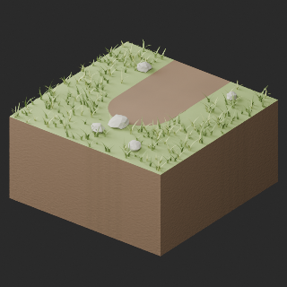](../previews/quality-tr018-027-v1/TR021_HQ__repair_full.png)

[ZIP · BLEND/GLB](https://raw.githubusercontent.com/k3peta/tales-on-a-table/main/distributions/quality-tr018-027-v1/TR021_HQ__repair_CC0.zip) · [Enlarge](../previews/quality-tr018-027-v1/TR021_HQ__repair_full.png) · [comparison](../previews/quality-tr018-027-v1/TR021_HQ__repair_comparison.png)

Variant/revision dimensions, pivot/facing and triangle count: not independently measured by publisher; refer to the base record and validation scope.

## TR021_LITE__repair

**path end N** · path end N

Original procedural bump baked to embedded2048px tangent-normal; original base-color textures unchanged. All original UV layers and baked atlas retained; UV0-copy padding added only where required to place baked atlas at UV2 uniformly. Uniform normalUV2 prevents UV-index-dependent material duplication; strict verifier unchanged. Exact-zero faces removed: 220. Positive surfaces retained. Sampled bake fidelity/seams evaluated separately from attribute pass. Revision of existing model, not new base or variant.

[ZIP · BLEND/GLB](https://raw.githubusercontent.com/k3peta/tales-on-a-table/main/distributions/quality-tr018-027-v1/TR021_LITE__repair_CC0.zip) · [Enlarge](../previews/quality-tr018-027-v1/TR021_LITE__repair_full.png) · [comparison](../previews/quality-tr018-027-v1/TR021_LITE__repair_comparison.png)

Variant/revision dimensions, pivot/facing and triangle count: not independently measured by publisher; refer to the base record and validation scope.

## TR022_HQ__repair

**path straight NS rutted** · path straight NS rutted

Original procedural bump baked to embedded2048px tangent-normal; original base-color textures unchanged. All original UV layers and baked atlas retained; UV0-copy padding added only where required to place baked atlas at UV2 uniformly. Uniform normalUV2 prevents UV-index-dependent material duplication; strict verifier unchanged. Exact-zero faces removed: 793. Positive surfaces retained. Sampled bake fidelity/seams evaluated separately from attribute pass. Revision of existing model, not new base or variant.

[ZIP · BLEND/GLB](https://raw.githubusercontent.com/k3peta/tales-on-a-table/main/distributions/quality-tr018-027-v1/TR022_HQ__repair_CC0.zip) · [Enlarge](../previews/quality-tr018-027-v1/TR022_HQ__repair_full.png) · [comparison](../previews/quality-tr018-027-v1/TR022_HQ__repair_comparison.png)

Variant/revision dimensions, pivot/facing and triangle count: not independently measured by publisher; refer to the base record and validation scope.

## TR022_LITE__repair

**path straight NS rutted** · path straight NS rutted

Original procedural bump baked to embedded2048px tangent-normal; original base-color textures unchanged. All original UV layers and baked atlas retained; UV0-copy padding added only where required to place baked atlas at UV2 uniformly. Uniform normalUV2 prevents UV-index-dependent material duplication; strict verifier unchanged. Exact-zero faces removed: 409. Positive surfaces retained. Sampled bake fidelity/seams evaluated separately from attribute pass. Revision of existing model, not new base or variant.

[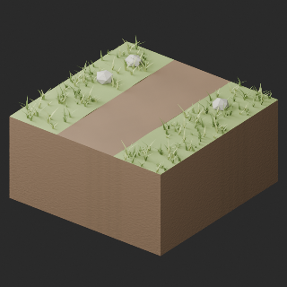](../previews/quality-tr018-027-v1/TR022_LITE__repair_full.png)

[ZIP · BLEND/GLB](https://raw.githubusercontent.com/k3peta/tales-on-a-table/main/distributions/quality-tr018-027-v1/TR022_LITE__repair_CC0.zip) · [Enlarge](../previews/quality-tr018-027-v1/TR022_LITE__repair_full.png) · [comparison](../previews/quality-tr018-027-v1/TR022_LITE__repair_comparison.png)

Variant/revision dimensions, pivot/facing and triangle count: not independently measured by publisher; refer to the base record and validation scope.

## TR023_HQ__repair

**path bend NE stony** · path bend NE stony

Original procedural bump baked to embedded2048px tangent-normal; original base-color textures unchanged. All original UV layers and baked atlas retained; UV0-copy padding added only where required to place baked atlas at UV2 uniformly. Uniform normalUV2 prevents UV-index-dependent material duplication; strict verifier unchanged. Exact-zero faces removed: 32. Positive surfaces retained. Sampled bake fidelity/seams evaluated separately from attribute pass. Revision of existing model, not new base or variant.

[ZIP · BLEND/GLB](https://raw.githubusercontent.com/k3peta/tales-on-a-table/main/distributions/quality-tr018-027-v1/TR023_HQ__repair_CC0.zip) · [Enlarge](../previews/quality-tr018-027-v1/TR023_HQ__repair_full.png) · [comparison](../previews/quality-tr018-027-v1/TR023_HQ__repair_comparison.png)

Variant/revision dimensions, pivot/facing and triangle count: not independently measured by publisher; refer to the base record and validation scope.

## TR023_LITE__repair

**path bend NE stony** · path bend NE stony

Original procedural bump baked to embedded2048px tangent-normal; original base-color textures unchanged. All original UV layers and baked atlas retained; UV0-copy padding added only where required to place baked atlas at UV2 uniformly. Uniform normalUV2 prevents UV-index-dependent material duplication; strict verifier unchanged. Exact-zero faces removed: 32. Positive surfaces retained. Sampled bake fidelity/seams evaluated separately from attribute pass. Revision of existing model, not new base or variant.

[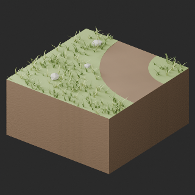](../previews/quality-tr018-027-v1/TR023_LITE__repair_full.png)

[ZIP · BLEND/GLB](https://raw.githubusercontent.com/k3peta/tales-on-a-table/main/distributions/quality-tr018-027-v1/TR023_LITE__repair_CC0.zip) · [Enlarge](../previews/quality-tr018-027-v1/TR023_LITE__repair_full.png) · [comparison](../previews/quality-tr018-027-v1/TR023_LITE__repair_comparison.png)

Variant/revision dimensions, pivot/facing and triangle count: not independently measured by publisher; refer to the base record and validation scope.

## TR024_HQ__repair

**path junction NES clearing** · path junction NES clearing

Original procedural bump baked to embedded2048px tangent-normal; original base-color textures unchanged. All original UV layers and baked atlas retained; UV0-copy padding added only where required to place baked atlas at UV2 uniformly. Uniform normalUV2 prevents UV-index-dependent material duplication; strict verifier unchanged. Exact-zero faces removed: 900. Positive surfaces retained. Sampled bake fidelity/seams evaluated separately from attribute pass. Revision of existing model, not new base or variant.

[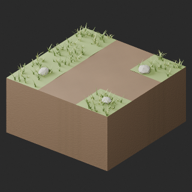](../previews/quality-tr018-027-v1/TR024_HQ__repair_full.png)

[ZIP · BLEND/GLB](https://raw.githubusercontent.com/k3peta/tales-on-a-table/main/distributions/quality-tr018-027-v1/TR024_HQ__repair_CC0.zip) · [Enlarge](../previews/quality-tr018-027-v1/TR024_HQ__repair_full.png) · [comparison](../previews/quality-tr018-027-v1/TR024_HQ__repair_comparison.png)

Variant/revision dimensions, pivot/facing and triangle count: not independently measured by publisher; refer to the base record and validation scope.

## TR024_LITE__repair

**path junction NES clearing** · path junction NES clearing

Original procedural bump baked to embedded2048px tangent-normal; original base-color textures unchanged. All original UV layers and baked atlas retained; UV0-copy padding added only where required to place baked atlas at UV2 uniformly. Uniform normalUV2 prevents UV-index-dependent material duplication; strict verifier unchanged. Exact-zero faces removed: 466. Positive surfaces retained. Sampled bake fidelity/seams evaluated separately from attribute pass. Revision of existing model, not new base or variant.

[ZIP · BLEND/GLB](https://raw.githubusercontent.com/k3peta/tales-on-a-table/main/distributions/quality-tr018-027-v1/TR024_LITE__repair_CC0.zip) · [Enlarge](../previews/quality-tr018-027-v1/TR024_LITE__repair_full.png) · [comparison](../previews/quality-tr018-027-v1/TR024_LITE__repair_comparison.png)

Variant/revision dimensions, pivot/facing and triangle count: not independently measured by publisher; refer to the base record and validation scope.

## TR025_HQ__repair

**rock flat scree** · rock flat scree

Original procedural bump baked to embedded2048px tangent-normal; original base-color textures unchanged. All original UV layers and baked atlas retained; UV0-copy padding added only where required to place baked atlas at UV2 uniformly. Uniform normalUV2 prevents UV-index-dependent material duplication; strict verifier unchanged. Exact-zero faces removed: 0. Positive surfaces retained. Sampled bake fidelity/seams evaluated separately from attribute pass. Revision of existing model, not new base or variant.

[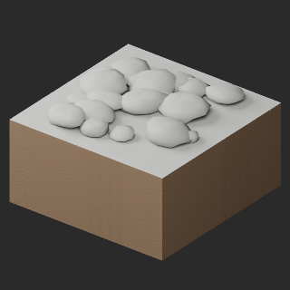](../previews/quality-tr018-027-v1/TR025_HQ__repair_full.png)

[ZIP · BLEND/GLB](https://raw.githubusercontent.com/k3peta/tales-on-a-table/main/distributions/quality-tr018-027-v1/TR025_HQ__repair_CC0.zip) · [Enlarge](../previews/quality-tr018-027-v1/TR025_HQ__repair_full.png) · [comparison](../previews/quality-tr018-027-v1/TR025_HQ__repair_comparison.png)

Variant/revision dimensions, pivot/facing and triangle count: not independently measured by publisher; refer to the base record and validation scope.

## TR025_LITE__repair

**rock flat scree** · rock flat scree

Original procedural bump baked to embedded2048px tangent-normal; original base-color textures unchanged. All original UV layers and baked atlas retained; UV0-copy padding added only where required to place baked atlas at UV2 uniformly. Uniform normalUV2 prevents UV-index-dependent material duplication; strict verifier unchanged. Exact-zero faces removed: 0. Positive surfaces retained. Sampled bake fidelity/seams evaluated separately from attribute pass. Revision of existing model, not new base or variant.

[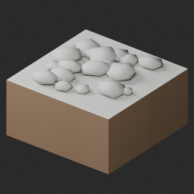](../previews/quality-tr018-027-v1/TR025_LITE__repair_full.png)

[ZIP · BLEND/GLB](https://raw.githubusercontent.com/k3peta/tales-on-a-table/main/distributions/quality-tr018-027-v1/TR025_LITE__repair_CC0.zip) · [Enlarge](../previews/quality-tr018-027-v1/TR025_LITE__repair_full.png) · [comparison](../previews/quality-tr018-027-v1/TR025_LITE__repair_comparison.png)

Variant/revision dimensions, pivot/facing and triangle count: not independently measured by publisher; refer to the base record and validation scope.

## TR026_HQ__repair

**rock low outcrop** · rock low outcrop

Original procedural bump baked to embedded2048px tangent-normal; original base-color textures unchanged. All original UV layers and baked atlas retained; UV0-copy padding added only where required to place baked atlas at UV2 uniformly. Uniform normalUV2 prevents UV-index-dependent material duplication; strict verifier unchanged. Exact-zero faces removed: 0. Positive surfaces retained. Sampled bake fidelity/seams evaluated separately from attribute pass. Revision of existing model, not new base or variant.

[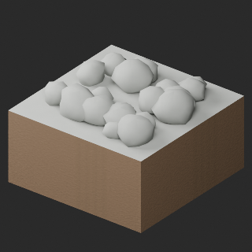](../previews/quality-tr018-027-v1/TR026_HQ__repair_full.png)

[ZIP · BLEND/GLB](https://raw.githubusercontent.com/k3peta/tales-on-a-table/main/distributions/quality-tr018-027-v1/TR026_HQ__repair_CC0.zip) · [Enlarge](../previews/quality-tr018-027-v1/TR026_HQ__repair_full.png) · [comparison](../previews/quality-tr018-027-v1/TR026_HQ__repair_comparison.png)

Variant/revision dimensions, pivot/facing and triangle count: not independently measured by publisher; refer to the base record and validation scope.

## TR026_LITE__repair

**rock low outcrop** · rock low outcrop

Original procedural bump baked to embedded2048px tangent-normal; original base-color textures unchanged. All original UV layers and baked atlas retained; UV0-copy padding added only where required to place baked atlas at UV2 uniformly. Uniform normalUV2 prevents UV-index-dependent material duplication; strict verifier unchanged. Exact-zero faces removed: 0. Positive surfaces retained. Sampled bake fidelity/seams evaluated separately from attribute pass. Revision of existing model, not new base or variant.

[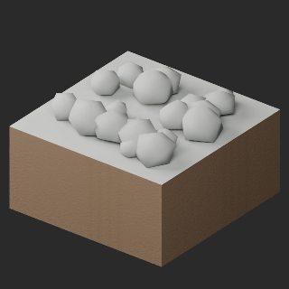](../previews/quality-tr018-027-v1/TR026_LITE__repair_full.png)

[ZIP · BLEND/GLB](https://raw.githubusercontent.com/k3peta/tales-on-a-table/main/distributions/quality-tr018-027-v1/TR026_LITE__repair_CC0.zip) · [Enlarge](../previews/quality-tr018-027-v1/TR026_LITE__repair_full.png) · [comparison](../previews/quality-tr018-027-v1/TR026_LITE__repair_comparison.png)

Variant/revision dimensions, pivot/facing and triangle count: not independently measured by publisher; refer to the base record and validation scope.

## TR027_HQ__repair

**rock tall outcrop** · rock tall outcrop

Original procedural bump baked to embedded2048px tangent-normal; original base-color textures unchanged. All original UV layers and baked atlas retained; UV0-copy padding added only where required to place baked atlas at UV2 uniformly. Uniform normalUV2 prevents UV-index-dependent material duplication; strict verifier unchanged. Exact-zero faces removed: 0. Positive surfaces retained. Sampled bake fidelity/seams evaluated separately from attribute pass. Revision of existing model, not new base or variant.

[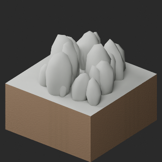](../previews/quality-tr018-027-v1/TR027_HQ__repair_full.png)

[ZIP · BLEND/GLB](https://raw.githubusercontent.com/k3peta/tales-on-a-table/main/distributions/quality-tr018-027-v1/TR027_HQ__repair_CC0.zip) · [Enlarge](../previews/quality-tr018-027-v1/TR027_HQ__repair_full.png) · [comparison](../previews/quality-tr018-027-v1/TR027_HQ__repair_comparison.png)

Variant/revision dimensions, pivot/facing and triangle count: not independently measured by publisher; refer to the base record and validation scope.

## TR027_LITE__repair

**rock tall outcrop** · rock tall outcrop

Original procedural bump baked to embedded2048px tangent-normal; original base-color textures unchanged. All original UV layers and baked atlas retained; UV0-copy padding added only where required to place baked atlas at UV2 uniformly. Uniform normalUV2 prevents UV-index-dependent material duplication; strict verifier unchanged. Exact-zero faces removed: 0. Positive surfaces retained. Sampled bake fidelity/seams evaluated separately from attribute pass. Revision of existing model, not new base or variant.

[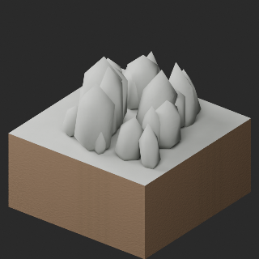](../previews/quality-tr018-027-v1/TR027_LITE__repair_full.png)

[ZIP · BLEND/GLB](https://raw.githubusercontent.com/k3peta/tales-on-a-table/main/distributions/quality-tr018-027-v1/TR027_LITE__repair_CC0.zip) · [Enlarge](../previews/quality-tr018-027-v1/TR027_LITE__repair_full.png) · [comparison](../previews/quality-tr018-027-v1/TR027_LITE__repair_comparison.png)

Variant/revision dimensions, pivot/facing and triangle count: not independently measured by publisher; refer to the base record and validation scope.

[Exact ZIP/image bindings](../distributions/quality-tr018-027-v1/image-bindings.json) · [Validation scope](../distributions/quality-tr018-027-v1/validation.json).
