# quality-tr028-037-v1

[Quality57–76 overview](quality-57-76.md) · [International catalogue](international/README.md)

TR028–037 HQ/LITE: partial material repair, restored soil bump; fine rock grain attenuated. No new shape; no exact procedural fidelity claim.

Existing distribution revisions and material variants only; zero new base records. Models/embedded materials only CC0; images are separate catalogue artwork. [License](../LICENSE.md).

Producer final-ZIP numerical reimports passed; independent public-download match pending. No publication-side Blender rerun. No gameplay, collision, load, fluid, mechanism or Blender4.3.2 approval. Images compare fixed camera/light per model; layouts differ by batch, source and final panels must not be interchanged.

## TR028_HQ__repair

**rock layered ridge** · rock layered ridge

Original procedural bump baked to embedded2048px tangent-normal; original base-color textures unchanged. All original UV layers and baked atlas retained; UV0-copy padding added only where required to place baked atlas at UV2 uniformly. Uniform normalUV2 prevents UV-index-dependent material duplication; strict verifier unchanged. Exact-zero faces removed: 0. Positive surfaces retained. Partial material repair: soil bump restored, fine rock grain attenuated versus source BLEND. Sampled bake fidelity/seams evaluated separately from attribute pass. Revision of existing model, not new base or variant.

[ZIP · BLEND/GLB](https://raw.githubusercontent.com/k3peta/tales-on-a-table/main/distributions/quality-tr028-037-v1/TR028_HQ__repair_CC0.zip) · [Enlarge](../previews/quality-tr028-037-v1/TR028_HQ__repair_full.png) · [comparison](../previews/quality-tr028-037-v1/TR028_HQ__repair_comparison.png)

Variant/revision dimensions, pivot/facing and triangle count: not independently measured by publisher; refer to the base record and validation scope.

## TR028_LITE__repair

**rock layered ridge** · rock layered ridge

Original procedural bump baked to embedded2048px tangent-normal; original base-color textures unchanged. All original UV layers and baked atlas retained; UV0-copy padding added only where required to place baked atlas at UV2 uniformly. Uniform normalUV2 prevents UV-index-dependent material duplication; strict verifier unchanged. Exact-zero faces removed: 0. Positive surfaces retained. Partial material repair: soil bump restored, fine rock grain attenuated versus source BLEND. Sampled bake fidelity/seams evaluated separately from attribute pass. Revision of existing model, not new base or variant.

[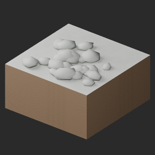](../previews/quality-tr028-037-v1/TR028_LITE__repair_full.png)

[ZIP · BLEND/GLB](https://raw.githubusercontent.com/k3peta/tales-on-a-table/main/distributions/quality-tr028-037-v1/TR028_LITE__repair_CC0.zip) · [Enlarge](../previews/quality-tr028-037-v1/TR028_LITE__repair_full.png) · [comparison](../previews/quality-tr028-037-v1/TR028_LITE__repair_comparison.png)

Variant/revision dimensions, pivot/facing and triangle count: not independently measured by publisher; refer to the base record and validation scope.

## TR029_HQ__repair

**rock broken slabs** · rock broken slabs

Original procedural bump baked to embedded2048px tangent-normal; original base-color textures unchanged. All original UV layers and baked atlas retained; UV0-copy padding added only where required to place baked atlas at UV2 uniformly. Uniform normalUV2 prevents UV-index-dependent material duplication; strict verifier unchanged. Exact-zero faces removed: 0. Positive surfaces retained. Partial material repair: soil bump restored, fine rock grain attenuated versus source BLEND. Sampled bake fidelity/seams evaluated separately from attribute pass. Revision of existing model, not new base or variant.

[ZIP · BLEND/GLB](https://raw.githubusercontent.com/k3peta/tales-on-a-table/main/distributions/quality-tr028-037-v1/TR029_HQ__repair_CC0.zip) · [Enlarge](../previews/quality-tr028-037-v1/TR029_HQ__repair_full.png) · [comparison](../previews/quality-tr028-037-v1/TR029_HQ__repair_comparison.png)

Variant/revision dimensions, pivot/facing and triangle count: not independently measured by publisher; refer to the base record and validation scope.

## TR029_LITE__repair

**rock broken slabs** · rock broken slabs

Original procedural bump baked to embedded2048px tangent-normal; original base-color textures unchanged. All original UV layers and baked atlas retained; UV0-copy padding added only where required to place baked atlas at UV2 uniformly. Uniform normalUV2 prevents UV-index-dependent material duplication; strict verifier unchanged. Exact-zero faces removed: 0. Positive surfaces retained. Partial material repair: soil bump restored, fine rock grain attenuated versus source BLEND. Sampled bake fidelity/seams evaluated separately from attribute pass. Revision of existing model, not new base or variant.

[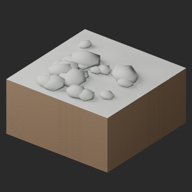](../previews/quality-tr028-037-v1/TR029_LITE__repair_full.png)

[ZIP · BLEND/GLB](https://raw.githubusercontent.com/k3peta/tales-on-a-table/main/distributions/quality-tr028-037-v1/TR029_LITE__repair_CC0.zip) · [Enlarge](../previews/quality-tr028-037-v1/TR029_LITE__repair_full.png) · [comparison](../previews/quality-tr028-037-v1/TR029_LITE__repair_comparison.png)

Variant/revision dimensions, pivot/facing and triangle count: not independently measured by publisher; refer to the base record and validation scope.

## TR030_HQ__repair

**rock moss boulders** · rock moss boulders

Original procedural bump baked to embedded2048px tangent-normal; original base-color textures unchanged. All original UV layers and baked atlas retained; UV0-copy padding added only where required to place baked atlas at UV2 uniformly. Uniform normalUV2 prevents UV-index-dependent material duplication; strict verifier unchanged. Exact-zero faces removed: 0. Positive surfaces retained. Partial material repair: soil bump restored, fine rock grain attenuated versus source BLEND. Sampled bake fidelity/seams evaluated separately from attribute pass. Revision of existing model, not new base or variant.

[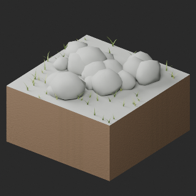](../previews/quality-tr028-037-v1/TR030_HQ__repair_full.png)

[ZIP · BLEND/GLB](https://raw.githubusercontent.com/k3peta/tales-on-a-table/main/distributions/quality-tr028-037-v1/TR030_HQ__repair_CC0.zip) · [Enlarge](../previews/quality-tr028-037-v1/TR030_HQ__repair_full.png) · [comparison](../previews/quality-tr028-037-v1/TR030_HQ__repair_comparison.png)

Variant/revision dimensions, pivot/facing and triangle count: not independently measured by publisher; refer to the base record and validation scope.

## TR030_LITE__repair

**rock moss boulders** · rock moss boulders

Original procedural bump baked to embedded2048px tangent-normal; original base-color textures unchanged. All original UV layers and baked atlas retained; UV0-copy padding added only where required to place baked atlas at UV2 uniformly. Uniform normalUV2 prevents UV-index-dependent material duplication; strict verifier unchanged. Exact-zero faces removed: 0. Positive surfaces retained. Partial material repair: soil bump restored, fine rock grain attenuated versus source BLEND. Sampled bake fidelity/seams evaluated separately from attribute pass. Revision of existing model, not new base or variant.

[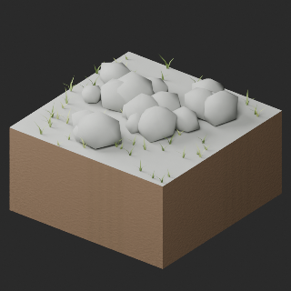](../previews/quality-tr028-037-v1/TR030_LITE__repair_full.png)

[ZIP · BLEND/GLB](https://raw.githubusercontent.com/k3peta/tales-on-a-table/main/distributions/quality-tr028-037-v1/TR030_LITE__repair_CC0.zip) · [Enlarge](../previews/quality-tr028-037-v1/TR030_LITE__repair_full.png) · [comparison](../previews/quality-tr028-037-v1/TR030_LITE__repair_comparison.png)

Variant/revision dimensions, pivot/facing and triangle count: not independently measured by publisher; refer to the base record and validation scope.

## TR031_HQ__repair

**rock sand transition** · rock sand transition

Original procedural bump baked to embedded2048px tangent-normal; original base-color textures unchanged. All original UV layers and baked atlas retained; UV0-copy padding added only where required to place baked atlas at UV2 uniformly. Uniform normalUV2 prevents UV-index-dependent material duplication; strict verifier unchanged. Exact-zero faces removed: 0. Positive surfaces retained. Partial material repair: soil bump restored, fine rock grain attenuated versus source BLEND. Sampled bake fidelity/seams evaluated separately from attribute pass. Revision of existing model, not new base or variant.

[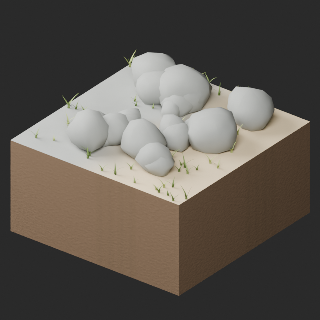](../previews/quality-tr028-037-v1/TR031_HQ__repair_full.png)

[ZIP · BLEND/GLB](https://raw.githubusercontent.com/k3peta/tales-on-a-table/main/distributions/quality-tr028-037-v1/TR031_HQ__repair_CC0.zip) · [Enlarge](../previews/quality-tr028-037-v1/TR031_HQ__repair_full.png) · [comparison](../previews/quality-tr028-037-v1/TR031_HQ__repair_comparison.png)

Variant/revision dimensions, pivot/facing and triangle count: not independently measured by publisher; refer to the base record and validation scope.

## TR031_LITE__repair

**rock sand transition** · rock sand transition

Original procedural bump baked to embedded2048px tangent-normal; original base-color textures unchanged. All original UV layers and baked atlas retained; UV0-copy padding added only where required to place baked atlas at UV2 uniformly. Uniform normalUV2 prevents UV-index-dependent material duplication; strict verifier unchanged. Exact-zero faces removed: 0. Positive surfaces retained. Partial material repair: soil bump restored, fine rock grain attenuated versus source BLEND. Sampled bake fidelity/seams evaluated separately from attribute pass. Revision of existing model, not new base or variant.

[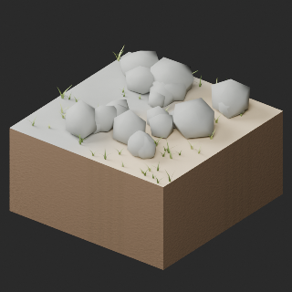](../previews/quality-tr028-037-v1/TR031_LITE__repair_full.png)

[ZIP · BLEND/GLB](https://raw.githubusercontent.com/k3peta/tales-on-a-table/main/distributions/quality-tr028-037-v1/TR031_LITE__repair_CC0.zip) · [Enlarge](../previews/quality-tr028-037-v1/TR031_LITE__repair_full.png) · [comparison](../previews/quality-tr028-037-v1/TR031_LITE__repair_comparison.png)

Variant/revision dimensions, pivot/facing and triangle count: not independently measured by publisher; refer to the base record and validation scope.

## TR032_HQ__repair

**rock snow transition** · rock snow transition

Original procedural bump baked to embedded2048px tangent-normal; original base-color textures unchanged. All original UV layers and baked atlas retained; UV0-copy padding added only where required to place baked atlas at UV2 uniformly. Uniform normalUV2 prevents UV-index-dependent material duplication; strict verifier unchanged. Exact-zero faces removed: 0. Positive surfaces retained. Partial material repair: soil bump restored, fine rock grain attenuated versus source BLEND. Sampled bake fidelity/seams evaluated separately from attribute pass. Revision of existing model, not new base or variant.

[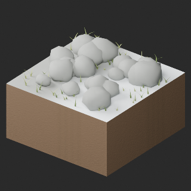](../previews/quality-tr028-037-v1/TR032_HQ__repair_full.png)

[ZIP · BLEND/GLB](https://raw.githubusercontent.com/k3peta/tales-on-a-table/main/distributions/quality-tr028-037-v1/TR032_HQ__repair_CC0.zip) · [Enlarge](../previews/quality-tr028-037-v1/TR032_HQ__repair_full.png) · [comparison](../previews/quality-tr028-037-v1/TR032_HQ__repair_comparison.png)

Variant/revision dimensions, pivot/facing and triangle count: not independently measured by publisher; refer to the base record and validation scope.

## TR032_LITE__repair

**rock snow transition** · rock snow transition

Original procedural bump baked to embedded2048px tangent-normal; original base-color textures unchanged. All original UV layers and baked atlas retained; UV0-copy padding added only where required to place baked atlas at UV2 uniformly. Uniform normalUV2 prevents UV-index-dependent material duplication; strict verifier unchanged. Exact-zero faces removed: 0. Positive surfaces retained. Partial material repair: soil bump restored, fine rock grain attenuated versus source BLEND. Sampled bake fidelity/seams evaluated separately from attribute pass. Revision of existing model, not new base or variant.

[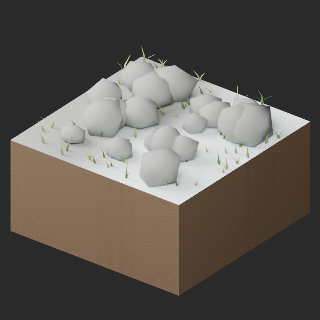](../previews/quality-tr028-037-v1/TR032_LITE__repair_full.png)

[ZIP · BLEND/GLB](https://raw.githubusercontent.com/k3peta/tales-on-a-table/main/distributions/quality-tr028-037-v1/TR032_LITE__repair_CC0.zip) · [Enlarge](../previews/quality-tr028-037-v1/TR032_LITE__repair_full.png) · [comparison](../previews/quality-tr028-037-v1/TR032_LITE__repair_comparison.png)

Variant/revision dimensions, pivot/facing and triangle count: not independently measured by publisher; refer to the base record and validation scope.

## TR033_HQ__repair

**sand flat fine** · sand flat fine

Original procedural bump baked to embedded2048px tangent-normal; original base-color textures unchanged. All original UV layers and baked atlas retained; UV0-copy padding added only where required to place baked atlas at UV2 uniformly. Uniform normalUV2 prevents UV-index-dependent material duplication; strict verifier unchanged. Exact-zero faces removed: 0. Positive surfaces retained. Partial material repair: soil bump restored, fine rock grain attenuated versus source BLEND. Sampled bake fidelity/seams evaluated separately from attribute pass. Revision of existing model, not new base or variant.

[ZIP · BLEND/GLB](https://raw.githubusercontent.com/k3peta/tales-on-a-table/main/distributions/quality-tr028-037-v1/TR033_HQ__repair_CC0.zip) · [Enlarge](../previews/quality-tr028-037-v1/TR033_HQ__repair_full.png) · [comparison](../previews/quality-tr028-037-v1/TR033_HQ__repair_comparison.png)

Variant/revision dimensions, pivot/facing and triangle count: not independently measured by publisher; refer to the base record and validation scope.

## TR033_LITE__repair

**sand flat fine** · sand flat fine

Original procedural bump baked to embedded2048px tangent-normal; original base-color textures unchanged. All original UV layers and baked atlas retained; UV0-copy padding added only where required to place baked atlas at UV2 uniformly. Uniform normalUV2 prevents UV-index-dependent material duplication; strict verifier unchanged. Exact-zero faces removed: 0. Positive surfaces retained. Partial material repair: soil bump restored, fine rock grain attenuated versus source BLEND. Sampled bake fidelity/seams evaluated separately from attribute pass. Revision of existing model, not new base or variant.

[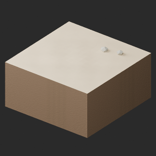](../previews/quality-tr028-037-v1/TR033_LITE__repair_full.png)

[ZIP · BLEND/GLB](https://raw.githubusercontent.com/k3peta/tales-on-a-table/main/distributions/quality-tr028-037-v1/TR033_LITE__repair_CC0.zip) · [Enlarge](../previews/quality-tr028-037-v1/TR033_LITE__repair_full.png) · [comparison](../previews/quality-tr028-037-v1/TR033_LITE__repair_comparison.png)

Variant/revision dimensions, pivot/facing and triangle count: not independently measured by publisher; refer to the base record and validation scope.

## TR034_HQ__repair

**sand wind ripples** · sand wind ripples

Original procedural bump baked to embedded2048px tangent-normal; original base-color textures unchanged. All original UV layers and baked atlas retained; UV0-copy padding added only where required to place baked atlas at UV2 uniformly. Uniform normalUV2 prevents UV-index-dependent material duplication; strict verifier unchanged. Exact-zero faces removed: 0. Positive surfaces retained. Partial material repair: soil bump restored, fine rock grain attenuated versus source BLEND. Sampled bake fidelity/seams evaluated separately from attribute pass. Revision of existing model, not new base or variant.

[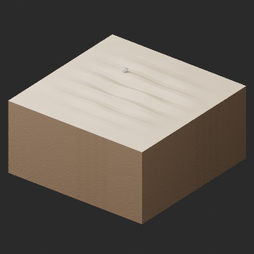](../previews/quality-tr028-037-v1/TR034_HQ__repair_full.png)

[ZIP · BLEND/GLB](https://raw.githubusercontent.com/k3peta/tales-on-a-table/main/distributions/quality-tr028-037-v1/TR034_HQ__repair_CC0.zip) · [Enlarge](../previews/quality-tr028-037-v1/TR034_HQ__repair_full.png) · [comparison](../previews/quality-tr028-037-v1/TR034_HQ__repair_comparison.png)

Variant/revision dimensions, pivot/facing and triangle count: not independently measured by publisher; refer to the base record and validation scope.

## TR034_LITE__repair

**sand wind ripples** · sand wind ripples

Original procedural bump baked to embedded2048px tangent-normal; original base-color textures unchanged. All original UV layers and baked atlas retained; UV0-copy padding added only where required to place baked atlas at UV2 uniformly. Uniform normalUV2 prevents UV-index-dependent material duplication; strict verifier unchanged. Exact-zero faces removed: 0. Positive surfaces retained. Partial material repair: soil bump restored, fine rock grain attenuated versus source BLEND. Sampled bake fidelity/seams evaluated separately from attribute pass. Revision of existing model, not new base or variant.

[ZIP · BLEND/GLB](https://raw.githubusercontent.com/k3peta/tales-on-a-table/main/distributions/quality-tr028-037-v1/TR034_LITE__repair_CC0.zip) · [Enlarge](../previews/quality-tr028-037-v1/TR034_LITE__repair_full.png) · [comparison](../previews/quality-tr028-037-v1/TR034_LITE__repair_comparison.png)

Variant/revision dimensions, pivot/facing and triangle count: not independently measured by publisher; refer to the base record and validation scope.

## TR035_HQ__repair

**sand low dune** · sand low dune

Original procedural bump baked to embedded2048px tangent-normal; original base-color textures unchanged. All original UV layers and baked atlas retained; UV0-copy padding added only where required to place baked atlas at UV2 uniformly. Uniform normalUV2 prevents UV-index-dependent material duplication; strict verifier unchanged. Exact-zero faces removed: 0. Positive surfaces retained. Partial material repair: soil bump restored, fine rock grain attenuated versus source BLEND. Sampled bake fidelity/seams evaluated separately from attribute pass. Revision of existing model, not new base or variant.

[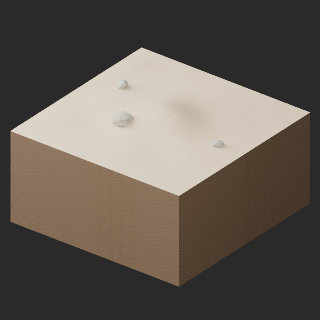](../previews/quality-tr028-037-v1/TR035_HQ__repair_full.png)

[ZIP · BLEND/GLB](https://raw.githubusercontent.com/k3peta/tales-on-a-table/main/distributions/quality-tr028-037-v1/TR035_HQ__repair_CC0.zip) · [Enlarge](../previews/quality-tr028-037-v1/TR035_HQ__repair_full.png) · [comparison](../previews/quality-tr028-037-v1/TR035_HQ__repair_comparison.png)

Variant/revision dimensions, pivot/facing and triangle count: not independently measured by publisher; refer to the base record and validation scope.

## TR035_LITE__repair

**sand low dune** · sand low dune

Original procedural bump baked to embedded2048px tangent-normal; original base-color textures unchanged. All original UV layers and baked atlas retained; UV0-copy padding added only where required to place baked atlas at UV2 uniformly. Uniform normalUV2 prevents UV-index-dependent material duplication; strict verifier unchanged. Exact-zero faces removed: 0. Positive surfaces retained. Partial material repair: soil bump restored, fine rock grain attenuated versus source BLEND. Sampled bake fidelity/seams evaluated separately from attribute pass. Revision of existing model, not new base or variant.

[ZIP · BLEND/GLB](https://raw.githubusercontent.com/k3peta/tales-on-a-table/main/distributions/quality-tr028-037-v1/TR035_LITE__repair_CC0.zip) · [Enlarge](../previews/quality-tr028-037-v1/TR035_LITE__repair_full.png) · [comparison](../previews/quality-tr028-037-v1/TR035_LITE__repair_comparison.png)

Variant/revision dimensions, pivot/facing and triangle count: not independently measured by publisher; refer to the base record and validation scope.

## TR036_HQ__repair

**sand pebble patch** · sand pebble patch

Original procedural bump baked to embedded2048px tangent-normal; original base-color textures unchanged. All original UV layers and baked atlas retained; UV0-copy padding added only where required to place baked atlas at UV2 uniformly. Uniform normalUV2 prevents UV-index-dependent material duplication; strict verifier unchanged. Exact-zero faces removed: 0. Positive surfaces retained. Partial material repair: soil bump restored, fine rock grain attenuated versus source BLEND. Sampled bake fidelity/seams evaluated separately from attribute pass. Revision of existing model, not new base or variant.

[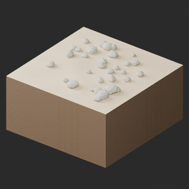](../previews/quality-tr028-037-v1/TR036_HQ__repair_full.png)

[ZIP · BLEND/GLB](https://raw.githubusercontent.com/k3peta/tales-on-a-table/main/distributions/quality-tr028-037-v1/TR036_HQ__repair_CC0.zip) · [Enlarge](../previews/quality-tr028-037-v1/TR036_HQ__repair_full.png) · [comparison](../previews/quality-tr028-037-v1/TR036_HQ__repair_comparison.png)

Variant/revision dimensions, pivot/facing and triangle count: not independently measured by publisher; refer to the base record and validation scope.

## TR036_LITE__repair

**sand pebble patch** · sand pebble patch

Original procedural bump baked to embedded2048px tangent-normal; original base-color textures unchanged. All original UV layers and baked atlas retained; UV0-copy padding added only where required to place baked atlas at UV2 uniformly. Uniform normalUV2 prevents UV-index-dependent material duplication; strict verifier unchanged. Exact-zero faces removed: 0. Positive surfaces retained. Partial material repair: soil bump restored, fine rock grain attenuated versus source BLEND. Sampled bake fidelity/seams evaluated separately from attribute pass. Revision of existing model, not new base or variant.

[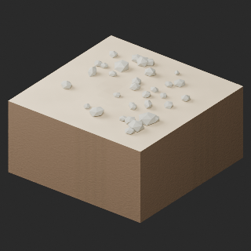](../previews/quality-tr028-037-v1/TR036_LITE__repair_full.png)

[ZIP · BLEND/GLB](https://raw.githubusercontent.com/k3peta/tales-on-a-table/main/distributions/quality-tr028-037-v1/TR036_LITE__repair_CC0.zip) · [Enlarge](../previews/quality-tr028-037-v1/TR036_LITE__repair_full.png) · [comparison](../previews/quality-tr028-037-v1/TR036_LITE__repair_comparison.png)

Variant/revision dimensions, pivot/facing and triangle count: not independently measured by publisher; refer to the base record and validation scope.

## TR037_HQ__repair

**sand dry grass** · sand dry grass

Original procedural bump baked to embedded2048px tangent-normal; original base-color textures unchanged. All original UV layers and baked atlas retained; UV0-copy padding added only where required to place baked atlas at UV2 uniformly. Uniform normalUV2 prevents UV-index-dependent material duplication; strict verifier unchanged. Exact-zero faces removed: 0. Positive surfaces retained. Partial material repair: soil bump restored, fine rock grain attenuated versus source BLEND. Sampled bake fidelity/seams evaluated separately from attribute pass. Revision of existing model, not new base or variant.

[ZIP · BLEND/GLB](https://raw.githubusercontent.com/k3peta/tales-on-a-table/main/distributions/quality-tr028-037-v1/TR037_HQ__repair_CC0.zip) · [Enlarge](../previews/quality-tr028-037-v1/TR037_HQ__repair_full.png) · [comparison](../previews/quality-tr028-037-v1/TR037_HQ__repair_comparison.png)

Variant/revision dimensions, pivot/facing and triangle count: not independently measured by publisher; refer to the base record and validation scope.

## TR037_LITE__repair

**sand dry grass** · sand dry grass

Original procedural bump baked to embedded2048px tangent-normal; original base-color textures unchanged. All original UV layers and baked atlas retained; UV0-copy padding added only where required to place baked atlas at UV2 uniformly. Uniform normalUV2 prevents UV-index-dependent material duplication; strict verifier unchanged. Exact-zero faces removed: 0. Positive surfaces retained. Partial material repair: soil bump restored, fine rock grain attenuated versus source BLEND. Sampled bake fidelity/seams evaluated separately from attribute pass. Revision of existing model, not new base or variant.

[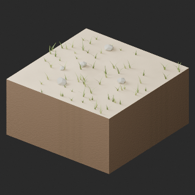](../previews/quality-tr028-037-v1/TR037_LITE__repair_full.png)

[ZIP · BLEND/GLB](https://raw.githubusercontent.com/k3peta/tales-on-a-table/main/distributions/quality-tr028-037-v1/TR037_LITE__repair_CC0.zip) · [Enlarge](../previews/quality-tr028-037-v1/TR037_LITE__repair_full.png) · [comparison](../previews/quality-tr028-037-v1/TR037_LITE__repair_comparison.png)

Variant/revision dimensions, pivot/facing and triangle count: not independently measured by publisher; refer to the base record and validation scope.

[Exact ZIP/image bindings](../distributions/quality-tr028-037-v1/image-bindings.json) · [Validation scope](../distributions/quality-tr028-037-v1/validation.json).
