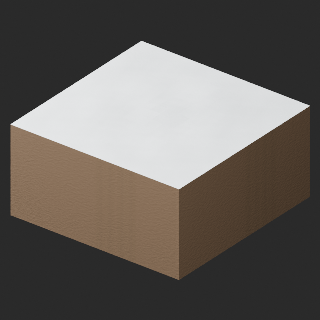
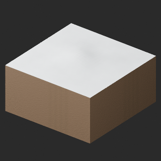
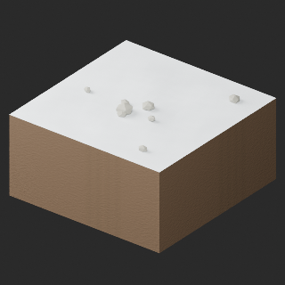
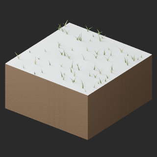
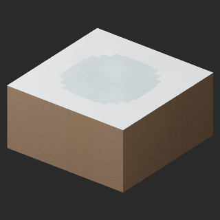
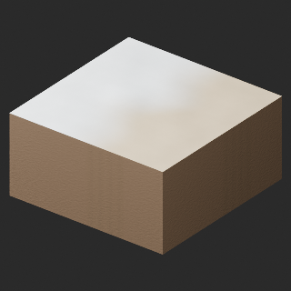
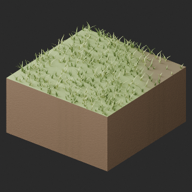

# quality-tr048-057-v1

[Quality77 overview](quality-77.md) · [International catalogue](international/README.md)

TR049–057 HQ/LITE:18 material/UV revisions across9 existing distribution records, no new base, variant or geometry revision. TR048 HQ/LITE is held for positive coplanar earth/water-port overlap and LITE black wedges; no candidate generated. Prior TR041–047 water14 and TR013 two candidates remain held. Embedded2048px tangent normals restore sampled soil bump; fine-grain attenuation remains. Original colors and original UV layers retained; bake UV2 and necessary UV0-copy padding added. TR050 shallow drift/faceting, TR053 angular ice boundary, TR056 weak track relief and TR057 repeated grass remain. Geometry/attribute pass does not establish exact procedural fidelity.

Existing distribution revisions and material variants only; zero new base records. Models/embedded materials only CC0; images are separate catalogue artwork. [License](../LICENSE.md).

Producer final-ZIP numerical reimports passed; independent public-download match pending. No publication-side Blender rerun. No gameplay, collision, load, fluid, mechanism or Blender4.3.2 approval. Images compare fixed camera/light per model; layouts differ by batch, source and final panels must not be interchanged.

## TR049_HQ__repair

**snow fresh flat** · snow fresh flat

Original procedural bump baked to embedded2048px tangent-normal; original base-color textures unchanged. All original UV layers and baked atlas retained; UV0-copy padding added only where required to place baked atlas at UV2 uniformly. Uniform normalUV2 prevents UV-index-dependent material duplication; strict verifier unchanged. Exact-zero faces removed: 0. Positive surfaces retained. Partial material repair: soil bump restored, fine rock grain attenuated versus source BLEND. Sampled bake fidelity/seams evaluated separately from attribute pass. Revision of existing model, not new base or variant.

[ZIP · BLEND/GLB](https://raw.githubusercontent.com/k3peta/tales-on-a-table/main/distributions/quality-tr048-057-v1/TR049_HQ__repair_CC0.zip) · [Enlarge](../previews/quality-tr048-057-v1/TR049_HQ__repair_full.png) · [comparison](../previews/quality-tr048-057-v1/TR049_HQ__repair_comparison.png)

Variant/revision dimensions, pivot/facing and triangle count: not independently measured by publisher; refer to the base record and validation scope.

## TR049_LITE__repair

**snow fresh flat** · snow fresh flat

Original procedural bump baked to embedded2048px tangent-normal; original base-color textures unchanged. All original UV layers and baked atlas retained; UV0-copy padding added only where required to place baked atlas at UV2 uniformly. Uniform normalUV2 prevents UV-index-dependent material duplication; strict verifier unchanged. Exact-zero faces removed: 0. Positive surfaces retained. Partial material repair: soil bump restored, fine rock grain attenuated versus source BLEND. Sampled bake fidelity/seams evaluated separately from attribute pass. Revision of existing model, not new base or variant.

[ZIP · BLEND/GLB](https://raw.githubusercontent.com/k3peta/tales-on-a-table/main/distributions/quality-tr048-057-v1/TR049_LITE__repair_CC0.zip) · [Enlarge](../previews/quality-tr048-057-v1/TR049_LITE__repair_full.png) · [comparison](../previews/quality-tr048-057-v1/TR049_LITE__repair_comparison.png)

Variant/revision dimensions, pivot/facing and triangle count: not independently measured by publisher; refer to the base record and validation scope.

## TR050_HQ__repair

**snow wind drift** · snow wind drift

Original procedural bump baked to embedded2048px tangent-normal; original base-color textures unchanged. All original UV layers and baked atlas retained; UV0-copy padding added only where required to place baked atlas at UV2 uniformly. Uniform normalUV2 prevents UV-index-dependent material duplication; strict verifier unchanged. Exact-zero faces removed: 0. Positive surfaces retained. Partial material repair: soil bump restored, fine rock grain attenuated versus source BLEND. Sampled bake fidelity/seams evaluated separately from attribute pass. Revision of existing model, not new base or variant.

[ZIP · BLEND/GLB](https://raw.githubusercontent.com/k3peta/tales-on-a-table/main/distributions/quality-tr048-057-v1/TR050_HQ__repair_CC0.zip) · [Enlarge](../previews/quality-tr048-057-v1/TR050_HQ__repair_full.png) · [comparison](../previews/quality-tr048-057-v1/TR050_HQ__repair_comparison.png)

Variant/revision dimensions, pivot/facing and triangle count: not independently measured by publisher; refer to the base record and validation scope.

## TR050_LITE__repair

**snow wind drift** · snow wind drift

Original procedural bump baked to embedded2048px tangent-normal; original base-color textures unchanged. All original UV layers and baked atlas retained; UV0-copy padding added only where required to place baked atlas at UV2 uniformly. Uniform normalUV2 prevents UV-index-dependent material duplication; strict verifier unchanged. Exact-zero faces removed: 0. Positive surfaces retained. Partial material repair: soil bump restored, fine rock grain attenuated versus source BLEND. Sampled bake fidelity/seams evaluated separately from attribute pass. Revision of existing model, not new base or variant.

[ZIP · BLEND/GLB](https://raw.githubusercontent.com/k3peta/tales-on-a-table/main/distributions/quality-tr048-057-v1/TR050_LITE__repair_CC0.zip) · [Enlarge](../previews/quality-tr048-057-v1/TR050_LITE__repair_full.png) · [comparison](../previews/quality-tr048-057-v1/TR050_LITE__repair_comparison.png)

Variant/revision dimensions, pivot/facing and triangle count: not independently measured by publisher; refer to the base record and validation scope.

## TR051_HQ__repair

**snow rock exposed** · snow rock exposed

Original procedural bump baked to embedded2048px tangent-normal; original base-color textures unchanged. All original UV layers and baked atlas retained; UV0-copy padding added only where required to place baked atlas at UV2 uniformly. Uniform normalUV2 prevents UV-index-dependent material duplication; strict verifier unchanged. Exact-zero faces removed: 0. Positive surfaces retained. Partial material repair: soil bump restored, fine rock grain attenuated versus source BLEND. Sampled bake fidelity/seams evaluated separately from attribute pass. Revision of existing model, not new base or variant.

[ZIP · BLEND/GLB](https://raw.githubusercontent.com/k3peta/tales-on-a-table/main/distributions/quality-tr048-057-v1/TR051_HQ__repair_CC0.zip) · [Enlarge](../previews/quality-tr048-057-v1/TR051_HQ__repair_full.png) · [comparison](../previews/quality-tr048-057-v1/TR051_HQ__repair_comparison.png)

Variant/revision dimensions, pivot/facing and triangle count: not independently measured by publisher; refer to the base record and validation scope.

## TR051_LITE__repair

**snow rock exposed** · snow rock exposed

Original procedural bump baked to embedded2048px tangent-normal; original base-color textures unchanged. All original UV layers and baked atlas retained; UV0-copy padding added only where required to place baked atlas at UV2 uniformly. Uniform normalUV2 prevents UV-index-dependent material duplication; strict verifier unchanged. Exact-zero faces removed: 0. Positive surfaces retained. Partial material repair: soil bump restored, fine rock grain attenuated versus source BLEND. Sampled bake fidelity/seams evaluated separately from attribute pass. Revision of existing model, not new base or variant.

[ZIP · BLEND/GLB](https://raw.githubusercontent.com/k3peta/tales-on-a-table/main/distributions/quality-tr048-057-v1/TR051_LITE__repair_CC0.zip) · [Enlarge](../previews/quality-tr048-057-v1/TR051_LITE__repair_full.png) · [comparison](../previews/quality-tr048-057-v1/TR051_LITE__repair_comparison.png)

Variant/revision dimensions, pivot/facing and triangle count: not independently measured by publisher; refer to the base record and validation scope.

## TR052_HQ__repair

**snow grass exposed** · snow grass exposed

Original procedural bump baked to embedded2048px tangent-normal; original base-color textures unchanged. All original UV layers and baked atlas retained; UV0-copy padding added only where required to place baked atlas at UV2 uniformly. Uniform normalUV2 prevents UV-index-dependent material duplication; strict verifier unchanged. Exact-zero faces removed: 0. Positive surfaces retained. Partial material repair: soil bump restored, fine rock grain attenuated versus source BLEND. Sampled bake fidelity/seams evaluated separately from attribute pass. Revision of existing model, not new base or variant.

[ZIP · BLEND/GLB](https://raw.githubusercontent.com/k3peta/tales-on-a-table/main/distributions/quality-tr048-057-v1/TR052_HQ__repair_CC0.zip) · [Enlarge](../previews/quality-tr048-057-v1/TR052_HQ__repair_full.png) · [comparison](../previews/quality-tr048-057-v1/TR052_HQ__repair_comparison.png)

Variant/revision dimensions, pivot/facing and triangle count: not independently measured by publisher; refer to the base record and validation scope.

## TR052_LITE__repair

**snow grass exposed** · snow grass exposed

Original procedural bump baked to embedded2048px tangent-normal; original base-color textures unchanged. All original UV layers and baked atlas retained; UV0-copy padding added only where required to place baked atlas at UV2 uniformly. Uniform normalUV2 prevents UV-index-dependent material duplication; strict verifier unchanged. Exact-zero faces removed: 0. Positive surfaces retained. Partial material repair: soil bump restored, fine rock grain attenuated versus source BLEND. Sampled bake fidelity/seams evaluated separately from attribute pass. Revision of existing model, not new base or variant.

[ZIP · BLEND/GLB](https://raw.githubusercontent.com/k3peta/tales-on-a-table/main/distributions/quality-tr048-057-v1/TR052_LITE__repair_CC0.zip) · [Enlarge](../previews/quality-tr048-057-v1/TR052_LITE__repair_full.png) · [comparison](../previews/quality-tr048-057-v1/TR052_LITE__repair_comparison.png)

Variant/revision dimensions, pivot/facing and triangle count: not independently measured by publisher; refer to the base record and validation scope.

## TR053_HQ__repair

**snow ice patch** · snow ice patch

Original procedural bump baked to embedded2048px tangent-normal; original base-color textures unchanged. All original UV layers and baked atlas retained; UV0-copy padding added only where required to place baked atlas at UV2 uniformly. Uniform normalUV2 prevents UV-index-dependent material duplication; strict verifier unchanged. Exact-zero faces removed: 0. Positive surfaces retained. Partial material repair: soil bump restored, fine rock grain attenuated versus source BLEND. Sampled bake fidelity/seams evaluated separately from attribute pass. Revision of existing model, not new base or variant.

[ZIP · BLEND/GLB](https://raw.githubusercontent.com/k3peta/tales-on-a-table/main/distributions/quality-tr048-057-v1/TR053_HQ__repair_CC0.zip) · [Enlarge](../previews/quality-tr048-057-v1/TR053_HQ__repair_full.png) · [comparison](../previews/quality-tr048-057-v1/TR053_HQ__repair_comparison.png)

Variant/revision dimensions, pivot/facing and triangle count: not independently measured by publisher; refer to the base record and validation scope.

## TR053_LITE__repair

**snow ice patch** · snow ice patch

Original procedural bump baked to embedded2048px tangent-normal; original base-color textures unchanged. All original UV layers and baked atlas retained; UV0-copy padding added only where required to place baked atlas at UV2 uniformly. Uniform normalUV2 prevents UV-index-dependent material duplication; strict verifier unchanged. Exact-zero faces removed: 0. Positive surfaces retained. Partial material repair: soil bump restored, fine rock grain attenuated versus source BLEND. Sampled bake fidelity/seams evaluated separately from attribute pass. Revision of existing model, not new base or variant.

[ZIP · BLEND/GLB](https://raw.githubusercontent.com/k3peta/tales-on-a-table/main/distributions/quality-tr048-057-v1/TR053_LITE__repair_CC0.zip) · [Enlarge](../previews/quality-tr048-057-v1/TR053_LITE__repair_full.png) · [comparison](../previews/quality-tr048-057-v1/TR053_LITE__repair_comparison.png)

Variant/revision dimensions, pivot/facing and triangle count: not independently measured by publisher; refer to the base record and validation scope.

## TR054_HQ__repair

**snow forest floor** · snow forest floor

Original procedural bump baked to embedded2048px tangent-normal; original base-color textures unchanged. All original UV layers and baked atlas retained; UV0-copy padding added only where required to place baked atlas at UV2 uniformly. Uniform normalUV2 prevents UV-index-dependent material duplication; strict verifier unchanged. Exact-zero faces removed: 0. Positive surfaces retained. Partial material repair: soil bump restored, fine rock grain attenuated versus source BLEND. Sampled bake fidelity/seams evaluated separately from attribute pass. Revision of existing model, not new base or variant.

[ZIP · BLEND/GLB](https://raw.githubusercontent.com/k3peta/tales-on-a-table/main/distributions/quality-tr048-057-v1/TR054_HQ__repair_CC0.zip) · [Enlarge](../previews/quality-tr048-057-v1/TR054_HQ__repair_full.png) · [comparison](../previews/quality-tr048-057-v1/TR054_HQ__repair_comparison.png)

Variant/revision dimensions, pivot/facing and triangle count: not independently measured by publisher; refer to the base record and validation scope.

## TR054_LITE__repair

**snow forest floor** · snow forest floor

Original procedural bump baked to embedded2048px tangent-normal; original base-color textures unchanged. All original UV layers and baked atlas retained; UV0-copy padding added only where required to place baked atlas at UV2 uniformly. Uniform normalUV2 prevents UV-index-dependent material duplication; strict verifier unchanged. Exact-zero faces removed: 0. Positive surfaces retained. Partial material repair: soil bump restored, fine rock grain attenuated versus source BLEND. Sampled bake fidelity/seams evaluated separately from attribute pass. Revision of existing model, not new base or variant.

[ZIP · BLEND/GLB](https://raw.githubusercontent.com/k3peta/tales-on-a-table/main/distributions/quality-tr048-057-v1/TR054_LITE__repair_CC0.zip) · [Enlarge](../previews/quality-tr048-057-v1/TR054_LITE__repair_full.png) · [comparison](../previews/quality-tr048-057-v1/TR054_LITE__repair_comparison.png)

Variant/revision dimensions, pivot/facing and triangle count: not independently measured by publisher; refer to the base record and validation scope.

## TR055_HQ__repair

**snow sand transition** · snow sand transition

Original procedural bump baked to embedded2048px tangent-normal; original base-color textures unchanged. All original UV layers and baked atlas retained; UV0-copy padding added only where required to place baked atlas at UV2 uniformly. Uniform normalUV2 prevents UV-index-dependent material duplication; strict verifier unchanged. Exact-zero faces removed: 0. Positive surfaces retained. Partial material repair: soil bump restored, fine rock grain attenuated versus source BLEND. Sampled bake fidelity/seams evaluated separately from attribute pass. Revision of existing model, not new base or variant.

[ZIP · BLEND/GLB](https://raw.githubusercontent.com/k3peta/tales-on-a-table/main/distributions/quality-tr048-057-v1/TR055_HQ__repair_CC0.zip) · [Enlarge](../previews/quality-tr048-057-v1/TR055_HQ__repair_full.png) · [comparison](../previews/quality-tr048-057-v1/TR055_HQ__repair_comparison.png)

Variant/revision dimensions, pivot/facing and triangle count: not independently measured by publisher; refer to the base record and validation scope.

## TR055_LITE__repair

**snow sand transition** · snow sand transition

Original procedural bump baked to embedded2048px tangent-normal; original base-color textures unchanged. All original UV layers and baked atlas retained; UV0-copy padding added only where required to place baked atlas at UV2 uniformly. Uniform normalUV2 prevents UV-index-dependent material duplication; strict verifier unchanged. Exact-zero faces removed: 0. Positive surfaces retained. Partial material repair: soil bump restored, fine rock grain attenuated versus source BLEND. Sampled bake fidelity/seams evaluated separately from attribute pass. Revision of existing model, not new base or variant.

[ZIP · BLEND/GLB](https://raw.githubusercontent.com/k3peta/tales-on-a-table/main/distributions/quality-tr048-057-v1/TR055_LITE__repair_CC0.zip) · [Enlarge](../previews/quality-tr048-057-v1/TR055_LITE__repair_full.png) · [comparison](../previews/quality-tr048-057-v1/TR055_LITE__repair_comparison.png)

Variant/revision dimensions, pivot/facing and triangle count: not independently measured by publisher; refer to the base record and validation scope.

## TR056_HQ__repair

**snow compacted tracks** · snow compacted tracks

Original procedural bump baked to embedded2048px tangent-normal; original base-color textures unchanged. All original UV layers and baked atlas retained; UV0-copy padding added only where required to place baked atlas at UV2 uniformly. Uniform normalUV2 prevents UV-index-dependent material duplication; strict verifier unchanged. Exact-zero faces removed: 0. Positive surfaces retained. Partial material repair: soil bump restored, fine rock grain attenuated versus source BLEND. Sampled bake fidelity/seams evaluated separately from attribute pass. Revision of existing model, not new base or variant.

[ZIP · BLEND/GLB](https://raw.githubusercontent.com/k3peta/tales-on-a-table/main/distributions/quality-tr048-057-v1/TR056_HQ__repair_CC0.zip) · [Enlarge](../previews/quality-tr048-057-v1/TR056_HQ__repair_full.png) · [comparison](../previews/quality-tr048-057-v1/TR056_HQ__repair_comparison.png)

Variant/revision dimensions, pivot/facing and triangle count: not independently measured by publisher; refer to the base record and validation scope.

## TR056_LITE__repair

**snow compacted tracks** · snow compacted tracks

Original procedural bump baked to embedded2048px tangent-normal; original base-color textures unchanged. All original UV layers and baked atlas retained; UV0-copy padding added only where required to place baked atlas at UV2 uniformly. Uniform normalUV2 prevents UV-index-dependent material duplication; strict verifier unchanged. Exact-zero faces removed: 0. Positive surfaces retained. Partial material repair: soil bump restored, fine rock grain attenuated versus source BLEND. Sampled bake fidelity/seams evaluated separately from attribute pass. Revision of existing model, not new base or variant.

[ZIP · BLEND/GLB](https://raw.githubusercontent.com/k3peta/tales-on-a-table/main/distributions/quality-tr048-057-v1/TR056_LITE__repair_CC0.zip) · [Enlarge](../previews/quality-tr048-057-v1/TR056_LITE__repair_full.png) · [comparison](../previews/quality-tr048-057-v1/TR056_LITE__repair_comparison.png)

Variant/revision dimensions, pivot/facing and triangle count: not independently measured by publisher; refer to the base record and validation scope.

## TR057_HQ__repair

**grass forest transition outer corner** · grass forest transition outer corner

Original procedural bump baked to embedded2048px tangent-normal; original base-color textures unchanged. All original UV layers and baked atlas retained; UV0-copy padding added only where required to place baked atlas at UV2 uniformly. Uniform normalUV2 prevents UV-index-dependent material duplication; strict verifier unchanged. Exact-zero faces removed: 0. Positive surfaces retained. Partial material repair: soil bump restored, fine rock grain attenuated versus source BLEND. Sampled bake fidelity/seams evaluated separately from attribute pass. Revision of existing model, not new base or variant.

[ZIP · BLEND/GLB](https://raw.githubusercontent.com/k3peta/tales-on-a-table/main/distributions/quality-tr048-057-v1/TR057_HQ__repair_CC0.zip) · [Enlarge](../previews/quality-tr048-057-v1/TR057_HQ__repair_full.png) · [comparison](../previews/quality-tr048-057-v1/TR057_HQ__repair_comparison.png)

Variant/revision dimensions, pivot/facing and triangle count: not independently measured by publisher; refer to the base record and validation scope.

## TR057_LITE__repair

**grass forest transition outer corner** · grass forest transition outer corner

Original procedural bump baked to embedded2048px tangent-normal; original base-color textures unchanged. All original UV layers and baked atlas retained; UV0-copy padding added only where required to place baked atlas at UV2 uniformly. Uniform normalUV2 prevents UV-index-dependent material duplication; strict verifier unchanged. Exact-zero faces removed: 0. Positive surfaces retained. Partial material repair: soil bump restored, fine rock grain attenuated versus source BLEND. Sampled bake fidelity/seams evaluated separately from attribute pass. Revision of existing model, not new base or variant.

[ZIP · BLEND/GLB](https://raw.githubusercontent.com/k3peta/tales-on-a-table/main/distributions/quality-tr048-057-v1/TR057_LITE__repair_CC0.zip) · [Enlarge](../previews/quality-tr048-057-v1/TR057_LITE__repair_full.png) · [comparison](../previews/quality-tr048-057-v1/TR057_LITE__repair_comparison.png)

Variant/revision dimensions, pivot/facing and triangle count: not independently measured by publisher; refer to the base record and validation scope.

[Exact ZIP/image bindings](../distributions/quality-tr048-057-v1/image-bindings.json) · [Validation scope](../distributions/quality-tr048-057-v1/validation.json).
