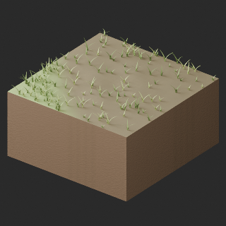
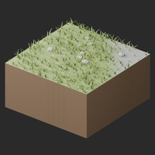

# quality-tr058-067-v1

[Quality78 overview](quality-78.md) · [International catalogue](international/README.md)

TR058–067 HQ/LITE:20 material/UV revisions across10 existing records; no new base, variant, geometry change or newly held candidate. Embedded2048px tangent normals restore sampled soil bump; fine-grain attenuation remains. Original color textures and original UV layers retained; bake UV2 and necessary UV0-copy padding added. Rock silhouettes/faceting and repeated grass remain; this is not shape redesign or complete procedural fidelity. Prior TR041–048 HQ/LITE water16 and TR013 two candidates remain held. Existing152 polygon-budget issues, PA020/PA023 atlas edges and IN016 diagnosis remain.

Existing distribution revisions and material variants only; zero new base records. Models/embedded materials only CC0; images are separate catalogue artwork. [License](../LICENSE.md).

Producer final-ZIP numerical reimports passed; all adopted public ZIP/member and image hashes independently matched. No publication-side Blender rerun. No gameplay, collision, load, fluid, mechanism or Blender4.3.2 approval. Images compare fixed camera/light per model; layouts differ by batch, source and final panels must not be interchanged.

## TR058_HQ__repair

**grass forest transition inner corner** · grass forest transition inner corner

Original procedural bump baked to embedded2048px tangent-normal; original base-color textures unchanged. All original UV layers and baked atlas retained; UV0-copy padding added only where required to place baked atlas at UV2 uniformly. Uniform normalUV2 prevents UV-index-dependent material duplication; strict verifier unchanged. Exact-zero faces removed: 0. Positive surfaces retained. Partial material repair: soil bump restored, fine rock grain attenuated versus source BLEND. Sampled bake fidelity/seams evaluated separately from attribute pass. Revision of existing model, not new base or variant.

[ZIP · BLEND/GLB](https://raw.githubusercontent.com/k3peta/tales-on-a-table/main/distributions/quality-tr058-067-v1/TR058_HQ__repair_CC0.zip) · [Enlarge](../previews/quality-tr058-067-v1/TR058_HQ__repair_full.png) · [comparison](../previews/quality-tr058-067-v1/TR058_HQ__repair_comparison.png)

Variant/revision dimensions, pivot/facing and triangle count: not independently measured by publisher; refer to the base record and validation scope.

## TR058_LITE__repair

**grass forest transition inner corner** · grass forest transition inner corner

Original procedural bump baked to embedded2048px tangent-normal; original base-color textures unchanged. All original UV layers and baked atlas retained; UV0-copy padding added only where required to place baked atlas at UV2 uniformly. Uniform normalUV2 prevents UV-index-dependent material duplication; strict verifier unchanged. Exact-zero faces removed: 0. Positive surfaces retained. Partial material repair: soil bump restored, fine rock grain attenuated versus source BLEND. Sampled bake fidelity/seams evaluated separately from attribute pass. Revision of existing model, not new base or variant.

[ZIP · BLEND/GLB](https://raw.githubusercontent.com/k3peta/tales-on-a-table/main/distributions/quality-tr058-067-v1/TR058_LITE__repair_CC0.zip) · [Enlarge](../previews/quality-tr058-067-v1/TR058_LITE__repair_full.png) · [comparison](../previews/quality-tr058-067-v1/TR058_LITE__repair_comparison.png)

Variant/revision dimensions, pivot/facing and triangle count: not independently measured by publisher; refer to the base record and validation scope.

## TR059_HQ__repair

**grass rock transition outer corner** · grass rock transition outer corner

Original procedural bump baked to embedded2048px tangent-normal; original base-color textures unchanged. All original UV layers and baked atlas retained; UV0-copy padding added only where required to place baked atlas at UV2 uniformly. Uniform normalUV2 prevents UV-index-dependent material duplication; strict verifier unchanged. Exact-zero faces removed: 0. Positive surfaces retained. Partial material repair: soil bump restored, fine rock grain attenuated versus source BLEND. Sampled bake fidelity/seams evaluated separately from attribute pass. Revision of existing model, not new base or variant.

[ZIP · BLEND/GLB](https://raw.githubusercontent.com/k3peta/tales-on-a-table/main/distributions/quality-tr058-067-v1/TR059_HQ__repair_CC0.zip) · [Enlarge](../previews/quality-tr058-067-v1/TR059_HQ__repair_full.png) · [comparison](../previews/quality-tr058-067-v1/TR059_HQ__repair_comparison.png)

Variant/revision dimensions, pivot/facing and triangle count: not independently measured by publisher; refer to the base record and validation scope.

## TR059_LITE__repair

**grass rock transition outer corner** · grass rock transition outer corner

Original procedural bump baked to embedded2048px tangent-normal; original base-color textures unchanged. All original UV layers and baked atlas retained; UV0-copy padding added only where required to place baked atlas at UV2 uniformly. Uniform normalUV2 prevents UV-index-dependent material duplication; strict verifier unchanged. Exact-zero faces removed: 0. Positive surfaces retained. Partial material repair: soil bump restored, fine rock grain attenuated versus source BLEND. Sampled bake fidelity/seams evaluated separately from attribute pass. Revision of existing model, not new base or variant.

[ZIP · BLEND/GLB](https://raw.githubusercontent.com/k3peta/tales-on-a-table/main/distributions/quality-tr058-067-v1/TR059_LITE__repair_CC0.zip) · [Enlarge](../previews/quality-tr058-067-v1/TR059_LITE__repair_full.png) · [comparison](../previews/quality-tr058-067-v1/TR059_LITE__repair_comparison.png)

Variant/revision dimensions, pivot/facing and triangle count: not independently measured by publisher; refer to the base record and validation scope.

## TR060_HQ__repair

**grass rock transition inner corner** · grass rock transition inner corner

Original procedural bump baked to embedded2048px tangent-normal; original base-color textures unchanged. All original UV layers and baked atlas retained; UV0-copy padding added only where required to place baked atlas at UV2 uniformly. Uniform normalUV2 prevents UV-index-dependent material duplication; strict verifier unchanged. Exact-zero faces removed: 0. Positive surfaces retained. Partial material repair: soil bump restored, fine rock grain attenuated versus source BLEND. Sampled bake fidelity/seams evaluated separately from attribute pass. Revision of existing model, not new base or variant.

[ZIP · BLEND/GLB](https://raw.githubusercontent.com/k3peta/tales-on-a-table/main/distributions/quality-tr058-067-v1/TR060_HQ__repair_CC0.zip) · [Enlarge](../previews/quality-tr058-067-v1/TR060_HQ__repair_full.png) · [comparison](../previews/quality-tr058-067-v1/TR060_HQ__repair_comparison.png)

Variant/revision dimensions, pivot/facing and triangle count: not independently measured by publisher; refer to the base record and validation scope.

## TR060_LITE__repair

**grass rock transition inner corner** · grass rock transition inner corner

Original procedural bump baked to embedded2048px tangent-normal; original base-color textures unchanged. All original UV layers and baked atlas retained; UV0-copy padding added only where required to place baked atlas at UV2 uniformly. Uniform normalUV2 prevents UV-index-dependent material duplication; strict verifier unchanged. Exact-zero faces removed: 0. Positive surfaces retained. Partial material repair: soil bump restored, fine rock grain attenuated versus source BLEND. Sampled bake fidelity/seams evaluated separately from attribute pass. Revision of existing model, not new base or variant.

[ZIP · BLEND/GLB](https://raw.githubusercontent.com/k3peta/tales-on-a-table/main/distributions/quality-tr058-067-v1/TR060_LITE__repair_CC0.zip) · [Enlarge](../previews/quality-tr058-067-v1/TR060_LITE__repair_full.png) · [comparison](../previews/quality-tr058-067-v1/TR060_LITE__repair_comparison.png)

Variant/revision dimensions, pivot/facing and triangle count: not independently measured by publisher; refer to the base record and validation scope.

## TR061_HQ__repair

**grass sand transition outer corner** · grass sand transition outer corner

Original procedural bump baked to embedded2048px tangent-normal; original base-color textures unchanged. All original UV layers and baked atlas retained; UV0-copy padding added only where required to place baked atlas at UV2 uniformly. Uniform normalUV2 prevents UV-index-dependent material duplication; strict verifier unchanged. Exact-zero faces removed: 0. Positive surfaces retained. Partial material repair: soil bump restored, fine rock grain attenuated versus source BLEND. Sampled bake fidelity/seams evaluated separately from attribute pass. Revision of existing model, not new base or variant.

[ZIP · BLEND/GLB](https://raw.githubusercontent.com/k3peta/tales-on-a-table/main/distributions/quality-tr058-067-v1/TR061_HQ__repair_CC0.zip) · [Enlarge](../previews/quality-tr058-067-v1/TR061_HQ__repair_full.png) · [comparison](../previews/quality-tr058-067-v1/TR061_HQ__repair_comparison.png)

Variant/revision dimensions, pivot/facing and triangle count: not independently measured by publisher; refer to the base record and validation scope.

## TR061_LITE__repair

**grass sand transition outer corner** · grass sand transition outer corner

Original procedural bump baked to embedded2048px tangent-normal; original base-color textures unchanged. All original UV layers and baked atlas retained; UV0-copy padding added only where required to place baked atlas at UV2 uniformly. Uniform normalUV2 prevents UV-index-dependent material duplication; strict verifier unchanged. Exact-zero faces removed: 0. Positive surfaces retained. Partial material repair: soil bump restored, fine rock grain attenuated versus source BLEND. Sampled bake fidelity/seams evaluated separately from attribute pass. Revision of existing model, not new base or variant.

[ZIP · BLEND/GLB](https://raw.githubusercontent.com/k3peta/tales-on-a-table/main/distributions/quality-tr058-067-v1/TR061_LITE__repair_CC0.zip) · [Enlarge](../previews/quality-tr058-067-v1/TR061_LITE__repair_full.png) · [comparison](../previews/quality-tr058-067-v1/TR061_LITE__repair_comparison.png)

Variant/revision dimensions, pivot/facing and triangle count: not independently measured by publisher; refer to the base record and validation scope.

## TR062_HQ__repair

**grass sand transition inner corner** · grass sand transition inner corner

Original procedural bump baked to embedded2048px tangent-normal; original base-color textures unchanged. All original UV layers and baked atlas retained; UV0-copy padding added only where required to place baked atlas at UV2 uniformly. Uniform normalUV2 prevents UV-index-dependent material duplication; strict verifier unchanged. Exact-zero faces removed: 0. Positive surfaces retained. Partial material repair: soil bump restored, fine rock grain attenuated versus source BLEND. Sampled bake fidelity/seams evaluated separately from attribute pass. Revision of existing model, not new base or variant.

[ZIP · BLEND/GLB](https://raw.githubusercontent.com/k3peta/tales-on-a-table/main/distributions/quality-tr058-067-v1/TR062_HQ__repair_CC0.zip) · [Enlarge](../previews/quality-tr058-067-v1/TR062_HQ__repair_full.png) · [comparison](../previews/quality-tr058-067-v1/TR062_HQ__repair_comparison.png)

Variant/revision dimensions, pivot/facing and triangle count: not independently measured by publisher; refer to the base record and validation scope.

## TR062_LITE__repair

**grass sand transition inner corner** · grass sand transition inner corner

Original procedural bump baked to embedded2048px tangent-normal; original base-color textures unchanged. All original UV layers and baked atlas retained; UV0-copy padding added only where required to place baked atlas at UV2 uniformly. Uniform normalUV2 prevents UV-index-dependent material duplication; strict verifier unchanged. Exact-zero faces removed: 0. Positive surfaces retained. Partial material repair: soil bump restored, fine rock grain attenuated versus source BLEND. Sampled bake fidelity/seams evaluated separately from attribute pass. Revision of existing model, not new base or variant.

[ZIP · BLEND/GLB](https://raw.githubusercontent.com/k3peta/tales-on-a-table/main/distributions/quality-tr058-067-v1/TR062_LITE__repair_CC0.zip) · [Enlarge](../previews/quality-tr058-067-v1/TR062_LITE__repair_full.png) · [comparison](../previews/quality-tr058-067-v1/TR062_LITE__repair_comparison.png)

Variant/revision dimensions, pivot/facing and triangle count: not independently measured by publisher; refer to the base record and validation scope.

## TR063_HQ__repair

**rock sand transition outer corner** · rock sand transition outer corner

Original procedural bump baked to embedded2048px tangent-normal; original base-color textures unchanged. All original UV layers and baked atlas retained; UV0-copy padding added only where required to place baked atlas at UV2 uniformly. Uniform normalUV2 prevents UV-index-dependent material duplication; strict verifier unchanged. Exact-zero faces removed: 0. Positive surfaces retained. Partial material repair: soil bump restored, fine rock grain attenuated versus source BLEND. Sampled bake fidelity/seams evaluated separately from attribute pass. Revision of existing model, not new base or variant.

[ZIP · BLEND/GLB](https://raw.githubusercontent.com/k3peta/tales-on-a-table/main/distributions/quality-tr058-067-v1/TR063_HQ__repair_CC0.zip) · [Enlarge](../previews/quality-tr058-067-v1/TR063_HQ__repair_full.png) · [comparison](../previews/quality-tr058-067-v1/TR063_HQ__repair_comparison.png)

Variant/revision dimensions, pivot/facing and triangle count: not independently measured by publisher; refer to the base record and validation scope.

## TR063_LITE__repair

**rock sand transition outer corner** · rock sand transition outer corner

Original procedural bump baked to embedded2048px tangent-normal; original base-color textures unchanged. All original UV layers and baked atlas retained; UV0-copy padding added only where required to place baked atlas at UV2 uniformly. Uniform normalUV2 prevents UV-index-dependent material duplication; strict verifier unchanged. Exact-zero faces removed: 0. Positive surfaces retained. Partial material repair: soil bump restored, fine rock grain attenuated versus source BLEND. Sampled bake fidelity/seams evaluated separately from attribute pass. Revision of existing model, not new base or variant.

[ZIP · BLEND/GLB](https://raw.githubusercontent.com/k3peta/tales-on-a-table/main/distributions/quality-tr058-067-v1/TR063_LITE__repair_CC0.zip) · [Enlarge](../previews/quality-tr058-067-v1/TR063_LITE__repair_full.png) · [comparison](../previews/quality-tr058-067-v1/TR063_LITE__repair_comparison.png)

Variant/revision dimensions, pivot/facing and triangle count: not independently measured by publisher; refer to the base record and validation scope.

## TR064_HQ__repair

**rock sand transition inner corner** · rock sand transition inner corner

Original procedural bump baked to embedded2048px tangent-normal; original base-color textures unchanged. All original UV layers and baked atlas retained; UV0-copy padding added only where required to place baked atlas at UV2 uniformly. Uniform normalUV2 prevents UV-index-dependent material duplication; strict verifier unchanged. Exact-zero faces removed: 0. Positive surfaces retained. Partial material repair: soil bump restored, fine rock grain attenuated versus source BLEND. Sampled bake fidelity/seams evaluated separately from attribute pass. Revision of existing model, not new base or variant.

[ZIP · BLEND/GLB](https://raw.githubusercontent.com/k3peta/tales-on-a-table/main/distributions/quality-tr058-067-v1/TR064_HQ__repair_CC0.zip) · [Enlarge](../previews/quality-tr058-067-v1/TR064_HQ__repair_full.png) · [comparison](../previews/quality-tr058-067-v1/TR064_HQ__repair_comparison.png)

Variant/revision dimensions, pivot/facing and triangle count: not independently measured by publisher; refer to the base record and validation scope.

## TR064_LITE__repair

**rock sand transition inner corner** · rock sand transition inner corner

Original procedural bump baked to embedded2048px tangent-normal; original base-color textures unchanged. All original UV layers and baked atlas retained; UV0-copy padding added only where required to place baked atlas at UV2 uniformly. Uniform normalUV2 prevents UV-index-dependent material duplication; strict verifier unchanged. Exact-zero faces removed: 0. Positive surfaces retained. Partial material repair: soil bump restored, fine rock grain attenuated versus source BLEND. Sampled bake fidelity/seams evaluated separately from attribute pass. Revision of existing model, not new base or variant.

[ZIP · BLEND/GLB](https://raw.githubusercontent.com/k3peta/tales-on-a-table/main/distributions/quality-tr058-067-v1/TR064_LITE__repair_CC0.zip) · [Enlarge](../previews/quality-tr058-067-v1/TR064_LITE__repair_full.png) · [comparison](../previews/quality-tr058-067-v1/TR064_LITE__repair_comparison.png)

Variant/revision dimensions, pivot/facing and triangle count: not independently measured by publisher; refer to the base record and validation scope.

## TR065_HQ__repair

**rock snow transition outer corner** · rock snow transition outer corner

Original procedural bump baked to embedded2048px tangent-normal; original base-color textures unchanged. All original UV layers and baked atlas retained; UV0-copy padding added only where required to place baked atlas at UV2 uniformly. Uniform normalUV2 prevents UV-index-dependent material duplication; strict verifier unchanged. Exact-zero faces removed: 0. Positive surfaces retained. Partial material repair: soil bump restored, fine rock grain attenuated versus source BLEND. Sampled bake fidelity/seams evaluated separately from attribute pass. Revision of existing model, not new base or variant.

[ZIP · BLEND/GLB](https://raw.githubusercontent.com/k3peta/tales-on-a-table/main/distributions/quality-tr058-067-v1/TR065_HQ__repair_CC0.zip) · [Enlarge](../previews/quality-tr058-067-v1/TR065_HQ__repair_full.png) · [comparison](../previews/quality-tr058-067-v1/TR065_HQ__repair_comparison.png)

Variant/revision dimensions, pivot/facing and triangle count: not independently measured by publisher; refer to the base record and validation scope.

## TR065_LITE__repair

**rock snow transition outer corner** · rock snow transition outer corner

Original procedural bump baked to embedded2048px tangent-normal; original base-color textures unchanged. All original UV layers and baked atlas retained; UV0-copy padding added only where required to place baked atlas at UV2 uniformly. Uniform normalUV2 prevents UV-index-dependent material duplication; strict verifier unchanged. Exact-zero faces removed: 0. Positive surfaces retained. Partial material repair: soil bump restored, fine rock grain attenuated versus source BLEND. Sampled bake fidelity/seams evaluated separately from attribute pass. Revision of existing model, not new base or variant.

[ZIP · BLEND/GLB](https://raw.githubusercontent.com/k3peta/tales-on-a-table/main/distributions/quality-tr058-067-v1/TR065_LITE__repair_CC0.zip) · [Enlarge](../previews/quality-tr058-067-v1/TR065_LITE__repair_full.png) · [comparison](../previews/quality-tr058-067-v1/TR065_LITE__repair_comparison.png)

Variant/revision dimensions, pivot/facing and triangle count: not independently measured by publisher; refer to the base record and validation scope.

## TR066_HQ__repair

**rock snow transition inner corner** · rock snow transition inner corner

Original procedural bump baked to embedded2048px tangent-normal; original base-color textures unchanged. All original UV layers and baked atlas retained; UV0-copy padding added only where required to place baked atlas at UV2 uniformly. Uniform normalUV2 prevents UV-index-dependent material duplication; strict verifier unchanged. Exact-zero faces removed: 0. Positive surfaces retained. Partial material repair: soil bump restored, fine rock grain attenuated versus source BLEND. Sampled bake fidelity/seams evaluated separately from attribute pass. Revision of existing model, not new base or variant.

[ZIP · BLEND/GLB](https://raw.githubusercontent.com/k3peta/tales-on-a-table/main/distributions/quality-tr058-067-v1/TR066_HQ__repair_CC0.zip) · [Enlarge](../previews/quality-tr058-067-v1/TR066_HQ__repair_full.png) · [comparison](../previews/quality-tr058-067-v1/TR066_HQ__repair_comparison.png)

Variant/revision dimensions, pivot/facing and triangle count: not independently measured by publisher; refer to the base record and validation scope.

## TR066_LITE__repair

**rock snow transition inner corner** · rock snow transition inner corner

Original procedural bump baked to embedded2048px tangent-normal; original base-color textures unchanged. All original UV layers and baked atlas retained; UV0-copy padding added only where required to place baked atlas at UV2 uniformly. Uniform normalUV2 prevents UV-index-dependent material duplication; strict verifier unchanged. Exact-zero faces removed: 0. Positive surfaces retained. Partial material repair: soil bump restored, fine rock grain attenuated versus source BLEND. Sampled bake fidelity/seams evaluated separately from attribute pass. Revision of existing model, not new base or variant.

[ZIP · BLEND/GLB](https://raw.githubusercontent.com/k3peta/tales-on-a-table/main/distributions/quality-tr058-067-v1/TR066_LITE__repair_CC0.zip) · [Enlarge](../previews/quality-tr058-067-v1/TR066_LITE__repair_full.png) · [comparison](../previews/quality-tr058-067-v1/TR066_LITE__repair_comparison.png)

Variant/revision dimensions, pivot/facing and triangle count: not independently measured by publisher; refer to the base record and validation scope.

## TR067_HQ__repair

**sand mud transition outer corner** · sand mud transition outer corner

Original procedural bump baked to embedded2048px tangent-normal; original base-color textures unchanged. All original UV layers and baked atlas retained; UV0-copy padding added only where required to place baked atlas at UV2 uniformly. Uniform normalUV2 prevents UV-index-dependent material duplication; strict verifier unchanged. Exact-zero faces removed: 0. Positive surfaces retained. Partial material repair: soil bump restored, fine rock grain attenuated versus source BLEND. Sampled bake fidelity/seams evaluated separately from attribute pass. Revision of existing model, not new base or variant.

[ZIP · BLEND/GLB](https://raw.githubusercontent.com/k3peta/tales-on-a-table/main/distributions/quality-tr058-067-v1/TR067_HQ__repair_CC0.zip) · [Enlarge](../previews/quality-tr058-067-v1/TR067_HQ__repair_full.png) · [comparison](../previews/quality-tr058-067-v1/TR067_HQ__repair_comparison.png)

Variant/revision dimensions, pivot/facing and triangle count: not independently measured by publisher; refer to the base record and validation scope.

## TR067_LITE__repair

**sand mud transition outer corner** · sand mud transition outer corner

Original procedural bump baked to embedded2048px tangent-normal; original base-color textures unchanged. All original UV layers and baked atlas retained; UV0-copy padding added only where required to place baked atlas at UV2 uniformly. Uniform normalUV2 prevents UV-index-dependent material duplication; strict verifier unchanged. Exact-zero faces removed: 0. Positive surfaces retained. Partial material repair: soil bump restored, fine rock grain attenuated versus source BLEND. Sampled bake fidelity/seams evaluated separately from attribute pass. Revision of existing model, not new base or variant.

[ZIP · BLEND/GLB](https://raw.githubusercontent.com/k3peta/tales-on-a-table/main/distributions/quality-tr058-067-v1/TR067_LITE__repair_CC0.zip) · [Enlarge](../previews/quality-tr058-067-v1/TR067_LITE__repair_full.png) · [comparison](../previews/quality-tr058-067-v1/TR067_LITE__repair_comparison.png)

Variant/revision dimensions, pivot/facing and triangle count: not independently measured by publisher; refer to the base record and validation scope.

[Exact ZIP/image bindings](../distributions/quality-tr058-067-v1/image-bindings.json) · [Validation scope](../distributions/quality-tr058-067-v1/validation.json).
