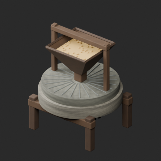
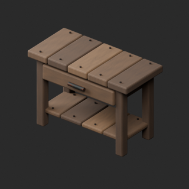
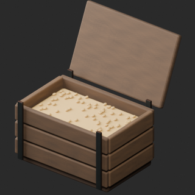
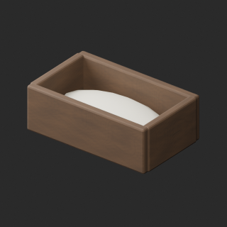
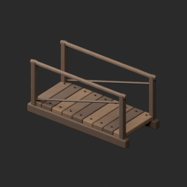

# quality-wm002-011-v1

[Quality57–76 overview](quality-57-76.md) · [International catalogue](international/README.md)

WM002:24 exact-zero faces measured in world space removed; local-space zero count was0. Timber detail UV added; repetitive grain remains. WM009 prior heel-wall repair retained. WM001 missing UV unresolved.

Existing distribution revisions and material variants only; zero new base records. Models/embedded materials only CC0; images are separate catalogue artwork. [License](../LICENSE.md).

Producer final-ZIP numerical reimports passed; independent public-download match pending. No publication-side Blender rerun. No gameplay, collision, load, fluid, mechanism or Blender4.3.2 approval. Images compare fixed camera/light per model; layouts differ by batch, source and final panels must not be interchanged.

## WM002__repair

**Millstone and grain hopper** · Millstone and grain hopper

Remove 24 exact zero-world-area grain faces, retain every positive surface triangle and attributes; add missing timber-check UV.

[ZIP · BLEND/GLB](https://raw.githubusercontent.com/k3peta/tales-on-a-table/main/distributions/quality-wm002-011-v1/WM002__repair_CC0.zip) · [Enlarge](../previews/quality-wm002-011-v1/WM002__repair_full.png) · [overview comparison](../previews/quality-wm002-011-v1/WM002__repair_overview_comparison.png) · [close comparison](../previews/quality-wm002-011-v1/WM002__repair_close_comparison.png)

Variant/revision dimensions, pivot/facing and triangle count: not independently measured by publisher; refer to the base record and validation scope.

## WM003__repair

**Millers workbench** · Millers workbench

Add missing UV0 only on source timber-check detail meshes. Original geometry/materials and existing UV layers retained. UV-only revision, no new base or palette variant.

[ZIP · BLEND/GLB](https://raw.githubusercontent.com/k3peta/tales-on-a-table/main/distributions/quality-wm002-011-v1/WM003__repair_CC0.zip) · [Enlarge](../previews/quality-wm002-011-v1/WM003__repair_full.png) · [overview comparison](../previews/quality-wm002-011-v1/WM003__repair_overview_comparison.png) · [close comparison](../previews/quality-wm002-011-v1/WM003__repair_close_comparison.png)

Variant/revision dimensions, pivot/facing and triangle count: not independently measured by publisher; refer to the base record and validation scope.

## WM005__repair

**Open grain bin** · Open grain bin

Add missing UV0 only on source timber-check detail meshes. Original geometry/materials and existing UV layers retained. UV-only revision, no new base or palette variant.

[ZIP · BLEND/GLB](https://raw.githubusercontent.com/k3peta/tales-on-a-table/main/distributions/quality-wm002-011-v1/WM005__repair_CC0.zip) · [Enlarge](../previews/quality-wm002-011-v1/WM005__repair_full.png) · [overview comparison](../previews/quality-wm002-011-v1/WM005__repair_overview_comparison.png) · [close comparison](../previews/quality-wm002-011-v1/WM005__repair_close_comparison.png)

Variant/revision dimensions, pivot/facing and triangle count: not independently measured by publisher; refer to the base record and validation scope.

## WM006__repair

**Flour collection trough** · Flour collection trough

Add missing UV0 only on source timber-check detail meshes. Original geometry/materials and existing UV layers retained. UV-only revision, no new base or palette variant.

[ZIP · BLEND/GLB](https://raw.githubusercontent.com/k3peta/tales-on-a-table/main/distributions/quality-wm002-011-v1/WM006__repair_CC0.zip) · [Enlarge](../previews/quality-wm002-011-v1/WM006__repair_full.png) · [overview comparison](../previews/quality-wm002-011-v1/WM006__repair_overview_comparison.png) · [close comparison](../previews/quality-wm002-011-v1/WM006__repair_close_comparison.png)

Variant/revision dimensions, pivot/facing and triangle count: not independently measured by publisher; refer to the base record and validation scope.

## WM007__repair

**Small footbridge** · Small footbridge

Add missing UV0 only on source timber-check detail meshes. Original geometry/materials and existing UV layers retained. UV-only revision, no new base or palette variant.

[ZIP · BLEND/GLB](https://raw.githubusercontent.com/k3peta/tales-on-a-table/main/distributions/quality-wm002-011-v1/WM007__repair_CC0.zip) · [Enlarge](../previews/quality-wm002-011-v1/WM007__repair_full.png) · [overview comparison](../previews/quality-wm002-011-v1/WM007__repair_overview_comparison.png) · [close comparison](../previews/quality-wm002-011-v1/WM007__repair_close_comparison.png)

Variant/revision dimensions, pivot/facing and triangle count: not independently measured by publisher; refer to the base record and validation scope.

[Exact ZIP/image bindings](../distributions/quality-wm002-011-v1/image-bindings.json) · [Validation scope](../distributions/quality-wm002-011-v1/validation.json).
