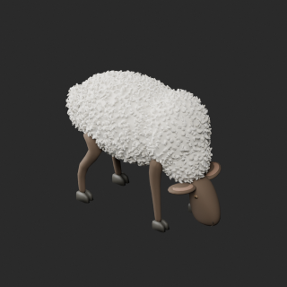
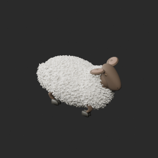
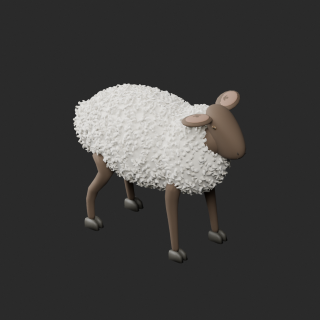
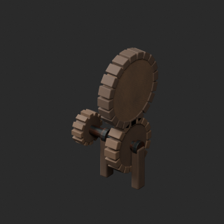
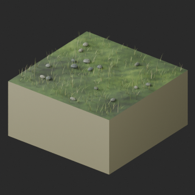
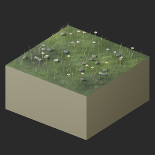
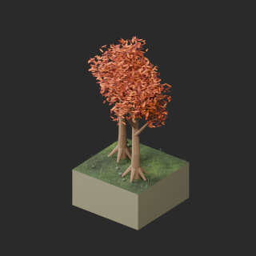
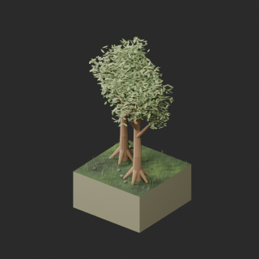
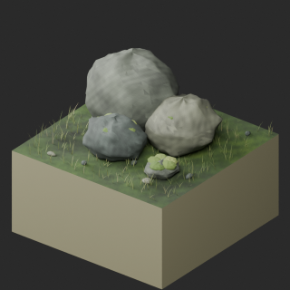

# quality-wm012-wt004-v1

[Quality57–76 overview](quality-57-76.md) · [International catalogue](international/README.md)

Sheep are three poses of one design; polygon-budget warnings remain. UV/zero-face revisions are not new shapes. WT001/002 are legacy prototypes, not terrain-v2-compatible modules.

Existing distribution revisions and material variants only; zero new base records. Models/embedded materials only CC0; images are separate catalogue artwork. [License](../LICENSE.md).

Producer final-ZIP numerical reimports passed; all adopted public ZIP/member and image hashes independently matched. No publication-side Blender rerun. No gameplay, collision, load, fluid, mechanism or Blender4.3.2 approval. Images compare fixed camera/light per model; layouts differ by batch, source and final panels must not be interchanged.

## WM014__repair

**Sheep grazing** · Sheep grazing

Add missing UV only; geometry/materials/existing UV unchanged.

[ZIP · BLEND/GLB](https://raw.githubusercontent.com/k3peta/tales-on-a-table/main/distributions/quality-wm012-wt004-v1/WM014__repair_CC0.zip) · [Enlarge](../previews/quality-wm012-wt004-v1/WM014__repair_full.png) · [overview comparison](../previews/quality-wm012-wt004-v1/WM014__repair_overview_comparison.png) · [close comparison](../previews/quality-wm012-wt004-v1/WM014__repair_close_comparison.png)

Variant/revision dimensions, pivot/facing and triangle count: not independently measured by publisher; refer to the base record and validation scope.

## WM015__repair

**Sheep resting** · Sheep resting

Add missing UV only; geometry/materials/existing UV unchanged.

[ZIP · BLEND/GLB](https://raw.githubusercontent.com/k3peta/tales-on-a-table/main/distributions/quality-wm012-wt004-v1/WM015__repair_CC0.zip) · [Enlarge](../previews/quality-wm012-wt004-v1/WM015__repair_full.png) · [overview comparison](../previews/quality-wm012-wt004-v1/WM015__repair_overview_comparison.png) · [close comparison](../previews/quality-wm012-wt004-v1/WM015__repair_close_comparison.png)

Variant/revision dimensions, pivot/facing and triangle count: not independently measured by publisher; refer to the base record and validation scope.

## WM016__repair

**Sheep standing** · Sheep standing

Add missing UV only; geometry/materials/existing UV unchanged.

[ZIP · BLEND/GLB](https://raw.githubusercontent.com/k3peta/tales-on-a-table/main/distributions/quality-wm012-wt004-v1/WM016__repair_CC0.zip) · [Enlarge](../previews/quality-wm012-wt004-v1/WM016__repair_full.png) · [overview comparison](../previews/quality-wm012-wt004-v1/WM016__repair_overview_comparison.png) · [close comparison](../previews/quality-wm012-wt004-v1/WM016__repair_close_comparison.png)

Variant/revision dimensions, pivot/facing and triangle count: not independently measured by publisher; refer to the base record and validation scope.

## WM017__repair

**Mill transmission gears** · Mill transmission gears

Add missing UV only; geometry/materials/existing UV unchanged.

[ZIP · BLEND/GLB](https://raw.githubusercontent.com/k3peta/tales-on-a-table/main/distributions/quality-wm012-wt004-v1/WM017__repair_CC0.zip) · [Enlarge](../previews/quality-wm012-wt004-v1/WM017__repair_full.png) · [overview comparison](../previews/quality-wm012-wt004-v1/WM017__repair_overview_comparison.png) · [close comparison](../previews/quality-wm012-wt004-v1/WM017__repair_close_comparison.png)

Variant/revision dimensions, pivot/facing and triangle count: not independently measured by publisher; refer to the base record and validation scope.

## WT001__repair

**Low meadow** · Low meadow

Remove exact-zero surface faces and add missing UV; all positive-area source triangles, materials and existing UV retained.

[ZIP · BLEND/GLB](https://raw.githubusercontent.com/k3peta/tales-on-a-table/main/distributions/quality-wm012-wt004-v1/WT001__repair_CC0.zip) · [Enlarge](../previews/quality-wm012-wt004-v1/WT001__repair_full.png) · [overview comparison](../previews/quality-wm012-wt004-v1/WT001__repair_overview_comparison.png) · [close comparison](../previews/quality-wm012-wt004-v1/WT001__repair_close_comparison.png)

Variant/revision dimensions, pivot/facing and triangle count: not independently measured by publisher; refer to the base record and validation scope.

## WT002__repair

**Flower meadow** · Flower meadow

Remove exact-zero surface faces and add missing UV; all positive-area source triangles, materials and existing UV retained.

[ZIP · BLEND/GLB](https://raw.githubusercontent.com/k3peta/tales-on-a-table/main/distributions/quality-wm012-wt004-v1/WT002__repair_CC0.zip) · [Enlarge](../previews/quality-wm012-wt004-v1/WT002__repair_full.png) · [overview comparison](../previews/quality-wm012-wt004-v1/WT002__repair_overview_comparison.png) · [close comparison](../previews/quality-wm012-wt004-v1/WT002__repair_close_comparison.png)

Variant/revision dimensions, pivot/facing and triangle count: not independently measured by publisher; refer to the base record and validation scope.

## WT003__autumn_ochre

**Deciduous copse** · Deciduous copse

Autumn ochre leaf UV color texture on repaired WT003 baseline; geometry/UV retained against repaired baseline. Not a new base model.

[ZIP · BLEND/GLB](https://raw.githubusercontent.com/k3peta/tales-on-a-table/main/distributions/quality-wm012-wt004-v1/WT003__autumn_ochre_CC0.zip) · [Enlarge](../previews/quality-wm012-wt004-v1/WT003__autumn_ochre_full.png) · [overview comparison](../previews/quality-wm012-wt004-v1/WT003__autumn_ochre_overview_comparison.png) · [close comparison](../previews/quality-wm012-wt004-v1/WT003__autumn_ochre_close_comparison.png)

Variant/revision dimensions, pivot/facing and triangle count: not independently measured by publisher; refer to the base record and validation scope.

## WT003__repair

**Deciduous copse** · Deciduous copse

Remove exact-zero surface faces and add missing UV; all positive-area source triangles, materials and existing UV retained.

[ZIP · BLEND/GLB](https://raw.githubusercontent.com/k3peta/tales-on-a-table/main/distributions/quality-wm012-wt004-v1/WT003__repair_CC0.zip) · [Enlarge](../previews/quality-wm012-wt004-v1/WT003__repair_full.png) · [overview comparison](../previews/quality-wm012-wt004-v1/WT003__repair_overview_comparison.png) · [close comparison](../previews/quality-wm012-wt004-v1/WT003__repair_close_comparison.png)

Variant/revision dimensions, pivot/facing and triangle count: not independently measured by publisher; refer to the base record and validation scope.

## WT004__repair

**Weathered rock outcrop** · Weathered rock outcrop

Remove exact-zero surface faces and add missing UV; all positive-area source triangles, materials and existing UV retained.

[ZIP · BLEND/GLB](https://raw.githubusercontent.com/k3peta/tales-on-a-table/main/distributions/quality-wm012-wt004-v1/WT004__repair_CC0.zip) · [Enlarge](../previews/quality-wm012-wt004-v1/WT004__repair_full.png) · [overview comparison](../previews/quality-wm012-wt004-v1/WT004__repair_overview_comparison.png) · [close comparison](../previews/quality-wm012-wt004-v1/WT004__repair_close_comparison.png)

Variant/revision dimensions, pivot/facing and triangle count: not independently measured by publisher; refer to the base record and validation scope.

[Exact ZIP/image bindings](../distributions/quality-wm012-wt004-v1/image-bindings.json) · [Validation scope](../distributions/quality-wm012-wt004-v1/validation.json).
