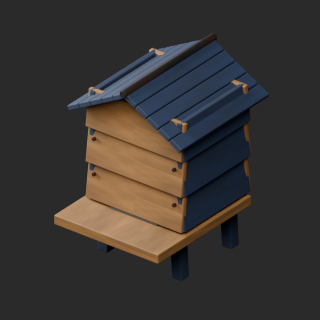

# quality-wt005-ap006-v1

[Quality57–76 overview](quality-57-76.md) · [International catalogue](international/README.md)

WT007/008 use the current v2 clean-slot water repair, retaining its water shape; grass zero faces removed. Original faulty v1 is not restored. Bank mosaic remains. Opaque liquid surfaces remain opaque.

Existing distribution revisions and material variants only; zero new base records. Models/embedded materials only CC0; images are separate catalogue artwork. [License](../LICENSE.md).

Producer final-ZIP numerical reimports passed; all adopted public ZIP/member and image hashes independently matched. No publication-side Blender rerun. No gameplay, collision, load, fluid, mechanism or Blender4.3.2 approval. Images compare fixed camera/light per model; layouts differ by batch, source and final panels must not be interchanged.

## AP001__blue_cedar

**Weather lift beehive** · Weather lift beehive

Blue cedar recolor of existing UV woodgrain on repaired AP001 baseline, other material channels and shape retained. Not a new base.

[ZIP · BLEND/GLB](https://raw.githubusercontent.com/k3peta/tales-on-a-table/main/distributions/quality-wt005-ap006-v1/AP001__blue_cedar_CC0.zip) · [Enlarge](../previews/quality-wt005-ap006-v1/AP001__blue_cedar_full.png) · [overview comparison](../previews/quality-wt005-ap006-v1/AP001__blue_cedar_overview_comparison.png) · [close comparison](../previews/quality-wt005-ap006-v1/AP001__blue_cedar_close_comparison.png)

Variant/revision dimensions, pivot/facing and triangle count: not independently measured by publisher; refer to the base record and validation scope.

## AP001__repair

**Weather lift beehive** · Weather lift beehive

Remove exact-zero world-area faces only; preserve positive surfaces, materials and existing UV. Add missing UV where absent. WT007/008 use current v2 source, water geometry unchanged; bank material mosaic remains unresolved.

[ZIP · BLEND/GLB](https://raw.githubusercontent.com/k3peta/tales-on-a-table/main/distributions/quality-wt005-ap006-v1/AP001__repair_CC0.zip) · [Enlarge](../previews/quality-wt005-ap006-v1/AP001__repair_full.png) · [overview comparison](../previews/quality-wt005-ap006-v1/AP001__repair_overview_comparison.png) · [close comparison](../previews/quality-wt005-ap006-v1/AP001__repair_close_comparison.png)

Variant/revision dimensions, pivot/facing and triangle count: not independently measured by publisher; refer to the base record and validation scope.

## AP003__repair

**Honeycomb frame** · Honeycomb frame

Remove exact-zero world-area faces only; preserve positive surfaces, materials and existing UV. Add missing UV where absent. WT007/008 use current v2 source, water geometry unchanged; bank material mosaic remains unresolved.

[ZIP · BLEND/GLB](https://raw.githubusercontent.com/k3peta/tales-on-a-table/main/distributions/quality-wt005-ap006-v1/AP003__repair_CC0.zip) · [Enlarge](../previews/quality-wt005-ap006-v1/AP003__repair_full.png) · [overview comparison](../previews/quality-wt005-ap006-v1/AP003__repair_overview_comparison.png) · [close comparison](../previews/quality-wt005-ap006-v1/AP003__repair_close_comparison.png)

Variant/revision dimensions, pivot/facing and triangle count: not independently measured by publisher; refer to the base record and validation scope.

## AP005__repair

**Copper bee smoker** · Copper bee smoker

Remove exact-zero world-area faces only; preserve positive surfaces, materials and existing UV. Add missing UV where absent. WT007/008 use current v2 source, water geometry unchanged; bank material mosaic remains unresolved.

[ZIP · BLEND/GLB](https://raw.githubusercontent.com/k3peta/tales-on-a-table/main/distributions/quality-wt005-ap006-v1/AP005__repair_CC0.zip) · [Enlarge](../previews/quality-wt005-ap006-v1/AP005__repair_full.png) · [overview comparison](../previews/quality-wt005-ap006-v1/AP005__repair_overview_comparison.png) · [close comparison](../previews/quality-wt005-ap006-v1/AP005__repair_close_comparison.png)

Variant/revision dimensions, pivot/facing and triangle count: not independently measured by publisher; refer to the base record and validation scope.

## WT005__repair

**Path straight NS** · Path straight NS

Remove exact-zero world-area faces only; preserve positive surfaces, materials and existing UV. Add missing UV where absent. WT007/008 use current v2 source, water geometry unchanged; bank material mosaic remains unresolved.

[ZIP · BLEND/GLB](https://raw.githubusercontent.com/k3peta/tales-on-a-table/main/distributions/quality-wt005-ap006-v1/WT005__repair_CC0.zip) · [Enlarge](../previews/quality-wt005-ap006-v1/WT005__repair_full.png) · [overview comparison](../previews/quality-wt005-ap006-v1/WT005__repair_overview_comparison.png) · [close comparison](../previews/quality-wt005-ap006-v1/WT005__repair_close_comparison.png)

Variant/revision dimensions, pivot/facing and triangle count: not independently measured by publisher; refer to the base record and validation scope.

## WT006__repair

**Path bend NE** · Path bend NE

Remove exact-zero world-area faces only; preserve positive surfaces, materials and existing UV. Add missing UV where absent. WT007/008 use current v2 source, water geometry unchanged; bank material mosaic remains unresolved.

[ZIP · BLEND/GLB](https://raw.githubusercontent.com/k3peta/tales-on-a-table/main/distributions/quality-wt005-ap006-v1/WT006__repair_CC0.zip) · [Enlarge](../previews/quality-wt005-ap006-v1/WT006__repair_full.png) · [overview comparison](../previews/quality-wt005-ap006-v1/WT006__repair_overview_comparison.png) · [close comparison](../previews/quality-wt005-ap006-v1/WT006__repair_close_comparison.png)

Variant/revision dimensions, pivot/facing and triangle count: not independently measured by publisher; refer to the base record and validation scope.

## WT007__repair

**Stream straight NS** · Stream straight NS

Remove exact-zero world-area faces only; preserve positive surfaces, materials and existing UV. Add missing UV where absent. WT007/008 use current v2 source, water geometry unchanged; bank material mosaic remains unresolved.

[ZIP · BLEND/GLB](https://raw.githubusercontent.com/k3peta/tales-on-a-table/main/distributions/quality-wt005-ap006-v1/WT007__repair_CC0.zip) · [Enlarge](../previews/quality-wt005-ap006-v1/WT007__repair_full.png) · [overview comparison](../previews/quality-wt005-ap006-v1/WT007__repair_overview_comparison.png) · [close comparison](../previews/quality-wt005-ap006-v1/WT007__repair_close_comparison.png)

Variant/revision dimensions, pivot/facing and triangle count: not independently measured by publisher; refer to the base record and validation scope.

## WT008__repair

**Stream bend NE** · Stream bend NE

Remove exact-zero world-area faces only; preserve positive surfaces, materials and existing UV. Add missing UV where absent. WT007/008 use current v2 source, water geometry unchanged; bank material mosaic remains unresolved.

[ZIP · BLEND/GLB](https://raw.githubusercontent.com/k3peta/tales-on-a-table/main/distributions/quality-wt005-ap006-v1/WT008__repair_CC0.zip) · [Enlarge](../previews/quality-wt005-ap006-v1/WT008__repair_full.png) · [overview comparison](../previews/quality-wt005-ap006-v1/WT008__repair_overview_comparison.png) · [close comparison](../previews/quality-wt005-ap006-v1/WT008__repair_close_comparison.png)

Variant/revision dimensions, pivot/facing and triangle count: not independently measured by publisher; refer to the base record and validation scope.

[Exact ZIP/image bindings](../distributions/quality-wt005-ap006-v1/image-bindings.json) · [Validation scope](../distributions/quality-wt005-ap006-v1/validation.json).
