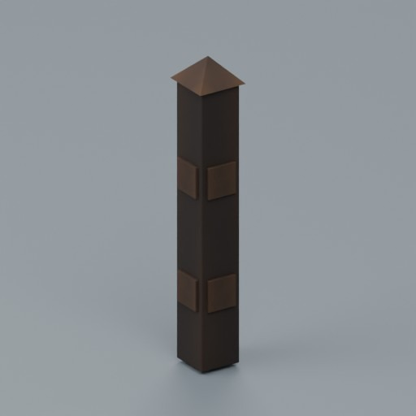
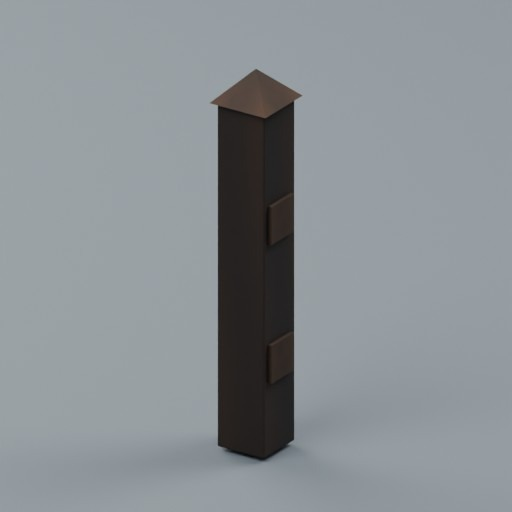
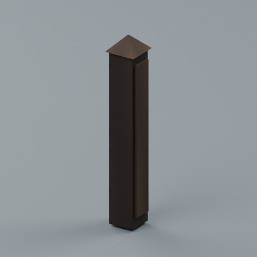

# Recovered rustic fences RF01-RF07

Seven existing works first distributed here: 891 + 7 = 898 distribution records. No new geometry was created for this recovery. This is not seven newly designed or confirmed historically unique shapes. BLEND and GLB are two formats per record.

|ID|Name|Download|Bytes|
|---|---|---|---:|
|RF01|Pasture inline shared post|[ZIP](https://raw.githubusercontent.com/k3peta/tales-on-a-table/main/distributions/recovered-rustic-fences-rf7/RF01_CC0.zip)|152733|
|RF02|Pasture gate fixed catch|[ZIP](https://raw.githubusercontent.com/k3peta/tales-on-a-table/main/distributions/recovered-rustic-fences-rf7/RF02_CC0.zip)|72622|
|RF03|Low kitchen-garden round-stake bay|[ZIP](https://raw.githubusercontent.com/k3peta/tales-on-a-table/main/distributions/recovered-rustic-fences-rf7/RF03_CC0.zip)|160820|
|RF04|Garden corner post|[ZIP](https://raw.githubusercontent.com/k3peta/tales-on-a-table/main/distributions/recovered-rustic-fences-rf7/RF04_CC0.zip)|150362|
|RF05|Garden inline shared post|[ZIP](https://raw.githubusercontent.com/k3peta/tales-on-a-table/main/distributions/recovered-rustic-fences-rf7/RF05_CC0.zip)|149000|
|RF06|Garden terminal post|[ZIP](https://raw.githubusercontent.com/k3peta/tales-on-a-table/main/distributions/recovered-rustic-fences-rf7/RF06_CC0.zip)|150883|
|RF07|Low garden gate with fixed hinge and catch hardware|[ZIP](https://raw.githubusercontent.com/k3peta/tales-on-a-table/main/distributions/recovered-rustic-fences-rf7/RF07_CC0.zip)|194253|

RF01 and RF04-RF07 are structural derivatives. RF02 is an existing complementary catch component. RF03 is the flat original of [RS202 slope bay](rustic_slope_connections_v2.md); its first distribution is not a new independent shape claim.

Metres, Z up, origin zero; nominal 2 m post/bay pitch, not 2 m square tiles. Follow each ZIP README connector coordinates. RF02 mounts above ground at the latch-side post. RF07 is a static gate leaf with its bottom at 0.07 m and requires separate posts.

BLEND is a Collection Append library. Blender 5.2.2 reload checks were completed in production. Gate animation, full opening interference, physics/collision, actual walking, structural safety, livestock containment, FPS, arbitrary connection compatibility and Blender 4.3.2 compatibility are unverified.

Model geometry and embedded display materials only are CC0-1.0. No code, private provenance, images or assembled scenes are included. [Checksums](../distributions/recovered-rustic-fences-rf7/SHA256SUMS.txt).

## 実作画像とID対応 / Render-to-ID mapping

画像は閲覧用でモデルCC0の対象外、[既存画像権利](../LICENSE.md)を維持。集合画像は単体モデルの新規加算ではありません。[対応manifest](../previews/rf7-terrain91/manifest.json)。

### RF01 — Pasture inline shared post

[ZIP](https://raw.githubusercontent.com/k3peta/tales-on-a-table/main/distributions/recovered-rustic-fences-rf7/RF01_CC0.zip)

[拡大 / Full image](https://raw.githubusercontent.com/k3peta/tales-on-a-table/main/previews/rf7-terrain91/images/RF01.jpg)

### RF02 — Pasture gate fixed catch

[ZIP](https://raw.githubusercontent.com/k3peta/tales-on-a-table/main/distributions/recovered-rustic-fences-rf7/RF02_CC0.zip)

[拡大 / Full image](https://raw.githubusercontent.com/k3peta/tales-on-a-table/main/previews/rf7-terrain91/images/RF02.jpg)

### RF03 — Low kitchen-garden round-stake bay

[ZIP](https://raw.githubusercontent.com/k3peta/tales-on-a-table/main/distributions/recovered-rustic-fences-rf7/RF03_CC0.zip)

[拡大 / Full image](https://raw.githubusercontent.com/k3peta/tales-on-a-table/main/previews/rf7-terrain91/images/RF03.jpg)

### RF04 — Garden corner post

[ZIP](https://raw.githubusercontent.com/k3peta/tales-on-a-table/main/distributions/recovered-rustic-fences-rf7/RF04_CC0.zip)

[拡大 / Full image](https://raw.githubusercontent.com/k3peta/tales-on-a-table/main/previews/rf7-terrain91/images/RF04.jpg)

[拡大 / Full image](https://raw.githubusercontent.com/k3peta/tales-on-a-table/main/previews/rf7-terrain91/images/RF04-reverse.jpg)

### RF05 — Garden inline shared post

[ZIP](https://raw.githubusercontent.com/k3peta/tales-on-a-table/main/distributions/recovered-rustic-fences-rf7/RF05_CC0.zip)

[拡大 / Full image](https://raw.githubusercontent.com/k3peta/tales-on-a-table/main/previews/rf7-terrain91/images/RF05.jpg)

[拡大 / Full image](https://raw.githubusercontent.com/k3peta/tales-on-a-table/main/previews/rf7-terrain91/images/RF05-reverse.jpg)

### RF06 — Garden terminal post

[ZIP](https://raw.githubusercontent.com/k3peta/tales-on-a-table/main/distributions/recovered-rustic-fences-rf7/RF06_CC0.zip)

[拡大 / Full image](https://raw.githubusercontent.com/k3peta/tales-on-a-table/main/previews/rf7-terrain91/images/RF06.jpg)

[拡大 / Full image](https://raw.githubusercontent.com/k3peta/tales-on-a-table/main/previews/rf7-terrain91/images/RF06-reverse.jpg)

### RF07 — Low garden gate with fixed hinge and catch hardware

[ZIP](https://raw.githubusercontent.com/k3peta/tales-on-a-table/main/distributions/recovered-rustic-fences-rf7/RF07_CC0.zip)

[拡大 / Full image](https://raw.githubusercontent.com/k3peta/tales-on-a-table/main/previews/rf7-terrain91/images/RF07.jpg)
