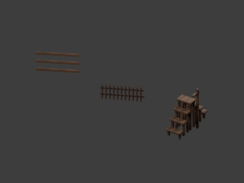
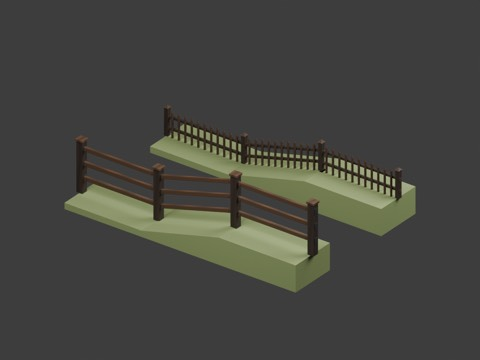
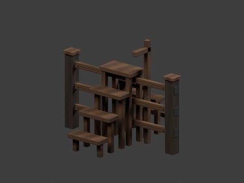
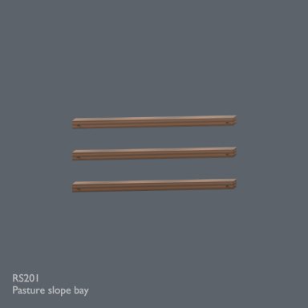
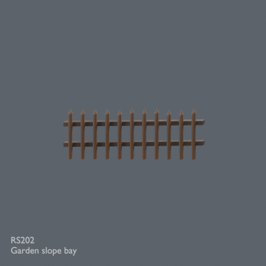
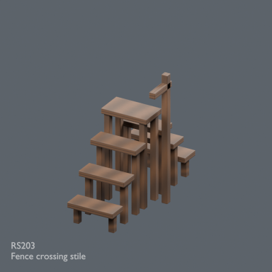

# Rustic slope fences and crossing stile

875 existing records + 3 = 878 distribution records. RS201 and RS202 are structural derivatives; RS203 is a local-use candidate. Global independent design count is unverified. BLEND and GLB are two formats, not separate assets.

### RS201

Pasture slope bay

structural_derivative

[ZIP](https://raw.githubusercontent.com/k3peta/tales-on-a-table/main/distributions/rustic-slope-connections-v2/zips/RS201_CC0.zip)

125379

### RS202

Garden slope bay

structural_derivative

[ZIP](https://raw.githubusercontent.com/k3peta/tales-on-a-table/main/distributions/rustic-slope-connections-v2/zips/RS202_CC0.zip)

176959

### RS203

Fence crossing stile

local_use_candidate

[ZIP](https://raw.githubusercontent.com/k3peta/tales-on-a-table/main/distributions/rustic-slope-connections-v2/zips/RS203_CC0.zip)

174748

## Placement limits

RS201 and RS202 use a 2 m horizontal post pitch and 0.5 m rise. RS201 rail ends are x = +/-0.92 m for existing RF01 posts; RS202 ends are +/-0.95 m for RF05. Posts are separate existing assets. High-side posts can leave about 0.02 m ground clearance; the example support is not included. Arbitrary terrain contact is not solved.

Step and mixed-fence connections use existing posts at 0.15 m centre separation, not a strict continuous single-post 2 m pitch. Example body gaps are about 0.02 m for pasture/garden and 0.05 m for garden/garden. These are not gap-free animal enclosures. Posts, supports and assembled examples add no distribution records.

RS203 is a static decorative stile, 0.62 m wide, with treads at 0.3/0.6/0.9 m, top at 1.2 m and handholds at 1.7 m. Its top underside clears the existing pasture rail by about 0.035 m. Actual walking, collision, structural loading/safety, animal containment, arbitrary terrain connections and Blender 4.3.2 compatibility are unverified. Blender 5.2.2 reimport was checked by production validation.

Model geometry and included display materials only are CC0-1.0. No images, source code, private records or assembled scenes are included. [Checksums](../distributions/rustic-slope-connections-v2/SHA256SUMS.txt).

## 実作画像 / Actual renders

完成バッチの配置・接写。画像は閲覧用でモデルCC0の対象外です。[既存の画像利用条件](../LICENSE.md)を維持します。

### RS201

Pasture slope bay

[ZIP](https://raw.githubusercontent.com/k3peta/tales-on-a-table/main/distributions/rustic-slope-connections-v2/zips/RS201_CC0.zip)

### RS202

Garden slope bay

[ZIP](https://raw.githubusercontent.com/k3peta/tales-on-a-table/main/distributions/rustic-slope-connections-v2/zips/RS202_CC0.zip)

### RS203

Fence crossing stile

[ZIP](https://raw.githubusercontent.com/k3peta/tales-on-a-table/main/distributions/rustic-slope-connections-v2/zips/RS203_CC0.zip)

### RF01

Pasture inline shared post

[ZIP](https://raw.githubusercontent.com/k3peta/tales-on-a-table/main/distributions/recovered-rustic-fences-rf7/RF01_CC0.zip)

### RF05

Garden inline shared post

[ZIP](https://raw.githubusercontent.com/k3peta/tales-on-a-table/main/distributions/recovered-rustic-fences-rf7/RF05_CC0.zip)

## Individual images / 個別画像 / 单件图片

Actual distributed models; chosen camera view does not establish intended front or placement pivot. Images are outside model CC0. Original links and archives retained.

**Known issue:** Three connection rails without posts in this distributed model; assembly not demonstrated.

### RS201 — Pasture slope bay

Pasture slope bay

[Full image](../previews/ud1102-rg24/renders/RS201.png) · [ZIP · BLEND/GLB](https://raw.githubusercontent.com/k3peta/tales-on-a-table/main/distributions/rustic-slope-connections-v2/zips/RS201_CC0.zip)

### RS202 — Garden slope bay

Garden slope bay

[Full image](../previews/ud1102-rg24/renders/RS202.png) · [ZIP · BLEND/GLB](https://raw.githubusercontent.com/k3peta/tales-on-a-table/main/distributions/rustic-slope-connections-v2/zips/RS202_CC0.zip)

### RS203 — Fence crossing stile

Fence crossing stile

[Full image](../previews/ud1102-rg24/renders/RS203.png) · [ZIP · BLEND/GLB](https://raw.githubusercontent.com/k3peta/tales-on-a-table/main/distributions/rustic-slope-connections-v2/zips/RS203_CC0.zip)
