# 配置改訂と薬師店舗 / Scene revisions and herbalist / 场景修订与药师店铺

1008 distribution records = 1007 + one first-distributed herbalist arrangement. No new model geometry.

### horse

revision / supplemental, +0

[ZIP](https://raw.githubusercontent.com/k3peta/tales-on-a-table/main/distributions/scene-polish-v3/horse-scene-v3.zip)

### winery

revision / supplemental, +0

[ZIP](https://raw.githubusercontent.com/k3peta/tales-on-a-table/main/distributions/scene-polish-v3/winery-scene-v3.zip)

### cellar

revision / supplemental, +0

[ZIP](https://raw.githubusercontent.com/k3peta/tales-on-a-table/main/distributions/scene-polish-v3/cellar-scene-v3.zip)

### poultry

revision / supplemental, +0

[ZIP](https://raw.githubusercontent.com/k3peta/tales-on-a-table/main/distributions/scene-polish-v3/poultry-scene-v3.zip)

### herbalist

first arrangement +1

[ZIP](https://raw.githubusercontent.com/k3peta/tales-on-a-table/main/distributions/herbalist-shop-v1/herbalist-scene-v1.zip)

## 日本語

馬小屋・醸造場・貯蔵洞窟は既存配布の改訂。鶏は既存私的配置の改訂を未加算の補足配布として掲載し、台帳に新規行を作りません。旧版と旧台帳の主項目を保持。薬師店舗は14種再利用の初配布配置1件のみ加算、新造形0。配置コピー22材質の誤Normal接続修正は新モデル/variantに加算せず、公開原本は不変。全配置はCC0ではなく閲覧・再配置用で追加の再配布許諾なし、下層モデル材質CC0は維持。コード画像私的資料は除外。医療効能・手順・荷重・生体安全・実歩行・衝突・動的機構・アプリ性能・旧Blender互換は未検証。

## English

Three existing public arrangements gain revisions; poultry is an uncounted supplement revising a previously private scene. Old files and primary ledger fields preserved. Herbalist is one first distribution, 14 reused types, zero new shapes. Correction of22 material nodes in scene copies is not a new model or variant; originals unchanged. Arrangements are NOT CC0, viewing/rearranging only without additional redistribution permission; underlying model/material CC0 rights remain. No medical efficacy/procedures, load/animal safety, walking/collision, dynamics, app performance or older Blender compatibility verified. Procedural bump can differ in GLB. Code/images/private records excluded.

## 中文

3个既有公开场景追加修订，鸡舍为未计数补充，旧版保留。药师店为14种既有模型组成的首次布置分发，加1条，新增形状0。22处材质修复不算新模型或变体，原公开模型不变。整体布置非CC0，仅供查看和重新排列，无额外再分发许可；底层模型材质CC0权利不变。医疗功效、操作程序、承重、生体安全、行走碰撞、动态机构、应用性能和旧版兼容未验证。不含代码图片私有资料。

実作レンダー / Actual model renders. Images are supplied for browsing, excluded from model CC0; existing [image rights](../LICENSE.md) remain unchanged. Images do not add model records.

## 配置全景・接写 / Scene overview and detail

### 改訂配置 horse

[Revision ZIP](../distributions/scene-polish-v3/horse-scene-v3.zip)

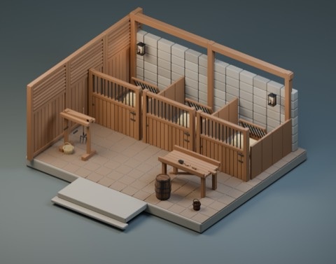

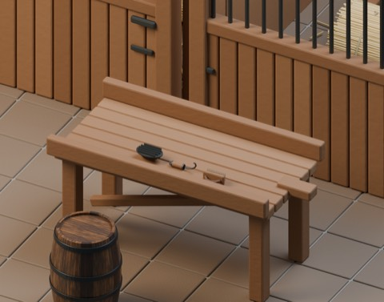

### 改訂配置 winery

[Revision ZIP](../distributions/scene-polish-v3/winery-scene-v3.zip)

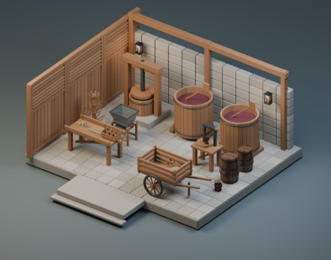

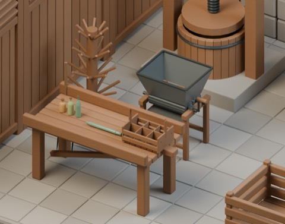

### 改訂配置 cellar

[Revision ZIP](../distributions/scene-polish-v3/cellar-scene-v3.zip)

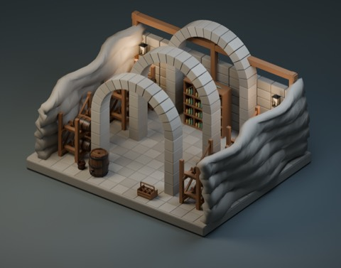

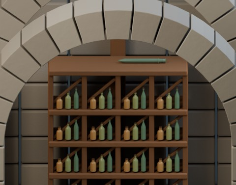

### 改訂配置 poultry

[Revision ZIP](../distributions/scene-polish-v3/poultry-scene-v3.zip)

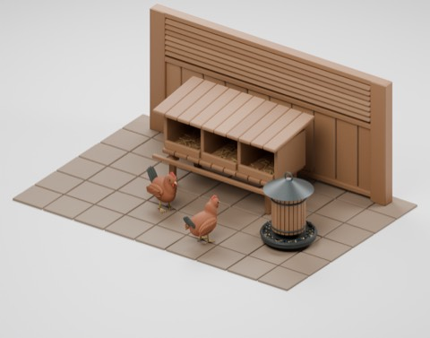

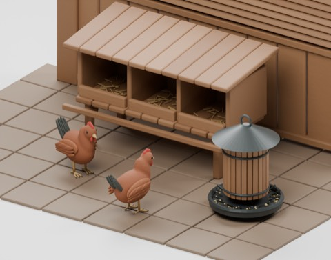

### 薬師店舗 HERBALIST_SCENE_V1

[HERBALIST_SCENE_V1 ZIP](https://raw.githubusercontent.com/k3peta/tales-on-a-table/main/distributions/herbalist-shop-v1/herbalist-scene-v1.zip) ·

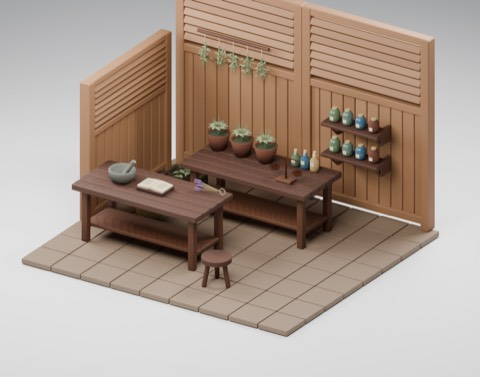

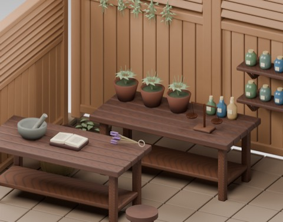

## Primary archive images / 初回配布版画像 / 原始归档图片

Actual distributed models; chosen camera view does not establish intended front or placement pivot. Images are outside model CC0. Original links and archives retained.

### HERBALIST_SCENE_V1 — Herbalist shop

薬師の店舗

[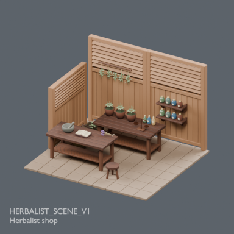](../previews/csh-herbalist7/renders/HERBALIST_SCENE_V1.png)

[Full image](../previews/csh-herbalist7/renders/HERBALIST_SCENE_V1.png) · [ZIP · BLEND/GLB](https://raw.githubusercontent.com/k3peta/tales-on-a-table/main/distributions/herbalist-shop-v1/herbalist-scene-v1.zip)

Version note: individual primary-archive thumbnails show their linked original ZIPs, not necessarily the revisions listed above. Earlier batch artwork retains its original association; exact revised-ZIP/render binding needs review for the six records listed in [Version audit](international/VERSION-AUDIT.md).

## Latest revision images / 現行改訂版画像

Exact revised ZIP GLB renders; public retrieval verification pending. Older archive previews remain labelled above. Images are viewing artwork, not model CC0.

### HCV_SCENE_HORSE

[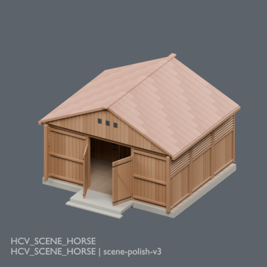](../previews/current-scenes6/renders/HCV_SCENE_HORSE.png)

[Matching revision ZIP](https://raw.githubusercontent.com/k3peta/tales-on-a-table/main/distributions/scene-polish-v3/horse-scene-v3.zip) · [Full-size image](../previews/current-scenes6/renders/HCV_SCENE_HORSE.png). Underlying models/materials CC0; arrangement for viewing and rearranging only; no additional redistribution license.

### HCV_SCENE_WINERY

[Matching revision ZIP](https://raw.githubusercontent.com/k3peta/tales-on-a-table/main/distributions/scene-polish-v3/winery-scene-v3.zip) · [Full-size image](../previews/current-scenes6/renders/HCV_SCENE_WINERY.png). Underlying models/materials CC0; arrangement for viewing and rearranging only; no additional redistribution license.

### HCV_SCENE_CELLAR

[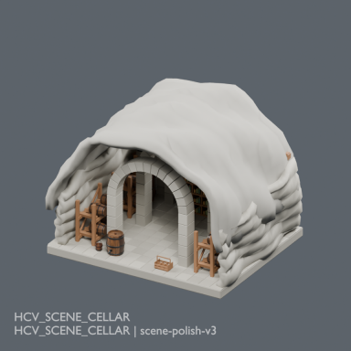](../previews/current-scenes6/renders/HCV_SCENE_CELLAR.png)

[Matching revision ZIP](https://raw.githubusercontent.com/k3peta/tales-on-a-table/main/distributions/scene-polish-v3/cellar-scene-v3.zip) · [Full-size image](../previews/current-scenes6/renders/HCV_SCENE_CELLAR.png). Underlying models/materials CC0; arrangement for viewing and rearranging only; no additional redistribution license.
