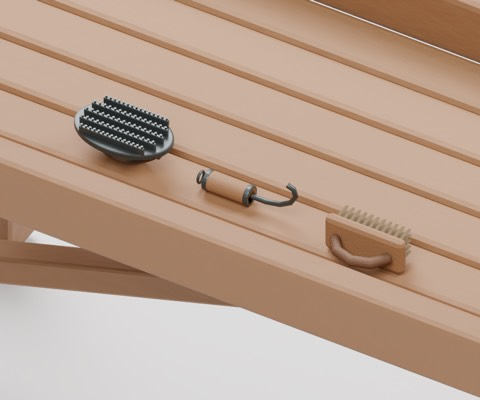
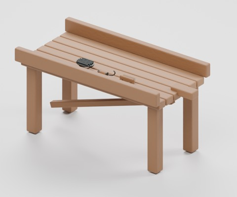
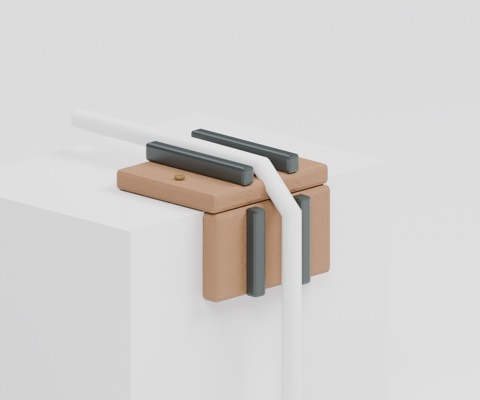
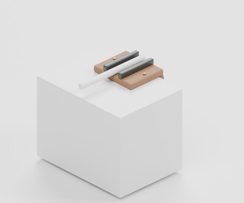

# stable-care-v1

976 distribution records = 972 + 4 stable-care equipment candidates. Existing HCV303 worktable is reused only in private examples and is not newly added. Two private arrangements and four images are not distributed or counted.

### HCV801

model

CC0-1.0

[ZIP](https://raw.githubusercontent.com/k3peta/tales-on-a-table/main/distributions/stable-care-v1/HCV801-CC0.zip)

### HCV802

model

CC0-1.0

[ZIP](https://raw.githubusercontent.com/k3peta/tales-on-a-table/main/distributions/stable-care-v1/HCV802-CC0.zip)

### HCV803

model

CC0-1.0

[ZIP](https://raw.githubusercontent.com/k3peta/tales-on-a-table/main/distributions/stable-care-v1/HCV803-CC0.zip)

### HCV804

model

CC0-1.0

[ZIP](https://raw.githubusercontent.com/k3peta/tales-on-a-table/main/distributions/stable-care-v1/HCV804-CC0.zip)

HCV801 toothed curry comb, HCV802 hoof pick, HCV803 grooming brush and HCV804 right-angle rope corner protector. Existing wheel chocks BM_051, ropes BM_052, covers BM_053, buckets and tack stands are not newly made or counted. AP015 beekeeping brush and PA006 paintbrush container have related names but different intended shapes/uses; this is not a complete historical mesh audit. Grooming items are static display models, not validated animal-safe tools. Cargo corner protection is a fit example, not proof of load capacity or rope mechanics. Private test cargo and rope are not included.

Metres, ground-centered component origins, Blender Z up / standard glTF axes. Global historical shape independence is unverified. Static display only: no animated doors/wheels/walking, rigid-body coupling, load simulation or fluid mechanisms. Safety, full motion/intersection volumes, real use, app UI/GPU/FPS and older Blender compatibility are unverified. Code, rendered images and private records are excluded.

[Checksums](../distributions/stable-care-v1/SHA256SUMS.txt).

## 実作画像 / Actual renders

完成バッチの配置・接写。画像は閲覧用でモデルCC0の対象外です。[既存の画像利用条件](../LICENSE.md)を維持します。

### BM_051

荷車の車止め

[ZIP](https://github.com/k3peta/tales-on-a-table/releases/download/v2026.10.19-bridge-market/BM_051_CC0.zip)

### BM_052

解いた荷縄

[ZIP](https://github.com/k3peta/tales-on-a-table/releases/download/v2026.10.19-bridge-market/BM_052_CC0.zip)

### BM_053

巻いた雨よけ布

[ZIP](https://github.com/k3peta/tales-on-a-table/releases/download/v2026.10.19-bridge-market/BM_053_CC0.zip)

### AP015

Hive tool and brush

[ZIP](https://github.com/k3peta/tales-on-a-table/releases/download/v2026.10.21-apiary/AP015_CC0.zip)

### PA006

Brush crock

[ZIP](https://github.com/k3peta/tales-on-a-table/releases/download/v2026.10.21-painter-atelier/PA006_CC0.zip)

### HCV303

HCV303

[ZIP](https://raw.githubusercontent.com/k3peta/tales-on-a-table/main/distributions/husbandry-cellar-v1/HCV303-CC0.zip)

### HCV801

HCV801

[ZIP](https://raw.githubusercontent.com/k3peta/tales-on-a-table/main/distributions/stable-care-v1/HCV801-CC0.zip)

### HCV802

HCV802

[ZIP](https://raw.githubusercontent.com/k3peta/tales-on-a-table/main/distributions/stable-care-v1/HCV802-CC0.zip)

### HCV803

HCV803

[ZIP](https://raw.githubusercontent.com/k3peta/tales-on-a-table/main/distributions/stable-care-v1/HCV803-CC0.zip)

### HCV804

HCV804

[ZIP](https://raw.githubusercontent.com/k3peta/tales-on-a-table/main/distributions/stable-care-v1/HCV804-CC0.zip)

