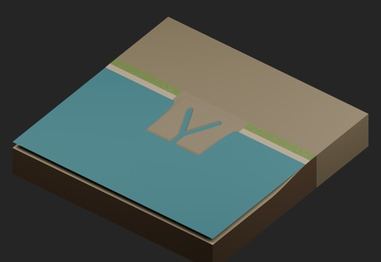
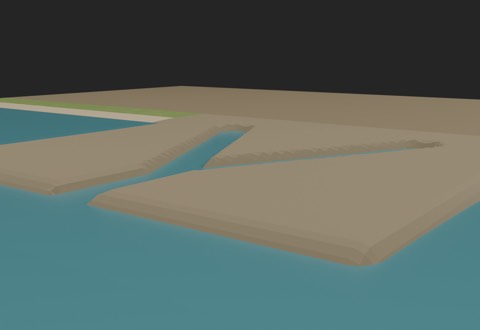
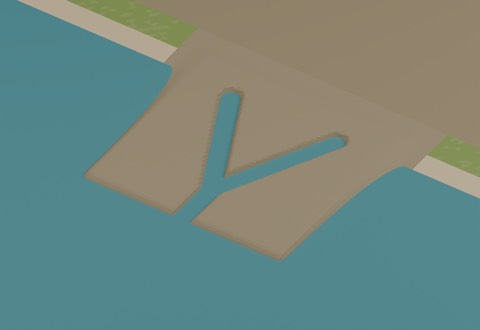

# Static mudflat — MF101

920 existing records + 1 = 921 distribution records. One local-use candidate, with BLEND and GLB as two formats of the same model. Global historical shape independence remains unconfirmed.

- [MF101_DrainedMudflat](https://raw.githubusercontent.com/k3peta/tales-on-a-table/main/distributions/static-mudflat-v1/MF101_DrainedMudflat_CC0.zip) — 1163024 bytes; SHA256 `0fe1188ca57f54506c7db8f9509df6a2faff09504a7e044fea9223afc37abd81`.

## Dimensions and connection limits

2 m square, metres, Z up, origin (0,0,0), bottom -0.98 m. Dry surface +0.02 m, groove bed -0.08 m, fixed water -0.01 m. East/west edges match the TG024 beach profile, north ground is 0 m, south seabed -0.19 m. Sampled endpoint error was at most 0.00000072 m. Two narrow upstream channels merge downstream; widths depend on sampled location. Five existing models in 20 rotations were tested against this bounded use requirement; this does not prove uniqueness across all history.

This is static terrain with thin opaque water, not a dynamic application feature. Tides, water-level switching and interactive climbing are not implemented. The shape is simplified and symmetric along Y; material color boundaries with adjacent beach remain visible. Actual walking, collision, fluid behavior, full watertight/contact volumes and Blender 4.3.2 compatibility are unverified.

Newly generated geometry and embedded materials only are CC0-1.0. No external or held geometry is included. Code, images, private evidence and assembled scenes are excluded. [Checksums](../distributions/static-mudflat-v1/SHA256SUMS.txt).

## 実作画像 / Actual renders

完成バッチの配置・接写。画像は閲覧用でモデルCC0の対象外です。[既存の画像利用条件](../LICENSE.md)を維持します。

|ID|名称 / Name|Download|
|---|---|---|
|TG024|beach|[ZIP](https://raw.githubusercontent.com/k3peta/tales-on-a-table/main/distributions/terrain-connectivity-91/zips/TG024_CC0.zip)|
|MF101_DrainedMudflat|DrainedMudflat|[ZIP](https://raw.githubusercontent.com/k3peta/tales-on-a-table/main/distributions/static-mudflat-v1/MF101_DrainedMudflat_CC0.zip)|

