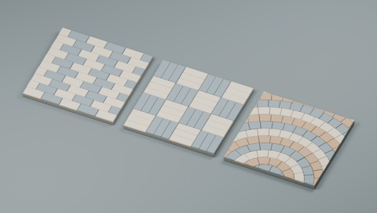
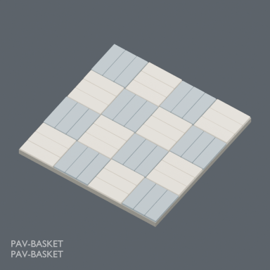
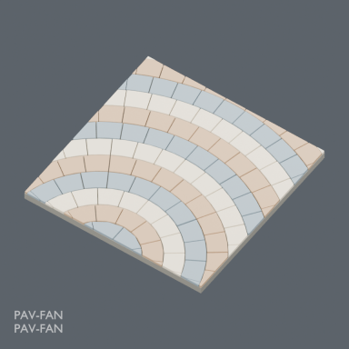
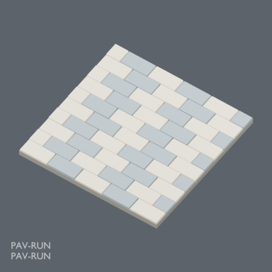

# Stone paving v2: three surface models

888 previous distribution records + 3 first publications = 891. v1 and v2 are revisions of the same three designs, not six assets. BLEND and GLB are two formats per record.

### PAV-RUN

[ZIP](https://raw.githubusercontent.com/k3peta/tales-on-a-table/main/distributions/stone-paving-v2/PAV-RUN-v2-models-CC0.zip)

198485

### PAV-BASKET

[ZIP](https://raw.githubusercontent.com/k3peta/tales-on-a-table/main/distributions/stone-paving-v2/PAV-BASKET-v2-models-CC0.zip)

182796

### PAV-FAN

[ZIP](https://raw.githubusercontent.com/k3peta/tales-on-a-table/main/distributions/stone-paving-v2/PAV-FAN-v2-models-CC0.zip)

505920

[Checksums](../distributions/stone-paving-v2/SHA256SUMS.txt). Model geometry and included display materials only are CC0; individual licenses are inside each ZIP. No code, images, assembled scenes or private documents are included.

## Placement and appearance limits

2 x 2 m surface overlays for gardens and plazas, not terrain connectivity blocks. XY extents -1 to +1 m; Z up, origin at ground centre. Bottom -0.10 m; stone tops approximately -0.002 to +0.003 m.

PAV-FAN curved courses do not continue seamlessly across adjacent panels; use as an accent panel. PAV-RUN alternating color phase changes at the horizontal panel boundary. Repeat PAV-BASKET with the same orientation.

BLEND is an object library: File > Append > Object, then select the named PAV object. GLB includes base colors, roughness and physical bevels. Fine procedural stone bump is Blender-only. No external textures required.

Production checks used Blender 5.2.2 LTS for reloading, bounds, origin, finite coordinates and zero degenerate faces. Application integration, performance, collision and older Blender compatibility are untested. Global historical shape uniqueness is not established by identifier/hash checks.

## 実作画像 / Actual renders

完成バッチの配置・接写。画像は閲覧用でモデルCC0の対象外です。[既存の画像利用条件](../LICENSE.md)を維持します。

### PAV-RUN

PAV-RUN

[ZIP](https://raw.githubusercontent.com/k3peta/tales-on-a-table/main/distributions/stone-paving-v2/PAV-RUN-v2-models-CC0.zip)

### PAV-BASKET

PAV-BASKET

[ZIP](https://raw.githubusercontent.com/k3peta/tales-on-a-table/main/distributions/stone-paving-v2/PAV-BASKET-v2-models-CC0.zip)

### PAV-FAN

PAV-FAN

[ZIP](https://raw.githubusercontent.com/k3peta/tales-on-a-table/main/distributions/stone-paving-v2/PAV-FAN-v2-models-CC0.zip)

## Individual images / 個別画像 / 单件图片

Actual distributed models; chosen camera view does not establish intended front or placement pivot. Images are outside model CC0. Original links and archives retained.

### PAV-BASKET — PAV-BASKET

PAV-BASKET

[Full image](../previews/ud1102-rg24/renders/PAV-BASKET.png) · [ZIP · BLEND/GLB](https://raw.githubusercontent.com/k3peta/tales-on-a-table/main/distributions/stone-paving-v2/PAV-BASKET-v2-models-CC0.zip)

### PAV-FAN — PAV-FAN

PAV-FAN

[Full image](../previews/ud1102-rg24/renders/PAV-FAN.png) · [ZIP · BLEND/GLB](https://raw.githubusercontent.com/k3peta/tales-on-a-table/main/distributions/stone-paving-v2/PAV-FAN-v2-models-CC0.zip)

### PAV-RUN — PAV-RUN

PAV-RUN

[Full image](../previews/ud1102-rg24/renders/PAV-RUN.png) · [ZIP · BLEND/GLB](https://raw.githubusercontent.com/k3peta/tales-on-a-table/main/distributions/stone-paving-v2/PAV-RUN-v2-models-CC0.zip)
