# 器・食べ物 1

[← 素材棚トップ](../README.md)

[日本語](tableware_01.md) · [English](tableware_01.en.md) · [简体中文](tableware_01.zh-CN.md)

## FT_016 — 金属製タンカード

酒場の素材「金属製タンカード」。収録単位：1モデル。BLENDとGLBを同梱しています。近景は同じ配布BLENDの実レンダーです。

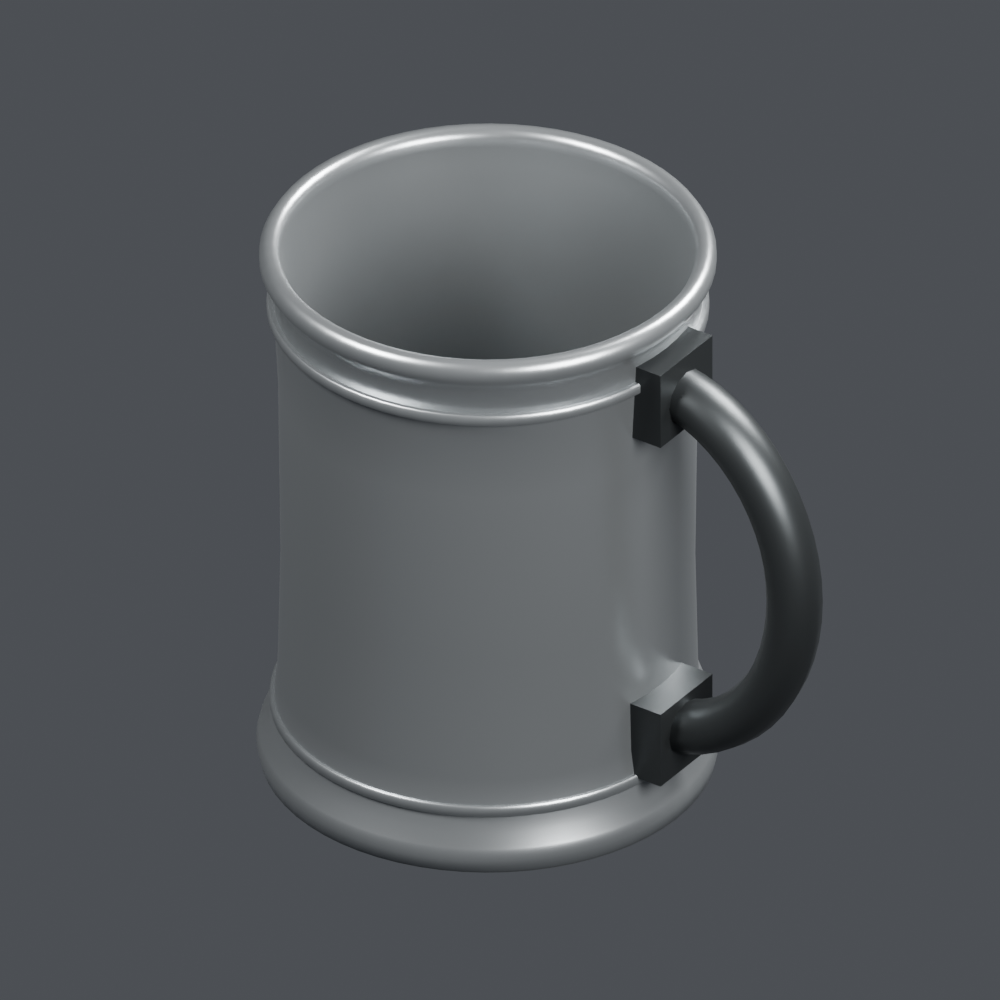

[ZIP · BLEND + GLB · 0.26 MB](https://github.com/k3peta/tales-on-a-table/releases/download/v2026.10.18/FT_016_CC0.zip) · CC0-1.0

`catalog-20261018` · SHA-256: `3dc5ad1edc48a10856f6d7dcb2b9f05ba9416ef5146dd6fc9a5317fc5cfb69fc`

## FT_017 — 木製マグ

酒場の素材「木製マグ」。収録単位：1モデル。BLENDとGLBを同梱しています。近景は同じ配布BLENDの実レンダーです。

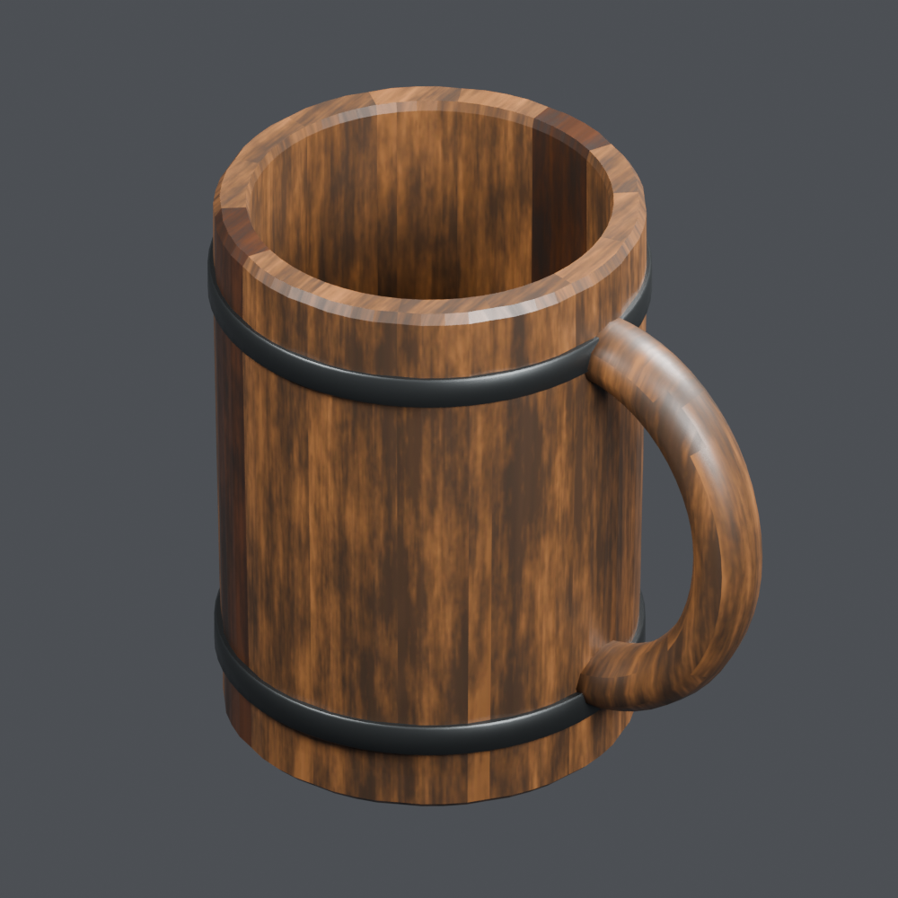

[ZIP · BLEND + GLB · 2.80 MB](https://github.com/k3peta/tales-on-a-table/releases/download/v2026.10.18/FT_017_CC0.zip) · CC0-1.0

`catalog-20261018` · SHA-256: `14bd4150053c91730d9cf72af5423543015e3bcb41c95a0528c0949424a48be1`

## FT_018 — 陶器の水差し

酒場の素材「陶器の水差し」。収録単位：1モデル。BLENDとGLBを同梱しています。近景は同じ配布BLENDの実レンダーです。

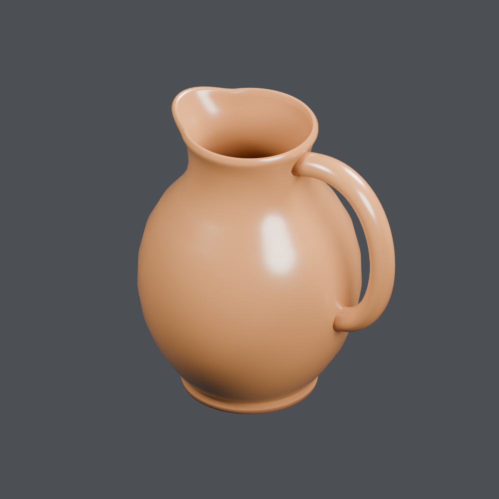

[ZIP · BLEND + GLB · 0.33 MB](https://github.com/k3peta/tales-on-a-table/releases/download/v2026.10.18/FT_018_CC0.zip) · CC0-1.0

`catalog-20261018` · SHA-256: `0b79e023e70929cc27bc5a748c4a109c5b7706e817692f0c709092ed0fa7244b`

## FT_019 — 脚付き金属杯

酒場の素材「脚付き金属杯」。収録単位：1モデル。BLENDとGLBを同梱しています。近景は同じ配布BLENDの実レンダーです。

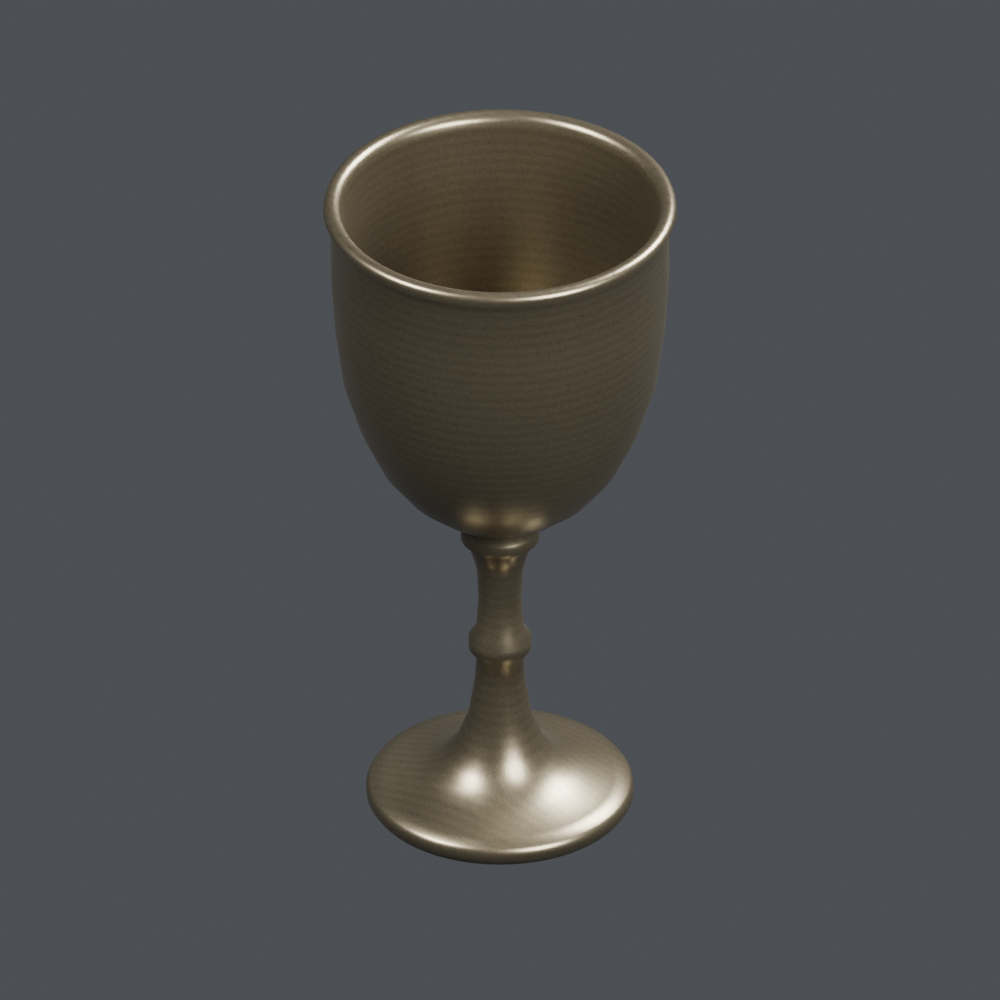

[ZIP · BLEND + GLB · 0.49 MB](https://github.com/k3peta/tales-on-a-table/releases/download/v2026.10.18/FT_019_CC0.zip) · CC0-1.0

`catalog-20261018` · SHA-256: `8227e7dbf851f091ebadbee128443b40018dc8e86e432a4cc9c8a966d8c5659d`

## FT_020 — 3本の空のガラス瓶

酒場の素材「3本の空のガラス瓶」。収録単位：1モデル。BLENDとGLBを同梱しています。近景は同じ配布BLENDの実レンダーです。

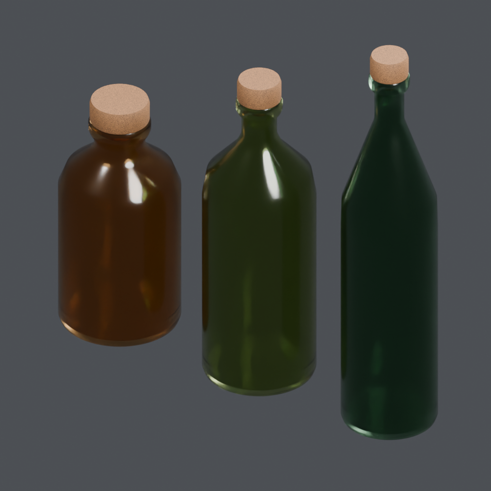

[ZIP · BLEND + GLB · 0.56 MB](https://github.com/k3peta/tales-on-a-table/releases/download/v2026.10.18/FT_020_CC0.zip) · CC0-1.0

`catalog-20261018` · SHA-256: `0c760e3ee20a6cf4fd85647053ecfe39f3f58095691cce54b09ae543c7e9ecba`

## FT_021 — 手穴付き木製盆

酒場の素材「手穴付き木製盆」。収録単位：1モデル。BLENDとGLBを同梱しています。近景は同じ配布BLENDの実レンダーです。

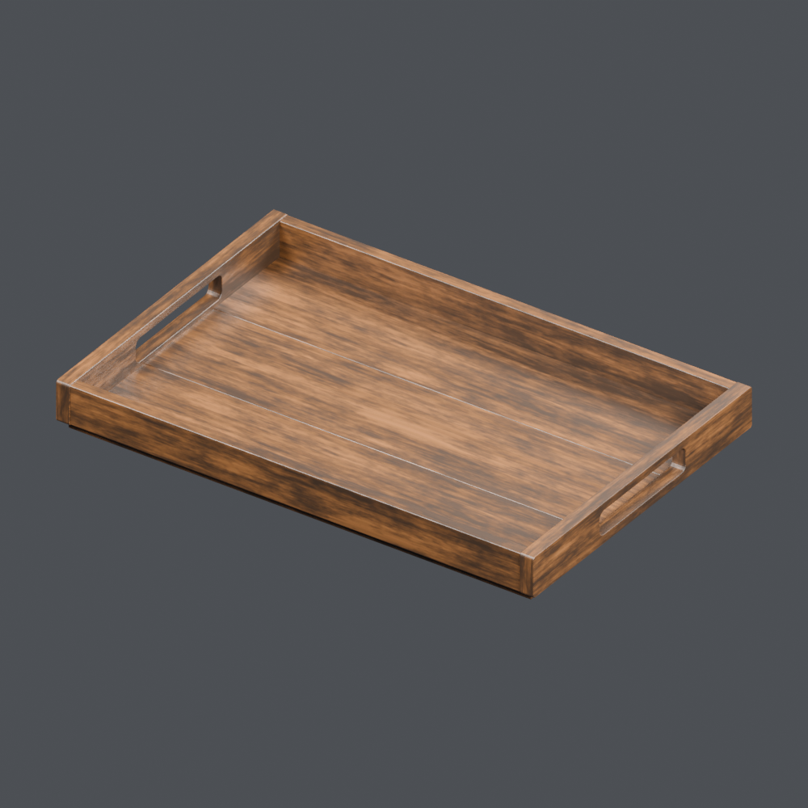

[ZIP · BLEND + GLB · 1.37 MB](https://github.com/k3peta/tales-on-a-table/releases/download/v2026.10.18/FT_021_CC0.zip) · CC0-1.0

`catalog-20261018` · SHA-256: `fd4f65e25fed8627976369068230505c01940c296553ee6b317467ee48649bd9`

## FT_022 — 浅い陶器皿

酒場の素材「浅い陶器皿」。収録単位：1モデル。BLENDとGLBを同梱しています。近景は同じ配布BLENDの実レンダーです。

[ZIP · BLEND + GLB · 0.23 MB](https://github.com/k3peta/tales-on-a-table/releases/download/v2026.10.18/FT_022_CC0.zip) · CC0-1.0

`catalog-20261018` · SHA-256: `450e501b16532cb446c51a8503a9b0de36c16d7a4892d173cccabc609a289485`

## FT_023 — スプーン・フォーク・食卓ナイフ

酒場の素材「スプーン・フォーク・食卓ナイフ」。収録単位：1モデル。BLENDとGLBを同梱しています。近景は同じ配布BLENDの実レンダーです。

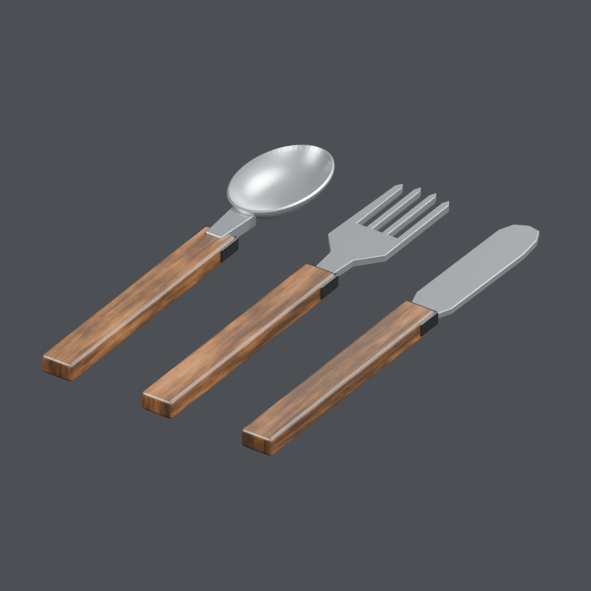

[ZIP · BLEND + GLB · 1.47 MB](https://github.com/k3peta/tales-on-a-table/releases/download/v2026.10.18/FT_023_CC0.zip) · CC0-1.0

`catalog-20261018` · SHA-256: `43a0913284d0ef4ac2936da3f49f262bc842d4dc4541c43c54704d843362a8ed`

## FT_024 — 丸い田舎パン

酒場の素材「丸い田舎パン」。収録単位：1モデル。BLENDとGLBを同梱しています。近景は同じ配布BLENDの実レンダーです。

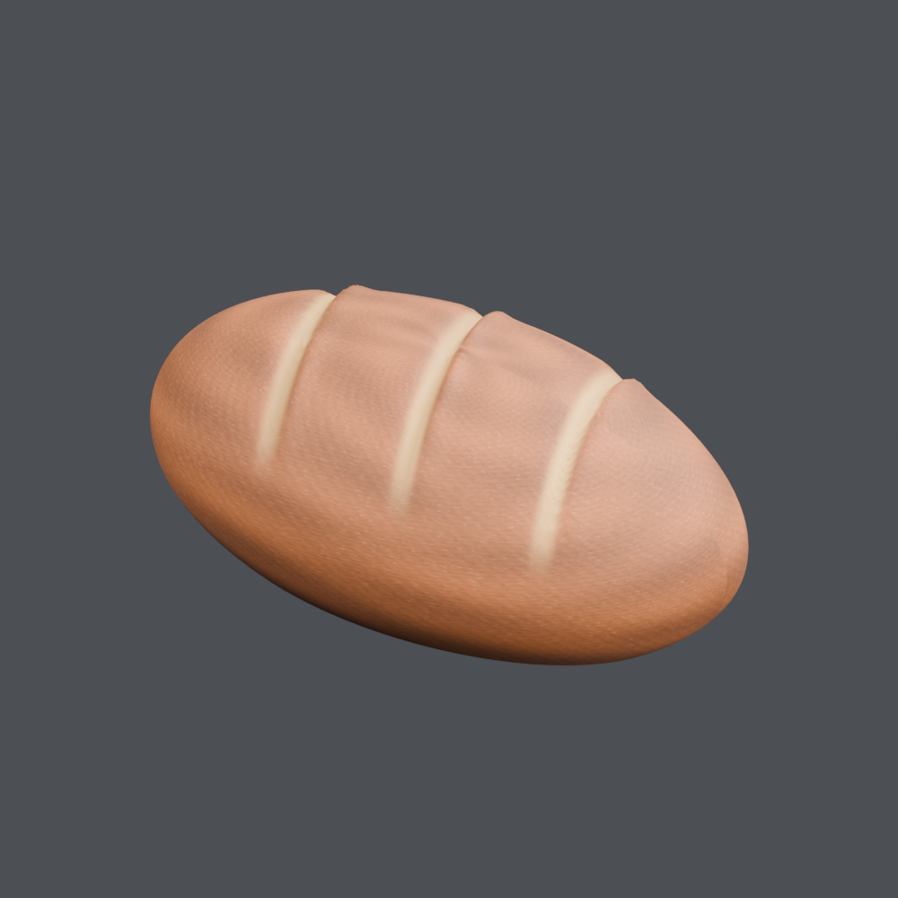

[ZIP · BLEND + GLB · 2.19 MB](https://github.com/k3peta/tales-on-a-table/releases/download/v2026.10.18/FT_024_CC0.zip) · CC0-1.0

`catalog-20261018` · SHA-256: `6e761cf51a48c2be3836dac5b3b57164f490cb01416437090f800a7c50e4db5d`

## FT_025 — 皮付きチーズの楔

酒場の素材「皮付きチーズの楔」。収録単位：1モデル。BLENDとGLBを同梱しています。近景は同じ配布BLENDの実レンダーです。

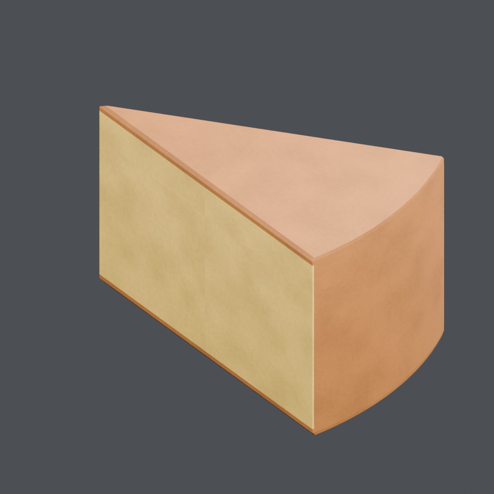

[ZIP · BLEND + GLB · 1.71 MB](https://github.com/k3peta/tales-on-a-table/releases/download/v2026.10.18/FT_025_CC0.zip) · CC0-1.0

`catalog-20261018` · SHA-256: `756025207e3c90b9bfebff9cccb117c8943a5b1bf3b01aea22176939f3169a8b`

## FT_026 — シチュー入り陶器鉢

酒場の素材「シチュー入り陶器鉢」。収録単位：1モデル。BLENDとGLBを同梱しています。近景は同じ配布BLENDの実レンダーです。

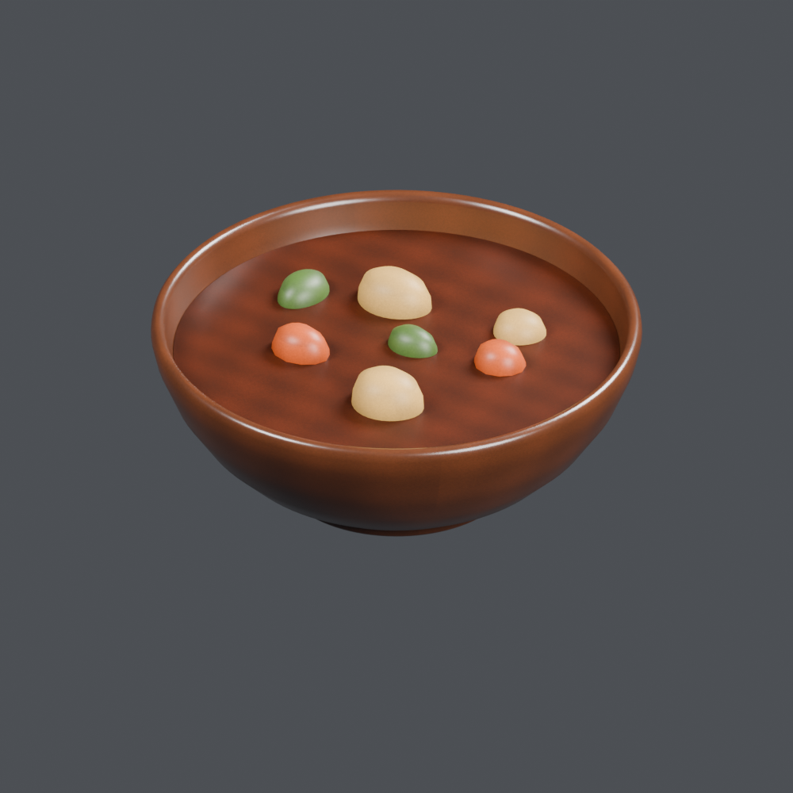

[ZIP · BLEND + GLB · 1.29 MB](https://github.com/k3peta/tales-on-a-table/releases/download/v2026.10.18/FT_026_CC0.zip) · CC0-1.0

`catalog-20261018` · SHA-256: `68bfb64cf7109212f747f791673509a5ec1c69ff58f618650db8d370b8f68294`

## FT_027 — ローストと野菜の盛皿

酒場の素材「ローストと野菜の盛皿」。収録単位：1モデル。BLENDとGLBを同梱しています。近景は同じ配布BLENDの実レンダーです。

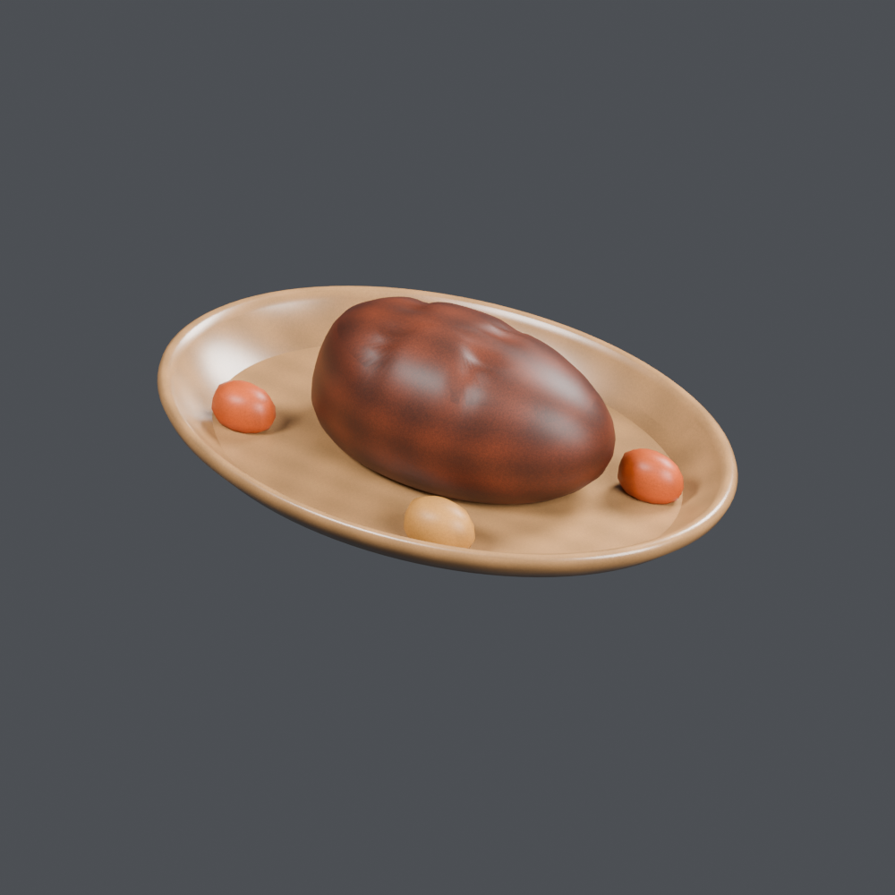

[ZIP · BLEND + GLB · 1.16 MB](https://github.com/k3peta/tales-on-a-table/releases/download/v2026.10.18/FT_027_CC0.zip) · CC0-1.0

`catalog-20261018` · SHA-256: `47d52d8dae9da4d28caa4d1c5e027809778c2cc4b40d8db2ac281034d214f767`
