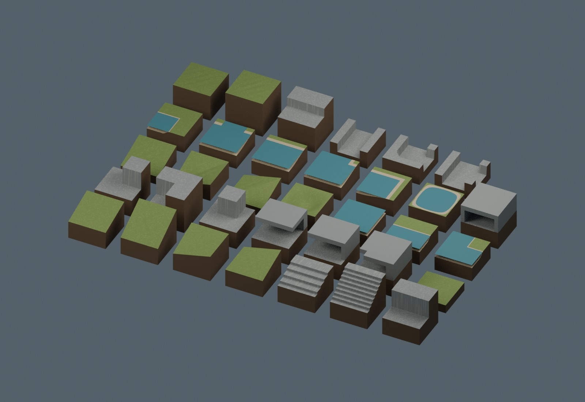
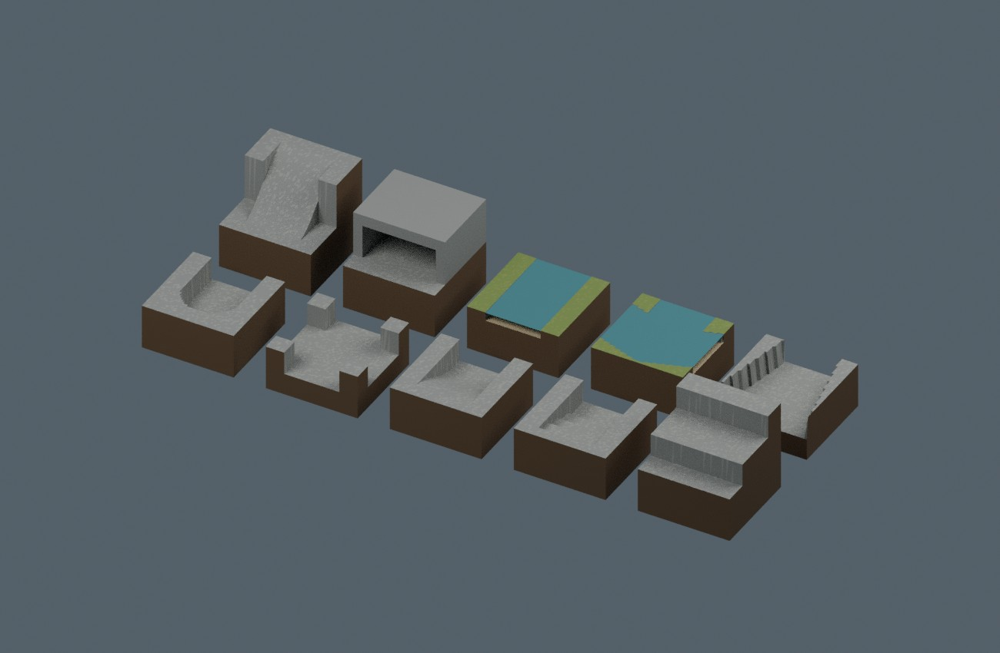
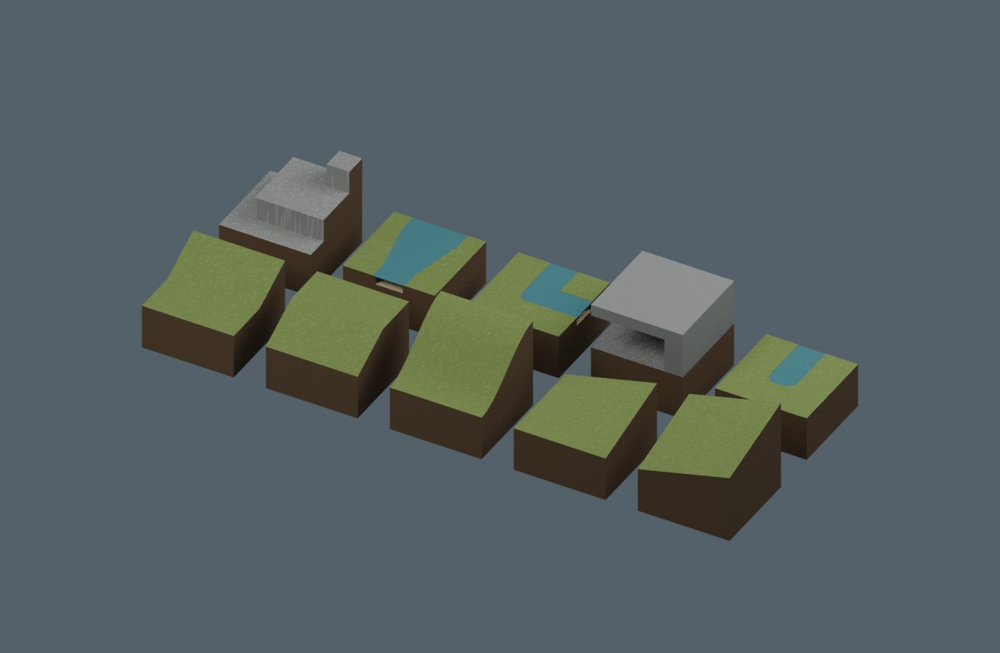
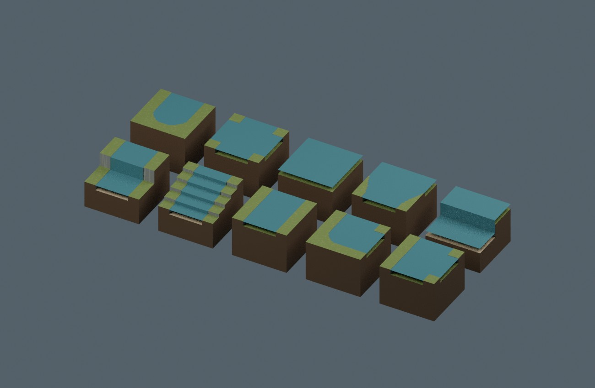
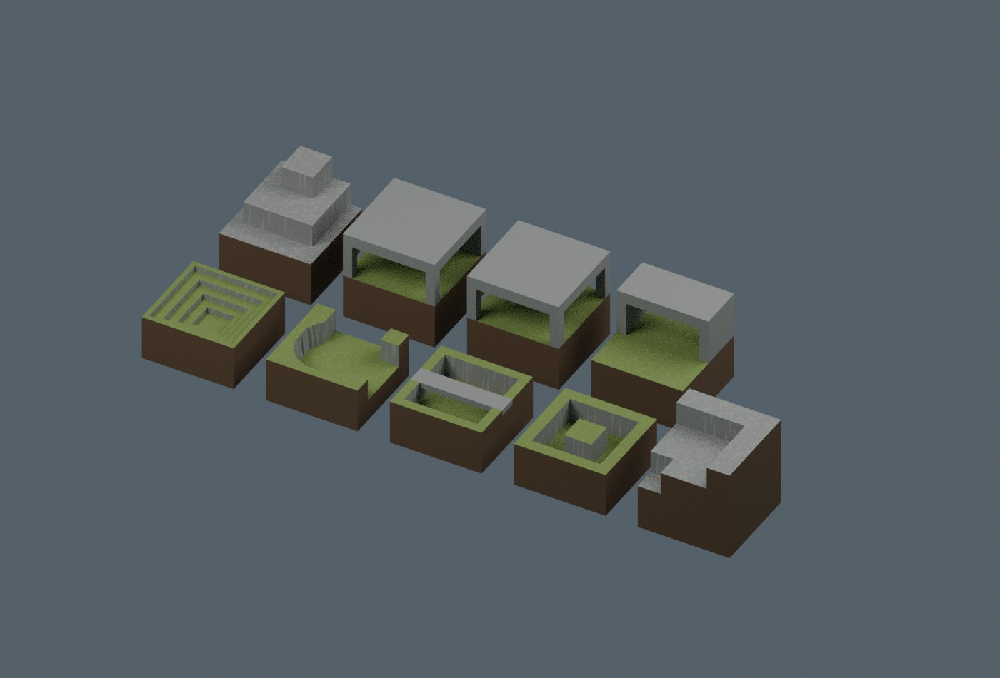
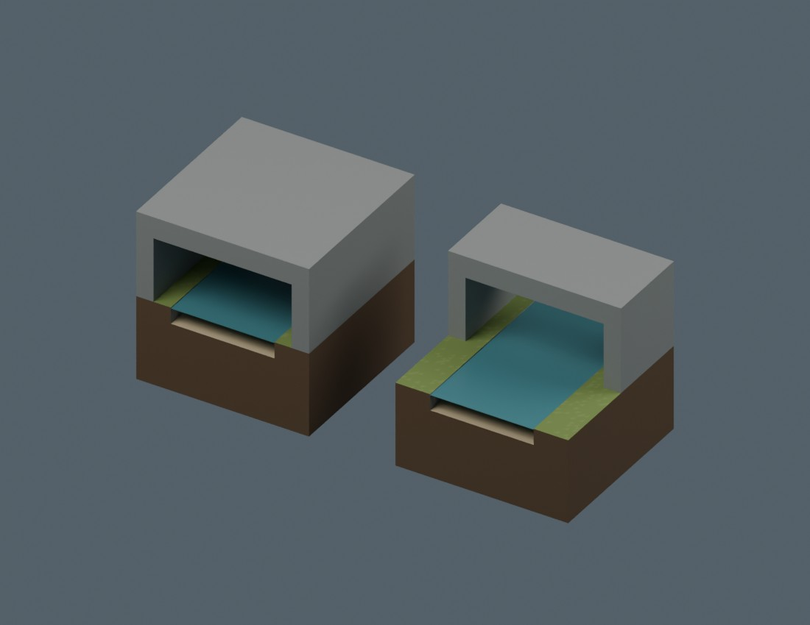
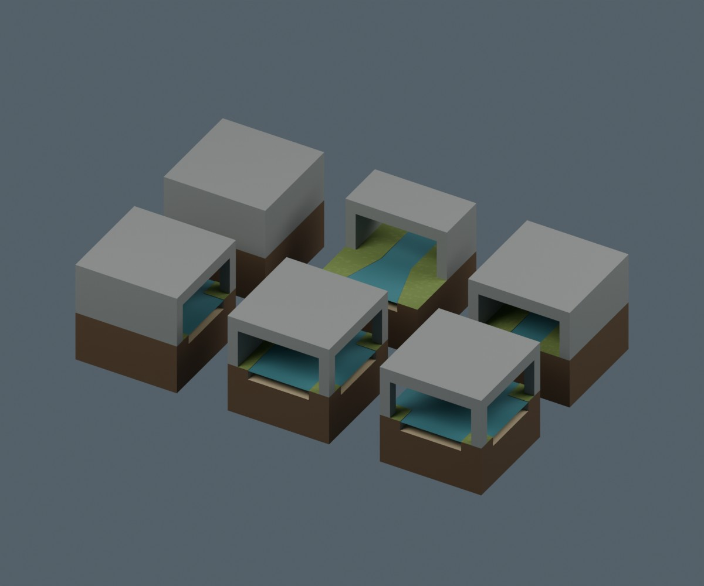
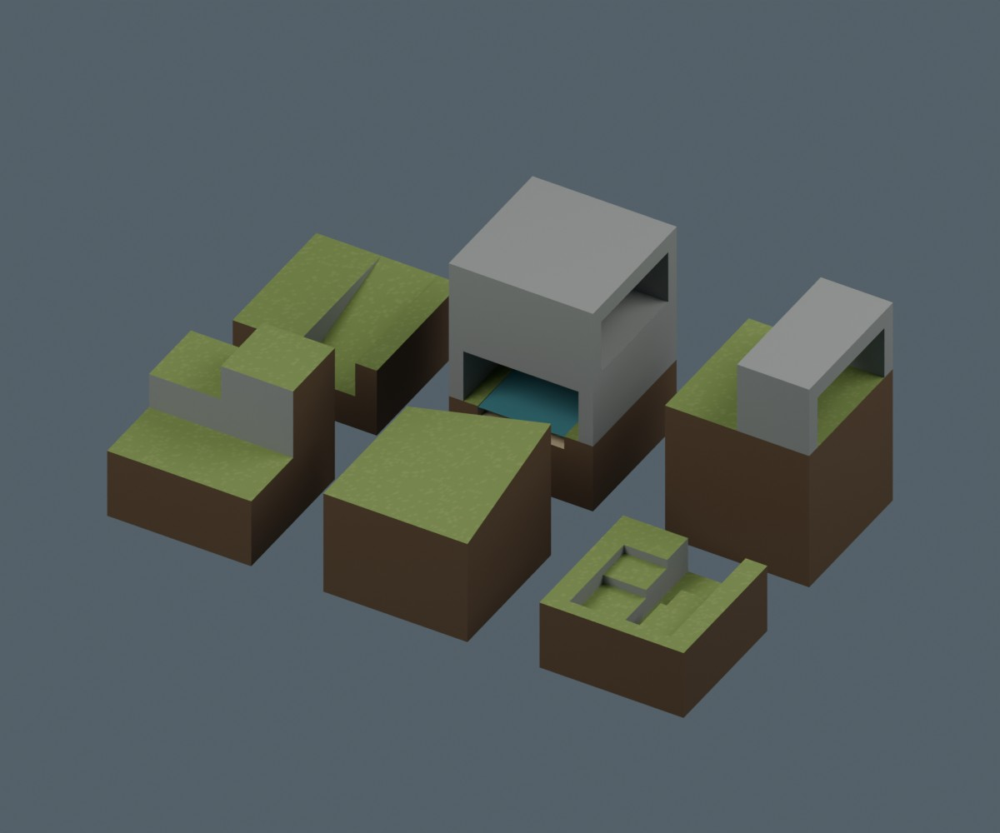
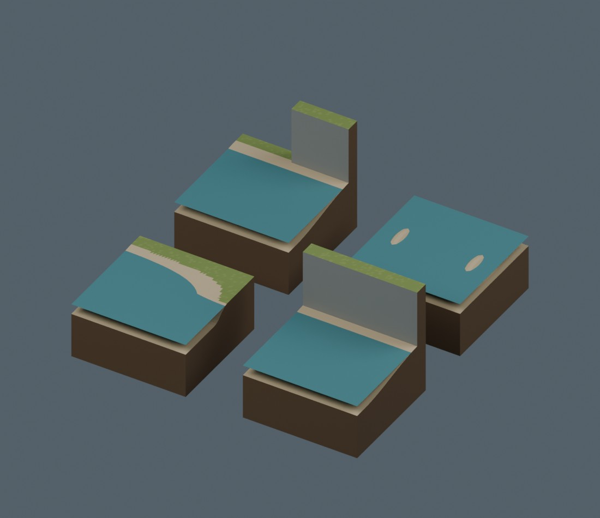

# 2m接続地形 — 91配布レコード

第1〜9バッチを収録。局所用途候補67＋構造派生24で、全履歴の独立造形種類数ではありません。同じモデルのBLEND/GLBを二重に数えません。既存779配布レコードへの追加91件です。

モデル形状と同梱表示材質のみCC0-1.0。生成コード・完成配置シーン・画像・記事は含みません。Blender 5.2.2 LTSで検証。ゲーム衝突、実歩行、船舶航行、navmesh、任意の全接続、Blender 4.3.2互換は未検証です。

2mグリッド、メートル、Z上。接続は各モデル同梱READMEの辺プロファイル等を確認してください。Collection Append用BLENDとGLBを同梱。

[配布フォルダ](../distributions/terrain-connectivity-91/) · [91件のSHA256](../distributions/terrain-connectivity-91/SHA256SUMS.txt) · [モデル台帳](../distributions/terrain-connectivity-91/manifest.json)

|ID|バッチ|名称|ZIP|bytes|
|---|---:|---|---|---:|
|TG001|1|ramp half|[Download](https://raw.githubusercontent.com/k3peta/tales-on-a-table/main/distributions/terrain-connectivity-91/zips/TG001_CC0.zip)|214238|
|TG002|1|ramp full|[Download](https://raw.githubusercontent.com/k3peta/tales-on-a-table/main/distributions/terrain-connectivity-91/zips/TG002_CC0.zip)|212917|
|TG003|1|ramp inner|[Download](https://raw.githubusercontent.com/k3peta/tales-on-a-table/main/distributions/terrain-connectivity-91/zips/TG003_CC0.zip)|219117|
|TG004|1|ramp outer|[Download](https://raw.githubusercontent.com/k3peta/tales-on-a-table/main/distributions/terrain-connectivity-91/zips/TG004_CC0.zip)|220235|
|TG005|1|stairs half|[Download](https://raw.githubusercontent.com/k3peta/tales-on-a-table/main/distributions/terrain-connectivity-91/zips/TG005_CC0.zip)|92695|
|TG006|1|stairs full|[Download](https://raw.githubusercontent.com/k3peta/tales-on-a-table/main/distributions/terrain-connectivity-91/zips/TG006_CC0.zip)|112381|
|TG007|1|cliff straight|[Download](https://raw.githubusercontent.com/k3peta/tales-on-a-table/main/distributions/terrain-connectivity-91/zips/TG007_CC0.zip)|153811|
|TG008|1|cliff outer|[Download](https://raw.githubusercontent.com/k3peta/tales-on-a-table/main/distributions/terrain-connectivity-91/zips/TG008_CC0.zip)|153941|
|TG009|1|cliff inner|[Download](https://raw.githubusercontent.com/k3peta/tales-on-a-table/main/distributions/terrain-connectivity-91/zips/TG009_CC0.zip)|153772|
|TG010|1|cliff nose|[Download](https://raw.githubusercontent.com/k3peta/tales-on-a-table/main/distributions/terrain-connectivity-91/zips/TG010_CC0.zip)|154534|
|TG011|1|overhang straight|[Download](https://raw.githubusercontent.com/k3peta/tales-on-a-table/main/distributions/terrain-connectivity-91/zips/TG011_CC0.zip)|153775|
|TG012|1|overhang end|[Download](https://raw.githubusercontent.com/k3peta/tales-on-a-table/main/distributions/terrain-connectivity-91/zips/TG012_CC0.zip)|154303|
|TG013|1|overhang corner|[Download](https://raw.githubusercontent.com/k3peta/tales-on-a-table/main/distributions/terrain-connectivity-91/zips/TG013_CC0.zip)|155002|
|TG014|1|pit floor|[Download](https://raw.githubusercontent.com/k3peta/tales-on-a-table/main/distributions/terrain-connectivity-91/zips/TG014_CC0.zip)|204822|
|TG015|1|pit rim|[Download](https://raw.githubusercontent.com/k3peta/tales-on-a-table/main/distributions/terrain-connectivity-91/zips/TG015_CC0.zip)|214014|
|TG016|1|pit outer|[Download](https://raw.githubusercontent.com/k3peta/tales-on-a-table/main/distributions/terrain-connectivity-91/zips/TG016_CC0.zip)|219328|
|TG017|1|pit inner|[Download](https://raw.githubusercontent.com/k3peta/tales-on-a-table/main/distributions/terrain-connectivity-91/zips/TG017_CC0.zip)|219836|
|TG018|1|pit closed|[Download](https://raw.githubusercontent.com/k3peta/tales-on-a-table/main/distributions/terrain-connectivity-91/zips/TG018_CC0.zip)|213603|
|TG019|1|water full|[Download](https://raw.githubusercontent.com/k3peta/tales-on-a-table/main/distributions/terrain-connectivity-91/zips/TG019_CC0.zip)|262135|
|TG020|1|shore|[Download](https://raw.githubusercontent.com/k3peta/tales-on-a-table/main/distributions/terrain-connectivity-91/zips/TG020_CC0.zip)|228856|
|TG021|1|shore outer|[Download](https://raw.githubusercontent.com/k3peta/tales-on-a-table/main/distributions/terrain-connectivity-91/zips/TG021_CC0.zip)|256714|
|TG022|1|shore inner|[Download](https://raw.githubusercontent.com/k3peta/tales-on-a-table/main/distributions/terrain-connectivity-91/zips/TG022_CC0.zip)|201281|
|TG023|1|estuary|[Download](https://raw.githubusercontent.com/k3peta/tales-on-a-table/main/distributions/terrain-connectivity-91/zips/TG023_CC0.zip)|261954|
|TG024|1|beach|[Download](https://raw.githubusercontent.com/k3peta/tales-on-a-table/main/distributions/terrain-connectivity-91/zips/TG024_CC0.zip)|253382|
|TG025|1|beach outer|[Download](https://raw.githubusercontent.com/k3peta/tales-on-a-table/main/distributions/terrain-connectivity-91/zips/TG025_CC0.zip)|269616|
|TG026|1|beach inner|[Download](https://raw.githubusercontent.com/k3peta/tales-on-a-table/main/distributions/terrain-connectivity-91/zips/TG026_CC0.zip)|241512|
|TG027|1|tide pool|[Download](https://raw.githubusercontent.com/k3peta/tales-on-a-table/main/distributions/terrain-connectivity-91/zips/TG027_CC0.zip)|304918|
|TG028|1|arch|[Download](https://raw.githubusercontent.com/k3peta/tales-on-a-table/main/distributions/terrain-connectivity-91/zips/TG028_CC0.zip)|154386|
|TG029|1|plateau half|[Download](https://raw.githubusercontent.com/k3peta/tales-on-a-table/main/distributions/terrain-connectivity-91/zips/TG029_CC0.zip)|205706|
|TG030|1|plateau full|[Download](https://raw.githubusercontent.com/k3peta/tales-on-a-table/main/distributions/terrain-connectivity-91/zips/TG030_CC0.zip)|204695|
|TG031|1|cliff half to full|[Download](https://raw.githubusercontent.com/k3peta/tales-on-a-table/main/distributions/terrain-connectivity-91/zips/TG031_CC0.zip)|153700|
|TG032|1|ravine|[Download](https://raw.githubusercontent.com/k3peta/tales-on-a-table/main/distributions/terrain-connectivity-91/zips/TG032_CC0.zip)|155848|
|TG033|1|ravine bend|[Download](https://raw.githubusercontent.com/k3peta/tales-on-a-table/main/distributions/terrain-connectivity-91/zips/TG033_CC0.zip)|154002|
|TG034|1|ravine T|[Download](https://raw.githubusercontent.com/k3peta/tales-on-a-table/main/distributions/terrain-connectivity-91/zips/TG034_CC0.zip)|154758|
|TV201|2|ravine end|[Download](https://raw.githubusercontent.com/k3peta/tales-on-a-table/main/distributions/terrain-connectivity-91/zips/TV201_CC0.zip)|160850|
|TV202|2|ravine cross|[Download](https://raw.githubusercontent.com/k3peta/tales-on-a-table/main/distributions/terrain-connectivity-91/zips/TV202_CC0.zip)|161328|
|TV203|2|ravine ramp entry|[Download](https://raw.githubusercontent.com/k3peta/tales-on-a-table/main/distributions/terrain-connectivity-91/zips/TV203_CC0.zip)|169651|
|TV204|2|ravine stair entry|[Download](https://raw.githubusercontent.com/k3peta/tales-on-a-table/main/distributions/terrain-connectivity-91/zips/TV204_CC0.zip)|165060|
|TV205|2|cliff double bench|[Download](https://raw.githubusercontent.com/k3peta/tales-on-a-table/main/distributions/terrain-connectivity-91/zips/TV205_CC0.zip)|161079|
|TV206|2|cliff access slot|[Download](https://raw.githubusercontent.com/k3peta/tales-on-a-table/main/distributions/terrain-connectivity-91/zips/TV206_CC0.zip)|170032|
|TV207|2|overhang closed|[Download](https://raw.githubusercontent.com/k3peta/tales-on-a-table/main/distributions/terrain-connectivity-91/zips/TV207_CC0.zip)|161197|
|TV208|2|water ravine sill|[Download](https://raw.githubusercontent.com/k3peta/tales-on-a-table/main/distributions/terrain-connectivity-91/zips/TV208_CC0.zip)|245920|
|TV209|2|river Y|[Download](https://raw.githubusercontent.com/k3peta/tales-on-a-table/main/distributions/terrain-connectivity-91/zips/TV209_CC0.zip)|259055|
|TV210|2|ravine widen|[Download](https://raw.githubusercontent.com/k3peta/tales-on-a-table/main/distributions/terrain-connectivity-91/zips/TV210_CC0.zip)|160408|
|TX301|3|ramp late half|[Download](https://raw.githubusercontent.com/k3peta/tales-on-a-table/main/distributions/terrain-connectivity-91/zips/TX301_CC0.zip)|161287|
|TX302|3|ramp early half|[Download](https://raw.githubusercontent.com/k3peta/tales-on-a-table/main/distributions/terrain-connectivity-91/zips/TX302_CC0.zip)|161174|
|TX303|3|ramp S full|[Download](https://raw.githubusercontent.com/k3peta/tales-on-a-table/main/distributions/terrain-connectivity-91/zips/TX303_CC0.zip)|169848|
|TX304|3|ramp bilinear corner|[Download](https://raw.githubusercontent.com/k3peta/tales-on-a-table/main/distributions/terrain-connectivity-91/zips/TX304_CC0.zip)|235059|
|TX305|3|ramp diagonal|[Download](https://raw.githubusercontent.com/k3peta/tales-on-a-table/main/distributions/terrain-connectivity-91/zips/TX305_CC0.zip)|193317|
|TX306|3|cliff double corner|[Download](https://raw.githubusercontent.com/k3peta/tales-on-a-table/main/distributions/terrain-connectivity-91/zips/TX306_CC0.zip)|158934|
|TX307|3|river width transition|[Download](https://raw.githubusercontent.com/k3peta/tales-on-a-table/main/distributions/terrain-connectivity-91/zips/TX307_CC0.zip)|216989|
|TX308|3|river narrow bend|[Download](https://raw.githubusercontent.com/k3peta/tales-on-a-table/main/distributions/terrain-connectivity-91/zips/TX308_CC0.zip)|192276|
|TX309|3|overhang full corner|[Download](https://raw.githubusercontent.com/k3peta/tales-on-a-table/main/distributions/terrain-connectivity-91/zips/TX309_CC0.zip)|157507|
|TX310|3|river narrow end|[Download](https://raw.githubusercontent.com/k3peta/tales-on-a-table/main/distributions/terrain-connectivity-91/zips/TX310_CC0.zip)|177768|
|TW401|4|waterfall channel|[Download](https://raw.githubusercontent.com/k3peta/tales-on-a-table/main/distributions/terrain-connectivity-91/zips/TW401_CC0.zip)|157638|
|TW402|4|cascade channel|[Download](https://raw.githubusercontent.com/k3peta/tales-on-a-table/main/distributions/terrain-connectivity-91/zips/TW402_CC0.zip)|162526|
|TW403|4|upper straight|[Download](https://raw.githubusercontent.com/k3peta/tales-on-a-table/main/distributions/terrain-connectivity-91/zips/TW403_CC0.zip)|231465|
|TW404|4|upper bend|[Download](https://raw.githubusercontent.com/k3peta/tales-on-a-table/main/distributions/terrain-connectivity-91/zips/TW404_CC0.zip)|230222|
|TW405|4|upper T|[Download](https://raw.githubusercontent.com/k3peta/tales-on-a-table/main/distributions/terrain-connectivity-91/zips/TW405_CC0.zip)|247156|
|TW406|4|upper end|[Download](https://raw.githubusercontent.com/k3peta/tales-on-a-table/main/distributions/terrain-connectivity-91/zips/TW406_CC0.zip)|214215|
|TW407|4|upper cross|[Download](https://raw.githubusercontent.com/k3peta/tales-on-a-table/main/distributions/terrain-connectivity-91/zips/TW407_CC0.zip)|259551|
|TW408|4|upper lake|[Download](https://raw.githubusercontent.com/k3peta/tales-on-a-table/main/distributions/terrain-connectivity-91/zips/TW408_CC0.zip)|267088|
|TW409|4|upper lake outlet|[Download](https://raw.githubusercontent.com/k3peta/tales-on-a-table/main/distributions/terrain-connectivity-91/zips/TW409_CC0.zip)|258134|
|TW410|4|waterfall lake|[Download](https://raw.githubusercontent.com/k3peta/tales-on-a-table/main/distributions/terrain-connectivity-91/zips/TW410_CC0.zip)|152673|
|TY501|5|pit steps|[Download](https://raw.githubusercontent.com/k3peta/tales-on-a-table/main/distributions/terrain-connectivity-91/zips/TY501_CC0.zip)|179004|
|TY502|5|pit basin NE|[Download](https://raw.githubusercontent.com/k3peta/tales-on-a-table/main/distributions/terrain-connectivity-91/zips/TY502_CC0.zip)|163622|
|TY503|5|pit bridge|[Download](https://raw.githubusercontent.com/k3peta/tales-on-a-table/main/distributions/terrain-connectivity-91/zips/TY503_CC0.zip)|168201|
|TY504|5|pit island moat|[Download](https://raw.githubusercontent.com/k3peta/tales-on-a-table/main/distributions/terrain-connectivity-91/zips/TY504_CC0.zip)|167793|
|TY505|5|cliff double inner|[Download](https://raw.githubusercontent.com/k3peta/tales-on-a-table/main/distributions/terrain-connectivity-91/zips/TY505_CC0.zip)|165545|
|TY506|5|cliff double nose|[Download](https://raw.githubusercontent.com/k3peta/tales-on-a-table/main/distributions/terrain-connectivity-91/zips/TY506_CC0.zip)|167399|
|TY507|5|cave T|[Download](https://raw.githubusercontent.com/k3peta/tales-on-a-table/main/distributions/terrain-connectivity-91/zips/TY507_CC0.zip)|163981|
|TY508|5|cave cross|[Download](https://raw.githubusercontent.com/k3peta/tales-on-a-table/main/distributions/terrain-connectivity-91/zips/TY508_CC0.zip)|164290|
|TY509|5|cave portal|[Download](https://raw.githubusercontent.com/k3peta/tales-on-a-table/main/distributions/terrain-connectivity-91/zips/TY509_CC0.zip)|163585|
|TZ601|6|river culvert|[Download](https://raw.githubusercontent.com/k3peta/tales-on-a-table/main/distributions/terrain-connectivity-91/zips/TZ601_CC0.zip)|230375|
|TZ602|6|river portal|[Download](https://raw.githubusercontent.com/k3peta/tales-on-a-table/main/distributions/terrain-connectivity-91/zips/TZ602_CC0.zip)|230500|
|TU701|7|wet bend|[Download](https://raw.githubusercontent.com/k3peta/tales-on-a-table/main/distributions/terrain-connectivity-91/zips/TU701_CC0.zip)|233124|
|TU702|7|wet T|[Download](https://raw.githubusercontent.com/k3peta/tales-on-a-table/main/distributions/terrain-connectivity-91/zips/TU702_CC0.zip)|249846|
|TU703|7|wet cross|[Download](https://raw.githubusercontent.com/k3peta/tales-on-a-table/main/distributions/terrain-connectivity-91/zips/TU703_CC0.zip)|260263|
|TU704|7|wet end|[Download](https://raw.githubusercontent.com/k3peta/tales-on-a-table/main/distributions/terrain-connectivity-91/zips/TU704_CC0.zip)|217167|
|TU705|7|walk portal|[Download](https://raw.githubusercontent.com/k3peta/tales-on-a-table/main/distributions/terrain-connectivity-91/zips/TU705_CC0.zip)|236326|
|TU706|7|walk culvert|[Download](https://raw.githubusercontent.com/k3peta/tales-on-a-table/main/distributions/terrain-connectivity-91/zips/TU706_CC0.zip)|195960|
|UA801|8|three level corner|[Download](https://raw.githubusercontent.com/k3peta/tales-on-a-table/main/distributions/terrain-connectivity-91/zips/UA801_CC0.zip)|156195|
|UA802|8|diagonal supported adapter|[Download](https://raw.githubusercontent.com/k3peta/tales-on-a-table/main/distributions/terrain-connectivity-91/zips/UA802_CC0.zip)|210438|
|UA803|8|switchback stair|[Download](https://raw.githubusercontent.com/k3peta/tales-on-a-table/main/distributions/terrain-connectivity-91/zips/UA803_CC0.zip)|161882|
|UA804|8|switchback approach|[Download](https://raw.githubusercontent.com/k3peta/tales-on-a-table/main/distributions/terrain-connectivity-91/zips/UA804_CC0.zip)|160639|
|UA805|8|stacked crossing|[Download](https://raw.githubusercontent.com/k3peta/tales-on-a-table/main/distributions/terrain-connectivity-91/zips/UA805_CC0.zip)|232685|
|UA806|8|upper cave portal|[Download](https://raw.githubusercontent.com/k3peta/tales-on-a-table/main/distributions/terrain-connectivity-91/zips/UA806_CC0.zip)|155950|
|UB901|9|beach_shore_transition|[Download](https://raw.githubusercontent.com/k3peta/tales-on-a-table/main/distributions/terrain-connectivity-91/zips/UB901_CC0.zip)|290795|
|UB902|9|beach_cliff|[Download](https://raw.githubusercontent.com/k3peta/tales-on-a-table/main/distributions/terrain-connectivity-91/zips/UB902_CC0.zip)|251045|
|UB903|9|beach_cliff_end|[Download](https://raw.githubusercontent.com/k3peta/tales-on-a-table/main/distributions/terrain-connectivity-91/zips/UB903_CC0.zip)|251770|
|UB904|9|twin_sandbar|[Download](https://raw.githubusercontent.com/k3peta/tales-on-a-table/main/distributions/terrain-connectivity-91/zips/UB904_CC0.zip)|272621|

## 配布方式

今回の91 ZIPは上表のGitHub実ファイルから直接取得できます。従来のRelease配布を変更するものではありません。第1バッチ34件の旧Release下書きは未公開のまま保持され、追加の配布レコードとして数えません。

[Additional batch 10: UC1001 and UC1002](terrain_connectivity_v10.md). These two records are separate from this 91-record batch.

[Additional batch 11: UD1101 and UD1102](terrain_connectivity_v11.md). These two records are separate from this 91-record batch.

## 実作画像とID対応 / Render-to-ID mapping

画像は閲覧用でモデルCC0の対象外、[既存画像権利](../LICENSE.md)を維持。集合画像は単体モデルの新規加算ではありません。[対応manifest](../previews/rf7-terrain91/manifest.json)。

### 地形バッチ 1

[拡大 / Full image](https://raw.githubusercontent.com/k3peta/tales-on-a-table/main/previews/rf7-terrain91/images/terrain-batch-1.jpg)

画像左上を0%とする各形状の中心位置（横, 縦）。集合画像内の識別補助です。

#### TG001 — ramp half

位置 16%, 55% · [ZIP](https://raw.githubusercontent.com/k3peta/tales-on-a-table/main/distributions/terrain-connectivity-91/zips/TG001_CC0.zip)

#### TG002 — ramp full

位置 25%, 58% · [ZIP](https://raw.githubusercontent.com/k3peta/tales-on-a-table/main/distributions/terrain-connectivity-91/zips/TG002_CC0.zip)

#### TG003 — ramp inner

位置 34%, 63% · [ZIP](https://raw.githubusercontent.com/k3peta/tales-on-a-table/main/distributions/terrain-connectivity-91/zips/TG003_CC0.zip)

#### TG004 — ramp outer

位置 43%, 68% · [ZIP](https://raw.githubusercontent.com/k3peta/tales-on-a-table/main/distributions/terrain-connectivity-91/zips/TG004_CC0.zip)

#### TG005 — stairs half

位置 52%, 71% · [ZIP](https://raw.githubusercontent.com/k3peta/tales-on-a-table/main/distributions/terrain-connectivity-91/zips/TG005_CC0.zip)

#### TG006 — stairs full

位置 61%, 74% · [ZIP](https://raw.githubusercontent.com/k3peta/tales-on-a-table/main/distributions/terrain-connectivity-91/zips/TG006_CC0.zip)

#### TG007 — cliff straight

位置 70%, 78% · [ZIP](https://raw.githubusercontent.com/k3peta/tales-on-a-table/main/distributions/terrain-connectivity-91/zips/TG007_CC0.zip)

#### TG008 — cliff outer

位置 21%, 46% · [ZIP](https://raw.githubusercontent.com/k3peta/tales-on-a-table/main/distributions/terrain-connectivity-91/zips/TG008_CC0.zip)

#### TG009 — cliff inner

位置 30%, 50% · [ZIP](https://raw.githubusercontent.com/k3peta/tales-on-a-table/main/distributions/terrain-connectivity-91/zips/TG009_CC0.zip)

#### TG010 — cliff nose

位置 39%, 54% · [ZIP](https://raw.githubusercontent.com/k3peta/tales-on-a-table/main/distributions/terrain-connectivity-91/zips/TG010_CC0.zip)

#### TG011 — overhang straight

位置 48%, 58% · [ZIP](https://raw.githubusercontent.com/k3peta/tales-on-a-table/main/distributions/terrain-connectivity-91/zips/TG011_CC0.zip)

#### TG012 — overhang end

位置 57%, 62% · [ZIP](https://raw.githubusercontent.com/k3peta/tales-on-a-table/main/distributions/terrain-connectivity-91/zips/TG012_CC0.zip)

#### TG013 — overhang corner

位置 66%, 66% · [ZIP](https://raw.githubusercontent.com/k3peta/tales-on-a-table/main/distributions/terrain-connectivity-91/zips/TG013_CC0.zip)

#### TG014 — pit floor

位置 75%, 73% · [ZIP](https://raw.githubusercontent.com/k3peta/tales-on-a-table/main/distributions/terrain-connectivity-91/zips/TG014_CC0.zip)

#### TG015 — pit rim

位置 25%, 40% · [ZIP](https://raw.githubusercontent.com/k3peta/tales-on-a-table/main/distributions/terrain-connectivity-91/zips/TG015_CC0.zip)

#### TG016 — pit outer

位置 34%, 44% · [ZIP](https://raw.githubusercontent.com/k3peta/tales-on-a-table/main/distributions/terrain-connectivity-91/zips/TG016_CC0.zip)

#### TG017 — pit inner

位置 43%, 49% · [ZIP](https://raw.githubusercontent.com/k3peta/tales-on-a-table/main/distributions/terrain-connectivity-91/zips/TG017_CC0.zip)

#### TG018 — pit closed

位置 52%, 52% · [ZIP](https://raw.githubusercontent.com/k3peta/tales-on-a-table/main/distributions/terrain-connectivity-91/zips/TG018_CC0.zip)

#### TG019 — water full

位置 61%, 56% · [ZIP](https://raw.githubusercontent.com/k3peta/tales-on-a-table/main/distributions/terrain-connectivity-91/zips/TG019_CC0.zip)

#### TG020 — shore

位置 70%, 60% · [ZIP](https://raw.githubusercontent.com/k3peta/tales-on-a-table/main/distributions/terrain-connectivity-91/zips/TG020_CC0.zip)

#### TG021 — shore outer

位置 79%, 64% · [ZIP](https://raw.githubusercontent.com/k3peta/tales-on-a-table/main/distributions/terrain-connectivity-91/zips/TG021_CC0.zip)

#### TG022 — shore inner

位置 30%, 32% · [ZIP](https://raw.githubusercontent.com/k3peta/tales-on-a-table/main/distributions/terrain-connectivity-91/zips/TG022_CC0.zip)

#### TG023 — estuary

位置 39%, 36% · [ZIP](https://raw.githubusercontent.com/k3peta/tales-on-a-table/main/distributions/terrain-connectivity-91/zips/TG023_CC0.zip)

#### TG024 — beach

位置 48%, 40% · [ZIP](https://raw.githubusercontent.com/k3peta/tales-on-a-table/main/distributions/terrain-connectivity-91/zips/TG024_CC0.zip)

#### TG025 — beach outer

位置 57%, 44% · [ZIP](https://raw.githubusercontent.com/k3peta/tales-on-a-table/main/distributions/terrain-connectivity-91/zips/TG025_CC0.zip)

#### TG026 — beach inner

位置 66%, 48% · [ZIP](https://raw.githubusercontent.com/k3peta/tales-on-a-table/main/distributions/terrain-connectivity-91/zips/TG026_CC0.zip)

#### TG027 — tide pool

位置 75%, 52% · [ZIP](https://raw.githubusercontent.com/k3peta/tales-on-a-table/main/distributions/terrain-connectivity-91/zips/TG027_CC0.zip)

#### TG028 — arch

位置 84%, 54% · [ZIP](https://raw.githubusercontent.com/k3peta/tales-on-a-table/main/distributions/terrain-connectivity-91/zips/TG028_CC0.zip)

#### TG029 — plateau half

位置 34%, 23% · [ZIP](https://raw.githubusercontent.com/k3peta/tales-on-a-table/main/distributions/terrain-connectivity-91/zips/TG029_CC0.zip)

#### TG030 — plateau full

位置 43%, 26% · [ZIP](https://raw.githubusercontent.com/k3peta/tales-on-a-table/main/distributions/terrain-connectivity-91/zips/TG030_CC0.zip)

#### TG031 — cliff half to full

位置 52%, 30% · [ZIP](https://raw.githubusercontent.com/k3peta/tales-on-a-table/main/distributions/terrain-connectivity-91/zips/TG031_CC0.zip)

#### TG032 — ravine

位置 61%, 36% · [ZIP](https://raw.githubusercontent.com/k3peta/tales-on-a-table/main/distributions/terrain-connectivity-91/zips/TG032_CC0.zip)

#### TG033 — ravine bend

位置 70%, 40% · [ZIP](https://raw.githubusercontent.com/k3peta/tales-on-a-table/main/distributions/terrain-connectivity-91/zips/TG033_CC0.zip)

#### TG034 — ravine T

位置 79%, 44% · [ZIP](https://raw.githubusercontent.com/k3peta/tales-on-a-table/main/distributions/terrain-connectivity-91/zips/TG034_CC0.zip)

### 地形バッチ 2

[拡大 / Full image](https://raw.githubusercontent.com/k3peta/tales-on-a-table/main/previews/rf7-terrain91/images/terrain-batch-2.jpg)

画像左上を0%とする各形状の中心位置（横, 縦）。集合画像内の識別補助です。

#### TV201 — ravine end

位置 21%, 48% · [ZIP](https://raw.githubusercontent.com/k3peta/tales-on-a-table/main/distributions/terrain-connectivity-91/zips/TV201_CC0.zip)

#### TV202 — ravine cross

位置 34%, 54% · [ZIP](https://raw.githubusercontent.com/k3peta/tales-on-a-table/main/distributions/terrain-connectivity-91/zips/TV202_CC0.zip)

#### TV203 — ravine ramp entry

位置 46%, 61% · [ZIP](https://raw.githubusercontent.com/k3peta/tales-on-a-table/main/distributions/terrain-connectivity-91/zips/TV203_CC0.zip)

#### TV204 — ravine stair entry

位置 59%, 67% · [ZIP](https://raw.githubusercontent.com/k3peta/tales-on-a-table/main/distributions/terrain-connectivity-91/zips/TV204_CC0.zip)

#### TV205 — cliff double bench

位置 71%, 70% · [ZIP](https://raw.githubusercontent.com/k3peta/tales-on-a-table/main/distributions/terrain-connectivity-91/zips/TV205_CC0.zip)

#### TV206 — cliff access slot

位置 29%, 33% · [ZIP](https://raw.githubusercontent.com/k3peta/tales-on-a-table/main/distributions/terrain-connectivity-91/zips/TV206_CC0.zip)

#### TV207 — overhang closed

位置 41%, 39% · [ZIP](https://raw.githubusercontent.com/k3peta/tales-on-a-table/main/distributions/terrain-connectivity-91/zips/TV207_CC0.zip)

#### TV208 — water ravine sill

位置 54%, 48% · [ZIP](https://raw.githubusercontent.com/k3peta/tales-on-a-table/main/distributions/terrain-connectivity-91/zips/TV208_CC0.zip)

#### TV209 — river Y

位置 66%, 55% · [ZIP](https://raw.githubusercontent.com/k3peta/tales-on-a-table/main/distributions/terrain-connectivity-91/zips/TV209_CC0.zip)

#### TV210 — ravine widen

位置 79%, 61% · [ZIP](https://raw.githubusercontent.com/k3peta/tales-on-a-table/main/distributions/terrain-connectivity-91/zips/TV210_CC0.zip)

### 地形バッチ 3

[拡大 / Full image](https://raw.githubusercontent.com/k3peta/tales-on-a-table/main/previews/rf7-terrain91/images/terrain-batch-3.jpg)

画像左上を0%とする各形状の中心位置（横, 縦）。集合画像内の識別補助です。

#### TX301 — ramp late half

位置 21%, 47% · [ZIP](https://raw.githubusercontent.com/k3peta/tales-on-a-table/main/distributions/terrain-connectivity-91/zips/TX301_CC0.zip)

#### TX302 — ramp early half

位置 34%, 53% · [ZIP](https://raw.githubusercontent.com/k3peta/tales-on-a-table/main/distributions/terrain-connectivity-91/zips/TX302_CC0.zip)

#### TX303 — ramp S full

位置 46%, 57% · [ZIP](https://raw.githubusercontent.com/k3peta/tales-on-a-table/main/distributions/terrain-connectivity-91/zips/TX303_CC0.zip)

#### TX304 — ramp bilinear corner

位置 59%, 67% · [ZIP](https://raw.githubusercontent.com/k3peta/tales-on-a-table/main/distributions/terrain-connectivity-91/zips/TX304_CC0.zip)

#### TX305 — ramp diagonal

位置 71%, 72% · [ZIP](https://raw.githubusercontent.com/k3peta/tales-on-a-table/main/distributions/terrain-connectivity-91/zips/TX305_CC0.zip)

#### TX306 — cliff double corner

位置 29%, 34% · [ZIP](https://raw.githubusercontent.com/k3peta/tales-on-a-table/main/distributions/terrain-connectivity-91/zips/TX306_CC0.zip)

#### TX307 — river width transition

位置 41%, 42% · [ZIP](https://raw.githubusercontent.com/k3peta/tales-on-a-table/main/distributions/terrain-connectivity-91/zips/TX307_CC0.zip)

#### TX308 — river narrow bend

位置 54%, 48% · [ZIP](https://raw.githubusercontent.com/k3peta/tales-on-a-table/main/distributions/terrain-connectivity-91/zips/TX308_CC0.zip)

#### TX309 — overhang full corner

位置 66%, 51% · [ZIP](https://raw.githubusercontent.com/k3peta/tales-on-a-table/main/distributions/terrain-connectivity-91/zips/TX309_CC0.zip)

#### TX310 — river narrow end

位置 79%, 61% · [ZIP](https://raw.githubusercontent.com/k3peta/tales-on-a-table/main/distributions/terrain-connectivity-91/zips/TX310_CC0.zip)

### 地形バッチ 4

[拡大 / Full image](https://raw.githubusercontent.com/k3peta/tales-on-a-table/main/previews/rf7-terrain91/images/terrain-batch-4.jpg)

画像左上を0%とする各形状の中心位置（横, 縦）。集合画像内の識別補助です。

#### TW401 — waterfall channel

位置 21%, 47% · [ZIP](https://raw.githubusercontent.com/k3peta/tales-on-a-table/main/distributions/terrain-connectivity-91/zips/TW401_CC0.zip)

#### TW402 — cascade channel

位置 34%, 53% · [ZIP](https://raw.githubusercontent.com/k3peta/tales-on-a-table/main/distributions/terrain-connectivity-91/zips/TW402_CC0.zip)

#### TW403 — upper straight

位置 46%, 59% · [ZIP](https://raw.githubusercontent.com/k3peta/tales-on-a-table/main/distributions/terrain-connectivity-91/zips/TW403_CC0.zip)

#### TW404 — upper bend

位置 59%, 65% · [ZIP](https://raw.githubusercontent.com/k3peta/tales-on-a-table/main/distributions/terrain-connectivity-91/zips/TW404_CC0.zip)

#### TW405 — upper T

位置 71%, 72% · [ZIP](https://raw.githubusercontent.com/k3peta/tales-on-a-table/main/distributions/terrain-connectivity-91/zips/TW405_CC0.zip)

#### TW406 — upper end

位置 29%, 34% · [ZIP](https://raw.githubusercontent.com/k3peta/tales-on-a-table/main/distributions/terrain-connectivity-91/zips/TW406_CC0.zip)

#### TW407 — upper cross

位置 41%, 40% · [ZIP](https://raw.githubusercontent.com/k3peta/tales-on-a-table/main/distributions/terrain-connectivity-91/zips/TW407_CC0.zip)

#### TW408 — upper lake

位置 54%, 47% · [ZIP](https://raw.githubusercontent.com/k3peta/tales-on-a-table/main/distributions/terrain-connectivity-91/zips/TW408_CC0.zip)

#### TW409 — upper lake outlet

位置 66%, 53% · [ZIP](https://raw.githubusercontent.com/k3peta/tales-on-a-table/main/distributions/terrain-connectivity-91/zips/TW409_CC0.zip)

#### TW410 — waterfall lake

位置 79%, 59% · [ZIP](https://raw.githubusercontent.com/k3peta/tales-on-a-table/main/distributions/terrain-connectivity-91/zips/TW410_CC0.zip)

### 地形バッチ 5

[拡大 / Full image](https://raw.githubusercontent.com/k3peta/tales-on-a-table/main/previews/rf7-terrain91/images/terrain-batch-5.jpg)

画像左上を0%とする各形状の中心位置（横, 縦）。集合画像内の識別補助です。

#### TY501 — pit steps

位置 21%, 48% · [ZIP](https://raw.githubusercontent.com/k3peta/tales-on-a-table/main/distributions/terrain-connectivity-91/zips/TY501_CC0.zip)

#### TY502 — pit basin NE

位置 34%, 54% · [ZIP](https://raw.githubusercontent.com/k3peta/tales-on-a-table/main/distributions/terrain-connectivity-91/zips/TY502_CC0.zip)

#### TY503 — pit bridge

位置 46%, 60% · [ZIP](https://raw.githubusercontent.com/k3peta/tales-on-a-table/main/distributions/terrain-connectivity-91/zips/TY503_CC0.zip)

#### TY504 — pit island moat

位置 59%, 67% · [ZIP](https://raw.githubusercontent.com/k3peta/tales-on-a-table/main/distributions/terrain-connectivity-91/zips/TY504_CC0.zip)

#### TY505 — cliff double inner

位置 71%, 70% · [ZIP](https://raw.githubusercontent.com/k3peta/tales-on-a-table/main/distributions/terrain-connectivity-91/zips/TY505_CC0.zip)

#### TY506 — cliff double nose

位置 29%, 33% · [ZIP](https://raw.githubusercontent.com/k3peta/tales-on-a-table/main/distributions/terrain-connectivity-91/zips/TY506_CC0.zip)

#### TY507 — cave T

位置 41%, 39% · [ZIP](https://raw.githubusercontent.com/k3peta/tales-on-a-table/main/distributions/terrain-connectivity-91/zips/TY507_CC0.zip)

#### TY508 — cave cross

位置 54%, 45% · [ZIP](https://raw.githubusercontent.com/k3peta/tales-on-a-table/main/distributions/terrain-connectivity-91/zips/TY508_CC0.zip)

#### TY509 — cave portal

位置 66%, 51% · [ZIP](https://raw.githubusercontent.com/k3peta/tales-on-a-table/main/distributions/terrain-connectivity-91/zips/TY509_CC0.zip)

### 地形バッチ 6

[拡大 / Full image](https://raw.githubusercontent.com/k3peta/tales-on-a-table/main/previews/rf7-terrain91/images/terrain-batch-6.jpg)

画像左上を0%とする各形状の中心位置（横, 縦）。集合画像内の識別補助です。

#### TZ601 — river culvert

位置 34%, 44% · [ZIP](https://raw.githubusercontent.com/k3peta/tales-on-a-table/main/distributions/terrain-connectivity-91/zips/TZ601_CC0.zip)

#### TZ602 — river portal

位置 66%, 58% · [ZIP](https://raw.githubusercontent.com/k3peta/tales-on-a-table/main/distributions/terrain-connectivity-91/zips/TZ602_CC0.zip)

### 地形バッチ 7

[拡大 / Full image](https://raw.githubusercontent.com/k3peta/tales-on-a-table/main/previews/rf7-terrain91/images/terrain-batch-7.jpg)

画像左上を0%とする各形状の中心位置（横, 縦）。集合画像内の識別補助です。

#### TU701 — wet bend

位置 22%, 51% · [ZIP](https://raw.githubusercontent.com/k3peta/tales-on-a-table/main/distributions/terrain-connectivity-91/zips/TU701_CC0.zip)

#### TU702 — wet T

位置 44%, 60% · [ZIP](https://raw.githubusercontent.com/k3peta/tales-on-a-table/main/distributions/terrain-connectivity-91/zips/TU702_CC0.zip)

#### TU703 — wet cross

位置 65%, 69% · [ZIP](https://raw.githubusercontent.com/k3peta/tales-on-a-table/main/distributions/terrain-connectivity-91/zips/TU703_CC0.zip)

#### TU704 — wet end

位置 35%, 36% · [ZIP](https://raw.githubusercontent.com/k3peta/tales-on-a-table/main/distributions/terrain-connectivity-91/zips/TU704_CC0.zip)

#### TU705 — walk portal

位置 56%, 45% · [ZIP](https://raw.githubusercontent.com/k3peta/tales-on-a-table/main/distributions/terrain-connectivity-91/zips/TU705_CC0.zip)

#### TU706 — walk culvert

位置 78%, 54% · [ZIP](https://raw.githubusercontent.com/k3peta/tales-on-a-table/main/distributions/terrain-connectivity-91/zips/TU706_CC0.zip)

### 地形バッチ 8

[拡大 / Full image](https://raw.githubusercontent.com/k3peta/tales-on-a-table/main/previews/rf7-terrain91/images/terrain-batch-8.jpg)

画像左上を0%とする各形状の中心位置（横, 縦）。集合画像内の識別補助です。

#### UA801 — three level corner

位置 22%, 53% · [ZIP](https://raw.githubusercontent.com/k3peta/tales-on-a-table/main/distributions/terrain-connectivity-91/zips/UA801_CC0.zip)

#### UA802 — diagonal supported adapter

位置 44%, 63% · [ZIP](https://raw.githubusercontent.com/k3peta/tales-on-a-table/main/distributions/terrain-connectivity-91/zips/UA802_CC0.zip)

#### UA803 — switchback stair

位置 65%, 74% · [ZIP](https://raw.githubusercontent.com/k3peta/tales-on-a-table/main/distributions/terrain-connectivity-91/zips/UA803_CC0.zip)

#### UA804 — switchback approach

位置 35%, 40% · [ZIP](https://raw.githubusercontent.com/k3peta/tales-on-a-table/main/distributions/terrain-connectivity-91/zips/UA804_CC0.zip)

#### UA805 — stacked crossing

位置 56%, 41% · [ZIP](https://raw.githubusercontent.com/k3peta/tales-on-a-table/main/distributions/terrain-connectivity-91/zips/UA805_CC0.zip)

#### UA806 — upper cave portal

位置 78%, 52% · [ZIP](https://raw.githubusercontent.com/k3peta/tales-on-a-table/main/distributions/terrain-connectivity-91/zips/UA806_CC0.zip)

### 地形バッチ 9

[拡大 / Full image](https://raw.githubusercontent.com/k3peta/tales-on-a-table/main/previews/rf7-terrain91/images/terrain-batch-9.jpg)

画像左上を0%とする各形状の中心位置（横, 縦）。集合画像内の識別補助です。

#### UB901 — beach_shore_transition

位置 27%, 61% · [ZIP](https://raw.githubusercontent.com/k3peta/tales-on-a-table/main/distributions/terrain-connectivity-91/zips/UB901_CC0.zip)

#### UB902 — beach_cliff

位置 56%, 68% · [ZIP](https://raw.githubusercontent.com/k3peta/tales-on-a-table/main/distributions/terrain-connectivity-91/zips/UB902_CC0.zip)

#### UB903 — beach_cliff_end

位置 44%, 38% · [ZIP](https://raw.githubusercontent.com/k3peta/tales-on-a-table/main/distributions/terrain-connectivity-91/zips/UB903_CC0.zip)

#### UB904 — twin_sandbar

位置 73%, 53% · [ZIP](https://raw.githubusercontent.com/k3peta/tales-on-a-table/main/distributions/terrain-connectivity-91/zips/UB904_CC0.zip)
