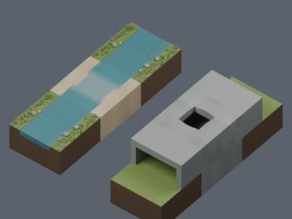
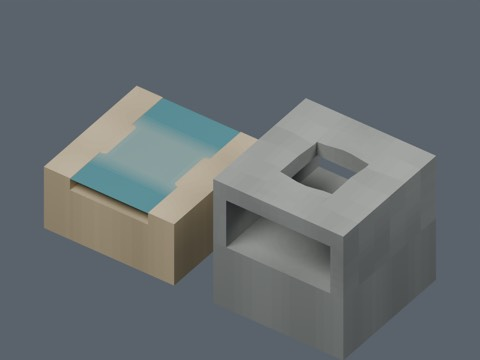

# Terrain batch 10: two distribution records

UC1001 (Shallow ford) and UC1002 (Cave skylight). Model geometry and included display materials only: CC0-1.0. BLEND and GLB are two formats of each record, not separate assets.

Previous 870 records + 2 = 872 distribution records. Global independent-design count is unverified. UC1003 and UC1004 are excluded because existing assemblies provide their uses.

Blender 5.2.2 reimport and sampled connection checks passed according to production validation. Collision, actual walking, navigation meshes, complete manifoldness, Blender 4.3.2 compatibility and global design independence are unverified. Water is a static display surface. No code, private records, rendered images or assembled scenes are distributed.

|ID|Name|ZIP|Bytes|
|---|---|---|---:|
|UC1001|Shallow ford|[Download](https://raw.githubusercontent.com/k3peta/tales-on-a-table/main/distributions/terrain-connectivity-10/zips/UC1001_CC0.zip)|680258|
|UC1002|Cave skylight|[Download](https://raw.githubusercontent.com/k3peta/tales-on-a-table/main/distributions/terrain-connectivity-10/zips/UC1002_CC0.zip)|505289|

[Checksums](../distributions/terrain-connectivity-10/SHA256SUMS.txt)

## 実作画像 / Actual renders

完成バッチの配置・接写。画像は閲覧用でモデルCC0の対象外です。[既存の画像利用条件](../LICENSE.md)を維持します。

|ID|名称 / Name|Download|
|---|---|---|
|UC1001|浅瀬|[ZIP](https://raw.githubusercontent.com/k3peta/tales-on-a-table/main/distributions/terrain-connectivity-10/zips/UC1001_CC0.zip)|
|UC1002|縦穴付き洞|[ZIP](https://raw.githubusercontent.com/k3peta/tales-on-a-table/main/distributions/terrain-connectivity-10/zips/UC1002_CC0.zip)|

