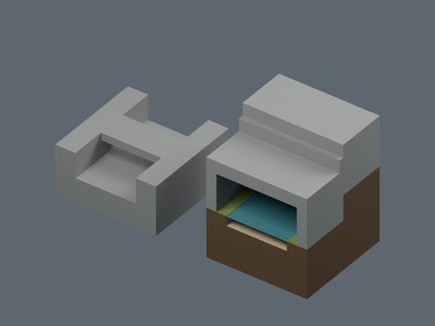
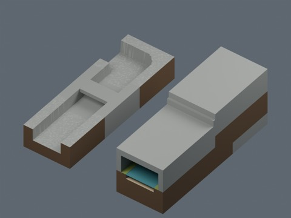

# Terrain batch 11: two distribution records

UD1101 (Under-rim drain) and UD1102 (Covered waterfall). Model geometry and included display materials only: CC0-1.0. BLEND and GLB are two formats of each record, not separate assets.

Previous 873 records + 2 = 875 distribution records. Global independent-design count is unverified. Sea cave entry and corner drain are excluded because existing assemblies provide their uses.

Blender 5.2.2 reimport and sampled connection checks passed according to production validation. Collision, actual walking, navigation meshes, arbitrary connections, complete manifoldness, Blender 4.3.2 compatibility and global design independence are unverified. Water is a static display surface. No code, private records, rendered images or assembled scenes are distributed.

|ID|Name|ZIP|Bytes|
|---|---|---|---:|
|UD1101|Under-rim drain|[Download](https://raw.githubusercontent.com/k3peta/tales-on-a-table/main/distributions/terrain-connectivity-11/zips/UD1101_CC0.zip)|63486|
|UD1102|Covered waterfall|[Download](https://raw.githubusercontent.com/k3peta/tales-on-a-table/main/distributions/terrain-connectivity-11/zips/UD1102_CC0.zip)|168460|

UD1102 is a structural derivative enclosing existing waterfall geometry, not a new waterfall shape. UD1101 is not a human passage.

[Checksums](../distributions/terrain-connectivity-11/SHA256SUMS.txt)

## 実作画像 / Actual renders

完成バッチの配置・接写。画像は閲覧用でモデルCC0の対象外です。[既存の画像利用条件](../LICENSE.md)を維持します。

|ID|名称 / Name|Download|
|---|---|---|
|UD1101|縁下排水口|[ZIP](https://raw.githubusercontent.com/k3peta/tales-on-a-table/main/distributions/terrain-connectivity-11/zips/UD1101_CC0.zip)|
|UD1102|洞内落差水路|[ZIP](https://raw.githubusercontent.com/k3peta/tales-on-a-table/main/distributions/terrain-connectivity-11/zips/UD1102_CC0.zip)|

