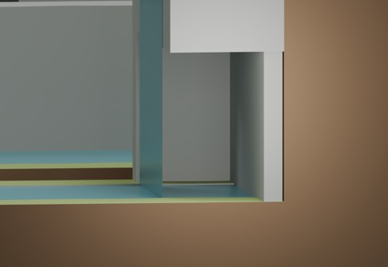
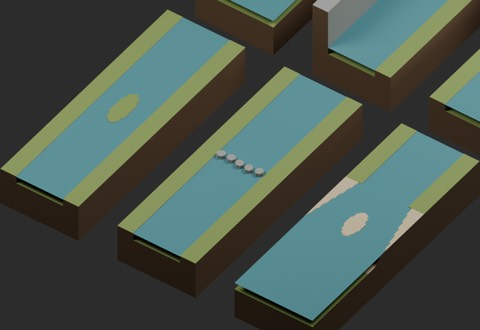
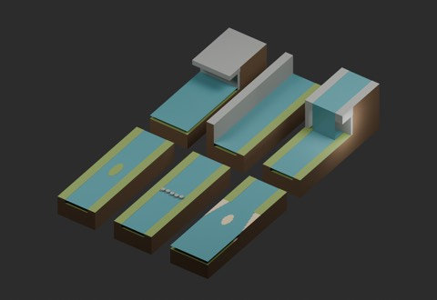
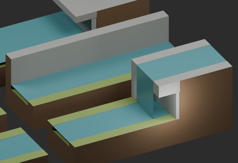

# Terrain use batch: six simplified connection models

911 existing records + 6 = 917 distribution records. Three local-use candidates (NP101, NP102, NP106) and three structural variants (NP103-NP105). Not six confirmed independent shapes. BLEND and GLB are two formats per record.

|ID|Classification|Download|Bytes|
|---|---|---|---:|
|NP101_BraidedIsland|local_use_candidate|[ZIP](https://raw.githubusercontent.com/k3peta/tales-on-a-table/main/distributions/terrain-use-plan-v1/NP101_BraidedIsland_CC0.zip)|243950|
|NP102_SteppingCrossing|local_use_candidate|[ZIP](https://raw.githubusercontent.com/k3peta/tales-on-a-table/main/distributions/terrain-use-plan-v1/NP102_SteppingCrossing_CC0.zip)|248287|
|NP103_DoubleMouth|structural_variant|[ZIP](https://raw.githubusercontent.com/k3peta/tales-on-a-table/main/distributions/terrain-use-plan-v1/NP103_DoubleMouth_CC0.zip)|269016|
|NP104_WetOverhang|structural_variant|[ZIP](https://raw.githubusercontent.com/k3peta/tales-on-a-table/main/distributions/terrain-use-plan-v1/NP104_WetOverhang_CC0.zip)|260493|
|NP105_CliffRiver|structural_variant|[ZIP](https://raw.githubusercontent.com/k3peta/tales-on-a-table/main/distributions/terrain-use-plan-v1/NP105_CliffRiver_CC0.zip)|242795|
|NP106_RecessedFall|local_use_candidate|[ZIP](https://raw.githubusercontent.com/k3peta/tales-on-a-table/main/distributions/terrain-use-plan-v1/NP106_RecessedFall_CC0.zip)|249011|

## Placement and limitations

- NP101_BraidedIsland: Local-use candidate: single N/S river split around central dry island then rejoined inside2m.
- NP102_SteppingCrossing: Local-use candidate: five grounded stepping stones crossing river, top.075m; water gaps remain. Not tested for walking.
- NP103_DoubleMouth: Structural variant: N river into S full sea, central sand island makes two outlets.
- NP104_WetOverhang: Structural variant: full sea bed-.19/water-.01 under roof underside.75/top1; N solid land1.
- NP105_CliffRiver: Structural variant: river bed-.19/water-.01, W bank1 and E bank0. N/S water ports standard; land heights differ on west.
- NP106_RecessedFall: Local-use candidate: lower river-.19/- .01 and upper bed1.31/water1.49, banks1.5. Behind water curtain lower cavity has ceiling1.05, open side. Not a human passage guarantee.

All tiles use 2 m XY extents (-1 to +1), metres, Z up, origin zero and fixed bottom -0.98 m. Standard river bed -0.19 m, water -0.01 m and wet width 1.2 m. NP105 west bank is 1 m high, so standard river land profiles do not match unchanged. NP106 upper bed/water are 1.31/1.49 m with banks at 1.5 m; its rear cavity is not a guaranteed human passage.

These are simplified, box-like connection models, not completed photorealistic natural landscapes. Water is a thin static opaque surface, not fluid volume or flow simulation. Sampled cross-sections and Blender 5.2.2 reloading were checked by production. Actual walking, collision, full-contact volumes, watertightness, arbitrary combinations, Blender 4.3.2 compatibility and global historical independence are unverified. Test fixtures and assembled scenes are not included. Append the named Collection from BLEND.

Model geometry and embedded display materials only: CC0-1.0. No code, images or private records included. [Checksums](../distributions/terrain-use-plan-v1/SHA256SUMS.txt).

## 実作画像 / Actual renders

完成バッチの配置・接写。画像は閲覧用でモデルCC0の対象外です。[既存の画像利用条件](../LICENSE.md)を維持します。

|ID|名称 / Name|Download|
|---|---|---|
|NP101_BraidedIsland|BraidedIsland|[ZIP](https://raw.githubusercontent.com/k3peta/tales-on-a-table/main/distributions/terrain-use-plan-v1/NP101_BraidedIsland_CC0.zip)|
|NP102_SteppingCrossing|SteppingCrossing|[ZIP](https://raw.githubusercontent.com/k3peta/tales-on-a-table/main/distributions/terrain-use-plan-v1/NP102_SteppingCrossing_CC0.zip)|
|NP103_DoubleMouth|DoubleMouth|[ZIP](https://raw.githubusercontent.com/k3peta/tales-on-a-table/main/distributions/terrain-use-plan-v1/NP103_DoubleMouth_CC0.zip)|
|NP104_WetOverhang|WetOverhang|[ZIP](https://raw.githubusercontent.com/k3peta/tales-on-a-table/main/distributions/terrain-use-plan-v1/NP104_WetOverhang_CC0.zip)|
|NP105_CliffRiver|CliffRiver|[ZIP](https://raw.githubusercontent.com/k3peta/tales-on-a-table/main/distributions/terrain-use-plan-v1/NP105_CliffRiver_CC0.zip)|
|NP106_RecessedFall|RecessedFall|[ZIP](https://raw.githubusercontent.com/k3peta/tales-on-a-table/main/distributions/terrain-use-plan-v1/NP106_RecessedFall_CC0.zip)|

