# 2m地形タイル v2

70配布レコード、70設計。HQ/LITEおよびBLEND/GLBは同一レコードに同梱。2m四方、中心原点。辺・角・道路・水路の接続規格を合わせて配置してください。全種類の任意隣接で継ぎ目ゼロを保証しません。

各単体ZIPはBLEND・GLB・README・ライセンスを含みます。モデルと必要な同梱材質のみCC0 1.0。記事・作例画像・完成配置シーンは対象外です。
BLENDは単体データのため、一部はFile > Appendでオブジェクト/コレクションを読み込んでください。GLBは微細バンプ等の表現がBlenderと異なることがあります。実機性能は未検証です。

| ID | 元ID | 素材 | 配布 |
|---|---|---|---|
| TR001 | T001 | grass short meadow | [ZIP](https://github.com/k3peta/tales-on-a-table/releases/download/v2026.10.21-terrain-v2/TR001_CC0.zip) |
| TR002 | T002 | grass long meadow | [ZIP](https://github.com/k3peta/tales-on-a-table/releases/download/v2026.10.21-terrain-v2/TR002_CC0.zip) |
| TR003 | T003 | grass wildflowers | [ZIP](https://github.com/k3peta/tales-on-a-table/releases/download/v2026.10.21-terrain-v2/TR003_CC0.zip) |
| TR004 | T004 | grass dry tussocks | [ZIP](https://github.com/k3peta/tales-on-a-table/releases/download/v2026.10.21-terrain-v2/TR004_CC0.zip) |
| TR005 | T005 | grass moss patches | [ZIP](https://github.com/k3peta/tales-on-a-table/releases/download/v2026.10.21-terrain-v2/TR005_CC0.zip) |
| TR006 | T006 | grass forest transition | [ZIP](https://github.com/k3peta/tales-on-a-table/releases/download/v2026.10.21-terrain-v2/TR006_CC0.zip) |
| TR007 | T007 | grass rock transition | [ZIP](https://github.com/k3peta/tales-on-a-table/releases/download/v2026.10.21-terrain-v2/TR007_CC0.zip) |
| TR008 | T008 | grass sand transition | [ZIP](https://github.com/k3peta/tales-on-a-table/releases/download/v2026.10.21-terrain-v2/TR008_CC0.zip) |
| TR009 | T009 | forest leaf litter | [ZIP](https://github.com/k3peta/tales-on-a-table/releases/download/v2026.10.21-terrain-v2/TR009_CC0.zip) |
| TR010 | T010 | forest mossy roots | [ZIP](https://github.com/k3peta/tales-on-a-table/releases/download/v2026.10.21-terrain-v2/TR010_CC0.zip) |
| TR011 | T011 | forest fern floor | [ZIP](https://github.com/k3peta/tales-on-a-table/releases/download/v2026.10.21-terrain-v2/TR011_CC0.zip) |
| TR012 | T012 | forest fallen branch | [ZIP](https://github.com/k3peta/tales-on-a-table/releases/download/v2026.10.21-terrain-v2/TR012_CC0.zip) |
| TR013 | T013 | forest stump clearing | [ZIP](https://github.com/k3peta/tales-on-a-table/releases/download/v2026.10.21-terrain-v2/TR013_CC0.zip) |
| TR014 | T014 | forest stone moss | [ZIP](https://github.com/k3peta/tales-on-a-table/releases/download/v2026.10.21-terrain-v2/TR014_CC0.zip) |
| TR015 | T015 | forest sparse grass | [ZIP](https://github.com/k3peta/tales-on-a-table/releases/download/v2026.10.21-terrain-v2/TR015_CC0.zip) |
| TR016 | T016 | forest exposed roots | [ZIP](https://github.com/k3peta/tales-on-a-table/releases/download/v2026.10.21-terrain-v2/TR016_CC0.zip) |
| TR017 | T017 | path straight NS | [ZIP](https://github.com/k3peta/tales-on-a-table/releases/download/v2026.10.21-terrain-v2/TR017_CC0.zip) |
| TR018 | T018 | path bend NE | [ZIP](https://github.com/k3peta/tales-on-a-table/releases/download/v2026.10.21-terrain-v2/TR018_CC0.zip) |
| TR019 | T019 | path junction NES | [ZIP](https://github.com/k3peta/tales-on-a-table/releases/download/v2026.10.21-terrain-v2/TR019_CC0.zip) |
| TR020 | T020 | path cross NESW | [ZIP](https://github.com/k3peta/tales-on-a-table/releases/download/v2026.10.21-terrain-v2/TR020_CC0.zip) |
| TR021 | T021 | path end N | [ZIP](https://github.com/k3peta/tales-on-a-table/releases/download/v2026.10.21-terrain-v2/TR021_CC0.zip) |
| TR022 | T022 | path straight NS rutted | [ZIP](https://github.com/k3peta/tales-on-a-table/releases/download/v2026.10.21-terrain-v2/TR022_CC0.zip) |
| TR023 | T023 | path bend NE stony | [ZIP](https://github.com/k3peta/tales-on-a-table/releases/download/v2026.10.21-terrain-v2/TR023_CC0.zip) |
| TR024 | T024 | path junction NES clearing | [ZIP](https://github.com/k3peta/tales-on-a-table/releases/download/v2026.10.21-terrain-v2/TR024_CC0.zip) |
| TR025 | T025 | rock flat scree | [ZIP](https://github.com/k3peta/tales-on-a-table/releases/download/v2026.10.21-terrain-v2/TR025_CC0.zip) |
| TR026 | T026 | rock low outcrop | [ZIP](https://github.com/k3peta/tales-on-a-table/releases/download/v2026.10.21-terrain-v2/TR026_CC0.zip) |
| TR027 | T027 | rock tall outcrop | [ZIP](https://github.com/k3peta/tales-on-a-table/releases/download/v2026.10.21-terrain-v2/TR027_CC0.zip) |
| TR028 | T028 | rock layered ridge | [ZIP](https://github.com/k3peta/tales-on-a-table/releases/download/v2026.10.21-terrain-v2/TR028_CC0.zip) |
| TR029 | T029 | rock broken slabs | [ZIP](https://github.com/k3peta/tales-on-a-table/releases/download/v2026.10.21-terrain-v2/TR029_CC0.zip) |
| TR030 | T030 | rock moss boulders | [ZIP](https://github.com/k3peta/tales-on-a-table/releases/download/v2026.10.21-terrain-v2/TR030_CC0.zip) |
| TR031 | T031 | rock sand transition | [ZIP](https://github.com/k3peta/tales-on-a-table/releases/download/v2026.10.21-terrain-v2/TR031_CC0.zip) |
| TR032 | T032 | rock snow transition | [ZIP](https://github.com/k3peta/tales-on-a-table/releases/download/v2026.10.21-terrain-v2/TR032_CC0.zip) |
| TR033 | T033 | sand flat fine | [ZIP](https://github.com/k3peta/tales-on-a-table/releases/download/v2026.10.21-terrain-v2/TR033_CC0.zip) |
| TR034 | T034 | sand wind ripples | [ZIP](https://github.com/k3peta/tales-on-a-table/releases/download/v2026.10.21-terrain-v2/TR034_CC0.zip) |
| TR035 | T035 | sand low dune | [ZIP](https://github.com/k3peta/tales-on-a-table/releases/download/v2026.10.21-terrain-v2/TR035_CC0.zip) |
| TR036 | T036 | sand pebble patch | [ZIP](https://github.com/k3peta/tales-on-a-table/releases/download/v2026.10.21-terrain-v2/TR036_CC0.zip) |
| TR037 | T037 | sand dry grass | [ZIP](https://github.com/k3peta/tales-on-a-table/releases/download/v2026.10.21-terrain-v2/TR037_CC0.zip) |
| TR038 | T038 | sand rock transition | [ZIP](https://github.com/k3peta/tales-on-a-table/releases/download/v2026.10.21-terrain-v2/TR038_CC0.zip) |
| TR039 | T039 | sand mud transition | [ZIP](https://github.com/k3peta/tales-on-a-table/releases/download/v2026.10.21-terrain-v2/TR039_CC0.zip) |
| TR040 | T040 | sand shell gravel | [ZIP](https://github.com/k3peta/tales-on-a-table/releases/download/v2026.10.21-terrain-v2/TR040_CC0.zip) |
| TR041 | T041 | water straight NS | [ZIP](https://github.com/k3peta/tales-on-a-table/releases/download/v2026.10.21-terrain-v2/TR041_CC0.zip) |
| TR042 | T042 | water bend NE | [ZIP](https://github.com/k3peta/tales-on-a-table/releases/download/v2026.10.21-terrain-v2/TR042_CC0.zip) |
| TR043 | T043 | water junction NES | [ZIP](https://github.com/k3peta/tales-on-a-table/releases/download/v2026.10.21-terrain-v2/TR043_CC0.zip) |
| TR044 | T044 | water cross NESW | [ZIP](https://github.com/k3peta/tales-on-a-table/releases/download/v2026.10.21-terrain-v2/TR044_CC0.zip) |
| TR045 | T045 | water end N pool | [ZIP](https://github.com/k3peta/tales-on-a-table/releases/download/v2026.10.21-terrain-v2/TR045_CC0.zip) |
| TR046 | T046 | water straight NS reeds | [ZIP](https://github.com/k3peta/tales-on-a-table/releases/download/v2026.10.21-terrain-v2/TR046_CC0.zip) |
| TR047 | T047 | water bend NE stones | [ZIP](https://github.com/k3peta/tales-on-a-table/releases/download/v2026.10.21-terrain-v2/TR047_CC0.zip) |
| TR048 | T048 | water junction NES marsh | [ZIP](https://github.com/k3peta/tales-on-a-table/releases/download/v2026.10.21-terrain-v2/TR048_CC0.zip) |
| TR049 | T049 | snow fresh flat | [ZIP](https://github.com/k3peta/tales-on-a-table/releases/download/v2026.10.21-terrain-v2/TR049_CC0.zip) |
| TR050 | T050 | snow wind drift | [ZIP](https://github.com/k3peta/tales-on-a-table/releases/download/v2026.10.21-terrain-v2/TR050_CC0.zip) |
| TR051 | T051 | snow rock exposed | [ZIP](https://github.com/k3peta/tales-on-a-table/releases/download/v2026.10.21-terrain-v2/TR051_CC0.zip) |
| TR052 | T052 | snow grass exposed | [ZIP](https://github.com/k3peta/tales-on-a-table/releases/download/v2026.10.21-terrain-v2/TR052_CC0.zip) |
| TR053 | T053 | snow ice patch | [ZIP](https://github.com/k3peta/tales-on-a-table/releases/download/v2026.10.21-terrain-v2/TR053_CC0.zip) |
| TR054 | T054 | snow forest floor | [ZIP](https://github.com/k3peta/tales-on-a-table/releases/download/v2026.10.21-terrain-v2/TR054_CC0.zip) |
| TR055 | T055 | snow sand transition | [ZIP](https://github.com/k3peta/tales-on-a-table/releases/download/v2026.10.21-terrain-v2/TR055_CC0.zip) |
| TR056 | T056 | snow compacted tracks | [ZIP](https://github.com/k3peta/tales-on-a-table/releases/download/v2026.10.21-terrain-v2/TR056_CC0.zip) |
| TR057 | T057 | grass forest transition outer corner | [ZIP](https://github.com/k3peta/tales-on-a-table/releases/download/v2026.10.21-terrain-v2/TR057_CC0.zip) |
| TR058 | T058 | grass forest transition inner corner | [ZIP](https://github.com/k3peta/tales-on-a-table/releases/download/v2026.10.21-terrain-v2/TR058_CC0.zip) |
| TR059 | T059 | grass rock transition outer corner | [ZIP](https://github.com/k3peta/tales-on-a-table/releases/download/v2026.10.21-terrain-v2/TR059_CC0.zip) |
| TR060 | T060 | grass rock transition inner corner | [ZIP](https://github.com/k3peta/tales-on-a-table/releases/download/v2026.10.21-terrain-v2/TR060_CC0.zip) |
| TR061 | T061 | grass sand transition outer corner | [ZIP](https://github.com/k3peta/tales-on-a-table/releases/download/v2026.10.21-terrain-v2/TR061_CC0.zip) |
| TR062 | T062 | grass sand transition inner corner | [ZIP](https://github.com/k3peta/tales-on-a-table/releases/download/v2026.10.21-terrain-v2/TR062_CC0.zip) |
| TR063 | T063 | rock sand transition outer corner | [ZIP](https://github.com/k3peta/tales-on-a-table/releases/download/v2026.10.21-terrain-v2/TR063_CC0.zip) |
| TR064 | T064 | rock sand transition inner corner | [ZIP](https://github.com/k3peta/tales-on-a-table/releases/download/v2026.10.21-terrain-v2/TR064_CC0.zip) |
| TR065 | T065 | rock snow transition outer corner | [ZIP](https://github.com/k3peta/tales-on-a-table/releases/download/v2026.10.21-terrain-v2/TR065_CC0.zip) |
| TR066 | T066 | rock snow transition inner corner | [ZIP](https://github.com/k3peta/tales-on-a-table/releases/download/v2026.10.21-terrain-v2/TR066_CC0.zip) |
| TR067 | T067 | sand mud transition outer corner | [ZIP](https://github.com/k3peta/tales-on-a-table/releases/download/v2026.10.21-terrain-v2/TR067_CC0.zip) |
| TR068 | T068 | sand mud transition inner corner | [ZIP](https://github.com/k3peta/tales-on-a-table/releases/download/v2026.10.21-terrain-v2/TR068_CC0.zip) |
| TR069 | T069 | snow sand transition outer corner | [ZIP](https://github.com/k3peta/tales-on-a-table/releases/download/v2026.10.21-terrain-v2/TR069_CC0.zip) |
| TR070 | T070 | snow sand transition inner corner | [ZIP](https://github.com/k3peta/tales-on-a-table/releases/download/v2026.10.21-terrain-v2/TR070_CC0.zip) |

## 作例・カタログ画像

画像は単体のすべてを示す保証ではありません。完成シーンは配布対象外です。画像にモデル用CC0を適用しません。

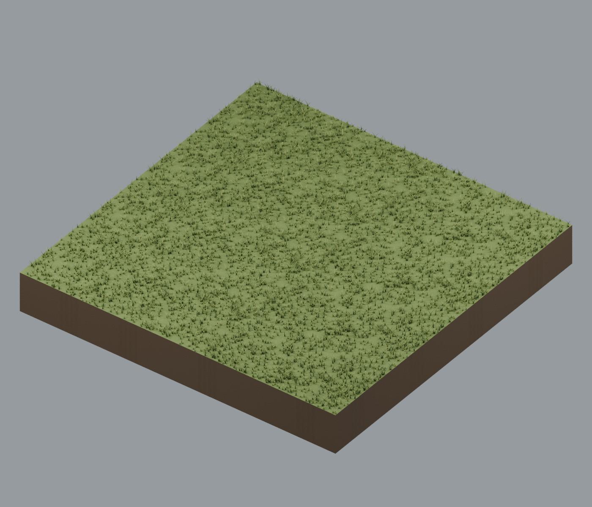

## 接続仕様

[全70種類の辺・角・開口仕様](../releases/terrain_v2/terrain_specification.json)を参照してください。元ID T001–T070は公開ID TR001–TR070に対応します。2m角、中心原点、地表Z=0、道路幅0.75m、水路幅1.2m、水面Z=-0.01mです。HQ/LITEは同じ接続規格です。岩の内側のLOD形状差・柄の反復・GLB微細バンプ省略は残ります。

[Release](https://github.com/k3peta/tales-on-a-table/releases/tag/v2026.10.21-terrain-v2) · [SHA256](../releases/terrain_v2/SHA256SUMS.txt) · [License](../LICENSE.md)

## Individual images / 個別画像 / 单件图片

Actual distributed models; chosen camera view does not establish intended front or placement pivot. Images are outside model CC0. Original links and archives retained.

### TR001 — grass short meadow

grass short meadow

[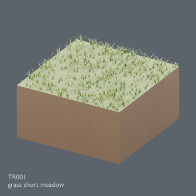](../previews/atelier-terrain24/renders/TR001.png)

[Full image](../previews/atelier-terrain24/renders/TR001.png) · [ZIP · BLEND/GLB](https://github.com/k3peta/tales-on-a-table/releases/download/v2026.10.21-terrain-v2/TR001_CC0.zip)

### TR002 — grass long meadow

grass long meadow

[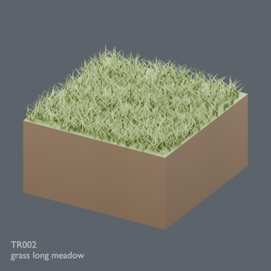](../previews/atelier-terrain24/renders/TR002.png)

[Full image](../previews/atelier-terrain24/renders/TR002.png) · [ZIP · BLEND/GLB](https://github.com/k3peta/tales-on-a-table/releases/download/v2026.10.21-terrain-v2/TR002_CC0.zip)

Image scope: TR001/TR002 show HQ only; LITE not shown.

## Individual images / 個別画像 / 单件图片

Actual distributed models; chosen camera view does not establish intended front or placement pivot. Images are outside model CC0. Original links and archives retained.

### TR003 — grass wildflowers

grass wildflowers

[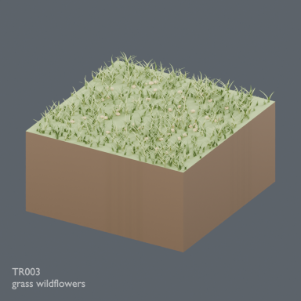](../previews/terrain-tr003-026/renders/TR003.png)

[Full image](../previews/terrain-tr003-026/renders/TR003.png) · [ZIP · BLEND/GLB](https://github.com/k3peta/tales-on-a-table/releases/download/v2026.10.21-terrain-v2/TR003_CC0.zip)

### TR004 — grass dry tussocks

grass dry tussocks

[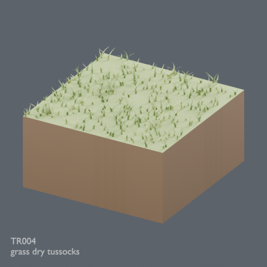](../previews/terrain-tr003-026/renders/TR004.png)

[Full image](../previews/terrain-tr003-026/renders/TR004.png) · [ZIP · BLEND/GLB](https://github.com/k3peta/tales-on-a-table/releases/download/v2026.10.21-terrain-v2/TR004_CC0.zip)

### TR005 — grass moss patches

grass moss patches

[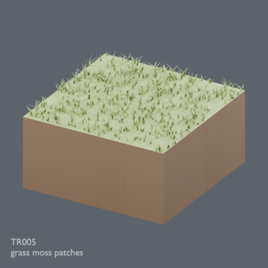](../previews/terrain-tr003-026/renders/TR005.png)

[Full image](../previews/terrain-tr003-026/renders/TR005.png) · [ZIP · BLEND/GLB](https://github.com/k3peta/tales-on-a-table/releases/download/v2026.10.21-terrain-v2/TR005_CC0.zip)

### TR006 — grass forest transition

grass forest transition

[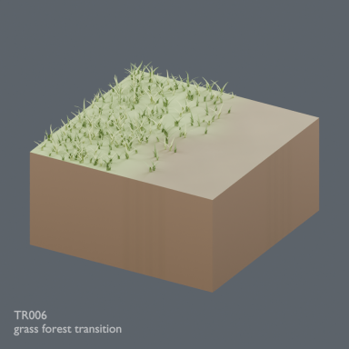](../previews/terrain-tr003-026/renders/TR006.png)

[Full image](../previews/terrain-tr003-026/renders/TR006.png) · [ZIP · BLEND/GLB](https://github.com/k3peta/tales-on-a-table/releases/download/v2026.10.21-terrain-v2/TR006_CC0.zip)

### TR007 — grass rock transition

grass rock transition

[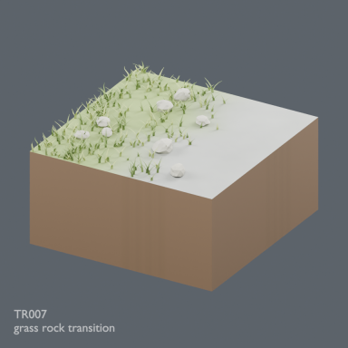](../previews/terrain-tr003-026/renders/TR007.png)

[Full image](../previews/terrain-tr003-026/renders/TR007.png) · [ZIP · BLEND/GLB](https://github.com/k3peta/tales-on-a-table/releases/download/v2026.10.21-terrain-v2/TR007_CC0.zip)

### TR008 — grass sand transition

grass sand transition

[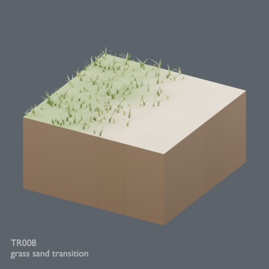](../previews/terrain-tr003-026/renders/TR008.png)

[Full image](../previews/terrain-tr003-026/renders/TR008.png) · [ZIP · BLEND/GLB](https://github.com/k3peta/tales-on-a-table/releases/download/v2026.10.21-terrain-v2/TR008_CC0.zip)

### TR009 — forest leaf litter

forest leaf litter

[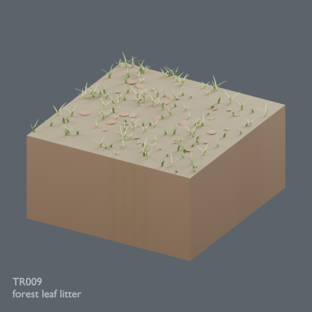](../previews/terrain-tr003-026/renders/TR009.png)

[Full image](../previews/terrain-tr003-026/renders/TR009.png) · [ZIP · BLEND/GLB](https://github.com/k3peta/tales-on-a-table/releases/download/v2026.10.21-terrain-v2/TR009_CC0.zip)

### TR010 — forest mossy roots

forest mossy roots

[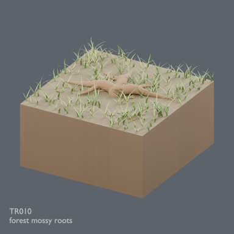](../previews/terrain-tr003-026/renders/TR010.png)

[Full image](../previews/terrain-tr003-026/renders/TR010.png) · [ZIP · BLEND/GLB](https://github.com/k3peta/tales-on-a-table/releases/download/v2026.10.21-terrain-v2/TR010_CC0.zip)

### TR011 — forest fern floor

forest fern floor

[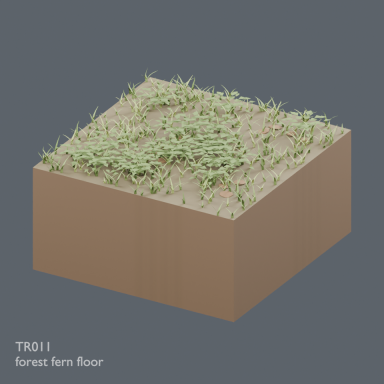](../previews/terrain-tr003-026/renders/TR011.png)

[Full image](../previews/terrain-tr003-026/renders/TR011.png) · [ZIP · BLEND/GLB](https://github.com/k3peta/tales-on-a-table/releases/download/v2026.10.21-terrain-v2/TR011_CC0.zip)

### TR012 — forest fallen branch

forest fallen branch

[Full image](../previews/terrain-tr003-026/renders/TR012.png) · [ZIP · BLEND/GLB](https://github.com/k3peta/tales-on-a-table/releases/download/v2026.10.21-terrain-v2/TR012_CC0.zip)

### TR013 — forest stump clearing

forest stump clearing

[Full image](../previews/terrain-tr003-026/renders/TR013.png) · [ZIP · BLEND/GLB](https://github.com/k3peta/tales-on-a-table/releases/download/v2026.10.21-terrain-v2/TR013_CC0.zip)

### TR014 — forest stone moss

forest stone moss

[Full image](../previews/terrain-tr003-026/renders/TR014.png) · [ZIP · BLEND/GLB](https://github.com/k3peta/tales-on-a-table/releases/download/v2026.10.21-terrain-v2/TR014_CC0.zip)

### TR015 — forest sparse grass

forest sparse grass

[Full image](../previews/terrain-tr003-026/renders/TR015.png) · [ZIP · BLEND/GLB](https://github.com/k3peta/tales-on-a-table/releases/download/v2026.10.21-terrain-v2/TR015_CC0.zip)

### TR016 — forest exposed roots

forest exposed roots

[Full image](../previews/terrain-tr003-026/renders/TR016.png) · [ZIP · BLEND/GLB](https://github.com/k3peta/tales-on-a-table/releases/download/v2026.10.21-terrain-v2/TR016_CC0.zip)

### TR017 — path straight NS

path straight NS

[Full image](../previews/terrain-tr003-026/renders/TR017.png) · [ZIP · BLEND/GLB](https://github.com/k3peta/tales-on-a-table/releases/download/v2026.10.21-terrain-v2/TR017_CC0.zip)

### TR018 — path bend NE

path bend NE

[Full image](../previews/terrain-tr003-026/renders/TR018.png) · [ZIP · BLEND/GLB](https://github.com/k3peta/tales-on-a-table/releases/download/v2026.10.21-terrain-v2/TR018_CC0.zip)

### TR019 — path junction NES

path junction NES

[Full image](../previews/terrain-tr003-026/renders/TR019.png) · [ZIP · BLEND/GLB](https://github.com/k3peta/tales-on-a-table/releases/download/v2026.10.21-terrain-v2/TR019_CC0.zip)

### TR020 — path cross NESW

path cross NESW

[Full image](../previews/terrain-tr003-026/renders/TR020.png) · [ZIP · BLEND/GLB](https://github.com/k3peta/tales-on-a-table/releases/download/v2026.10.21-terrain-v2/TR020_CC0.zip)

### TR021 — path end N

path end N

[Full image](../previews/terrain-tr003-026/renders/TR021.png) · [ZIP · BLEND/GLB](https://github.com/k3peta/tales-on-a-table/releases/download/v2026.10.21-terrain-v2/TR021_CC0.zip)

### TR022 — path straight NS rutted

path straight NS rutted

[Full image](../previews/terrain-tr003-026/renders/TR022.png) · [ZIP · BLEND/GLB](https://github.com/k3peta/tales-on-a-table/releases/download/v2026.10.21-terrain-v2/TR022_CC0.zip)

### TR023 — path bend NE stony

path bend NE stony

[Full image](../previews/terrain-tr003-026/renders/TR023.png) · [ZIP · BLEND/GLB](https://github.com/k3peta/tales-on-a-table/releases/download/v2026.10.21-terrain-v2/TR023_CC0.zip)

### TR024 — path junction NES clearing

path junction NES clearing

[Full image](../previews/terrain-tr003-026/renders/TR024.png) · [ZIP · BLEND/GLB](https://github.com/k3peta/tales-on-a-table/releases/download/v2026.10.21-terrain-v2/TR024_CC0.zip)

### TR025 — rock flat scree

rock flat scree

[Full image](../previews/terrain-tr003-026/renders/TR025.png) · [ZIP · BLEND/GLB](https://github.com/k3peta/tales-on-a-table/releases/download/v2026.10.21-terrain-v2/TR025_CC0.zip)

### TR026 — rock low outcrop

rock low outcrop

[Full image](../previews/terrain-tr003-026/renders/TR026.png) · [ZIP · BLEND/GLB](https://github.com/k3peta/tales-on-a-table/releases/download/v2026.10.21-terrain-v2/TR026_CC0.zip)

## Individual images / 個別画像 / 单件图片

HQ models shown; LITE not pictured. Actual distributed models; chosen camera view does not establish intended front or placement pivot. Images are outside model CC0. Original links and archives retained.

### TR027 — rock tall outcrop

rock tall outcrop

[Full image](../previews/terrain-tr027-050/renders/TR027.png) · [ZIP · BLEND/GLB](https://github.com/k3peta/tales-on-a-table/releases/download/v2026.10.21-terrain-v2/TR027_CC0.zip)

### TR028 — rock layered ridge

rock layered ridge

[Full image](../previews/terrain-tr027-050/renders/TR028.png) · [ZIP · BLEND/GLB](https://github.com/k3peta/tales-on-a-table/releases/download/v2026.10.21-terrain-v2/TR028_CC0.zip)

### TR029 — rock broken slabs

rock broken slabs

[Full image](../previews/terrain-tr027-050/renders/TR029.png) · [ZIP · BLEND/GLB](https://github.com/k3peta/tales-on-a-table/releases/download/v2026.10.21-terrain-v2/TR029_CC0.zip)

### TR030 — rock moss boulders

rock moss boulders

[Full image](../previews/terrain-tr027-050/renders/TR030.png) · [ZIP · BLEND/GLB](https://github.com/k3peta/tales-on-a-table/releases/download/v2026.10.21-terrain-v2/TR030_CC0.zip)

### TR031 — rock sand transition

rock sand transition

[Full image](../previews/terrain-tr027-050/renders/TR031.png) · [ZIP · BLEND/GLB](https://github.com/k3peta/tales-on-a-table/releases/download/v2026.10.21-terrain-v2/TR031_CC0.zip)

### TR032 — rock snow transition

rock snow transition

[Full image](../previews/terrain-tr027-050/renders/TR032.png) · [ZIP · BLEND/GLB](https://github.com/k3peta/tales-on-a-table/releases/download/v2026.10.21-terrain-v2/TR032_CC0.zip)

### TR033 — sand flat fine

sand flat fine

[Full image](../previews/terrain-tr027-050/renders/TR033.png) · [ZIP · BLEND/GLB](https://github.com/k3peta/tales-on-a-table/releases/download/v2026.10.21-terrain-v2/TR033_CC0.zip)

### TR034 — sand wind ripples

sand wind ripples

[Full image](../previews/terrain-tr027-050/renders/TR034.png) · [ZIP · BLEND/GLB](https://github.com/k3peta/tales-on-a-table/releases/download/v2026.10.21-terrain-v2/TR034_CC0.zip)

### TR035 — sand low dune

sand low dune

[Full image](../previews/terrain-tr027-050/renders/TR035.png) · [ZIP · BLEND/GLB](https://github.com/k3peta/tales-on-a-table/releases/download/v2026.10.21-terrain-v2/TR035_CC0.zip)

### TR036 — sand pebble patch

sand pebble patch

[Full image](../previews/terrain-tr027-050/renders/TR036.png) · [ZIP · BLEND/GLB](https://github.com/k3peta/tales-on-a-table/releases/download/v2026.10.21-terrain-v2/TR036_CC0.zip)

### TR037 — sand dry grass

sand dry grass

[Full image](../previews/terrain-tr027-050/renders/TR037.png) · [ZIP · BLEND/GLB](https://github.com/k3peta/tales-on-a-table/releases/download/v2026.10.21-terrain-v2/TR037_CC0.zip)

### TR038 — sand rock transition

sand rock transition

[Full image](../previews/terrain-tr027-050/renders/TR038.png) · [ZIP · BLEND/GLB](https://github.com/k3peta/tales-on-a-table/releases/download/v2026.10.21-terrain-v2/TR038_CC0.zip)

### TR039 — sand mud transition

sand mud transition

[Full image](../previews/terrain-tr027-050/renders/TR039.png) · [ZIP · BLEND/GLB](https://github.com/k3peta/tales-on-a-table/releases/download/v2026.10.21-terrain-v2/TR039_CC0.zip)

### TR040 — sand shell gravel

sand shell gravel

[Full image](../previews/terrain-tr027-050/renders/TR040.png) · [ZIP · BLEND/GLB](https://github.com/k3peta/tales-on-a-table/releases/download/v2026.10.21-terrain-v2/TR040_CC0.zip)

### TR041 — water straight NS

water straight NS

[Full image](../previews/terrain-tr027-050/renders/TR041.png) · [ZIP · BLEND/GLB](https://github.com/k3peta/tales-on-a-table/releases/download/v2026.10.21-terrain-v2/TR041_CC0.zip)

### TR042 — water bend NE

water bend NE

[Full image](../previews/terrain-tr027-050/renders/TR042.png) · [ZIP · BLEND/GLB](https://github.com/k3peta/tales-on-a-table/releases/download/v2026.10.21-terrain-v2/TR042_CC0.zip)

### TR043 — water junction NES

water junction NES

[Full image](../previews/terrain-tr027-050/renders/TR043.png) · [ZIP · BLEND/GLB](https://github.com/k3peta/tales-on-a-table/releases/download/v2026.10.21-terrain-v2/TR043_CC0.zip)

### TR044 — water cross NESW

water cross NESW

[Full image](../previews/terrain-tr027-050/renders/TR044.png) · [ZIP · BLEND/GLB](https://github.com/k3peta/tales-on-a-table/releases/download/v2026.10.21-terrain-v2/TR044_CC0.zip)

### TR045 — water end N pool

water end N pool

[Full image](../previews/terrain-tr027-050/renders/TR045.png) · [ZIP · BLEND/GLB](https://github.com/k3peta/tales-on-a-table/releases/download/v2026.10.21-terrain-v2/TR045_CC0.zip)

### TR046 — water straight NS reeds

water straight NS reeds

[Full image](../previews/terrain-tr027-050/renders/TR046.png) · [ZIP · BLEND/GLB](https://github.com/k3peta/tales-on-a-table/releases/download/v2026.10.21-terrain-v2/TR046_CC0.zip)

### TR047 — water bend NE stones

water bend NE stones

[Full image](../previews/terrain-tr027-050/renders/TR047.png) · [ZIP · BLEND/GLB](https://github.com/k3peta/tales-on-a-table/releases/download/v2026.10.21-terrain-v2/TR047_CC0.zip)

### TR048 — water junction NES marsh

water junction NES marsh

[Full image](../previews/terrain-tr027-050/renders/TR048.png) · [ZIP · BLEND/GLB](https://github.com/k3peta/tales-on-a-table/releases/download/v2026.10.21-terrain-v2/TR048_CC0.zip)

### TR049 — snow fresh flat

snow fresh flat

[Full image](../previews/terrain-tr027-050/renders/TR049.png) · [ZIP · BLEND/GLB](https://github.com/k3peta/tales-on-a-table/releases/download/v2026.10.21-terrain-v2/TR049_CC0.zip)

### TR050 — snow wind drift

snow wind drift

[Full image](../previews/terrain-tr027-050/renders/TR050.png) · [ZIP · BLEND/GLB](https://github.com/k3peta/tales-on-a-table/releases/download/v2026.10.21-terrain-v2/TR050_CC0.zip)

## Individual images / 個別画像 / 单件图片

HQ models shown; LITE not pictured. Actual distributed models; chosen camera view does not establish intended front or placement pivot. Images are outside model CC0. Original links and archives retained.

### TR051 — snow rock exposed

snow rock exposed

[Full image](../previews/terrain-tr051-ud24/renders/TR051.png) · [ZIP · BLEND/GLB](https://github.com/k3peta/tales-on-a-table/releases/download/v2026.10.21-terrain-v2/TR051_CC0.zip)

### TR052 — snow grass exposed

snow grass exposed

[Full image](../previews/terrain-tr051-ud24/renders/TR052.png) · [ZIP · BLEND/GLB](https://github.com/k3peta/tales-on-a-table/releases/download/v2026.10.21-terrain-v2/TR052_CC0.zip)

### TR053 — snow ice patch

snow ice patch

[Full image](../previews/terrain-tr051-ud24/renders/TR053.png) · [ZIP · BLEND/GLB](https://github.com/k3peta/tales-on-a-table/releases/download/v2026.10.21-terrain-v2/TR053_CC0.zip)

### TR054 — snow forest floor

snow forest floor

[Full image](../previews/terrain-tr051-ud24/renders/TR054.png) · [ZIP · BLEND/GLB](https://github.com/k3peta/tales-on-a-table/releases/download/v2026.10.21-terrain-v2/TR054_CC0.zip)

### TR055 — snow sand transition

snow sand transition

[Full image](../previews/terrain-tr051-ud24/renders/TR055.png) · [ZIP · BLEND/GLB](https://github.com/k3peta/tales-on-a-table/releases/download/v2026.10.21-terrain-v2/TR055_CC0.zip)

### TR056 — snow compacted tracks

snow compacted tracks

[Full image](../previews/terrain-tr051-ud24/renders/TR056.png) · [ZIP · BLEND/GLB](https://github.com/k3peta/tales-on-a-table/releases/download/v2026.10.21-terrain-v2/TR056_CC0.zip)

### TR057 — grass forest transition outer corner

grass forest transition outer corner

[Full image](../previews/terrain-tr051-ud24/renders/TR057.png) · [ZIP · BLEND/GLB](https://github.com/k3peta/tales-on-a-table/releases/download/v2026.10.21-terrain-v2/TR057_CC0.zip)

### TR058 — grass forest transition inner corner

grass forest transition inner corner

[Full image](../previews/terrain-tr051-ud24/renders/TR058.png) · [ZIP · BLEND/GLB](https://github.com/k3peta/tales-on-a-table/releases/download/v2026.10.21-terrain-v2/TR058_CC0.zip)

### TR059 — grass rock transition outer corner

grass rock transition outer corner

[Full image](../previews/terrain-tr051-ud24/renders/TR059.png) · [ZIP · BLEND/GLB](https://github.com/k3peta/tales-on-a-table/releases/download/v2026.10.21-terrain-v2/TR059_CC0.zip)

### TR060 — grass rock transition inner corner

grass rock transition inner corner

[Full image](../previews/terrain-tr051-ud24/renders/TR060.png) · [ZIP · BLEND/GLB](https://github.com/k3peta/tales-on-a-table/releases/download/v2026.10.21-terrain-v2/TR060_CC0.zip)

### TR061 — grass sand transition outer corner

grass sand transition outer corner

[Full image](../previews/terrain-tr051-ud24/renders/TR061.png) · [ZIP · BLEND/GLB](https://github.com/k3peta/tales-on-a-table/releases/download/v2026.10.21-terrain-v2/TR061_CC0.zip)

### TR062 — grass sand transition inner corner

grass sand transition inner corner

[Full image](../previews/terrain-tr051-ud24/renders/TR062.png) · [ZIP · BLEND/GLB](https://github.com/k3peta/tales-on-a-table/releases/download/v2026.10.21-terrain-v2/TR062_CC0.zip)

### TR063 — rock sand transition outer corner

rock sand transition outer corner

[Full image](../previews/terrain-tr051-ud24/renders/TR063.png) · [ZIP · BLEND/GLB](https://github.com/k3peta/tales-on-a-table/releases/download/v2026.10.21-terrain-v2/TR063_CC0.zip)

### TR064 — rock sand transition inner corner

rock sand transition inner corner

[Full image](../previews/terrain-tr051-ud24/renders/TR064.png) · [ZIP · BLEND/GLB](https://github.com/k3peta/tales-on-a-table/releases/download/v2026.10.21-terrain-v2/TR064_CC0.zip)

### TR065 — rock snow transition outer corner

rock snow transition outer corner

[Full image](../previews/terrain-tr051-ud24/renders/TR065.png) · [ZIP · BLEND/GLB](https://github.com/k3peta/tales-on-a-table/releases/download/v2026.10.21-terrain-v2/TR065_CC0.zip)

### TR066 — rock snow transition inner corner

rock snow transition inner corner

[Full image](../previews/terrain-tr051-ud24/renders/TR066.png) · [ZIP · BLEND/GLB](https://github.com/k3peta/tales-on-a-table/releases/download/v2026.10.21-terrain-v2/TR066_CC0.zip)

### TR067 — sand mud transition outer corner

sand mud transition outer corner

[Full image](../previews/terrain-tr051-ud24/renders/TR067.png) · [ZIP · BLEND/GLB](https://github.com/k3peta/tales-on-a-table/releases/download/v2026.10.21-terrain-v2/TR067_CC0.zip)

### TR068 — sand mud transition inner corner

sand mud transition inner corner

[Full image](../previews/terrain-tr051-ud24/renders/TR068.png) · [ZIP · BLEND/GLB](https://github.com/k3peta/tales-on-a-table/releases/download/v2026.10.21-terrain-v2/TR068_CC0.zip)

### TR069 — snow sand transition outer corner

snow sand transition outer corner

[Full image](../previews/terrain-tr051-ud24/renders/TR069.png) · [ZIP · BLEND/GLB](https://github.com/k3peta/tales-on-a-table/releases/download/v2026.10.21-terrain-v2/TR069_CC0.zip)

### TR070 — snow sand transition inner corner

snow sand transition inner corner

[Full image](../previews/terrain-tr051-ud24/renders/TR070.png) · [ZIP · BLEND/GLB](https://github.com/k3peta/tales-on-a-table/releases/download/v2026.10.21-terrain-v2/TR070_CC0.zip)
