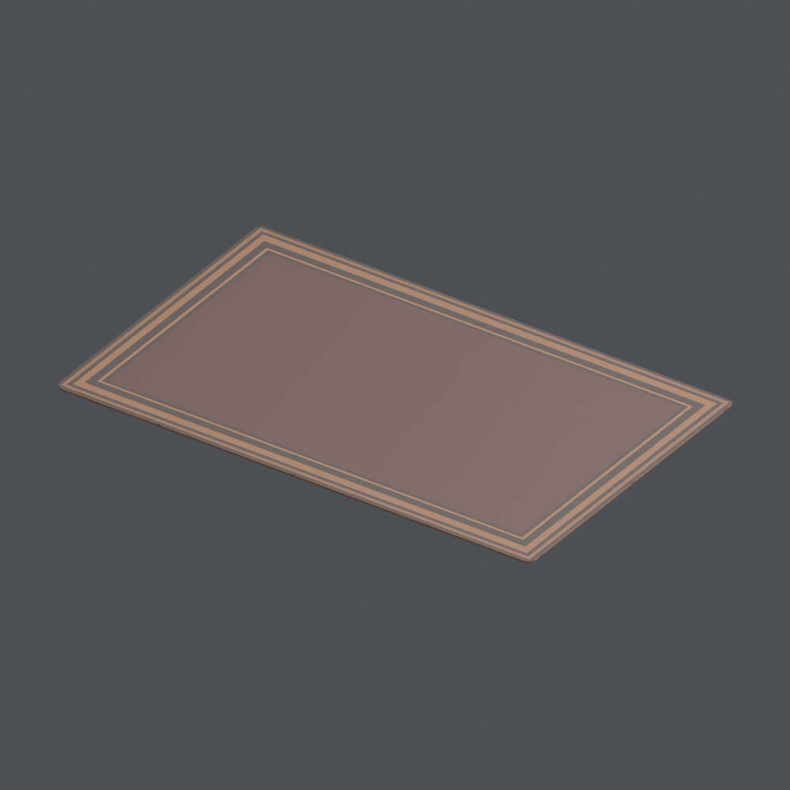
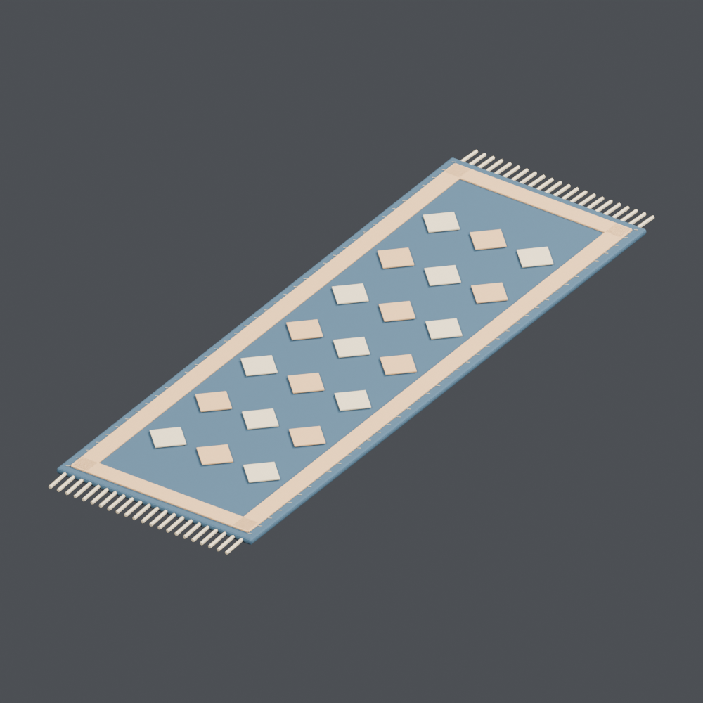
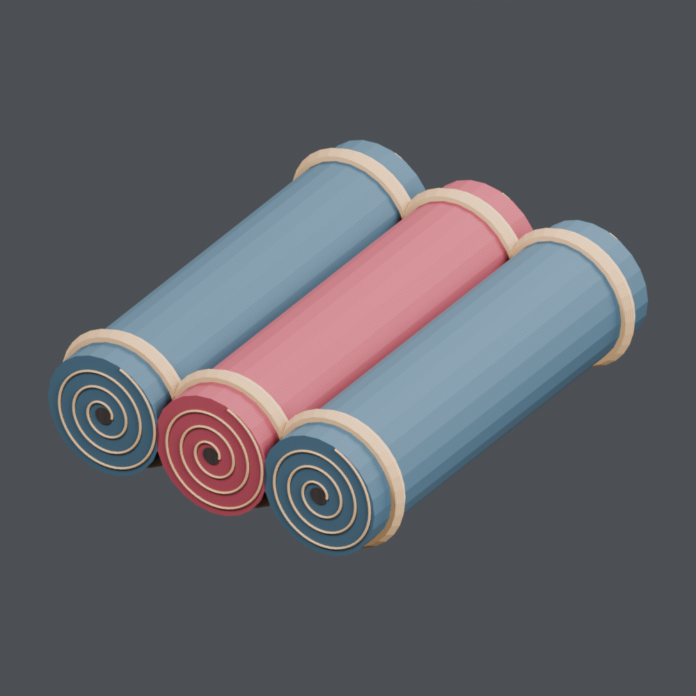
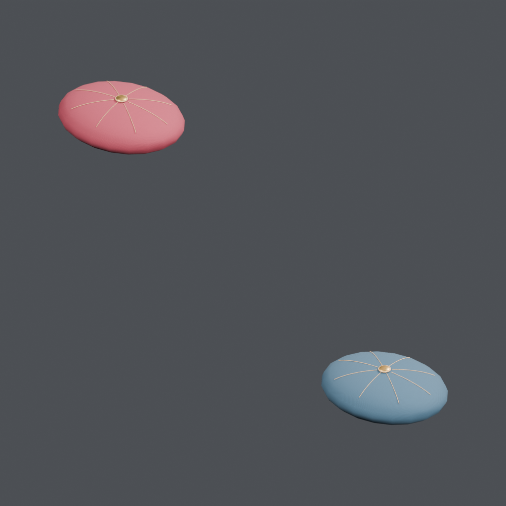
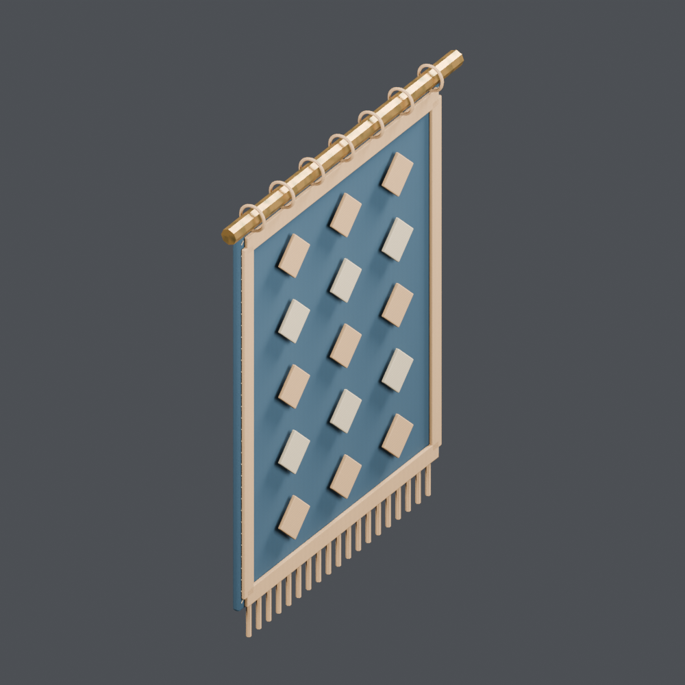
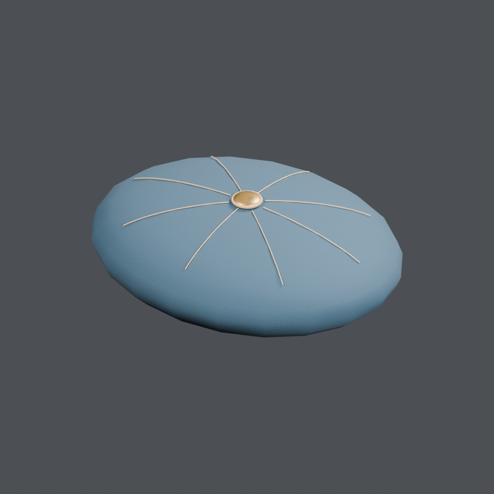
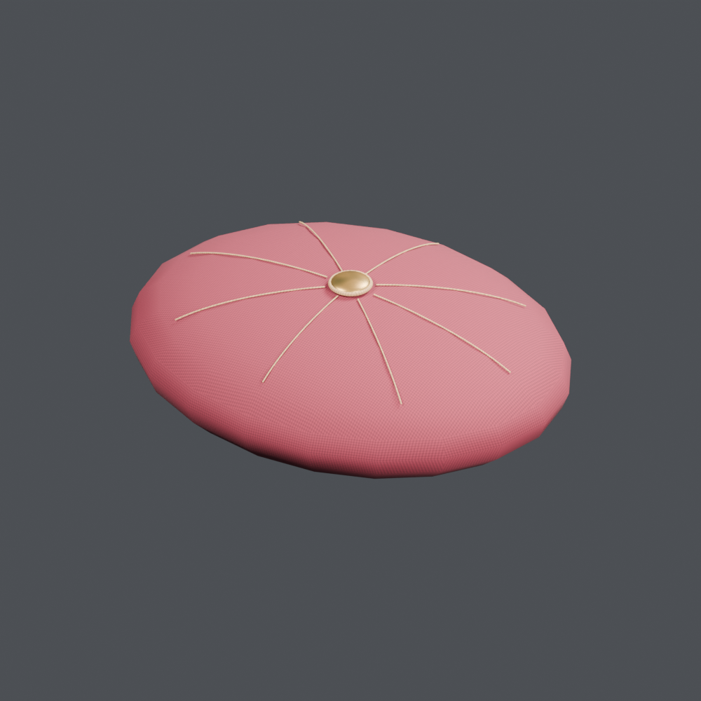

# 织物与衣物 1

[← 素材架首页](../README.zh-CN.md)

[日本語](textiles_01.md) · [English](textiles_01.en.md) · [简体中文](textiles_01.zh-CN.md)

## FT_049 — 带编织纹样的薄地毯

酒馆素材「带编织纹样的薄地毯」。计数单位：一个模型记录。包含BLEND和GLB。近景图由所提供的BLEND实际渲染。

[ZIP · BLEND + GLB · 0.64 MB](https://github.com/k3peta/tales-on-a-table/releases/download/v2026.10.18/FT_049_CC0.zip) · CC0-1.0

`catalog-20261018` · SHA-256: `2a2fc62f714e925fa3a7ec9dffcb5a11d620af88a468d946fcd9ec102974d643`

## FH_037 — 挂在钉子上的雨披

港口码头素材「挂在钉子上的雨披」。计数单位：一个模型记录。包含BLEND和GLB。近景图由所提供的BLEND实际渲染。

[ZIP · BLEND + GLB · 0.46 MB](https://github.com/k3peta/tales-on-a-table/releases/download/v2026.10.18/FH_037_CC0.zip) · CC0-1.0

`catalog-20261018` · SHA-256: `6f6d37f32ef3c273fede1a25a0cb999974f57a442163b1031386cace7f165345`

## FH_038 — 晾晒中的一双长靴

港口码头素材「晾晒中的一双长靴」。计数单位：一个模型记录。包含BLEND和GLB。近景图由所提供的BLEND实际渲染。

[ZIP · BLEND + GLB · 0.39 MB](https://github.com/k3peta/tales-on-a-table/releases/download/v2026.10.18/FH_038_CC0.zip) · CC0-1.0

`quality-patch-20261017` · SHA-256: `5329f5f8fdd70b1c92d14ce5ec416497722307ea37e4bc5f901f548e814c4898`

## OL_005 — 深红团花地毯

灯具店素材「深红团花地毯」。计数单位：一个模型记录。包含BLEND和GLB。近景图由所提供的BLEND实际渲染。

[ZIP · BLEND + GLB · 0.93 MB](https://github.com/k3peta/tales-on-a-table/releases/download/v2026.10.18/OL_005_CC0.zip) · CC0-1.0

`catalog-20261018` · SHA-256: `d92d9efc2b43c96d99ed226ea62d63316c503d026ec28adf299c5140015950e4`

## OL_011 — 靛蓝长条地毯

灯具店素材「靛蓝长条地毯」。计数单位：一个模型记录。包含BLEND和GLB。近景图由所提供的BLEND实际渲染。

[ZIP · BLEND + GLB · 0.92 MB](https://github.com/k3peta/tales-on-a-table/releases/download/v2026.10.18/OL_011_CC0.zip) · CC0-1.0

`catalog-20261018` · SHA-256: `6a9393b0c46220e1218ad527ea46aa932406fbab5b288f17db65faa842afbbd5`

## OL_014 — 三卷地毯

灯具店素材「三卷地毯」。计数单位：一个模型记录。包含BLEND和GLB。近景图由所提供的BLEND实际渲染。

[ZIP · BLEND + GLB · 1.38 MB](https://github.com/k3peta/tales-on-a-table/releases/download/v2026.10.18/OL_014_CC0.zip) · CC0-1.0

`catalog-20261018` · SHA-256: `c6366d2a15511a44833c3f3116adcc715b79558acbe07d1f92c3b898ffbaed94`

## OL_019 — 一组丝绸靠垫

灯具店素材「一组丝绸靠垫」。计数单位：一个模型记录。包含BLEND和GLB。近景图由所提供的BLEND实际渲染。

[ZIP · BLEND + GLB · 1.83 MB](https://github.com/k3peta/tales-on-a-table/releases/download/v2026.10.18/OL_019_CC0.zip) · CC0-1.0

`catalog-20261018` · SHA-256: `d8dbce1a94174ccdfa4dba29b62ce5f387edef2b62b742a494495f37c2cc2ad3`

## OL_035 — 靛蓝壁毯

灯具店素材「靛蓝壁毯」。计数单位：一个模型记录。包含BLEND和GLB。近景图由所提供的BLEND实际渲染。

[ZIP · BLEND + GLB · 1.72 MB](https://github.com/k3peta/tales-on-a-table/releases/download/v2026.10.18/OL_035_CC0.zip) · CC0-1.0

`catalog-20261018` · SHA-256: `3ce18c3e0b26ba02fdc3fc09b16fa2313d2e389c90c3cf0be37a6cf4514ff1ad`

## OL_extra_blue — 蓝色单体靠垫

灯具店素材「蓝色单体靠垫」。计数单位：从已有模型分离的部件。包含BLEND和GLB。近景图由所提供的BLEND实际渲染。

[ZIP · BLEND + GLB · 1.64 MB](https://github.com/k3peta/tales-on-a-table/releases/download/v2026.10.18/OL_extra_blue_CC0.zip) · CC0-1.0

`catalog-20261018` · SHA-256: `0daec767e5694bcb4a8377123692831ec2f117d3aec39261a39f4b05749f437f`

## OL_extra_red — 红色单体靠垫

灯具店素材「红色单体靠垫」。计数单位：从已有模型分离的部件。包含BLEND和GLB。近景图由所提供的BLEND实际渲染。

[ZIP · BLEND + GLB · 1.65 MB](https://github.com/k3peta/tales-on-a-table/releases/download/v2026.10.18/OL_extra_red_CC0.zip) · CC0-1.0

`catalog-20261018` · SHA-256: `87352b3b86b7673ead7b43f91a7812163d8bff783060d770c24dd12a86aa2faf`

## AT_034 — 带羽毛的旧帽

古董店素材「带羽毛的旧帽」。计数单位：一个模型记录。包含BLEND和GLB。近景图由所提供的BLEND实际渲染。

[ZIP · BLEND + GLB · 0.84 MB](https://github.com/k3peta/tales-on-a-table/releases/download/v2026.10.18/AT_034_CC0.zip) · CC0-1.0

`catalog-20261018` · SHA-256: `09901917ca629678093510b47bcc911ff7f4a657b1bdfca1cd0efcc4c2aa6db7`

## AT_035 — 一双旧靴

古董店素材「一双旧靴」。计数单位：一个模型记录。包含BLEND和GLB。近景图由所提供的BLEND实际渲染。

[ZIP · BLEND + GLB · 1.32 MB](https://github.com/k3peta/tales-on-a-table/releases/download/v2026.10.18/AT_035_CC0.zip) · CC0-1.0

`catalog-20261018` · SHA-256: `199f5954dc61946cf3c2fba71ca6eab1fbf0288ac8c2f8e6043e538def87a15e`

## AT_080 — 亚麻布下的封印物

古董店素材「亚麻布下的封印物」。计数单位：一个包含多个物体的组合。包含BLEND和GLB。近景图由所提供的BLEND实际渲染。 保留原始素材名称。近景可见木托盘上放着书、瓶子和杯子的组合。

[ZIP · BLEND + GLB · 0.33 MB](https://github.com/k3peta/tales-on-a-table/releases/download/v2026.10.18/AT_080_CC0.zip) · CC0-1.0

`catalog-20261018` · SHA-256: `ba03e087e22d3da0d51699d6eca4c92b10ddb5d54b15acddc9144d3ba886252a`
