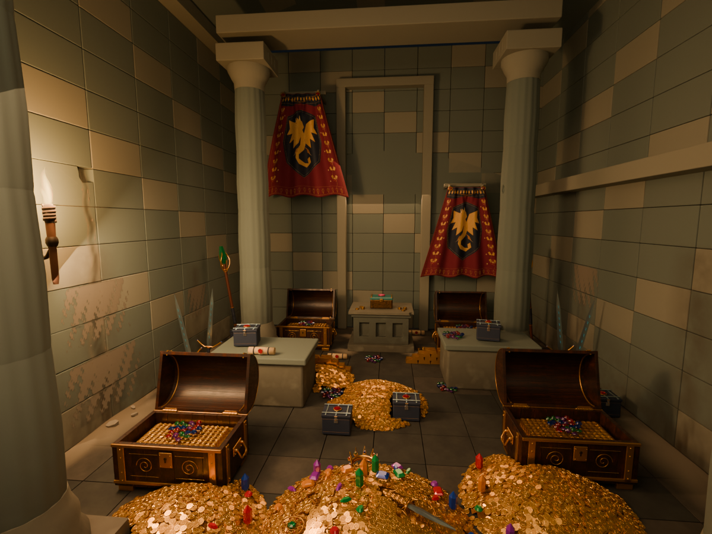

# 竜の宝物庫 — 17セット品質更新

[日本語](treasury.md) · [English](treasury.en.md) · [简体中文](treasury.zh-CN.md)

既存17記録（16単品形状＋宝石小山1グループ）の品質更新です。新種類加算0。単品は合格済みv6、作例画像は建築v7です。松明の暖光と、100年以上手入れされていない部屋を意図した経年表現へ更新しました。旧版17セットと25色GLBは旧リリースに保持し、今回のZIPには改訂した基準モデルを収録しています。

[Previous release / 旧版](https://github.com/k3peta/tales-on-a-table/releases/tag/v2026.10.19-treasury)

2026-10-19 quality revision: the existing 17 records are updated; new design count = 0. The model bytes are the independently accepted v6 assets. Static decorative models, metres, BLEND and GLB. No rig, collisions or game-engine performance certification. The mantle is a high-density still-image asset (~4.65 million triangles); a lighter version is deferred. Blender procedural microdetail is not fully baked into GLB. Models and display materials remain CC0-1.0; articles, images, code and complete scene layouts are excluded. No completed scene BLEND is distributed.

既存17記録の品質更新で、新種類の加算は0です。合格済みv6のモデルを収録。メートル単位の静的装飾素材で、リグ・衝突形状・ゲームエンジン別の実測保証はありません。マントは約465万三角形の高密度版で、軽量版は後工程です。Blender固有の微細凹凸はGLBへ完全にはベイクしていません。自作モデルと表示材質はCC0、記事・画像・コード・完成配置は対象外。完成配置BLENDは配布しません。

现有17条记录的质量更新，新增种类为0。收录通过独立检查的v6模型。静态装饰素材，单位为米，不含骨骼、碰撞体或游戏引擎性能保证。披风约465万三角形，轻量版留待后续。Blender微细程序纹理未完整烘焙到GLB。原创模型及显示材质保持CC0，文章、图片、代码和完整场景不在此范围内。不分发完整场景BLEND。

## TD_001 — 太陽と翠玉のタリスマン

透かしの八芒輪、中央の多面翠玉、鎖環、裏側の封印文様。

0.199 × 0.363 × 0.040 m · model · CC0-1.0

[ZIP · BLEND + GLB](https://github.com/k3peta/tales-on-a-table/releases/download/v2026.10.19-treasury-quality/TD_001_CC0.zip)

## TD_002 — 月光の長剣

菱断面の長い刃、象嵌文字、翼状鍔、革巻き柄、青玉柄頭。

0.392 × 0.076 × 1.260 m · model · CC0-1.0

[ZIP · BLEND + GLB](https://github.com/k3peta/tales-on-a-table/releases/download/v2026.10.19-treasury-quality/TD_002_CC0.zip)

## TD_003 — 竜頭の儀礼短剣

二本角と宝石の眼、連続した吻と顎を持つ竜頭柄頭。尖った鱗板の柄、薄い接合部と翼鍔、菱断面刃。

0.188 × 0.112 × 0.557 m · model · CC0-1.0

[ZIP · BLEND + GLB](https://github.com/k3peta/tales-on-a-table/releases/download/v2026.10.19-treasury-quality/TD_003_CC0.zip)

## TD_004 — 星竜の刺繍マント

濃紺の盾に面刺繍の竜と翼、連続する花と月桂葉、扇形の裾、襟元と紅玉の留め具を備える深紅のマント。

1.543 × 0.282 × 1.696 m · model · CC0-1.0

[ZIP · BLEND + GLB](https://github.com/k3peta/tales-on-a-table/releases/download/v2026.10.19-treasury-quality/TD_004_CC0.zip)

## TD_005 — 翠晶を抱く魔法杖

螺旋の枝金具が大きな結晶を支え、革巻きと石突きを持つ長杖。

0.194 × 0.177 × 1.840 m · model · CC0-1.0

[ZIP · BLEND + GLB](https://github.com/k3peta/tales-on-a-table/releases/download/v2026.10.19-treasury-quality/TD_005_CC0.zip)

## TD_006 — 封蝋と金帯の秘伝巻物

20周の巻紙断面、縫い目のある二本の革帯、封紙と凹刻された赤い封蝋。

0.320 × 0.106 × 0.091 m · model · CC0-1.0

[ZIP · BLEND + GLB](https://github.com/k3peta/tales-on-a-table/releases/download/v2026.10.19-treasury-quality/TD_006_CC0.zip)

## TD_007 — 王家の紋章金貨

両面の縁、表の王冠紋、放射状刻みと側面のミル打ちを持つ金貨。

0.045 × 0.045 × 0.006 m · model · CC0-1.0

[ZIP · BLEND + GLB](https://github.com/k3peta/tales-on-a-table/releases/download/v2026.10.19-treasury-quality/TD_007_CC0.zip)

## TD_008 — 刻印入り金塊

台形鋳型の金塊、面取りと凹刻された純度・検印。

0.190 × 0.085 × 0.055 m · model · CC0-1.0

[ZIP · BLEND + GLB](https://github.com/k3peta/tales-on-a-table/releases/download/v2026.10.19-treasury-quality/TD_008_CC0.zip)

## TD_009 — 多面宝石の小山

四種の色と異なる大きさの面取り宝石を集めた1グループ。個数を種類に加算しない。

0.209 × 0.211 × 0.034 m · group · CC0-1.0

[ZIP · BLEND + GLB](https://github.com/k3peta/tales-on-a-table/releases/download/v2026.10.19-treasury-quality/TD_009_CC0.zip)

## TD_010 — 九葉の宝冠

透かしの葉飾り、赤と青の石留め、彫金の二重帯を備えた王冠。

0.272 × 0.275 × 0.119 m · model · CC0-1.0

[ZIP · BLEND + GLB](https://github.com/k3peta/tales-on-a-table/releases/download/v2026.10.19-treasury-quality/TD_010_CC0.zip)

## TD_011 — 金装飾の開いた宝箱

内壁・底・曲面蓋・蝶番・角金具・鍵穴を持つ大箱。中身は別素材で配置。

1.094 × 0.951 × 0.981 m · model · CC0-1.0

[ZIP · BLEND + GLB](https://github.com/k3peta/tales-on-a-table/releases/download/v2026.10.19-treasury-quality/TD_011_CC0.zip)

## TD_012 — 封印された宝石小箱

上下に重なる銀の帯金、支持座、蝶番と掛け金、赤石留めを持つ四角い小箱。

0.312 × 0.270 × 0.265 m · model · CC0-1.0

[ZIP · BLEND + GLB](https://github.com/k3peta/tales-on-a-table/releases/download/v2026.10.19-treasury-quality/TD_012_CC0.zip)

## TD_013 — 円形ブリリアント宝石

独立した宝石・結晶の基準形状。旧版5色GLBは旧リリースに保持し、色違いを別種類に数えません。

0.064 × 0.064 × 0.041 m · model · CC0-1.0

[ZIP · BLEND + GLB](https://github.com/k3peta/tales-on-a-table/releases/download/v2026.10.19-treasury-quality/TD_013_CC0.zip)

## TD_014 — 長方形ステップカット宝石

独立した宝石・結晶の基準形状。旧版5色GLBは旧リリースに保持し、色違いを別種類に数えません。

0.072 × 0.096 × 0.047 m · model · CC0-1.0

[ZIP · BLEND + GLB](https://github.com/k3peta/tales-on-a-table/releases/download/v2026.10.19-treasury-quality/TD_014_CC0.zip)

## TD_015 — 洋梨形カット宝石

独立した宝石・結晶の基準形状。旧版5色GLBは旧リリースに保持し、色違いを別種類に数えません。

0.050 × 0.064 × 0.041 m · model · CC0-1.0

[ZIP · BLEND + GLB](https://github.com/k3peta/tales-on-a-table/releases/download/v2026.10.19-treasury-quality/TD_015_CC0.zip)

## TD_016 — マーキス形カット宝石

独立した宝石・結晶の基準形状。旧版5色GLBは旧リリースに保持し、色違いを別種類に数えません。

0.035 × 0.083 × 0.041 m · model · CC0-1.0

[ZIP · BLEND + GLB](https://github.com/k3peta/tales-on-a-table/releases/download/v2026.10.19-treasury-quality/TD_016_CC0.zip)

## TD_017 — 六角柱の原石結晶

独立した宝石・結晶の基準形状。旧版5色GLBは旧リリースに保持し、色違いを別種類に数えません。

0.064 × 0.055 × 0.140 m · model · CC0-1.0

[ZIP · BLEND + GLB](https://github.com/k3peta/tales-on-a-table/releases/download/v2026.10.19-treasury-quality/TD_017_CC0.zip)
