# 巨龙宝库 — 17个分发套件

[日本語](treasury.md) · [English](treasury.en.md) · [简体中文](treasury.zh-CN.md)

17条分发记录：16种单体形状和1个宝石堆组合。五形状各五色，共25个宝石GLB，包含在对应的单体ZIP中，颜色不另计种类。场景内14,167枚金币是重复摆放数量，既有复用素材也不计入新增。

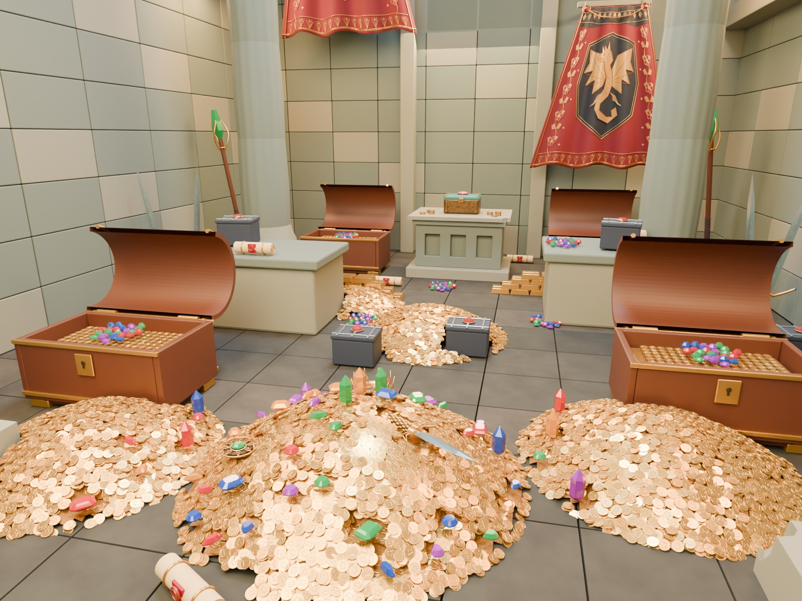

Metres; bottom-centre root origin; GLB Y-up. Static decorative models; editable parts in BLEND. No rig, animation, collision mesh or engine-specific optimization. Materials can differ by renderer. Scene coins use shaped underfill and repeated meshes, not rigid-body simulation. Full WebGL performance is not verified. Original models and display materials: CC0-1.0. Articles, renders, code and completed scene layouts are excluded. No completed scene BLEND is distributed.

メートル単位、底面中央のルート原点、GLBはY-up。BLENDの部品は編集可能。静的装飾素材で、リグ・アニメーション・衝突形状・エンジン別最適化は含みません。材質は表示環境で異なる場合があります。自作モデルと表示材質はCC0。記事・画像・コード・完成配置シーンは対象外で、完成シーンBLENDは配布しません。

单位为米，底面中央根原点，GLB为Y-up。BLEND部件可编辑。静态装饰素材，不含骨架、动画、碰撞体或引擎专用优化；材质显示因环境而异。原创模型及显示材质采用CC0，文章、渲染图、代码与完整场景布局不在此范围内，不分发完整场景BLEND。

## TD_001 — 太阳与翠玉护符

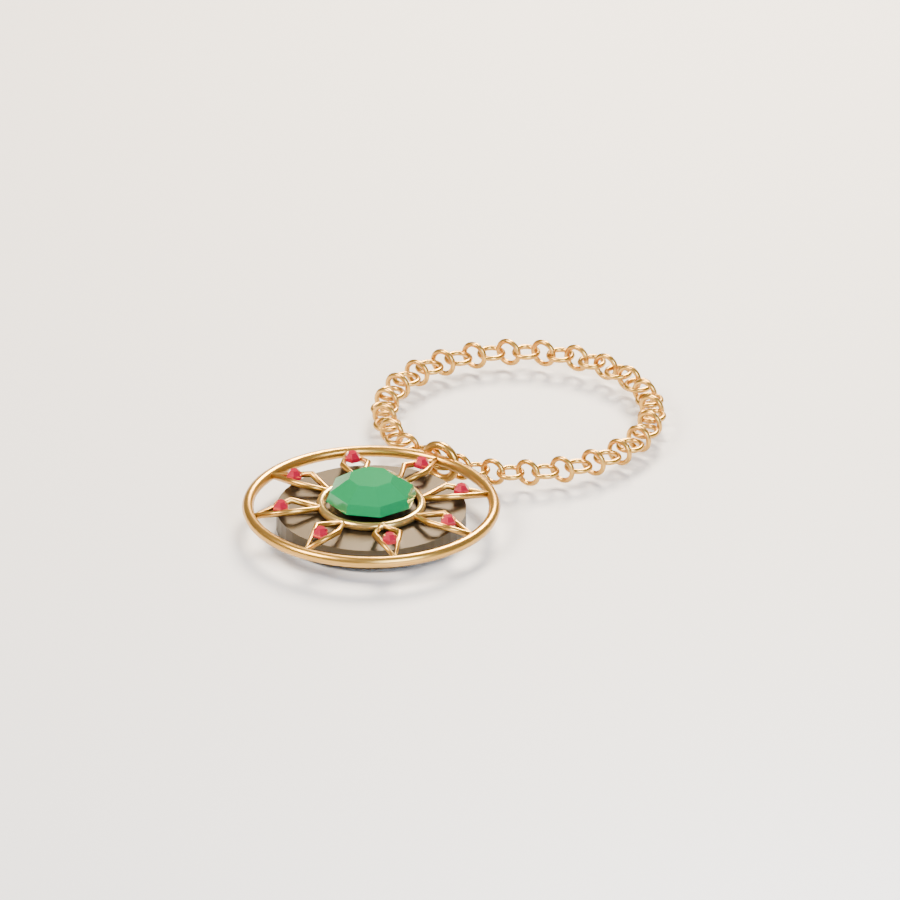

镂空八芒环、多面绿色主石、链环及背面封印纹样。

0.200 × 0.367 × 0.040 m · model · CC0-1.0

[ZIP · BLEND + GLB](https://github.com/k3peta/tales-on-a-table/releases/download/v2026.10.19-treasury/TD_001_CC0.zip)

## TD_002 — 月光长剑

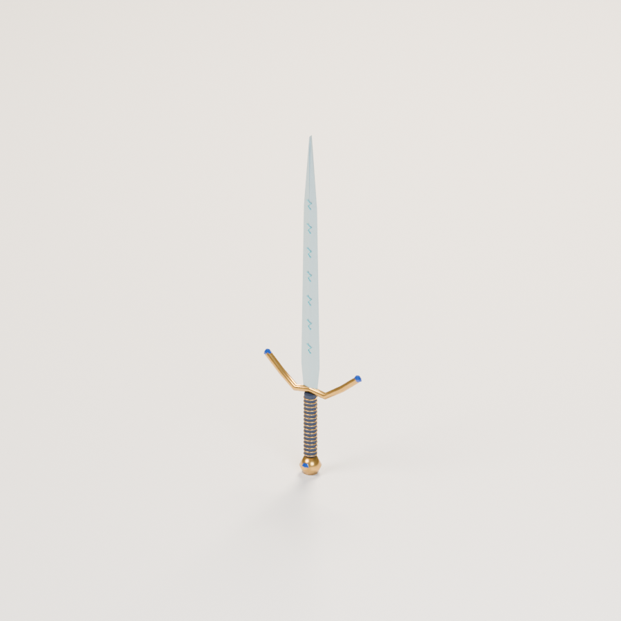

菱形截面剑身、镶嵌纹字、翼形护手、皮革握柄及蓝色柄头宝石。

0.392 × 0.076 × 1.260 m · model · CC0-1.0

[ZIP · BLEND + GLB](https://github.com/k3peta/tales-on-a-table/releases/download/v2026.10.19-treasury/TD_002_CC0.zip)

## TD_003 — 龙首仪式短剑

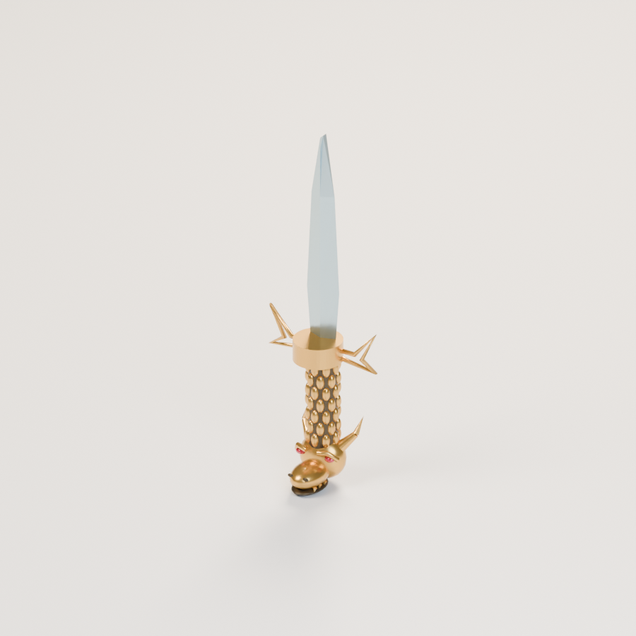

带角、眉、鼻孔及獠牙的龙首柄头，配鳞纹握柄与翼形护手。

0.188 × 0.119 × 0.558 m · model · CC0-1.0

[ZIP · BLEND + GLB](https://github.com/k3peta/tales-on-a-table/releases/download/v2026.10.19-treasury/TD_003_CC0.zip)

## TD_004 — 星龙刺绣披风

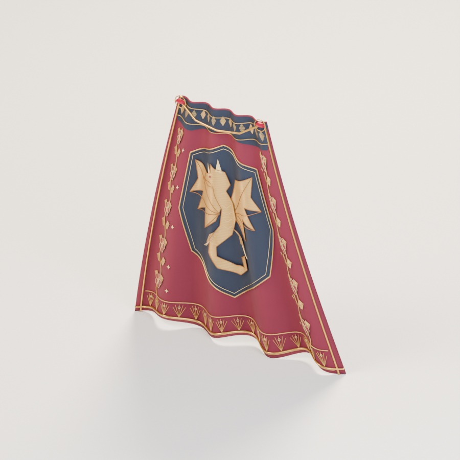

深红披风，深蓝盾形底上的金色龙纹面刺绣、花叶边饰、扇形下摆及红宝石扣。

1.543 × 0.308 × 1.696 m · model · CC0-1.0

[ZIP · BLEND + GLB](https://github.com/k3peta/tales-on-a-table/releases/download/v2026.10.19-treasury/TD_004_CC0.zip)

## TD_005 — 翠晶魔杖

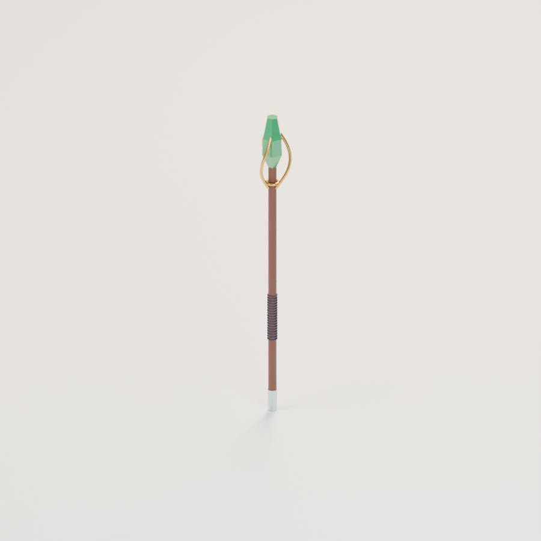

螺旋金属枝托起大型晶体，配皮革握柄与杖尾金属套。

0.194 × 0.177 × 1.840 m · model · CC0-1.0

[ZIP · BLEND + GLB](https://github.com/k3peta/tales-on-a-table/releases/download/v2026.10.19-treasury/TD_005_CC0.zip)

## TD_006 — 封蜡秘传卷轴

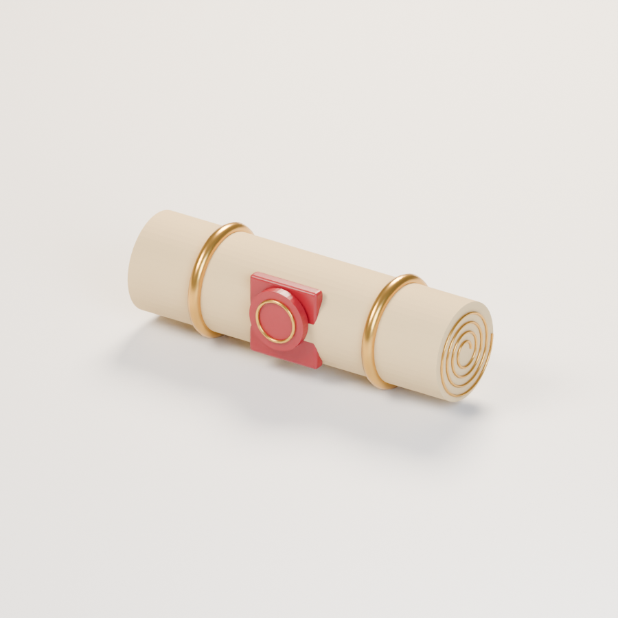

羊皮纸卷端、两条金带、垂下的封条及压印红色封蜡。

0.324 × 0.109 × 0.104 m · model · CC0-1.0

[ZIP · BLEND + GLB](https://github.com/k3peta/tales-on-a-table/releases/download/v2026.10.19-treasury/TD_006_CC0.zip)

## TD_007 — 王家纹章金币

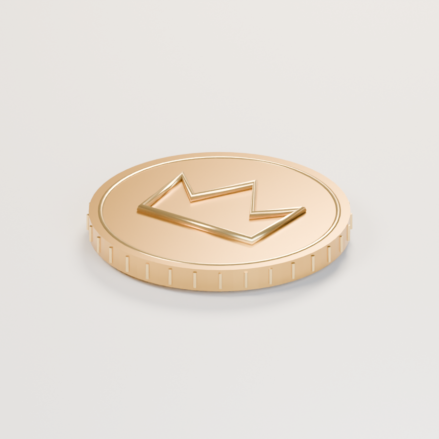

双面凸缘、王冠纹章、放射刻纹及齿状边缘。

0.045 × 0.045 × 0.005 m · model · CC0-1.0

[ZIP · BLEND + GLB](https://github.com/k3peta/tales-on-a-table/releases/download/v2026.10.19-treasury/TD_007_CC0.zip)

## TD_008 — 带印记的金锭

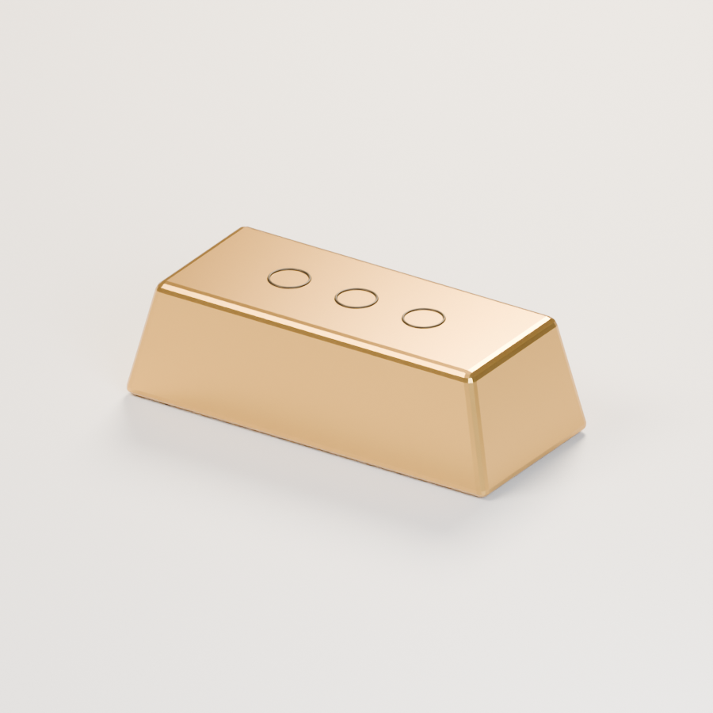

带倒角、纯度标记及独立检验印记部件的梯形铸造金锭。

0.188 × 0.084 × 0.056 m · model · CC0-1.0

[ZIP · BLEND + GLB](https://github.com/k3peta/tales-on-a-table/releases/download/v2026.10.19-treasury/TD_008_CC0.zip)

## TD_009 — 多面宝石堆

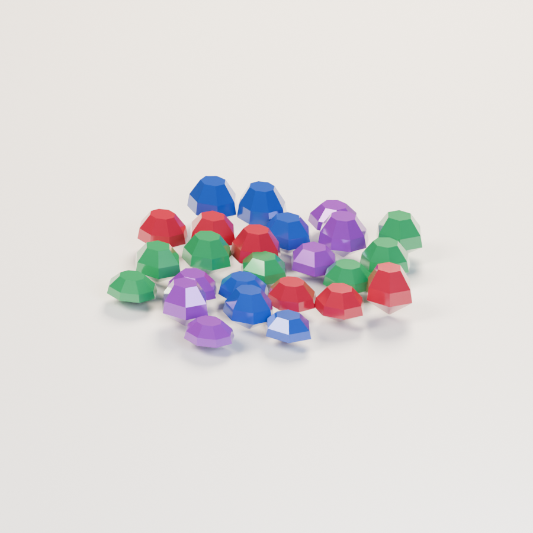

由四种颜色、不同尺寸的倒角宝石组成的一个组，不按内部颗数增加种类。

0.209 × 0.211 × 0.034 m · group · CC0-1.0

[ZIP · BLEND + GLB](https://github.com/k3peta/tales-on-a-table/releases/download/v2026.10.19-treasury/TD_009_CC0.zip)

## TD_010 — 九叶宝冠

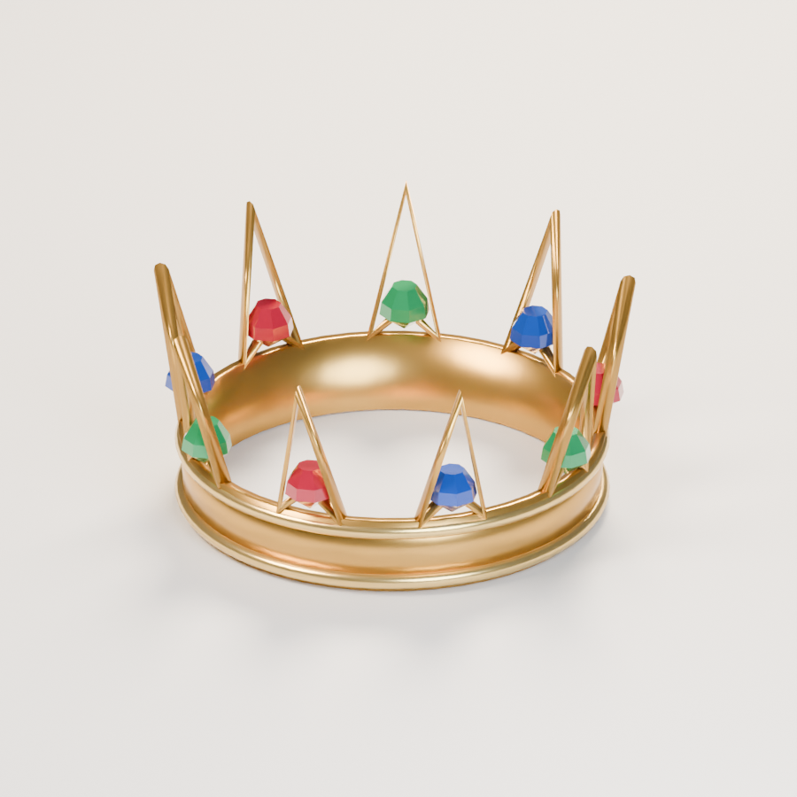

镂空叶饰、红蓝宝石镶座及双层雕花冠带。

0.240 × 0.244 × 0.119 m · model · CC0-1.0

[ZIP · BLEND + GLB](https://github.com/k3peta/tales-on-a-table/releases/download/v2026.10.19-treasury/TD_010_CC0.zip)

## TD_011 — 镀金敞开宝箱

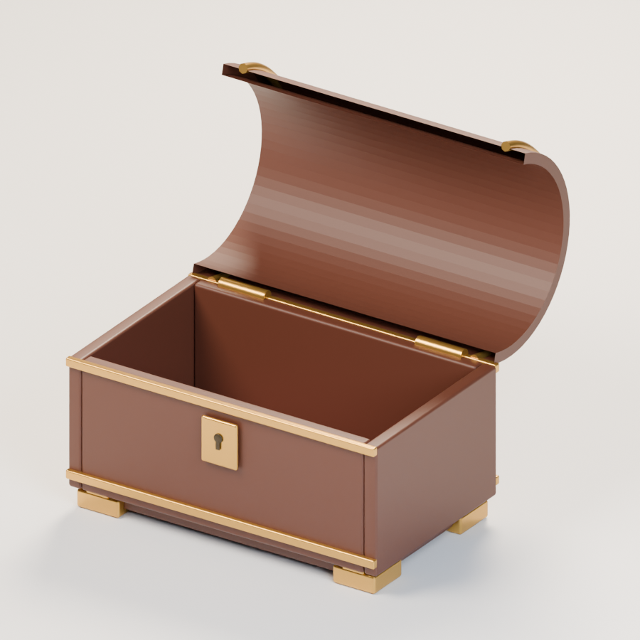

带内壁、底板、曲面箱盖、铰链与角部金属件的大型静态宝箱，内容物为独立素材。

0.940 × 0.951 × 0.987 m · model · CC0-1.0

[ZIP · BLEND + GLB](https://github.com/k3peta/tales-on-a-table/releases/download/v2026.10.19-treasury/TD_011_CC0.zip)

## TD_012 — 封印珠宝匣

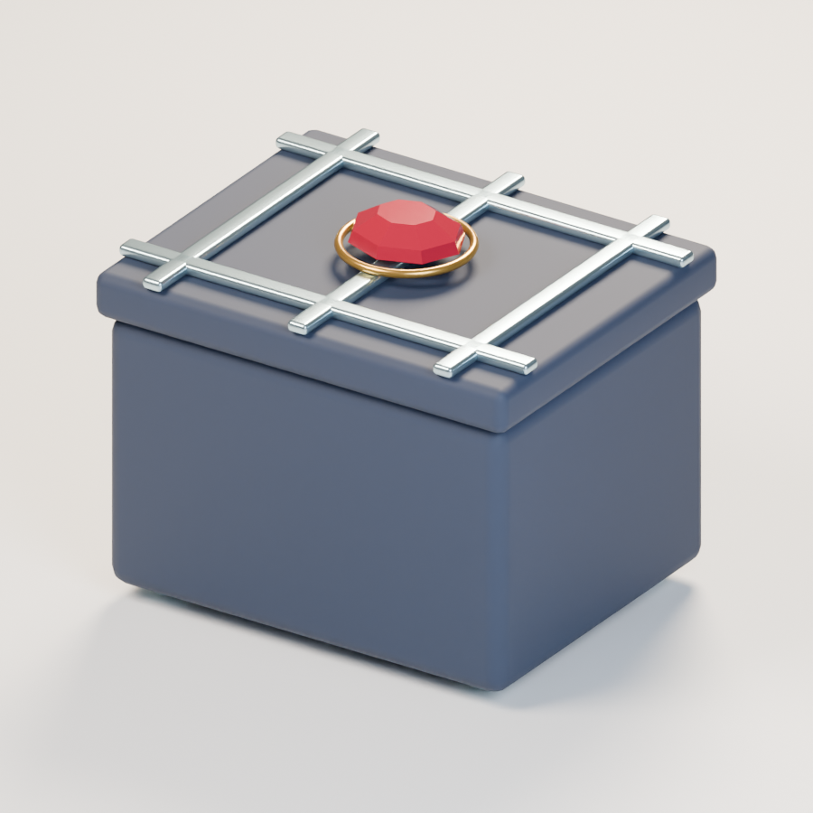

方形小匣，配银色格状金属件、中央红宝石、底脚及箱盖接缝。

0.312 × 0.255 × 0.265 m · model · CC0-1.0

[ZIP · BLEND + GLB](https://github.com/k3peta/tales-on-a-table/releases/download/v2026.10.19-treasury/TD_012_CC0.zip)

## TD_013 — 圆形明亮式宝石

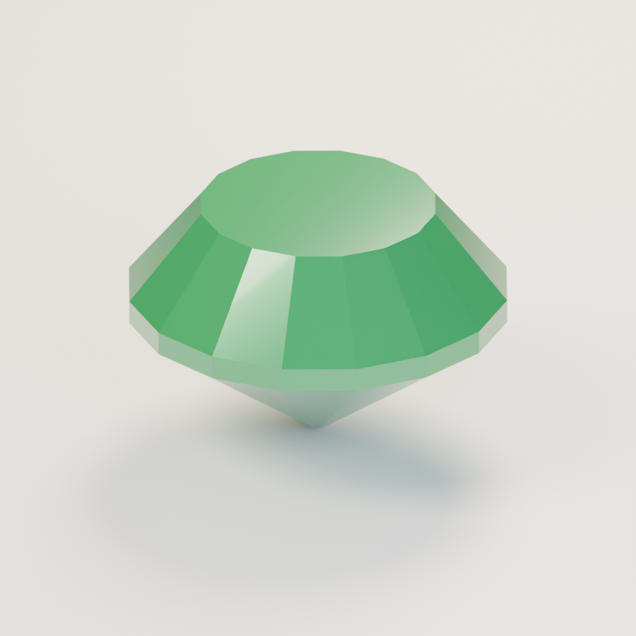

一种切割形状，附红、蓝、绿、紫、琥珀五色GLB，颜色不另计种类。

0.064 × 0.064 × 0.041 m · model · CC0-1.0

[ZIP · BLEND + GLB](https://github.com/k3peta/tales-on-a-table/releases/download/v2026.10.19-treasury/TD_013_CC0.zip)

## TD_014 — 长方形阶梯切割宝石

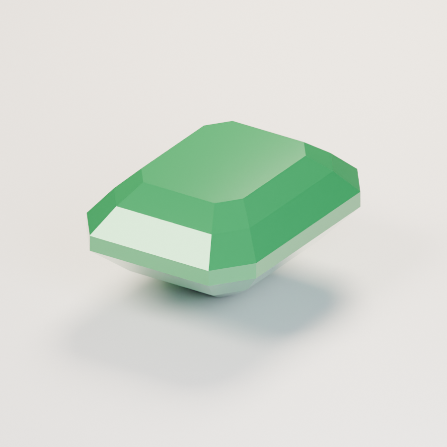

一种切割形状，附红、蓝、绿、紫、琥珀五色GLB，颜色不另计种类。

0.072 × 0.096 × 0.047 m · model · CC0-1.0

[ZIP · BLEND + GLB](https://github.com/k3peta/tales-on-a-table/releases/download/v2026.10.19-treasury/TD_014_CC0.zip)

## TD_015 — 梨形切割宝石

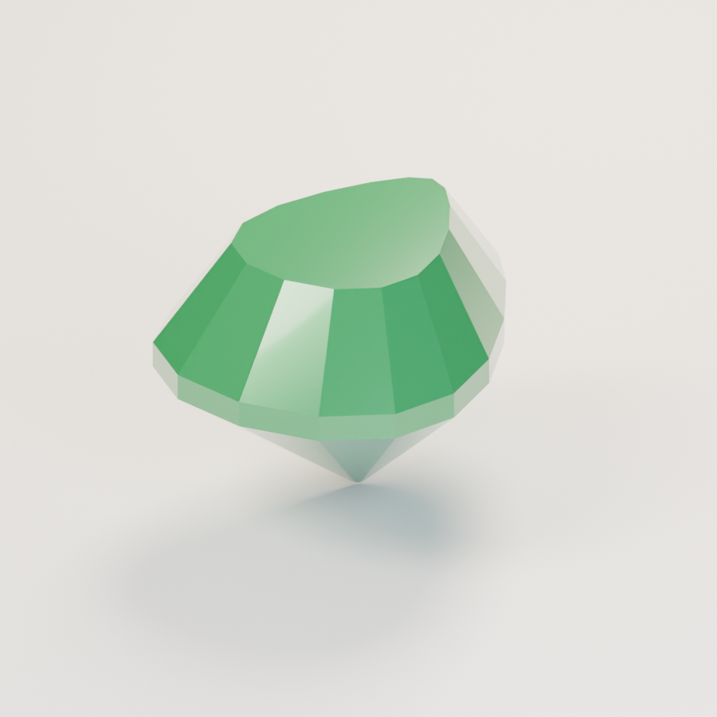

一种切割形状，附红、蓝、绿、紫、琥珀五色GLB，颜色不另计种类。

0.050 × 0.064 × 0.041 m · model · CC0-1.0

[ZIP · BLEND + GLB](https://github.com/k3peta/tales-on-a-table/releases/download/v2026.10.19-treasury/TD_015_CC0.zip)

## TD_016 — 马眼形切割宝石

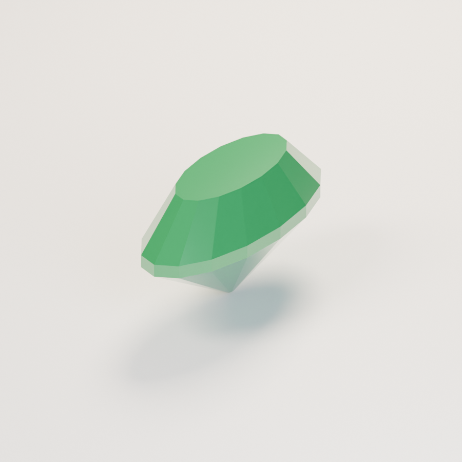

一种切割形状，附红、蓝、绿、紫、琥珀五色GLB，颜色不另计种类。

0.035 × 0.083 × 0.041 m · model · CC0-1.0

[ZIP · BLEND + GLB](https://github.com/k3peta/tales-on-a-table/releases/download/v2026.10.19-treasury/TD_016_CC0.zip)

## TD_017 — 六角柱晶体

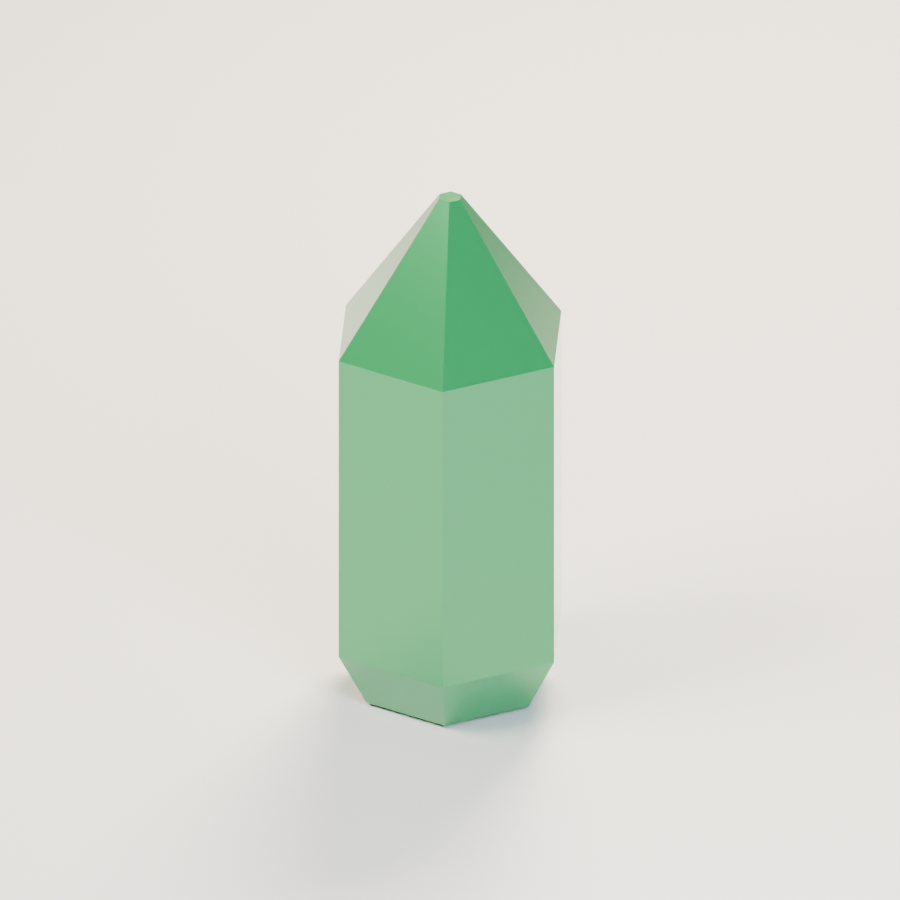

一种晶体形状，附红、蓝、绿、紫、琥珀五色GLB，颜色不另计种类。

0.064 × 0.055 × 0.140 m · model · CC0-1.0

[ZIP · BLEND + GLB](https://github.com/k3peta/tales-on-a-table/releases/download/v2026.10.19-treasury/TD_017_CC0.zip)

