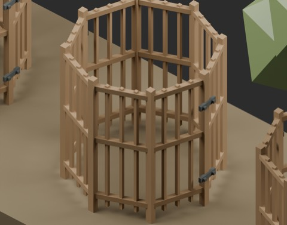
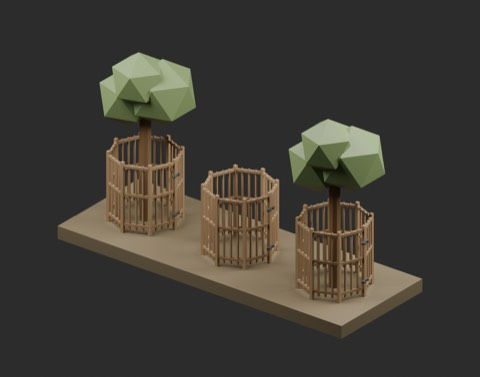

# RG101: open tree guard

904 existing records + 1 = 905 distribution records. Historical independent-shape count remains unconfirmed. BLEND and GLB are two formats of one record.

[Download RG101_OpenTreeGuard](https://raw.githubusercontent.com/k3peta/tales-on-a-table/main/distributions/tree-guard-v1/RG101_OpenTreeGuard_CC0.zip) (103773 bytes)

Open-top and open-bottom eight-sided frame, height 1.32 m. Soil datum at origin Z=0, metres, Z up. Central radius 0.5 m is unobstructed; outer radius is below 0.70 m. Four fixed metal straps at two seams. A single closed static model, not an operating gate. Trees, ground, floor and roof are not included.

Protection performance, animal exclusion, opening/closing, structural strength, collision, actual walking, Blender 4.3.2 compatibility and global historical independence are unverified. Production checked sampled opening rays, dimensions and Blender 5.2.2 reloading. This is a miniature model, not a validated protective device. Append the named Collection from BLEND.

Model geometry and embedded display materials only: CC0-1.0. No code, private records, images or assembled scenes included. [Checksums](../distributions/tree-guard-v1/SHA256SUMS.txt).

## 実作画像 / Actual renders

完成バッチの配置・接写。画像は閲覧用でモデルCC0の対象外です。[既存の画像利用条件](../LICENSE.md)を維持します。

### RG101_OpenTreeGuard

OpenTreeGuard

[ZIP](https://raw.githubusercontent.com/k3peta/tales-on-a-table/main/distributions/tree-guard-v1/RG101_OpenTreeGuard_CC0.zip)

