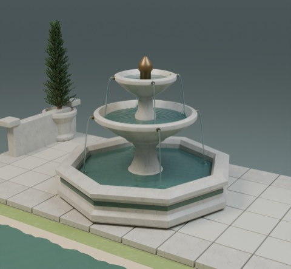
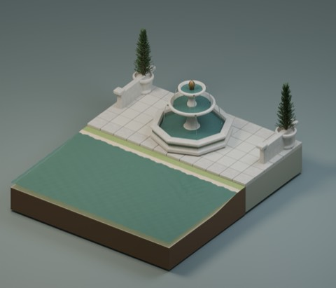
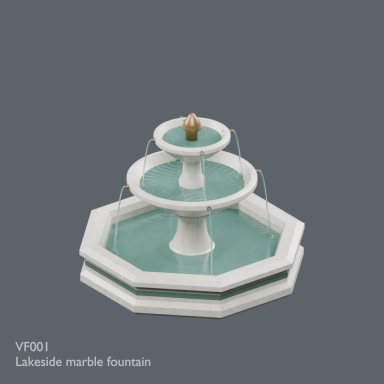

# VF001: Lakeside marble fountain v2

[Download BLEND + GLB ZIP](https://raw.githubusercontent.com/k3peta/tales-on-a-table/main/distributions/vf001-v2/VF001-v2-public-clean-CC0.zip) (2,453,624 bytes)

[SHA256](../distributions/vf001-v2/SHA256SUMS.txt) | [CC0 scope](../distributions/vf001-v2/LICENSE-CC0.txt)

One standalone model distribution record, not an application. v1 and v2 are revisions of the same model, not two assets. This first publication adds one record: 872 + 1 = 873.

Approximately 2.5975 x 2.5975 x 1.98 metres, Z up, origin at the base centre. Marble image embedded. Ripples, droplets and falling water are static geometry, not fluid simulation or animation. Model geometry and included display materials only are CC0. No rendered images, trees, assembled scenes, generation code or application source are included.

Validated for Blender 5.2.2. GLB transparency needs KHR_materials_transmission and KHR_materials_ior support. Procedural fine surface details can differ between viewers. Device FPS, game collision, older Blender compatibility and application integration are unverified.

## 実作画像 / Actual renders

完成バッチの配置・接写。画像は閲覧用でモデルCC0の対象外です。[既存の画像利用条件](../LICENSE.md)を維持します。

### VF001

湖畔の大理石噴水

[ZIP](https://raw.githubusercontent.com/k3peta/tales-on-a-table/main/distributions/vf001-v2/VF001-v2-public-clean-CC0.zip)

## Individual images / 個別画像 / 单件图片

HQ models shown; LITE not pictured. Actual distributed models; chosen camera view does not establish intended front or placement pivot. Images are outside model CC0. Original links and archives retained.

### VF001 — Lakeside marble fountain

湖畔の大理石噴水

[Full image](../previews/terrain-tr051-ud24/renders/VF001.png) · [ZIP · BLEND/GLB](https://raw.githubusercontent.com/k3peta/tales-on-a-table/main/distributions/vf001-v2/VF001-v2-public-clean-CC0.zip)
