# 水車小屋

**WT007/WT008 — QA status pending / 検査記録の照合待ち / 检查记录待核对**

QA reconciliation pending: final numerical BLEND/GLB report records passes, but a separate summary still records a false reimport flag. The discrepancy is unresolved. This published revision is not fully QA-cleared or a confirmed recommended replacement. Download/CRC/SHA verification does not resolve model QA.

最終数値記録は合格ですが、別QAのfalseフラグと不一致が残っています。解消まで全検査合格・推奨修正版とは扱いません。旧版にも既知の黒断面があり、旧版が正常と確認されたわけではありません。

最终数值记录为通过，另一份QA标志仍为false。差异未解决，不视为全部验证通过或推荐替换版。原版也有已知黑断面。

[日本語](watermill.md) · [English](watermill.en.md) · [简体中文](watermill.zh-CN.md)

25配布レコード、23設計。羊3姿勢は1設計です。WT001–008は旧水車用地形の別原型で、新2m地形v2と完全互換ではありません。

各単品ZIPにBLEND・GLB・README・利用条件を収録。モデルと必要な同梱材質のみCC0 1.0です。記事・作例画像・完成配置シーン・制作コードは対象外です。BLENDの一部はFile > Appendでオブジェクト/コレクションを読み込んでください。GLBの微細な凹凸等はBlenderと見え方が異なります。ゲームでの実機性能は未検証です。

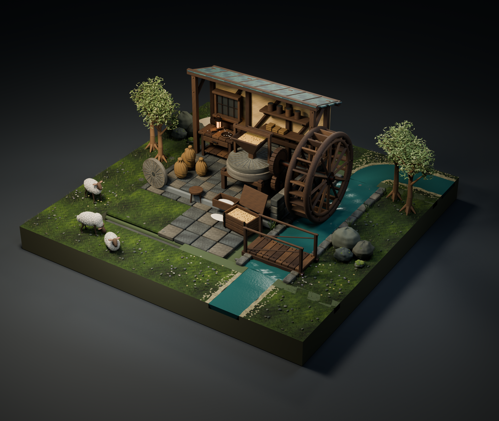

画像は組合せ作例であり、完成シーンは配布しません。

| ID | Asset | ZIP (BLEND + GLB) |
|---|---|---|
| WM001 | Undershot waterwheel | [ZIP](https://github.com/k3peta/tales-on-a-table/releases/download/v2026.10.21-watermill/WM001_CC0.zip) |
| WM002 | Millstone and grain hopper | [ZIP](https://github.com/k3peta/tales-on-a-table/releases/download/v2026.10.21-watermill/WM002_CC0.zip) |
| WM003 | Millers workbench | [ZIP](https://github.com/k3peta/tales-on-a-table/releases/download/v2026.10.21-watermill/WM003_CC0.zip) |
| WM004 | Burlap grain sack | [ZIP](https://github.com/k3peta/tales-on-a-table/releases/download/v2026.10.21-watermill/WM004_CC0.zip) |
| WM005 | Open grain bin | [ZIP](https://github.com/k3peta/tales-on-a-table/releases/download/v2026.10.21-watermill/WM005_CC0.zip) |
| WM006 | Flour collection trough | [ZIP](https://github.com/k3peta/tales-on-a-table/releases/download/v2026.10.21-watermill/WM006_CC0.zip) |
| WM007 | Small footbridge | [ZIP](https://github.com/k3peta/tales-on-a-table/releases/download/v2026.10.21-watermill/WM007_CC0.zip) |
| WM008 | Flour sieve | [ZIP](https://github.com/k3peta/tales-on-a-table/releases/download/v2026.10.21-watermill/WM008_CC0.zip) |
| WM009 | Wooden grain scoop | [ZIP](https://github.com/k3peta/tales-on-a-table/releases/download/v2026.10.21-watermill/WM009_CC0.zip) |
| WM010 | Mill broom | [ZIP](https://github.com/k3peta/tales-on-a-table/releases/download/v2026.10.21-watermill/WM010_CC0.zip) |
| WM011 | Millers oil lantern | [ZIP](https://github.com/k3peta/tales-on-a-table/releases/download/v2026.10.21-watermill/WM011_CC0.zip) |
| WM012 | Spare millstone | [ZIP](https://github.com/k3peta/tales-on-a-table/releases/download/v2026.10.21-watermill/WM012_CC0.zip) |
| WM013 | Three legged millers stool | [ZIP](https://github.com/k3peta/tales-on-a-table/releases/download/v2026.10.21-watermill/WM013_CC0.zip) |
| WM014 | Sheep grazing | [ZIP](https://github.com/k3peta/tales-on-a-table/releases/download/v2026.10.21-watermill/WM014_CC0.zip) |
| WM015 | Sheep resting | [ZIP](https://github.com/k3peta/tales-on-a-table/releases/download/v2026.10.21-watermill/WM015_CC0.zip) |
| WM016 | Sheep standing | [ZIP](https://github.com/k3peta/tales-on-a-table/releases/download/v2026.10.21-watermill/WM016_CC0.zip) |
| WM017 | Mill transmission gears | [ZIP](https://github.com/k3peta/tales-on-a-table/releases/download/v2026.10.21-watermill/WM017_CC0.zip) |
| WT001 | Low meadow | [ZIP](https://github.com/k3peta/tales-on-a-table/releases/download/v2026.10.21-watermill/WT001_CC0.zip) |
| WT002 | Flower meadow | [ZIP](https://github.com/k3peta/tales-on-a-table/releases/download/v2026.10.21-watermill/WT002_CC0.zip) |
| WT003 | Deciduous copse | [ZIP](https://github.com/k3peta/tales-on-a-table/releases/download/v2026.10.21-watermill/WT003_CC0.zip) |
| WT004 | Weathered rock outcrop | [ZIP](https://github.com/k3peta/tales-on-a-table/releases/download/v2026.10.21-watermill/WT004_CC0.zip) |
| WT005 | Path straight NS | [ZIP](https://github.com/k3peta/tales-on-a-table/releases/download/v2026.10.21-watermill/WT005_CC0.zip) |
| WT006 | Path bend NE | [ZIP](https://github.com/k3peta/tales-on-a-table/releases/download/v2026.10.21-watermill/WT006_CC0.zip) |
| WT007 | Stream straight NS | [ZIP](https://github.com/k3peta/tales-on-a-table/releases/download/v2026.10.21-watermill/WT007_CC0.zip) |
| WT008 | Stream bend NE | [ZIP](https://github.com/k3peta/tales-on-a-table/releases/download/v2026.10.21-watermill/WT008_CC0.zip) |

[Release](https://github.com/k3peta/tales-on-a-table/releases/tag/v2026.10.21-watermill) · [SHA256](../releases/watermill/SHA256SUMS.txt) · [License](../LICENSE.md)

## Individual images / 個別画像 / 单件图片

Actual distributed models; chosen camera view does not establish intended front or placement pivot. Images are outside model CC0. Original links and archives retained.

### WM001 — Undershot waterwheel

Undershot waterwheel

[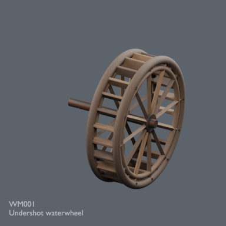](../previews/prison-mill24/renders/WM001.png)

[Full image](../previews/prison-mill24/renders/WM001.png) · [ZIP · BLEND/GLB](https://github.com/k3peta/tales-on-a-table/releases/download/v2026.10.21-watermill/WM001_CC0.zip)

### WM002 — Millstone and grain hopper

Millstone and grain hopper

[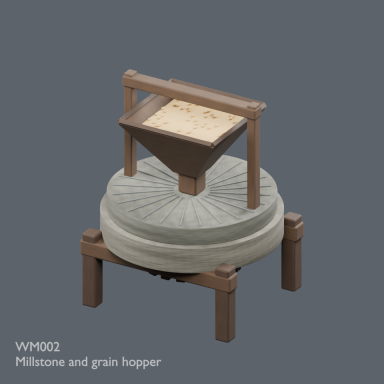](../previews/prison-mill24/renders/WM002.png)

[Full image](../previews/prison-mill24/renders/WM002.png) · [ZIP · BLEND/GLB](https://github.com/k3peta/tales-on-a-table/releases/download/v2026.10.21-watermill/WM002_CC0.zip)

### WM003 — Millers workbench

Millers workbench

[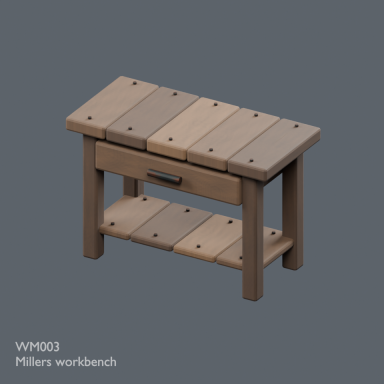](../previews/prison-mill24/renders/WM003.png)

[Full image](../previews/prison-mill24/renders/WM003.png) · [ZIP · BLEND/GLB](https://github.com/k3peta/tales-on-a-table/releases/download/v2026.10.21-watermill/WM003_CC0.zip)

### WM004 — Burlap grain sack

Burlap grain sack

[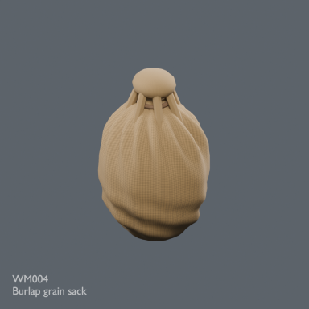](../previews/prison-mill24/renders/WM004.png)

[Full image](../previews/prison-mill24/renders/WM004.png) · [ZIP · BLEND/GLB](https://github.com/k3peta/tales-on-a-table/releases/download/v2026.10.21-watermill/WM004_CC0.zip)

### WM005 — Open grain bin

Open grain bin

[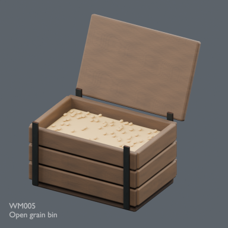](../previews/prison-mill24/renders/WM005.png)

[Full image](../previews/prison-mill24/renders/WM005.png) · [ZIP · BLEND/GLB](https://github.com/k3peta/tales-on-a-table/releases/download/v2026.10.21-watermill/WM005_CC0.zip)

### WM006 — Flour collection trough

Flour collection trough

[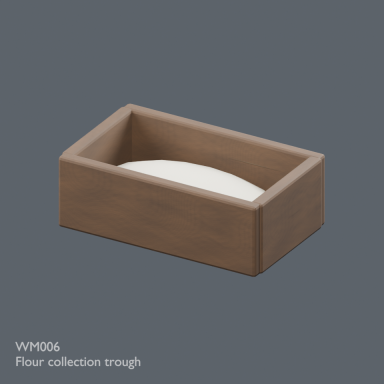](../previews/prison-mill24/renders/WM006.png)

[Full image](../previews/prison-mill24/renders/WM006.png) · [ZIP · BLEND/GLB](https://github.com/k3peta/tales-on-a-table/releases/download/v2026.10.21-watermill/WM006_CC0.zip)

### WM007 — Small footbridge

Small footbridge

[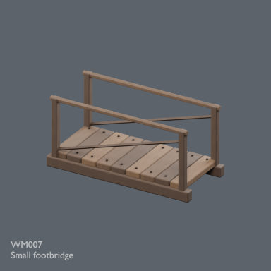](../previews/prison-mill24/renders/WM007.png)

[Full image](../previews/prison-mill24/renders/WM007.png) · [ZIP · BLEND/GLB](https://github.com/k3peta/tales-on-a-table/releases/download/v2026.10.21-watermill/WM007_CC0.zip)

### WM008 — Flour sieve

Flour sieve

[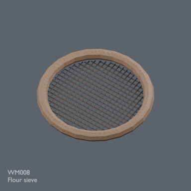](../previews/prison-mill24/renders/WM008.png)

[Full image](../previews/prison-mill24/renders/WM008.png) · [ZIP · BLEND/GLB](https://github.com/k3peta/tales-on-a-table/releases/download/v2026.10.21-watermill/WM008_CC0.zip)

**Original-version issue (history):** Handle detached from bowl; repaired version now available.

### WM009 — Wooden grain scoop

Wooden grain scoop

[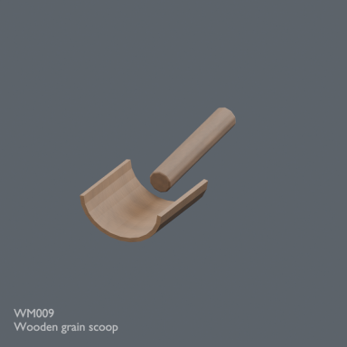](../previews/prison-mill24/renders/WM009.png)

[Full image](../previews/prison-mill24/renders/WM009.png) · [ZIP · BLEND/GLB](https://github.com/k3peta/tales-on-a-table/releases/download/v2026.10.21-watermill/WM009_CC0.zip)

### WM010 — Mill broom

Mill broom

[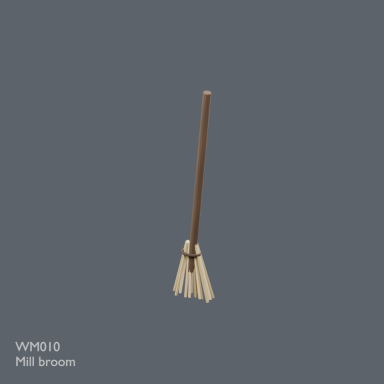](../previews/prison-mill24/renders/WM010.png)

[Full image](../previews/prison-mill24/renders/WM010.png) · [ZIP · BLEND/GLB](https://github.com/k3peta/tales-on-a-table/releases/download/v2026.10.21-watermill/WM010_CC0.zip)

### WM011 — Millers oil lantern

Millers oil lantern

[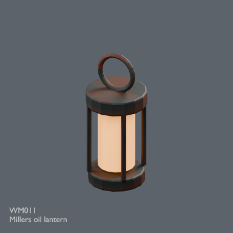](../previews/prison-mill24/renders/WM011.png)

[Full image](../previews/prison-mill24/renders/WM011.png) · [ZIP · BLEND/GLB](https://github.com/k3peta/tales-on-a-table/releases/download/v2026.10.21-watermill/WM011_CC0.zip)

### WM012 — Spare millstone

Spare millstone

[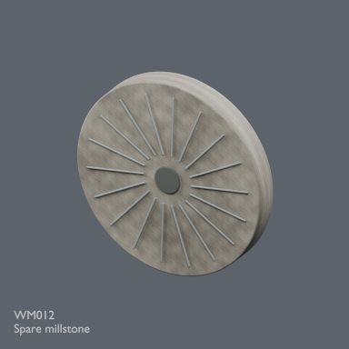](../previews/prison-mill24/renders/WM012.png)

[Full image](../previews/prison-mill24/renders/WM012.png) · [ZIP · BLEND/GLB](https://github.com/k3peta/tales-on-a-table/releases/download/v2026.10.21-watermill/WM012_CC0.zip)

## Revised versions / 修正版 / 修订版

Original archives/images above remain as version history. Scoped defects repaired; no new record count.

### WM009 — scoop_heel_wall_v1

[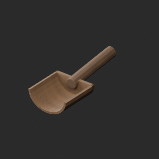](../previews/quality-pmnode-wm009-repair-v1/WM009__repair_comparison.png)

[Revised ZIP](https://raw.githubusercontent.com/k3peta/tales-on-a-table/main/distributions/quality-pmnode-wm009-repair-v1/WM009__repair_CC0.zip) · [Scope and comparison](pmnode_wm009_repairs.md)

## Individual images / 個別画像 / 单件图片

Actual distributed models; chosen camera view does not establish intended front or placement pivot. Images are outside model CC0. Original links and archives retained.

### WM013 — Three legged millers stool

Three legged millers stool

[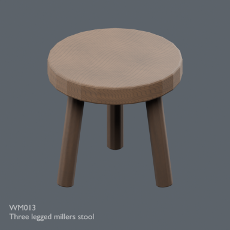](../previews/mill-terrain-apiary24/renders/WM013.png)

[Full image](../previews/mill-terrain-apiary24/renders/WM013.png) · [ZIP · BLEND/GLB](https://github.com/k3peta/tales-on-a-table/releases/download/v2026.10.21-watermill/WM013_CC0.zip)

### WM014 — Sheep grazing

Sheep grazing

[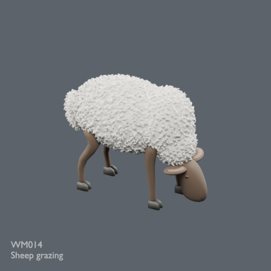](../previews/mill-terrain-apiary24/renders/WM014.png)

[Full image](../previews/mill-terrain-apiary24/renders/WM014.png) · [ZIP · BLEND/GLB](https://github.com/k3peta/tales-on-a-table/releases/download/v2026.10.21-watermill/WM014_CC0.zip)

### WM015 — Sheep resting

Sheep resting

[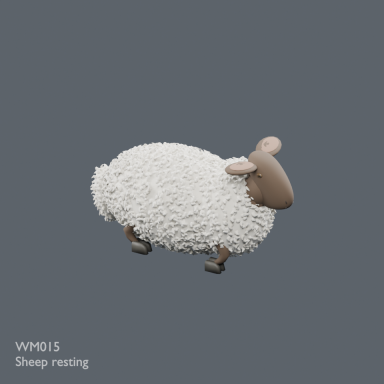](../previews/mill-terrain-apiary24/renders/WM015.png)

[Full image](../previews/mill-terrain-apiary24/renders/WM015.png) · [ZIP · BLEND/GLB](https://github.com/k3peta/tales-on-a-table/releases/download/v2026.10.21-watermill/WM015_CC0.zip)

### WM016 — Sheep standing

Sheep standing

[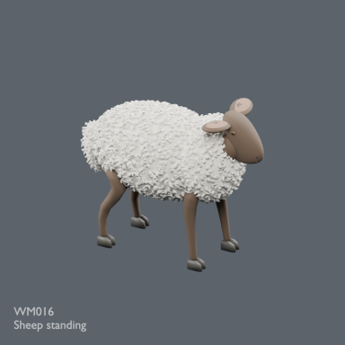](../previews/mill-terrain-apiary24/renders/WM016.png)

[Full image](../previews/mill-terrain-apiary24/renders/WM016.png) · [ZIP · BLEND/GLB](https://github.com/k3peta/tales-on-a-table/releases/download/v2026.10.21-watermill/WM016_CC0.zip)

### WM017 — Mill transmission gears

Mill transmission gears

[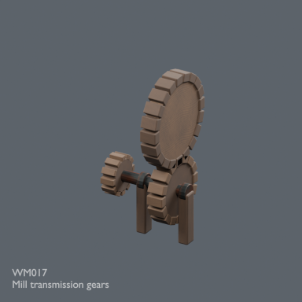](../previews/mill-terrain-apiary24/renders/WM017.png)

[Full image](../previews/mill-terrain-apiary24/renders/WM017.png) · [ZIP · BLEND/GLB](https://github.com/k3peta/tales-on-a-table/releases/download/v2026.10.21-watermill/WM017_CC0.zip)

### WT001 — Low meadow

Low meadow

[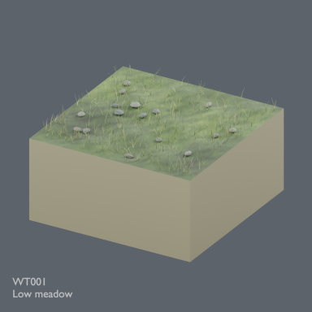](../previews/mill-terrain-apiary24/renders/WT001.png)

[Full image](../previews/mill-terrain-apiary24/renders/WT001.png) · [ZIP · BLEND/GLB](https://github.com/k3peta/tales-on-a-table/releases/download/v2026.10.21-watermill/WT001_CC0.zip)

### WT002 — Flower meadow

Flower meadow

[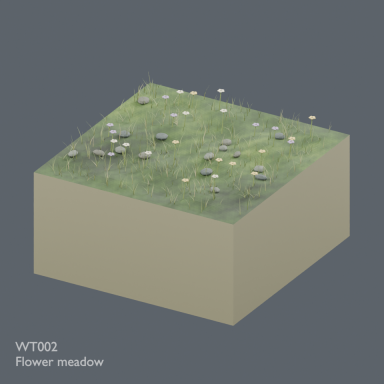](../previews/mill-terrain-apiary24/renders/WT002.png)

[Full image](../previews/mill-terrain-apiary24/renders/WT002.png) · [ZIP · BLEND/GLB](https://github.com/k3peta/tales-on-a-table/releases/download/v2026.10.21-watermill/WT002_CC0.zip)

### WT003 — Deciduous copse

Deciduous copse

[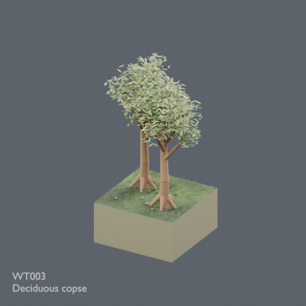](../previews/mill-terrain-apiary24/renders/WT003.png)

[Full image](../previews/mill-terrain-apiary24/renders/WT003.png) · [ZIP · BLEND/GLB](https://github.com/k3peta/tales-on-a-table/releases/download/v2026.10.21-watermill/WT003_CC0.zip)

### WT004 — Weathered rock outcrop

Weathered rock outcrop

[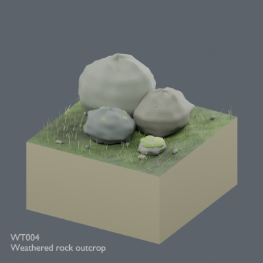](../previews/mill-terrain-apiary24/renders/WT004.png)

[Full image](../previews/mill-terrain-apiary24/renders/WT004.png) · [ZIP · BLEND/GLB](https://github.com/k3peta/tales-on-a-table/releases/download/v2026.10.21-watermill/WT004_CC0.zip)

### WT005 — Path straight NS

Path straight NS

[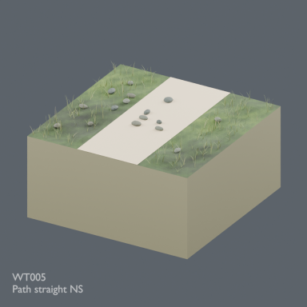](../previews/mill-terrain-apiary24/renders/WT005.png)

[Full image](../previews/mill-terrain-apiary24/renders/WT005.png) · [ZIP · BLEND/GLB](https://github.com/k3peta/tales-on-a-table/releases/download/v2026.10.21-watermill/WT005_CC0.zip)

### WT006 — Path bend NE

Path bend NE

[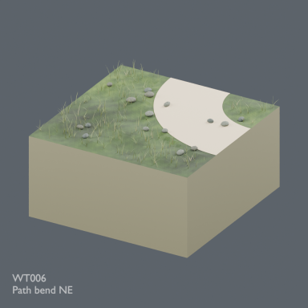](../previews/mill-terrain-apiary24/renders/WT006.png)

[Full image](../previews/mill-terrain-apiary24/renders/WT006.png) · [ZIP · BLEND/GLB](https://github.com/k3peta/tales-on-a-table/releases/download/v2026.10.21-watermill/WT006_CC0.zip)

**Original-version issue (history):** Black end patches were unresolved at image publication. Water/bank overlap subsequently identified; published channel_fitted_water_v2 has unresolved QA-record reconciliation; see notice above. Original images retained.

### WT007 — Stream straight NS

Stream straight NS

[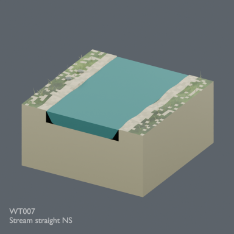](../previews/mill-terrain-apiary24/renders/WT007.png)

[Full image](../previews/mill-terrain-apiary24/renders/WT007.png) · [ZIP · BLEND/GLB](https://github.com/k3peta/tales-on-a-table/releases/download/v2026.10.21-watermill/WT007_CC0.zip)

**Original-version issue (history):** Black end patches were unresolved at image publication. Water/bank overlap subsequently identified; published channel_fitted_water_v2 has unresolved QA-record reconciliation; see notice above. Original images retained.

### WT008 — Stream bend NE

Stream bend NE

[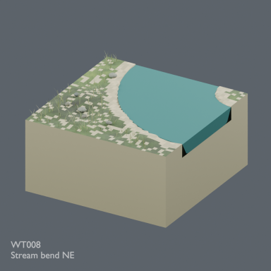](../previews/mill-terrain-apiary24/renders/WT008.png)

[Full image](../previews/mill-terrain-apiary24/renders/WT008.png) · [ZIP · BLEND/GLB](https://github.com/k3peta/tales-on-a-table/releases/download/v2026.10.21-watermill/WT008_CC0.zip)

## Revised versions / 修正版 / 修订版

Original archives/images above remain as version history. Scoped defects repaired; no new record count.

### WT007 — channel_fitted_water_v2 (QA pending)

[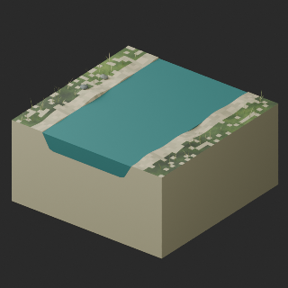](../previews/quality-wt007-008-repair-v1/WT007__repair_comparison.png)

[Revised ZIP](https://raw.githubusercontent.com/k3peta/tales-on-a-table/main/distributions/quality-wt007-008-repair-v1/WT007__repair_CC0.zip) · [Scope and comparison](wt007_008_repairs.md)

### WT008 — channel_fitted_water_v2 (QA pending)

[Revised ZIP](https://raw.githubusercontent.com/k3peta/tales-on-a-table/main/distributions/quality-wt007-008-repair-v1/WT008__repair_CC0.zip) · [Scope and comparison](wt007_008_repairs.md)
