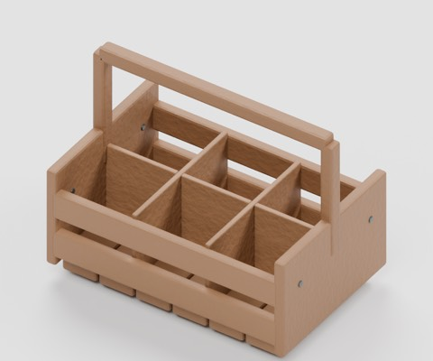
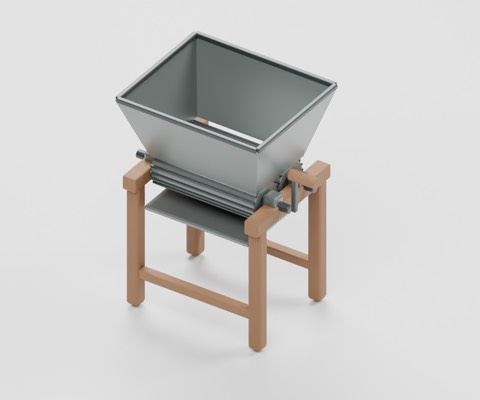
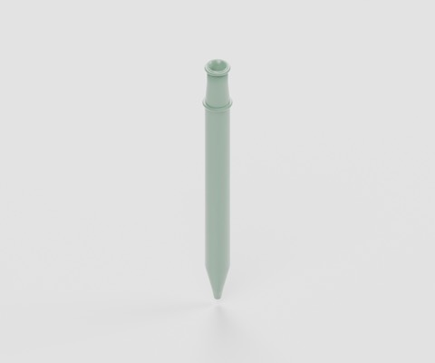
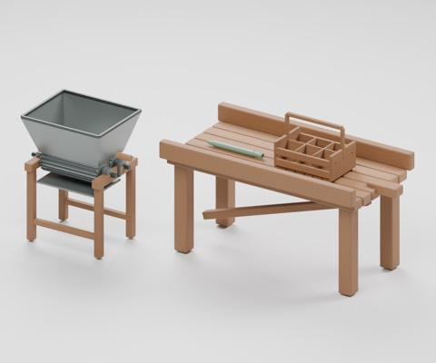
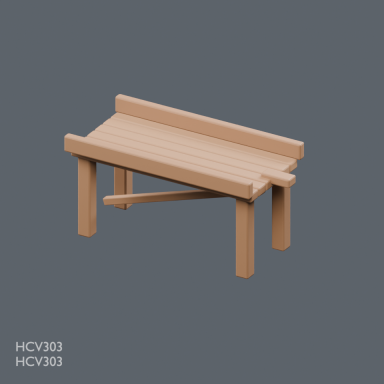

# winery-utilities-v1

988 distribution records = 985 + 3 winery utility candidates: 2 composite implements and 1 hollow single implement. Components are not counted separately. Existing HCV303 worktable and one private example are not newly added. Four images are not distributed.

### HCV901

model

CC0-1.0

[ZIP](https://raw.githubusercontent.com/k3peta/tales-on-a-table/main/distributions/winery-utilities-v1/HCV901-CC0.zip)

### HCV902

model

CC0-1.0

[ZIP](https://raw.githubusercontent.com/k3peta/tales-on-a-table/main/distributions/winery-utilities-v1/HCV902-CC0.zip)

### HCV903

model

CC0-1.0

[ZIP](https://raw.githubusercontent.com/k3peta/tales-on-a-table/main/distributions/winery-utilities-v1/HCV903-CC0.zip)

HCV901 twin fluted-roller grape crusher is a pre-press preparation tool, distinct in intended use from an existing press; hopper, crank and catch board are fixed. HCV902 wine sampler has an open connected hollow passage between top and bottom, but no suction or fluid behavior. HCV903 six-compartment bottle carrier has nominal cells0.168x0.161m; a fully loaded fit test with a specific bottle model has not been performed. Glass appearance varies by viewer. Crushing/mechanisms, cleaning/food hygiene and practical suitability are unverified. Existing barrel stands, tapped barrels, funnels, scales, bottle dryers, baskets and ordinary crates are not added. Historical mesh independence remains unconfirmed.

Metres, ground-centered component origins, Blender Z up / standard glTF axes. Global historical shape independence is unverified. Static display only: no animated doors/wheels/walking, rigid-body coupling, load simulation or fluid mechanisms. Safety, full motion/intersection volumes, real use, app UI/GPU/FPS and older Blender compatibility are unverified. Code, rendered images and private records are excluded.

[Checksums](../distributions/winery-utilities-v1/SHA256SUMS.txt).

## 実作画像 / Actual renders

完成バッチの配置・接写。画像は閲覧用でモデルCC0の対象外です。[既存の画像利用条件](../LICENSE.md)を維持します。

### HCV303

HCV303

[ZIP](https://raw.githubusercontent.com/k3peta/tales-on-a-table/main/distributions/husbandry-cellar-v1/HCV303-CC0.zip)

### HCV901

HCV901

[ZIP](https://raw.githubusercontent.com/k3peta/tales-on-a-table/main/distributions/winery-utilities-v1/HCV901-CC0.zip)

### HCV902

HCV902

[ZIP](https://raw.githubusercontent.com/k3peta/tales-on-a-table/main/distributions/winery-utilities-v1/HCV902-CC0.zip)

### HCV903

HCV903

[ZIP](https://raw.githubusercontent.com/k3peta/tales-on-a-table/main/distributions/winery-utilities-v1/HCV903-CC0.zip)

## Individual images / 個別画像 / 单件图片

Actual distributed models; chosen camera view does not establish intended front or placement pivot. Images are outside model CC0. Original links and archives retained.

**Known issue:** Brace contact diagnosis pending. GLB shown; Blender-only procedural bump not represented.

### HCV303 — HCV303

HCV303

[Full image](../previews/hcv-chb24/renders/HCV303.png) · [ZIP · BLEND/GLB](https://raw.githubusercontent.com/k3peta/tales-on-a-table/main/distributions/husbandry-cellar-v1/HCV303-CC0.zip)
