# Wizard study — 40 distribution sets

[Catalogue](../README.en.md) · [日本語](wizard-study.md) · [English](wizard-study.en.md) · [简体中文](wizard-study.zh-CN.md)

These 40 distribution sets comprise 32 previously created wizard models, 6 new designs and 2 structural variants of the bookcase and ladder. The 397 books count scene placements, not asset types. Each ZIP includes BLEND, GLB, an actual render, a trilingual README and CC0 terms. The completed scene layout is not included.

## WS_001 — Moon-emblem grimoire with twin clasps

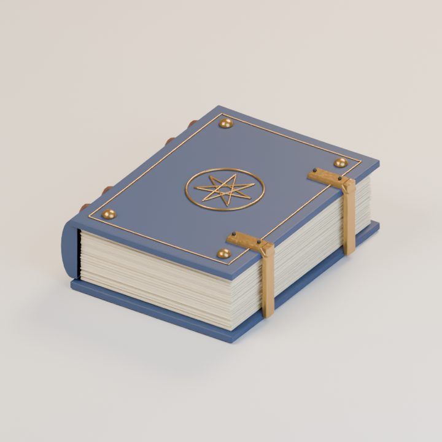

A thick closed grimoire with twin clasps and a moon emblem.

0.269 × 0.330 × 0.111 m · model · CC0-1.0

[Download BLEND + GLB (5.71 MiB)](https://github.com/k3peta/tales-on-a-table/releases/download/v2026.10.19-wizard-study/WS_001_CC0.zip)

## WS_002 — Cord-bound field notebook

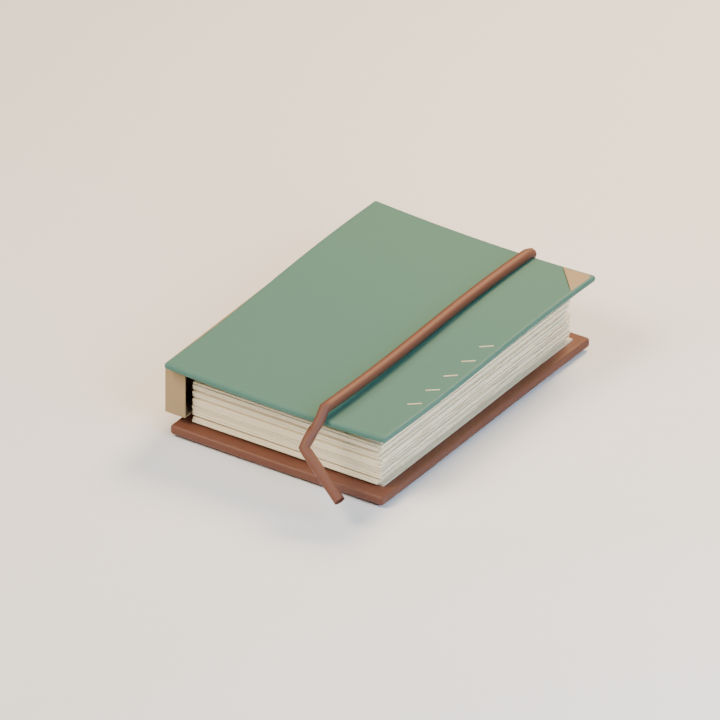

A cord-bound notebook for field observations and collecting notes.

0.164 × 0.256 × 0.058 m · model · CC0-1.0

[Download BLEND + GLB (7.18 MiB)](https://github.com/k3peta/tales-on-a-table/releases/download/v2026.10.19-wizard-study/WS_002_CC0.zip)

## WS_003 — Large star atlas

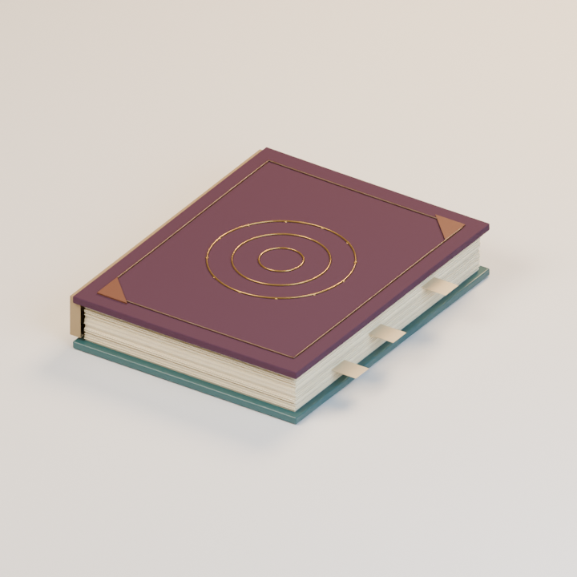

A large star atlas for a desk or a stack of reference books.

0.331 × 0.390 × 0.070 m · model · CC0-1.0

[Download BLEND + GLB (4.20 MiB)](https://github.com/k3peta/tales-on-a-table/releases/download/v2026.10.19-wizard-study/WS_003_CC0.zip)

## WS_004 — Banded reference folio

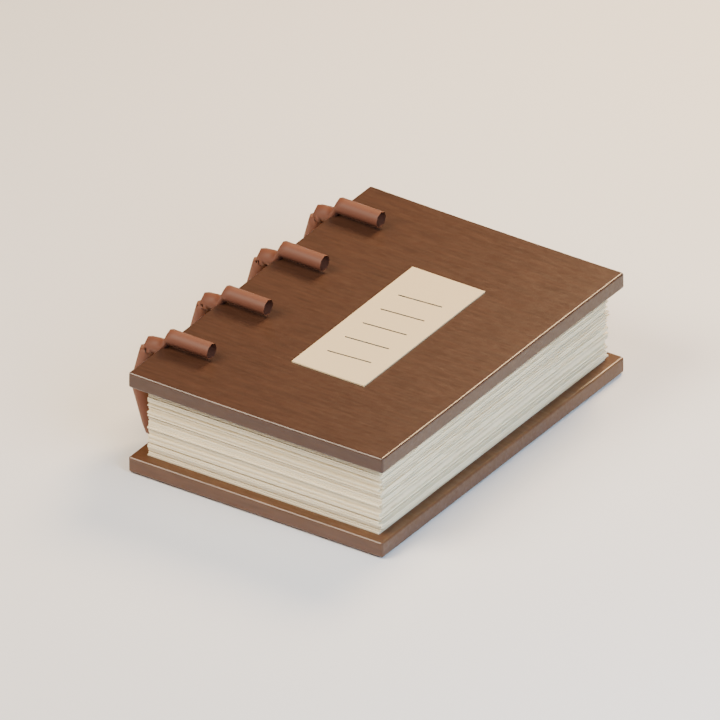

A reference folio with spine bands, suitable for book piles.

0.237 × 0.300 × 0.094 m · model · CC0-1.0

[Download BLEND + GLB (5.92 MiB)](https://github.com/k3peta/tales-on-a-table/releases/download/v2026.10.19-wizard-study/WS_004_CC0.zip)

## WS_005 — Slim index booklet

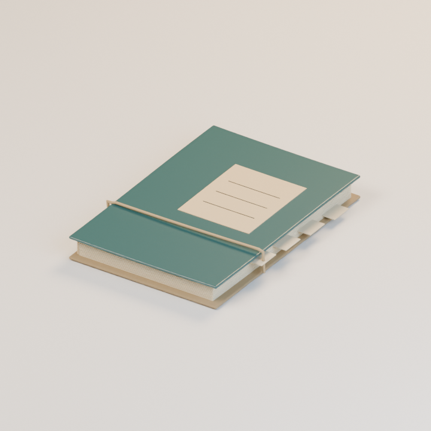

A slim index booklet to pair with thicker reference volumes.

0.184 × 0.250 × 0.031 m · model · CC0-1.0

[Download BLEND + GLB (6.99 MiB)](https://github.com/k3peta/tales-on-a-table/releases/download/v2026.10.19-wizard-study/WS_005_CC0.zip)

## WS_006 — Open annotated manuscript

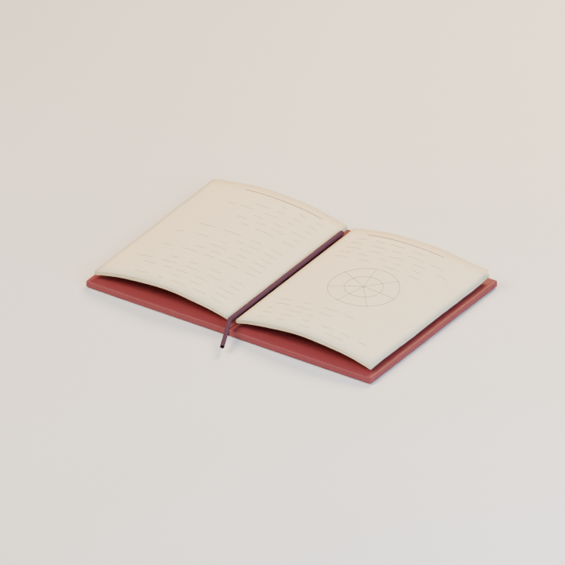

An open annotated manuscript for a research desk or lectern.

0.491 × 0.376 × 0.040 m · model · CC0-1.0

[Download BLEND + GLB (7.77 MiB)](https://github.com/k3peta/tales-on-a-table/releases/download/v2026.10.19-wizard-study/WS_006_CC0.zip)

## WS_007 — Wax-sealed scroll

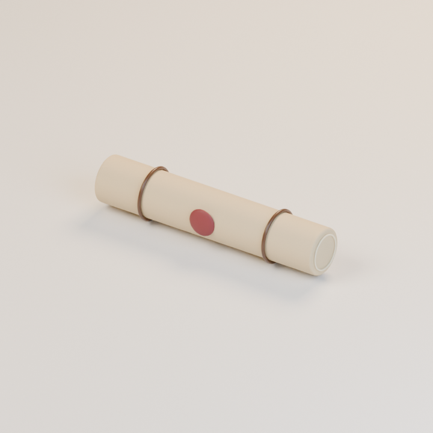

A wax-sealed scroll for a shelf or desk.

0.282 × 0.063 × 0.062 m · model · CC0-1.0

[Download BLEND + GLB (9.34 MiB)](https://github.com/k3peta/tales-on-a-table/releases/download/v2026.10.19-wizard-study/WS_007_CC0.zip)

## WS_008 — Unrolled survey chart

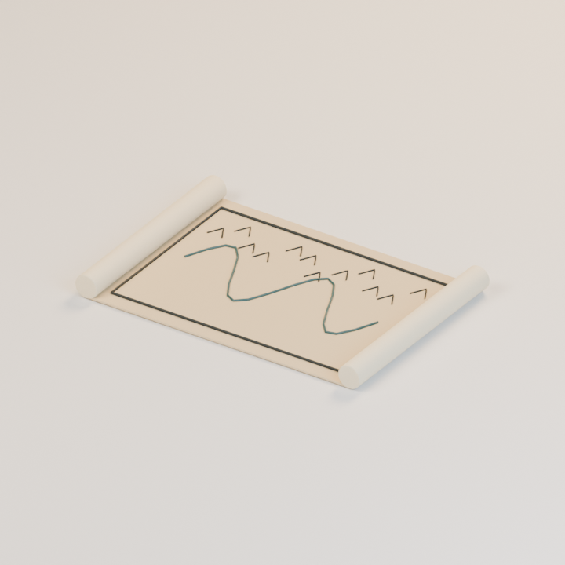

An unrolled survey chart for a scene of ongoing research.

0.466 × 0.320 × 0.036 m · model · CC0-1.0

[Download BLEND + GLB (2.78 MiB)](https://github.com/k3peta/tales-on-a-table/releases/download/v2026.10.19-wizard-study/WS_008_CC0.zip)

## WS_009 — Twin-roller ritual scroll

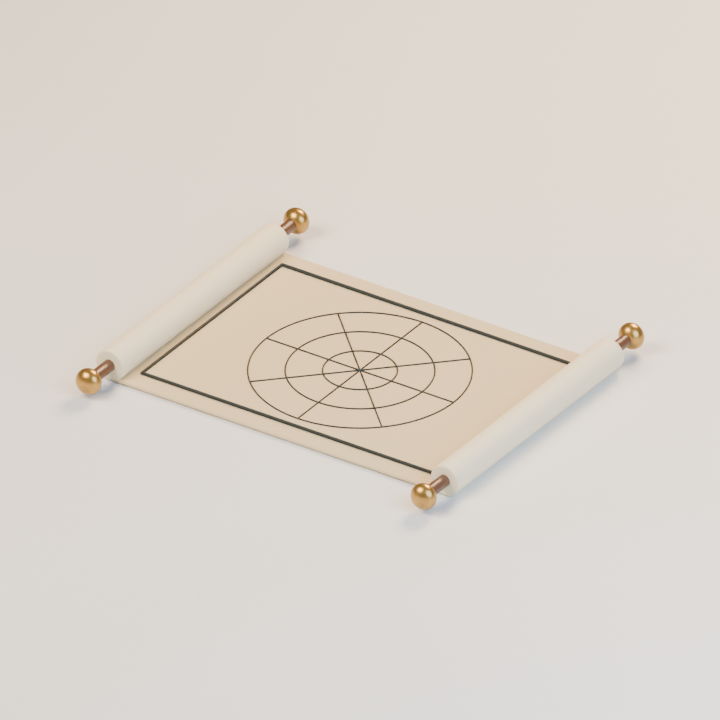

A ritual scroll with rollers at both ends.

0.466 × 0.424 × 0.036 m · model · CC0-1.0

[Download BLEND + GLB (10.08 MiB)](https://github.com/k3peta/tales-on-a-table/releases/download/v2026.10.19-wizard-study/WS_009_CC0.zip)

## WS_010 — Research desk with drawers

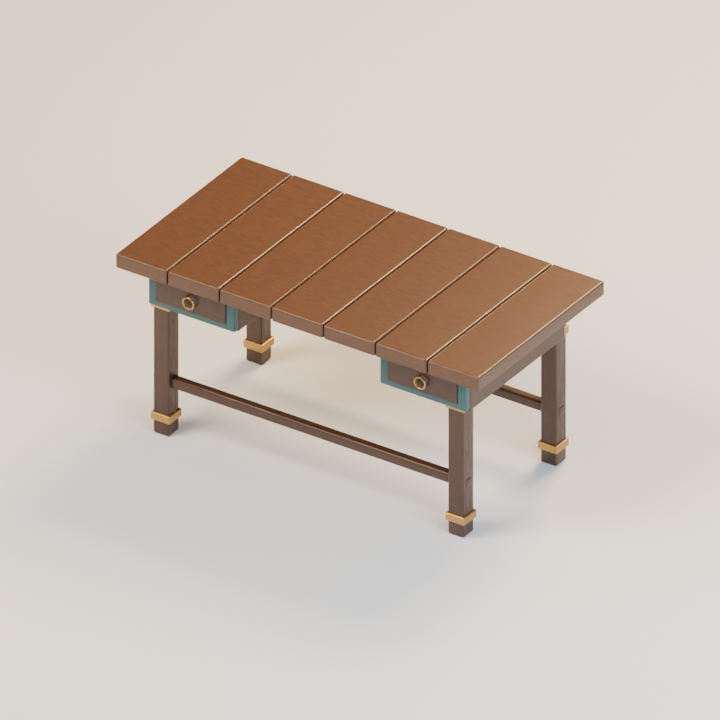

A research desk with drawers and a broad working surface.

1.725 × 0.900 × 0.822 m · model · CC0-1.0

[Download BLEND + GLB (10.23 MiB)](https://github.com/k3peta/tales-on-a-table/releases/download/v2026.10.19-wizard-study/WS_010_CC0.zip)

## WS_011 — Library bay with carved columns

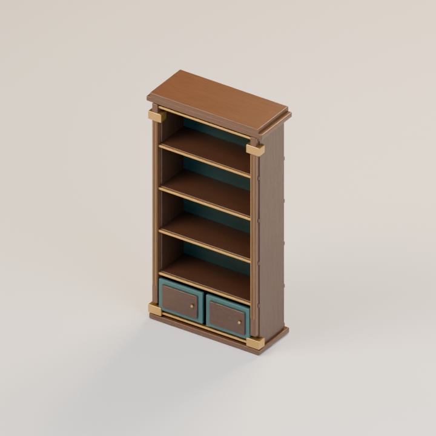

A library bay with carved columns and lower storage.

1.320 × 0.560 × 2.507 m · model · CC0-1.0

[Download BLEND + GLB (8.38 MiB)](https://github.com/k3peta/tales-on-a-table/releases/download/v2026.10.19-wizard-study/WS_011_CC0.zip)

## WS_012 — Flat map cabinet

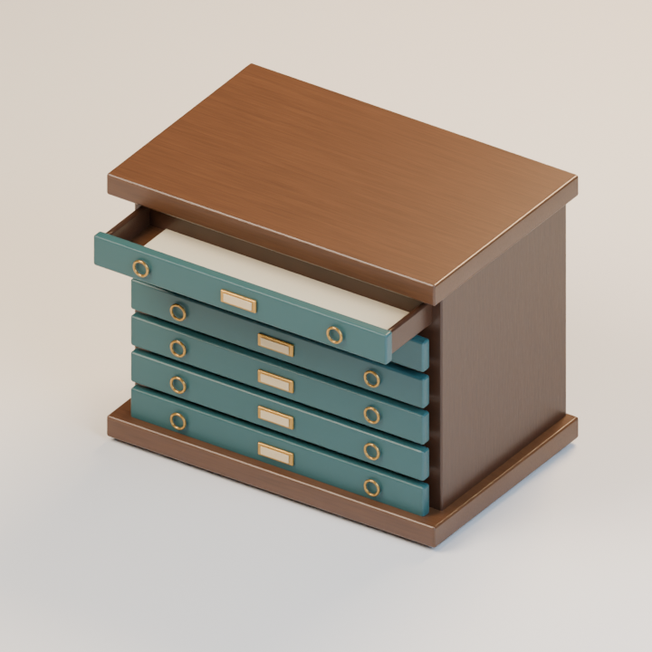

A drawer cabinet for flat maps and plans.

1.120 × 0.910 × 0.885 m · model · CC0-1.0

[Download BLEND + GLB (6.92 MiB)](https://github.com/k3peta/tales-on-a-table/releases/download/v2026.10.19-wizard-study/WS_012_CC0.zip)

## WS_013 — 24-drawer catalogue cabinet

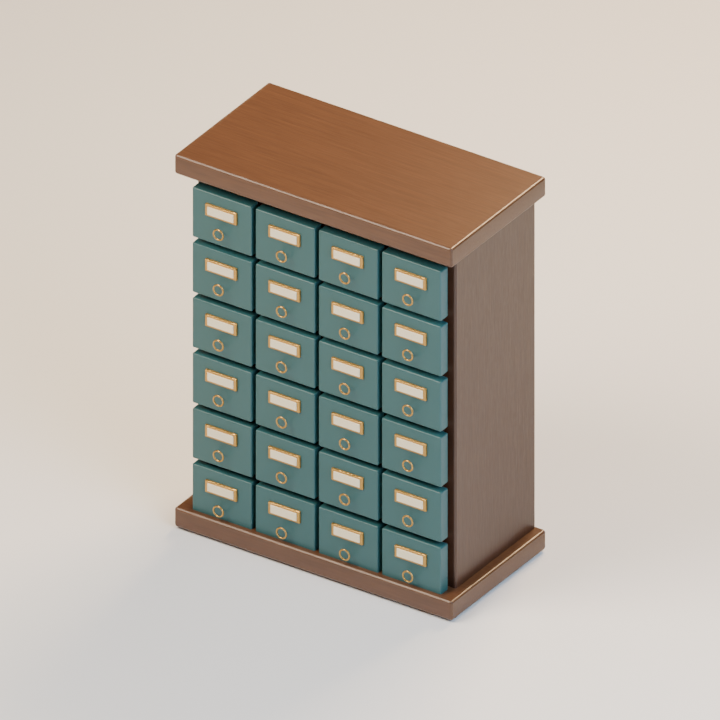

A 24-drawer cabinet for organizing catalogue records.

0.880 × 0.451 × 1.150 m · model · CC0-1.0

[Download BLEND + GLB (29.22 MiB)](https://github.com/k3peta/tales-on-a-table/releases/download/v2026.10.19-wizard-study/WS_013_CC0.zip)

## WS_014 — Sloped reading lectern

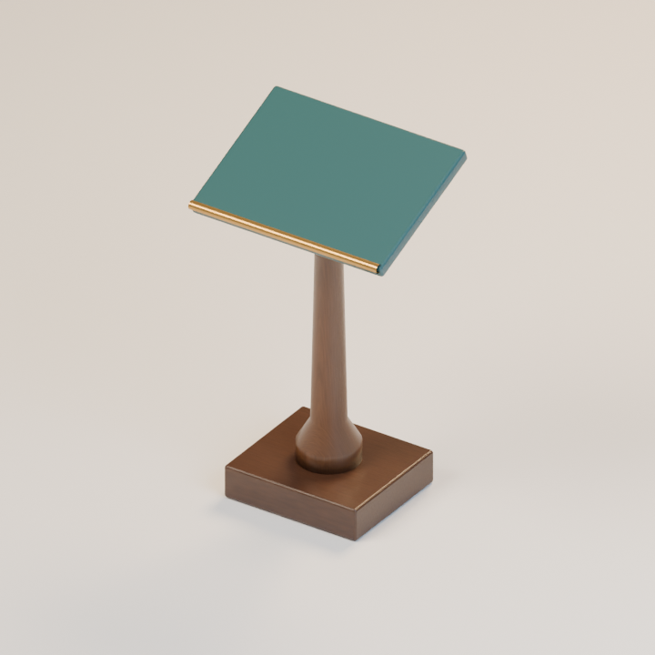

A sloped lectern for displaying an open book.

0.550 × 0.392 × 0.949 m · model · CC0-1.0

[Download BLEND + GLB (5.78 MiB)](https://github.com/k3peta/tales-on-a-table/releases/download/v2026.10.19-wizard-study/WS_014_CC0.zip)

## WS_015 — High-backed reading chair

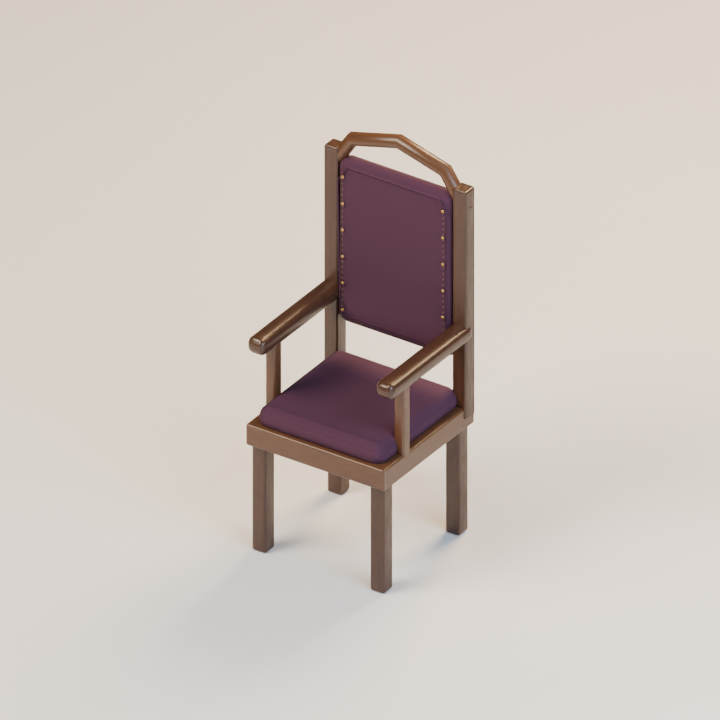

An upholstered reading chair with a high back.

0.570 × 0.530 × 1.414 m · model · CC0-1.0

[Download BLEND + GLB (10.90 MiB)](https://github.com/k3peta/tales-on-a-table/releases/download/v2026.10.19-wizard-study/WS_015_CC0.zip)

## WS_016 — Library ladder with brass rollers

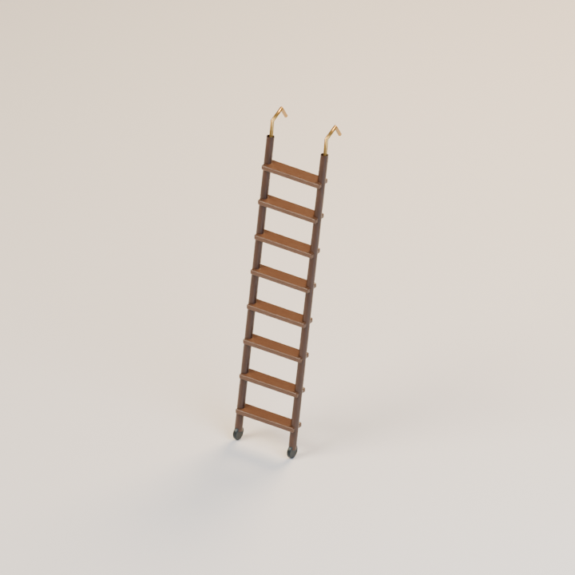

A library ladder with brass rollers for a bookcase rail.

0.450 × 0.585 × 2.151 m · model · CC0-1.0

[Download BLEND + GLB (4.85 MiB)](https://github.com/k3peta/tales-on-a-table/releases/download/v2026.10.19-wizard-study/WS_016_CC0.zip)

## WS_017 — Wooden bookbinding press

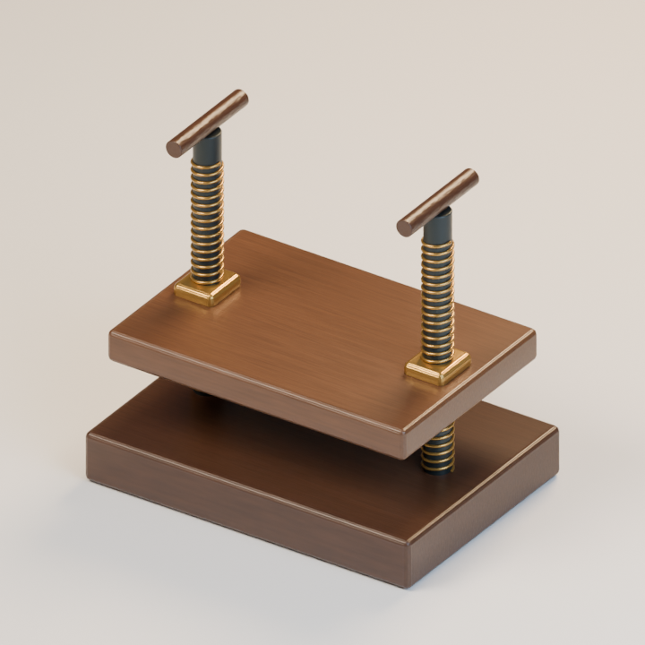

A wooden bookbinding press for a book restoration workspace.

0.480 × 0.340 × 0.462 m · model · CC0-1.0

[Download BLEND + GLB (7.91 MiB)](https://github.com/k3peta/tales-on-a-table/releases/download/v2026.10.19-wizard-study/WS_017_CC0.zip)

## WS_018 — Wide-mouth crystal specimen jar

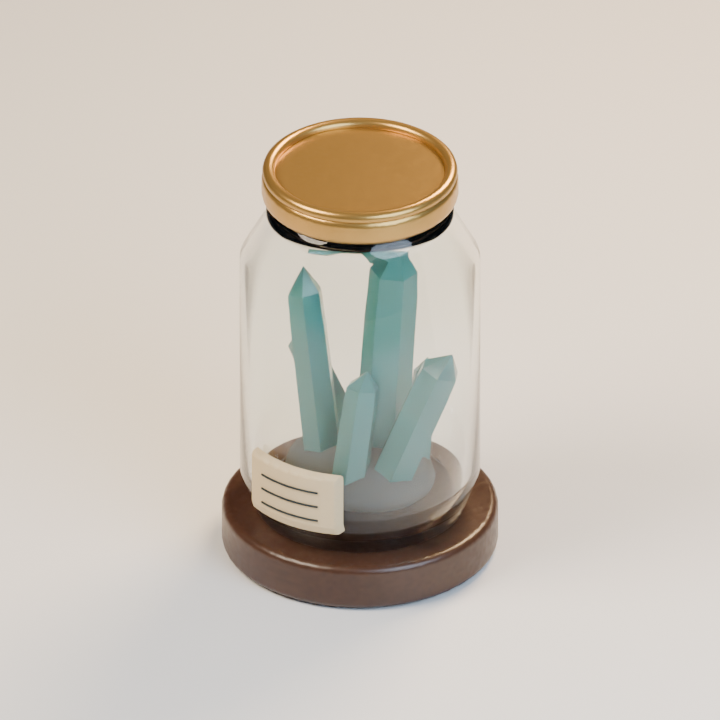

A wide-mouth jar containing a crystal specimen.

0.172 × 0.172 × 0.272 m · model · CC0-1.0

[Download BLEND + GLB (3.35 MiB)](https://github.com/k3peta/tales-on-a-table/releases/download/v2026.10.19-wizard-study/WS_018_CC0.zip)

## WS_019 — Narrow-neck feather specimen jar

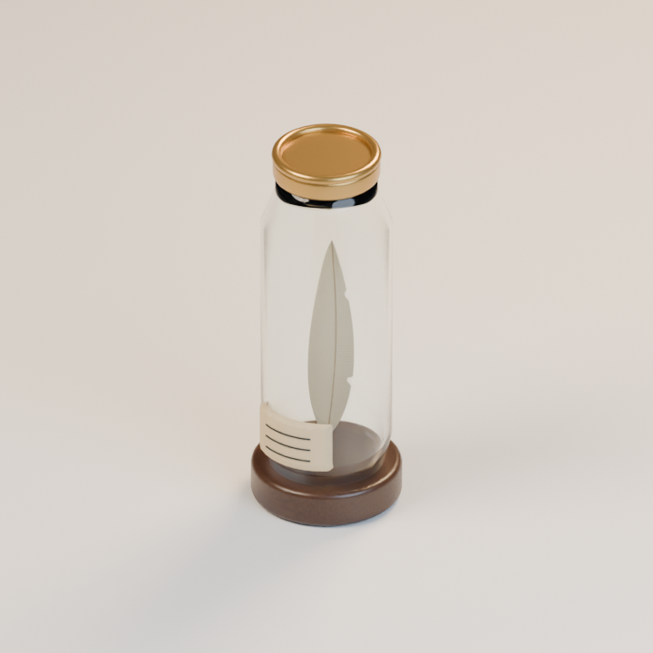

A narrow-neck container holding a feather specimen.

0.120 × 0.120 × 0.312 m · model · CC0-1.0

[Download BLEND + GLB (6.26 MiB)](https://github.com/k3peta/tales-on-a-table/releases/download/v2026.10.19-wizard-study/WS_019_CC0.zip)

## WS_020 — Botanical specimen dome

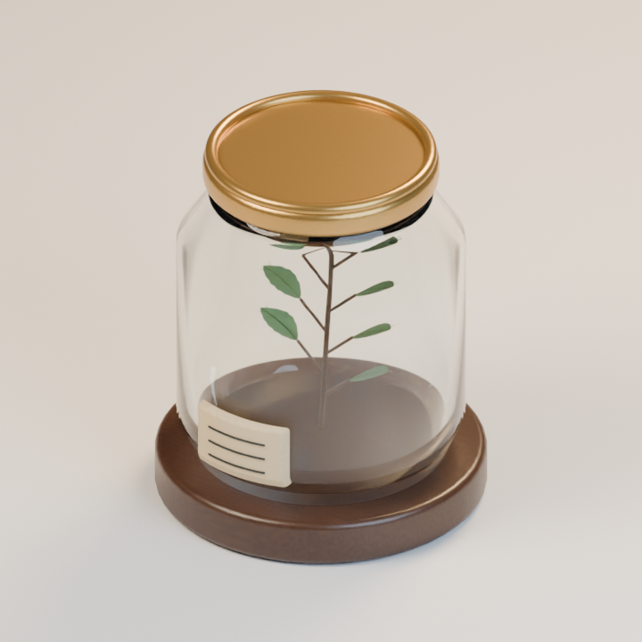

A domed container displaying a collected plant specimen.

0.207 × 0.207 × 0.242 m · model · CC0-1.0

[Download BLEND + GLB (7.66 MiB)](https://github.com/k3peta/tales-on-a-table/releases/download/v2026.10.19-wizard-study/WS_020_CC0.zip)

## WS_021 — Quill and ink writing set

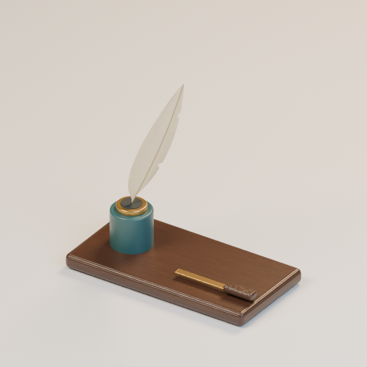

A writing set combining a quill and ink bottle.

0.310 × 0.160 × 0.321 m · model · CC0-1.0

[Download BLEND + GLB (5.40 MiB)](https://github.com/k3peta/tales-on-a-table/releases/download/v2026.10.19-wizard-study/WS_021_CC0.zip)

## WS_022 — Desk magnifying glass

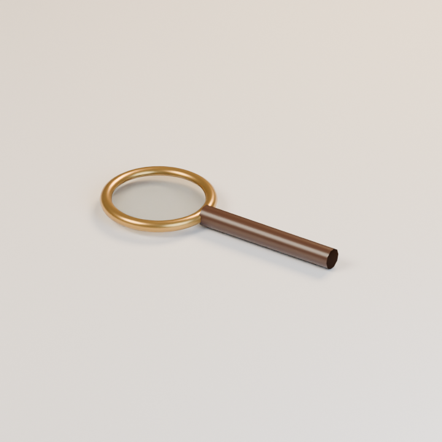

A magnifying glass for inspecting fine records and specimens.

0.218 × 0.096 × 0.017 m · model · CC0-1.0

[Download BLEND + GLB (0.92 MiB)](https://github.com/k3peta/tales-on-a-table/releases/download/v2026.10.19-wizard-study/WS_022_CC0.zip)

## WS_023 — Hourglass with brass columns

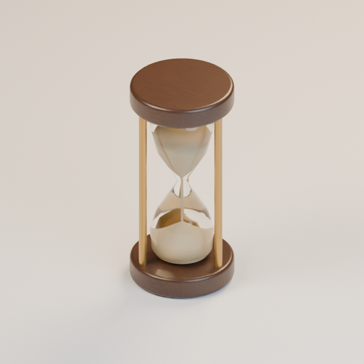

An hourglass with brass columns for a research desk.

0.130 × 0.130 × 0.273 m · model · CC0-1.0

[Download BLEND + GLB (10.29 MiB)](https://github.com/k3peta/tales-on-a-table/releases/download/v2026.10.19-wizard-study/WS_023_CC0.zip)

## WS_024 — Hooded research lamp

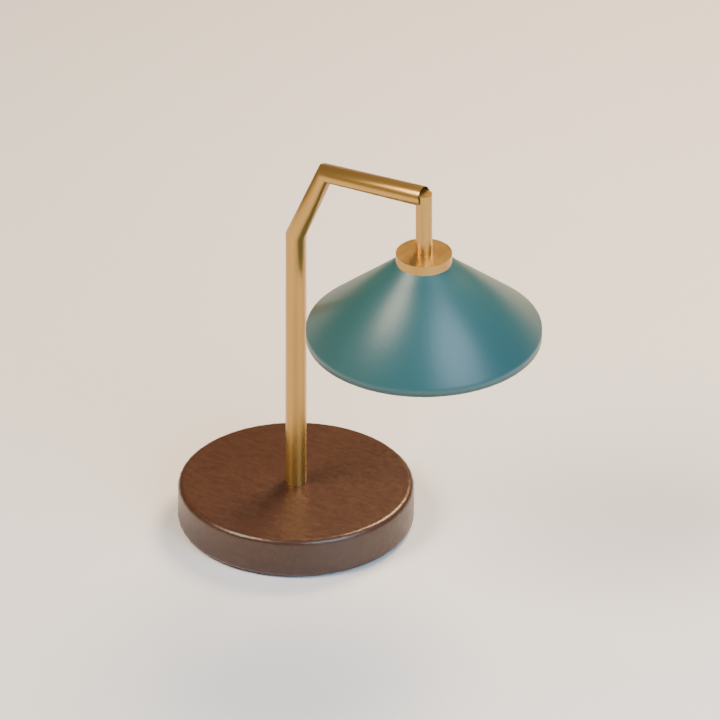

A tabletop research lamp with a shade hood.

0.330 × 0.200 × 0.369 m · model · CC0-1.0

[Download BLEND + GLB (0.95 MiB)](https://github.com/k3peta/tales-on-a-table/releases/download/v2026.10.19-wizard-study/WS_024_CC0.zip)

## WS_025 — Tabletop armillary sphere

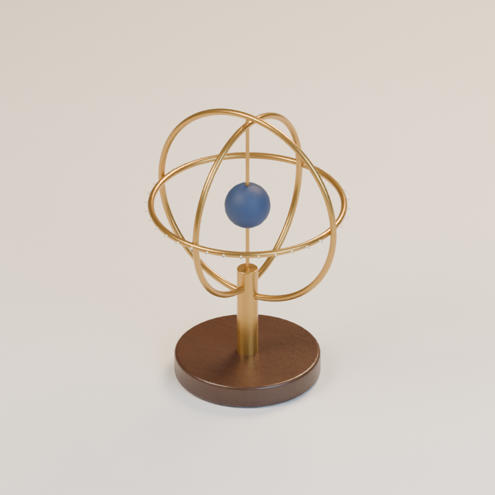

A tabletop astronomical instrument with multiple rings.

0.320 × 0.310 × 0.450 m · model · CC0-1.0

[Download BLEND + GLB (6.82 MiB)](https://github.com/k3peta/tales-on-a-table/releases/download/v2026.10.19-wizard-study/WS_025_CC0.zip)

## WS_026 — Sealed archive chest

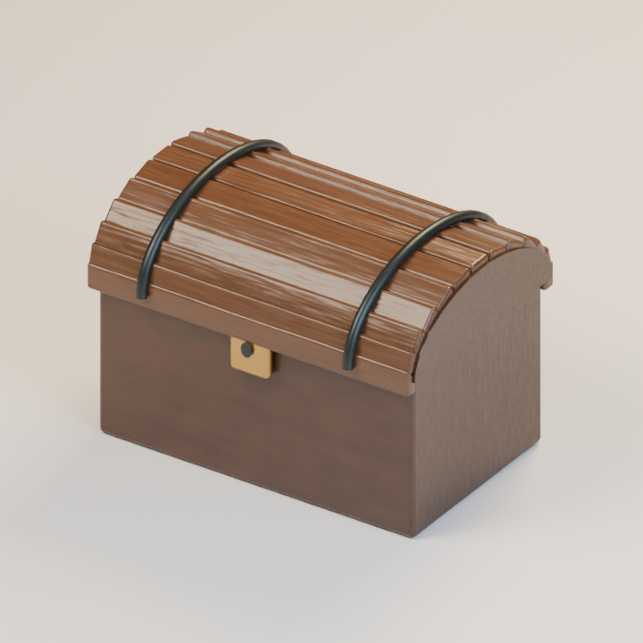

A storage chest for sealed archival material.

0.534 × 0.389 × 0.386 m · model · CC0-1.0

[Download BLEND + GLB (2.94 MiB)](https://github.com/k3peta/tales-on-a-table/releases/download/v2026.10.19-wizard-study/WS_026_CC0.zip)

## WS_027 — Document box with leather handles

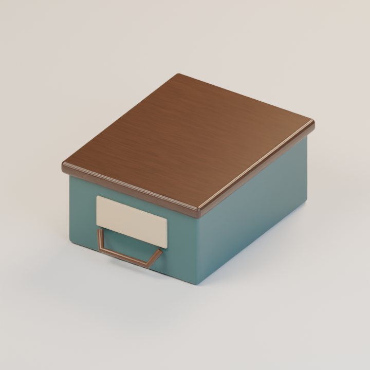

A document storage box with leather handles.

0.300 × 0.401 × 0.171 m · model · CC0-1.0

[Download BLEND + GLB (5.27 MiB)](https://github.com/k3peta/tales-on-a-table/releases/download/v2026.10.19-wizard-study/WS_027_CC0.zip)

## WS_028 — Six-slot scroll rack

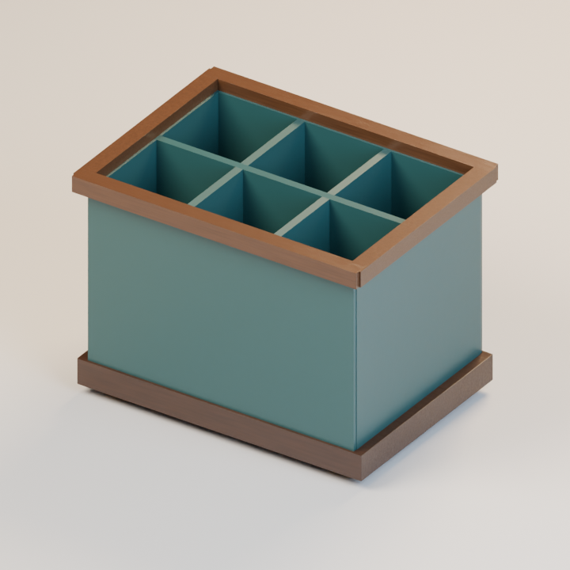

A six-slot rack for storing and sorting upright scrolls.

0.465 × 0.345 × 0.348 m · model · CC0-1.0

[Download BLEND + GLB (17.06 MiB)](https://github.com/k3peta/tales-on-a-table/releases/download/v2026.10.19-wizard-study/WS_028_CC0.zip)

## WS_029 — Working calculation slate

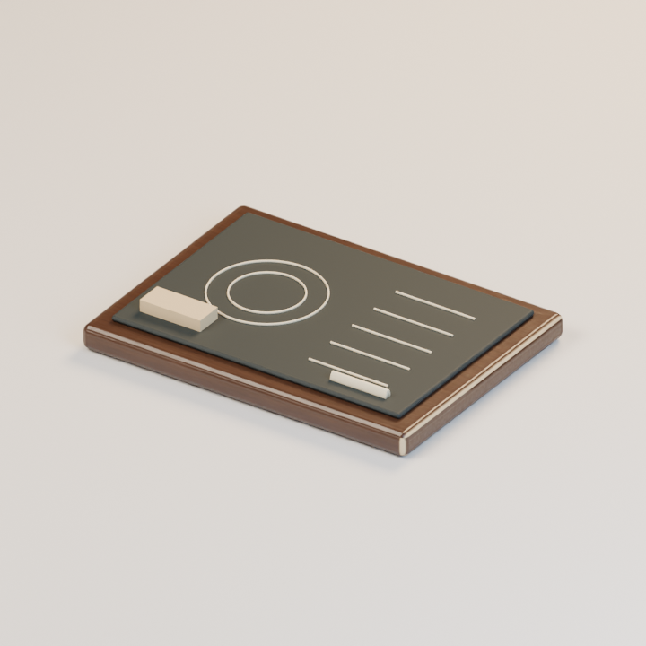

A slate with working calculations left on its surface.

0.350 × 0.260 × 0.044 m · model · CC0-1.0

[Download BLEND + GLB (9.67 MiB)](https://github.com/k3peta/tales-on-a-table/releases/download/v2026.10.19-wizard-study/WS_029_CC0.zip)

## WS_030 — Octagonal footstool

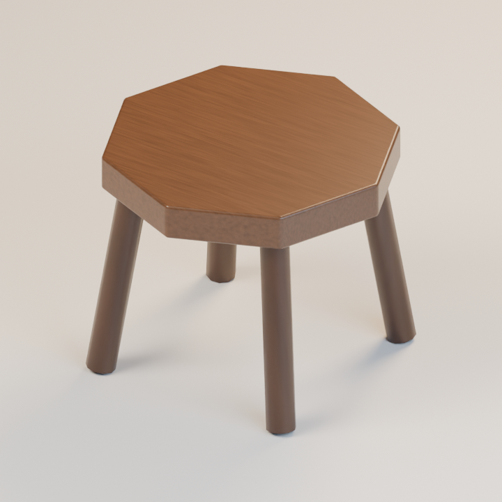

An octagonal footstool that can also serve as a small temporary stand.

0.437 × 0.437 × 0.356 m · model · CC0-1.0

[Download BLEND + GLB (9.54 MiB)](https://github.com/k3peta/tales-on-a-table/releases/download/v2026.10.19-wizard-study/WS_030_CC0.zip)

## WS_031 — Hexagonal brass lantern

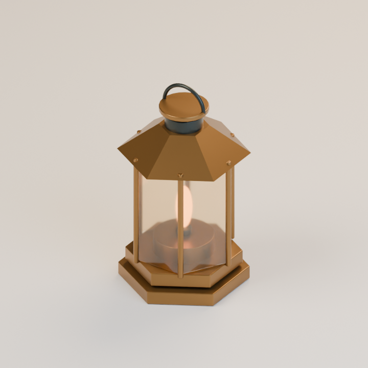

A hexagonal brass lantern with glass panes and a carrying loop.

0.197 × 0.228 × 0.377 m · model · CC0-1.0

[Download BLEND + GLB (0.69 MiB)](https://github.com/k3peta/tales-on-a-table/releases/download/v2026.10.19-wizard-study/WS_031_CC0.zip)

## WS_032 — Serpentine paperweight

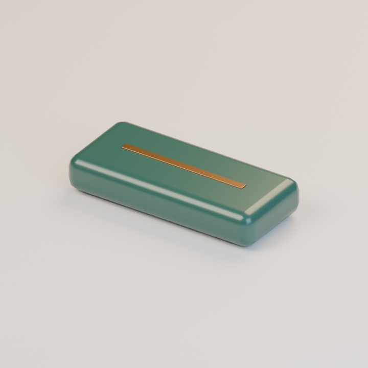

A serpentine stone paperweight for holding open parchment.

0.100 × 0.045 × 0.018 m · model · CC0-1.0

[Download BLEND + GLB (0.60 MiB)](https://github.com/k3peta/tales-on-a-table/releases/download/v2026.10.19-wizard-study/WS_032_CC0.zip)

## WS_033 — Tall five-tier bookcase

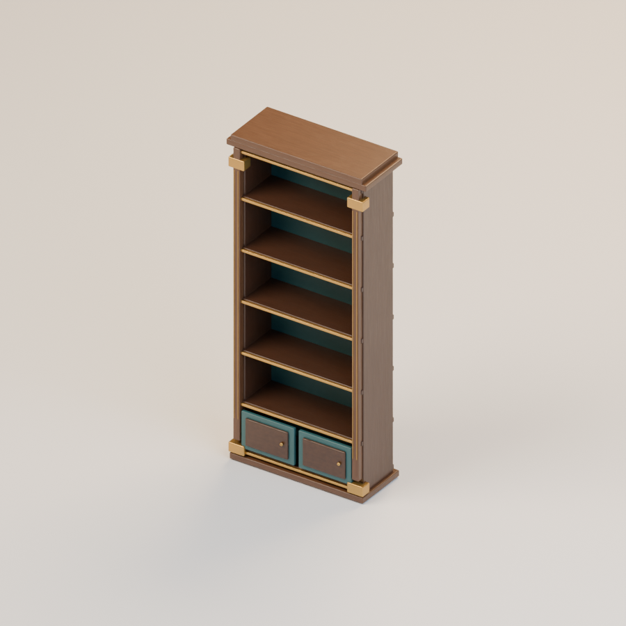

A structural variant of WS011 with extended uprights and an extra shelf; member cross-sections are retained.

1.320 × 0.560 × 2.977 m · structural_variant · CC0-1.0

[Download BLEND + GLB (8.75 MiB)](https://github.com/k3peta/tales-on-a-table/releases/download/v2026.10.19-wizard-study/WS_033_CC0.zip)

## WS_034 — Hooked tall library ladder

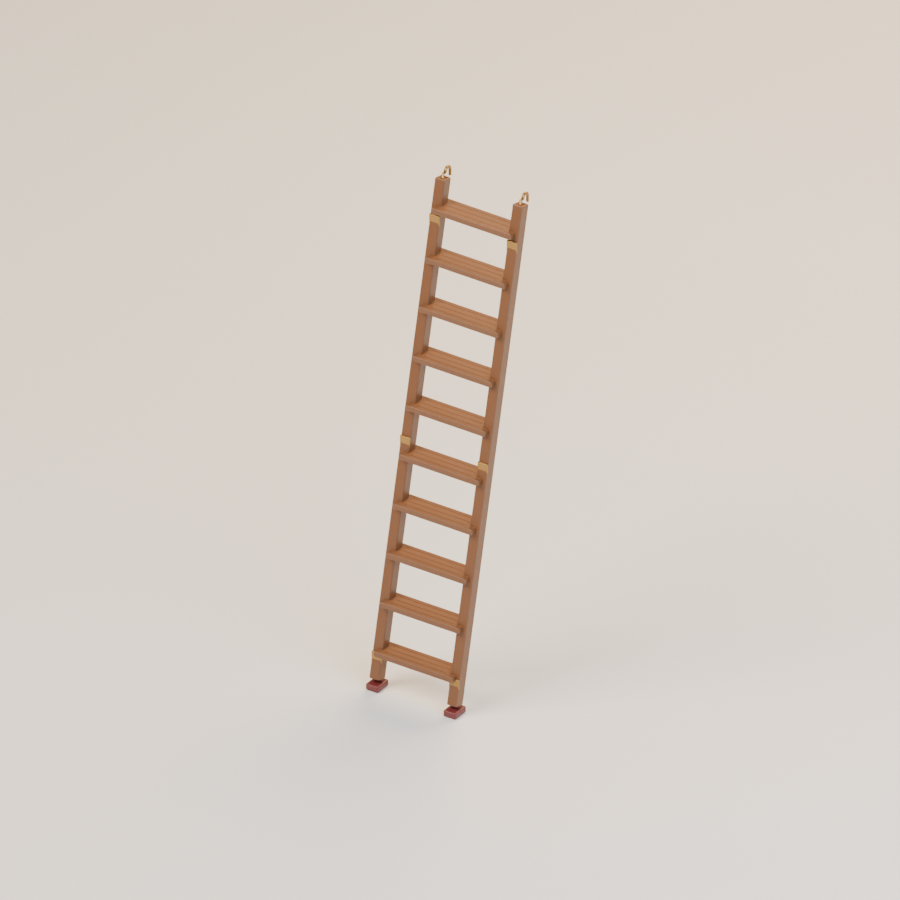

A tall structural ladder variant with ten level treads, leather soles and brass rail hooks.

0.545 × 0.720 × 2.750 m · structural_variant · CC0-1.0

[Download BLEND + GLB (0.95 MiB)](https://github.com/k3peta/tales-on-a-table/releases/download/v2026.10.19-wizard-study/WS_034_CC0.zip)

## WS_035 — Mineral sorting tray

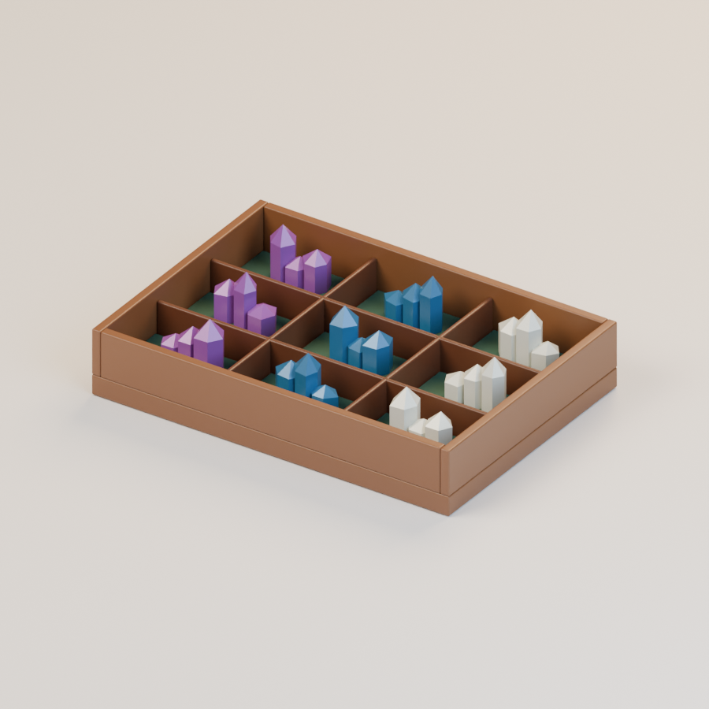

A nine-compartment wooden tray with felt, crystal specimens and individual labels.

0.480 × 0.340 × 0.098 m · model · CC0-1.0

[Download BLEND + GLB (1.02 MiB)](https://github.com/k3peta/tales-on-a-table/releases/download/v2026.10.19-wizard-study/WS_035_CC0.zip)

## WS_036 — Open leather document portfolio

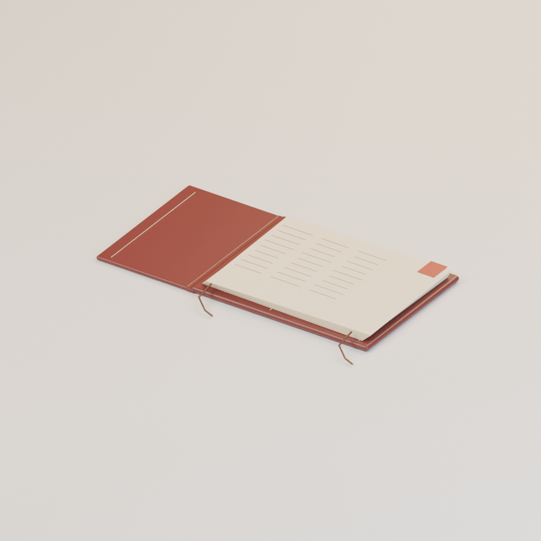

An open leather portfolio with a folded-out cover, separate sheets, tie cords and an index tab.

0.584 × 0.352 × 0.028 m · model · CC0-1.0

[Download BLEND + GLB (0.90 MiB)](https://github.com/k3peta/tales-on-a-table/releases/download/v2026.10.19-wizard-study/WS_036_CC0.zip)

## WS_037 — Apothecary balance

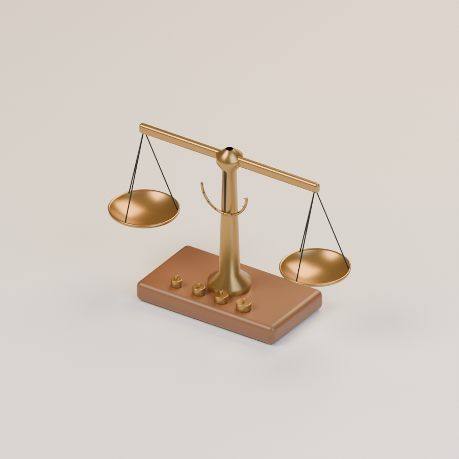

A small balance with three-point suspended pans, a pointer, scale marks and four weights.

0.568 × 0.190 × 0.370 m · model · CC0-1.0

[Download BLEND + GLB (1.02 MiB)](https://github.com/k3peta/tales-on-a-table/releases/download/v2026.10.19-wizard-study/WS_037_CC0.zip)

## WS_038 — Scroll sorting carousel

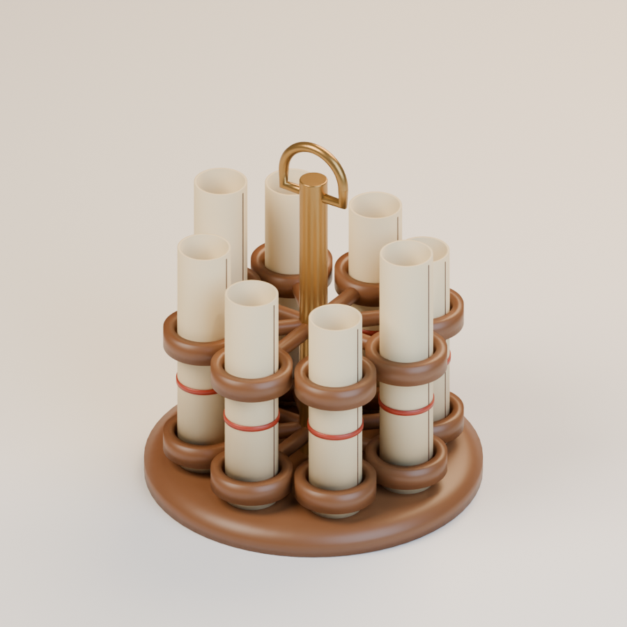

An eight-slot scroll organizer with two support levels, hollow vellum rolls and a carrying handle.

0.380 × 0.380 × 0.426 m · model · CC0-1.0

[Download BLEND + GLB (1.02 MiB)](https://github.com/k3peta/tales-on-a-table/releases/download/v2026.10.19-wizard-study/WS_038_CC0.zip)

## WS_039 — Annotated research sheets

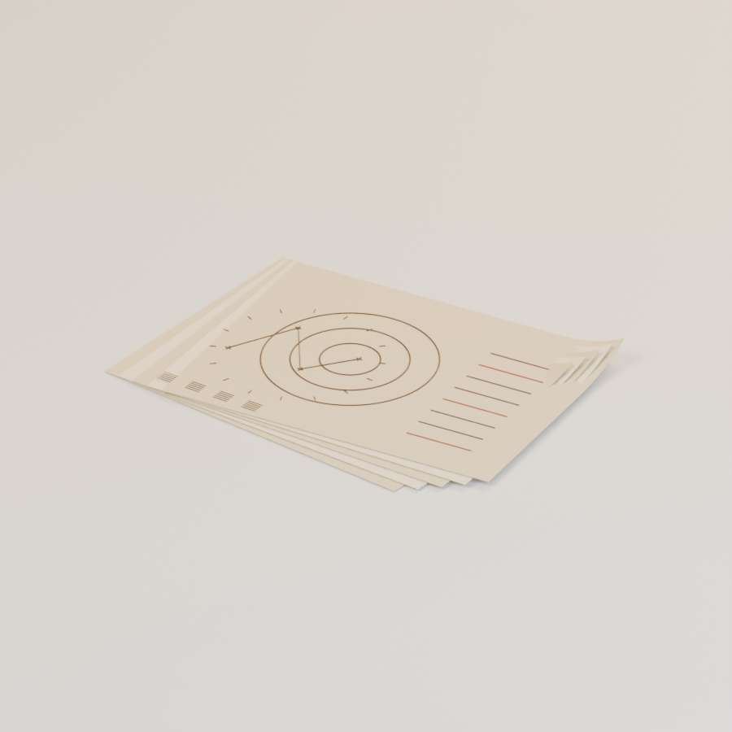

Five separate curled sheets with an original fictional astronomical diagram, graduations and margin notes.

0.406 × 0.314 × 0.022 m · model · CC0-1.0

[Download BLEND + GLB (0.95 MiB)](https://github.com/k3peta/tales-on-a-table/releases/download/v2026.10.19-wizard-study/WS_039_CC0.zip)

## WS_040 — Open amethyst geode

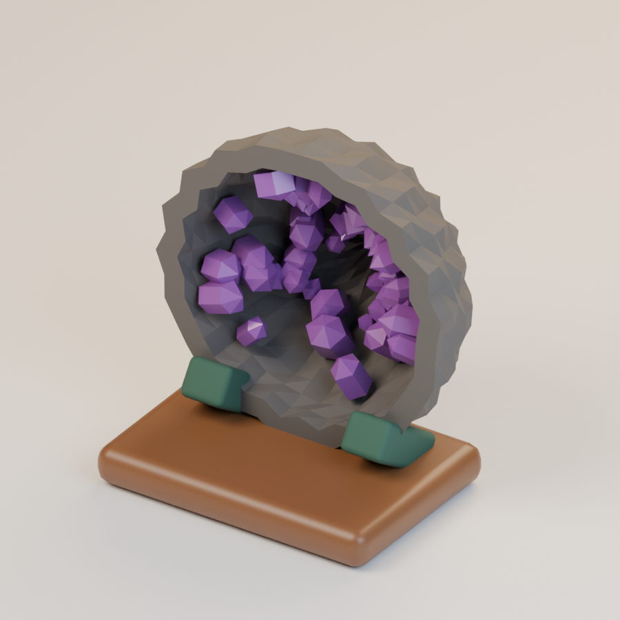

An opened amethyst geode with a rocky shell, inward crystals and a padded wooden cradle.

0.286 × 0.255 × 0.312 m · model · CC0-1.0

[Download BLEND + GLB (1.08 MiB)](https://github.com/k3peta/tales-on-a-table/releases/download/v2026.10.19-wizard-study/WS_040_CC0.zip)
