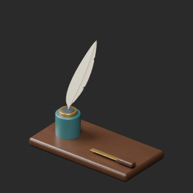
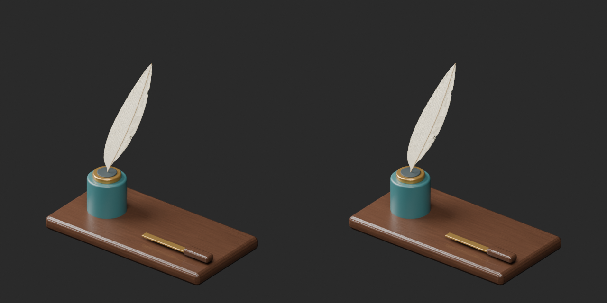
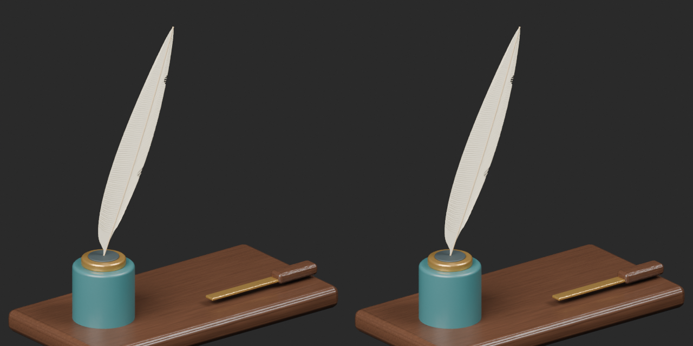

# WS021 scan resolution / 公開検査保留の解消候補

One geometry revision, no new base or variant.99 exactly-zero-area faces removed; positive faces/UV/normals retained including5 tiny positive faces. The earlier broad marker was coincidental compressed PNG IDAT bytes, not token syntax or text metadata. Resolution/offset ancillary metadata removed; lossless recompression retains identical filtered scanlines, dimensions/color chunks and Blender decoded pixels. The strict marker test was not weakened. Original and failed copies preserved.

以前の文字列検出は圧縮画像内の偶然一致と診断。画素不変の再圧縮と解像度・オフセット付属情報の除去を行い、検査条件を緩めず新しい最終ZIPが合格。旧失敗記録は保持。99枚の面積ゼロ面の除去は改訂扱いで非加算。

Producer final-ZIP guard and image-byte equivalence evidence checked. Public ZIP/member hashes match the final guarded artifacts. Publication did not rerun Blender. No physics/collision/old-version guarantee. Models/materials only CC0; images separate. [License](../LICENSE.md).

## WS_021__repair — Quill and ink writing set

羽根ペンとインク壺の筆記台

WS021 revision:99 exact-zero-area faces removed; positive faces and UV retained. Embedded basecolor PNG losslessly recompressed with identical filtered pixels, resolution/offset metadata removed. Broad byte-marker scan unchanged and passed. No new model or material variant.

[ZIP · BLEND/GLB](https://raw.githubusercontent.com/k3peta/tales-on-a-table/main/distributions/quality-ws021-scan-repair-v2/WS_021__repair_CC0.zip)

Left: original; right: accepted revision/variant, identical camera/light/scale.

[Exact package validation evidence](../distributions/quality-ws021-scan-repair-v2/validation.json).

Independent publication check also found identical decompressed PNG filtered scanlines, dimensions/color chunks and unchanged other embedded image bytes.
