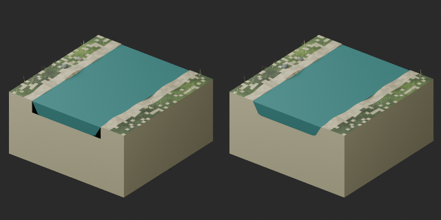
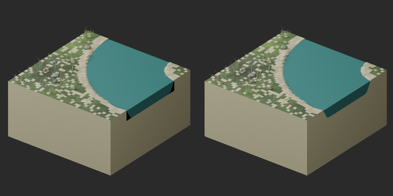

# Stream-end repairs / 川断面修復 / 河道断面修复

**WT correction status / 訂正状況:** v1 validation claim withdrawn: stale older-candidate report was misapplied and strict null-material-slot test failed. v2 exact public-download ZIPs independently reimported successfully in Blender5.2.2; scoped geometry/UV/material/image checks passed, not a general function or safety guarantee. [v2 details](wt007_008_replacement_v2.md). 原v1の合格は撤回、v2公開再取得物の独立検査のみ合格。

**Correction / 訂正:** Prior v1 pass claim withdrawn: stale older-candidate results were applied to a package failing strict null-material-slot checks. Replacement v2 public-download reimport has now passed scoped checks; v1 remains withdrawn. [Replacement v2](wt007_008_replacement_v2.md). Original and v1 archives retained as history.

**WT007/WT008 — Historical v1 validation warning / v1検査誤りの履歴 / v1错误检验历史**

Historical v1 notice (resolved as incorrect validation, not cleared): final numerical BLEND/GLB report records passes, but a separate summary still records a false reimport flag. The discrepancy was traced to an incorrectly reused old-candidate result; v1 failed the strict null-slot check. Historical v1 is not a validated replacement; see the current v2 result. Download/CRC/SHA verification does not resolve model QA.

旧数値合格は別候補の誤適用で、v1は空材質スロット検査に不合格でした。v1は合格撤回。訂正v2の状態は冒頭参照。旧版にも既知の黒断面があり、旧版が正常と確認されたわけではありません。

旧数值通过记录被错误套用，v1未通过空材质槽检查。v1通过声明撤回，v2状态见页首。原版也有已知黑断面。

Two revised distribution records, zero new base models or variants. Original ZIPs/images retained as version history. Revised baseline channel_fitted_water_v2.

WT007/008 black end wedges came from coplanar overlapping water/bank surfaces. Water solid is trimmed to the existing channel, without widening water area or altering bank geometry. Water level -0.01m,2m tile retained; revised outlet water width1.188421m matches both revised tiles. No claim of arbitrary compatibility with every old tile.

水と岸の重複面を、既存岸に沿って水形状を切り詰め修復。水域拡大なし。水位と2m枠保持。欠落UV追加、既存UV保持、水Boolean部分はトポロジー/UV改訂。低ポリ化ではなく水三角形は増加。旧版・失敗初案は保全。

原版黑断面保留为历史；修订水体贴合既有河岸，没有扩大水域。保留水位与2m地块。水体拓扑/UV修改，不是减面版本。

Producer final BLEND/GLB numerical tests use repaired references; the final numerical report records passes, subject to the unresolved summary discrepancy above. Section checks report no below-bank vertices at the repaired outlets, water welded boundary/nonmanifold edges0, no tiny faces. Scoped repair, not full collision/walking/safety/Blender4.3.2 verification. Historic source script unrecovered. These2focused repairs are not added again to the cumulative assessment count.

モデル/埋込材質のみCC0。画像は閲覧用でモデルCC0対象外、[既存画像権利](../LICENSE.md)維持。代码图片私有査定不属模型CC0。

## WT007__repair — Stream straight NS

revision · [ZIP · BLEND/GLB](https://raw.githubusercontent.com/k3peta/tales-on-a-table/main/distributions/quality-wt007-008-repair-v1/WT007__repair_CC0.zip)

[拡大 / Full image](https://raw.githubusercontent.com/k3peta/tales-on-a-table/main/previews/quality-wt007-008-repair-v1/WT007__repair_thumb.png)

[拡大 / Full image](https://raw.githubusercontent.com/k3peta/tales-on-a-table/main/previews/quality-wt007-008-repair-v1/WT007__repair_comparison.png)

left: original base; right: revised model; same overview camera

## WT008__repair — Stream bend NE

revision · [ZIP · BLEND/GLB](https://raw.githubusercontent.com/k3peta/tales-on-a-table/main/distributions/quality-wt007-008-repair-v1/WT008__repair_CC0.zip)

[拡大 / Full image](https://raw.githubusercontent.com/k3peta/tales-on-a-table/main/previews/quality-wt007-008-repair-v1/WT008__repair_thumb.png)

[拡大 / Full image](https://raw.githubusercontent.com/k3peta/tales-on-a-table/main/previews/quality-wt007-008-repair-v1/WT008__repair_comparison.png)

left: original base; right: revised model; same overview camera
