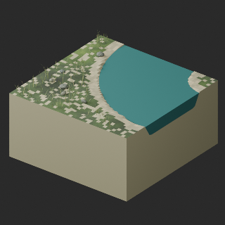

# WT replacement v2 / WT訂正版v2 / WT更正版v2

**v2 exact public downloads independently reimported successfully. Scoped checks passed; prior v1 validation claim remains withdrawn.**

The prior v1 pass claim is withdrawn: a passing result from an older candidate was incorrectly applied to a later failing package. The v1 BLEND retained unused null material slots and failed the original strict material check. This was not merely a stale summary flag. Original reports, failed attempts and v1 ZIPs are retained as history, not recommended replacements.

v2 removes unused null slots without weakening tests. Geometry revision channel_fitted_water_v3_clean_slots. Existing channel-fitted water repair retained, no water-area expansion. Producer rechecked files extracted from these exact two ZIPs: BLEND/GLB triangle correspondence, coordinates, UV, materials and embedded images. Publication task independently repeated these checks on public-download files; all four format checks passed.

旧v1合格報告は撤回。古い別候補の結果を、未使用空材質スロットで厳格検査に失敗した後続候補へ誤適用しました。単なるフラグ更新漏れではありません。訂正v2は空スロットを除去し、検査条件を緩めずZIP展開物から再検査。公開再取得物の独立再検査は4形式とも合格しました。旧原本・v1・失敗記録保持、新規モデル/variant加算0。

旧v1通过声明撤回：错误套用了旧候选结果。v2删除未使用空材质槽，未放宽测试。公开下载包独立复检已通过；旧版保留为历史。

Scoped model validation only; no game collision/walking/function/strength/Blender4.3.2 guarantee. Missing UV additions and Boolean-water topology/UV changes remain explicit; not original UV unchanged or polygon reduction.

モデル/埋込材質のみCC0。画像は閲覧用でモデルCC0対象外、[既存画像権利](../LICENSE.md)維持。代码图片私有査定不属模型CC0。

## WT007__repair — Stream straight NS

revision · [ZIP · BLEND/GLB](https://raw.githubusercontent.com/k3peta/tales-on-a-table/main/distributions/quality-wt007-008-repair-v2/WT007__repair_CC0.zip)

[拡大 / Full image](https://raw.githubusercontent.com/k3peta/tales-on-a-table/main/previews/quality-wt007-008-repair-v2/WT007__repair_thumb.png)

[拡大 / Full image](https://raw.githubusercontent.com/k3peta/tales-on-a-table/main/previews/quality-wt007-008-repair-v2/WT007__repair_comparison.png)

left: original base; right: revised model; same overview camera

## WT008__repair — Stream bend NE

revision · [ZIP · BLEND/GLB](https://raw.githubusercontent.com/k3peta/tales-on-a-table/main/distributions/quality-wt007-008-repair-v2/WT008__repair_CC0.zip)

[拡大 / Full image](https://raw.githubusercontent.com/k3peta/tales-on-a-table/main/previews/quality-wt007-008-repair-v2/WT008__repair_thumb.png)

[拡大 / Full image](https://raw.githubusercontent.com/k3peta/tales-on-a-table/main/previews/quality-wt007-008-repair-v2/WT008__repair_comparison.png)

left: original base; right: revised model; same overview camera

[Exact package/model hashes and independent numerical results](../distributions/quality-wt007-008-repair-v2/validation.json). Gameplay, physics and old-version compatibility remain unverified.
