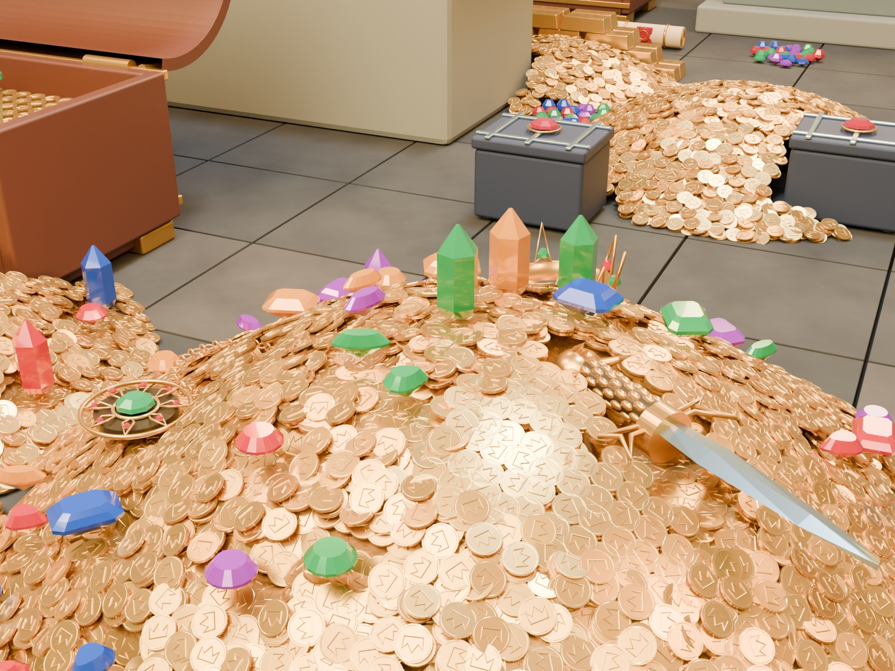
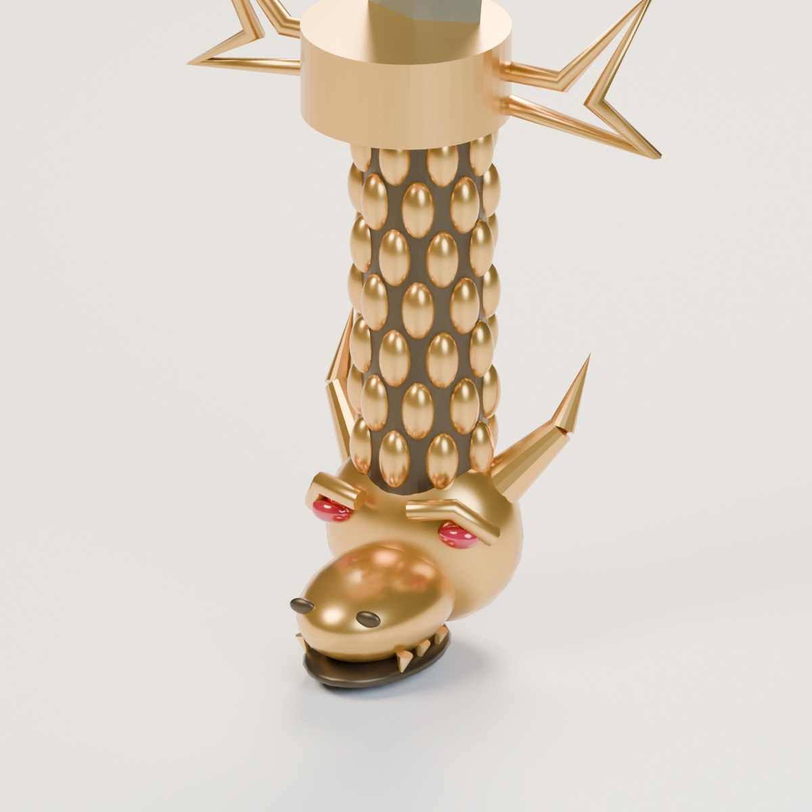
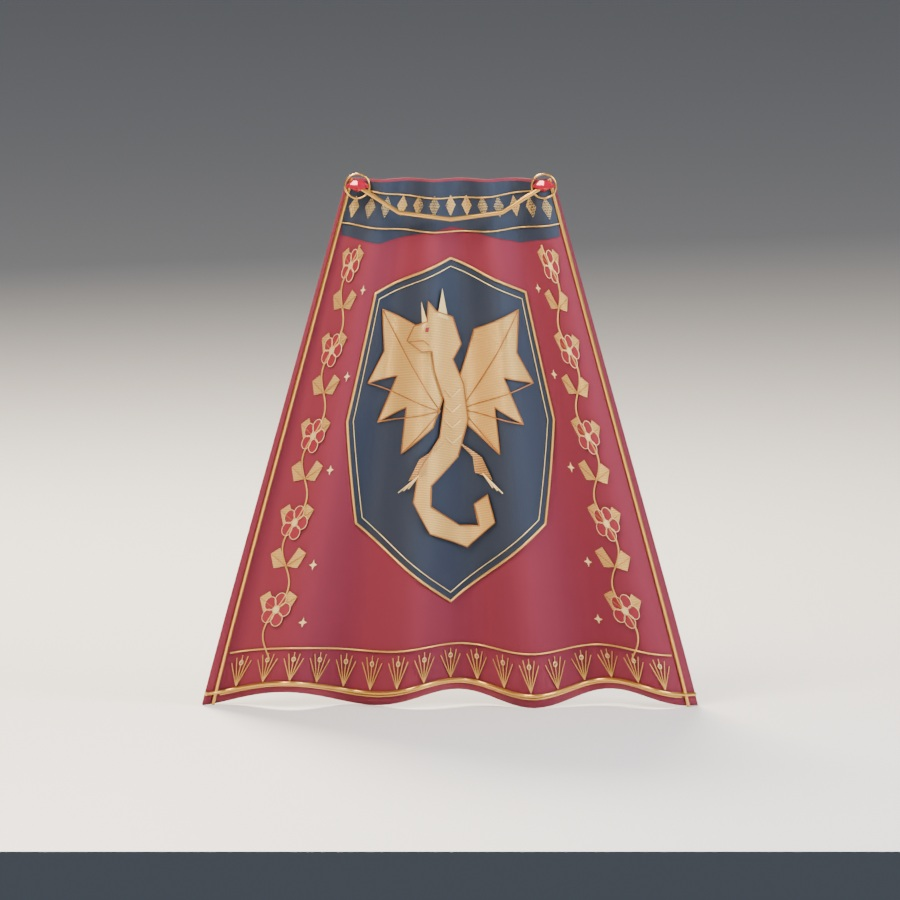
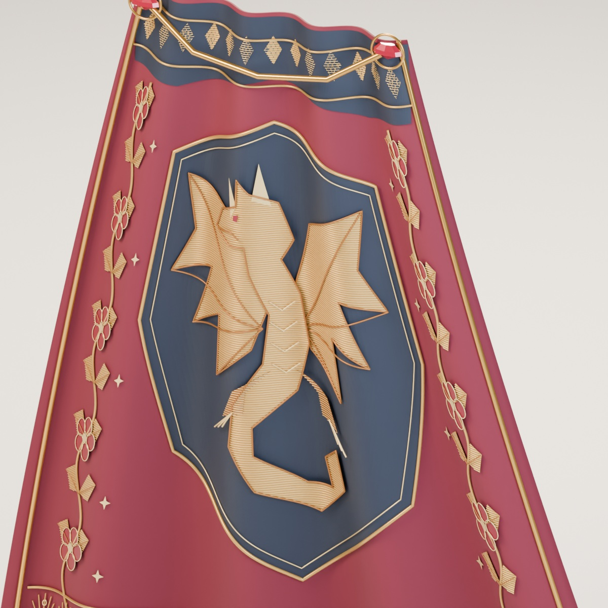
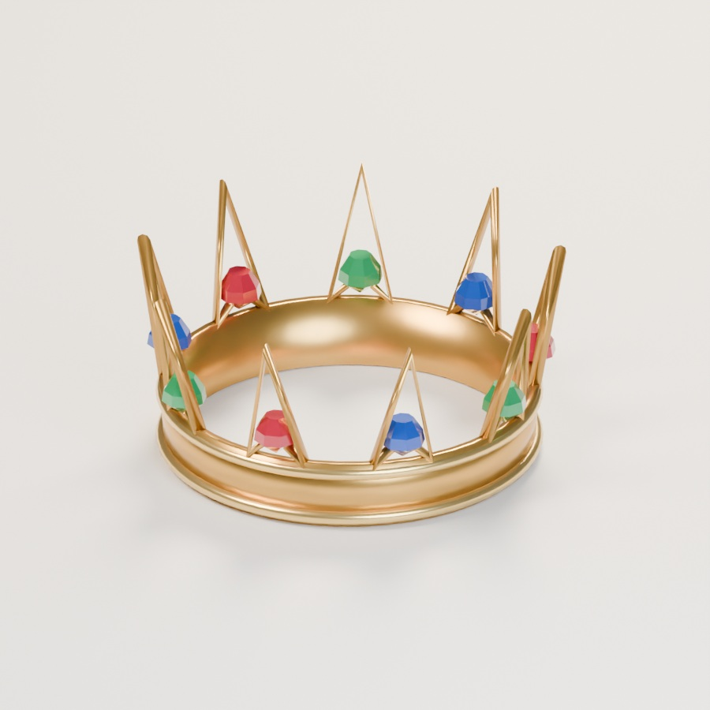
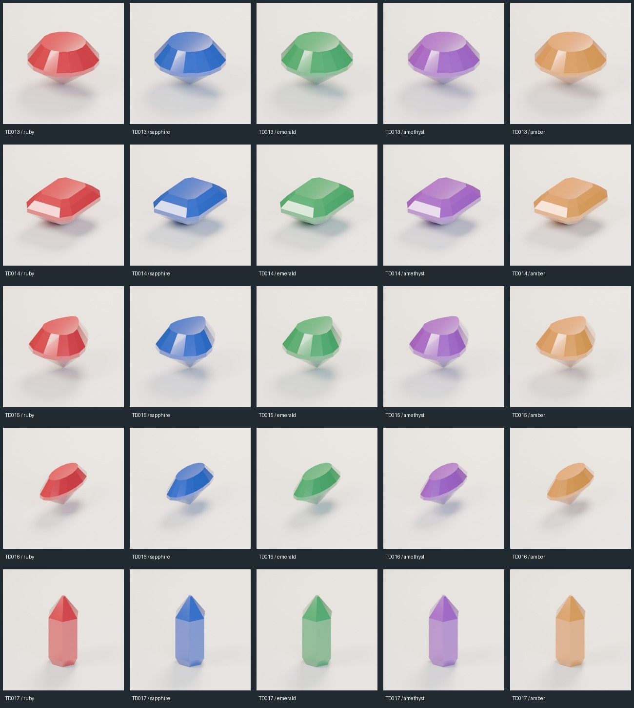

# 一夜で富豪になる、竜の宝物庫

扉の先には、床を覆う金貨の山。開いた宝箱の周りに金塊と宝石がこぼれ、その中から金の鎖や短剣の柄がのぞいています。全部を運び出すには、冒険者の袋がいくつあっても足りなさそうです。

人物を置かず、見つけた瞬間を想像できる宝物庫を作りました。高い石造りの部屋に、財宝の大小のまとまりを置きました。手前では護符、竜頭短剣、宝冠が目に入り、奥には箱や巻物、壁に掛かったマントが続きます。

## 金貨の中から、魔法の品を拾い上げる

護符は、翠玉を囲む透かしの八芒輪と閉じた金の鎖。竜頭短剣には角、赤い目、牙、鱗のついた柄があります。金貨の山に置いても、その形が見えるように周囲の高さを調整しました。

長剣と魔法の杖は壁際に。主役の品に寄った画像と、部屋全体を見渡す画像の両方を用意しています。金貨の配置数で豪華さを説明するより、手に取りたい品がいくつも見つかる場面を目指しました。

## 竜を縫い取った、深紅のマント

マントの中央には、濃紺の盾形を背景にした金糸の竜。頭と角、大きく開いた翼、巻いた尾を、輪郭と面の刺繍で表しました。近づくと、面を埋める細い糸の列が見えます。

左右の縁には、蔓につながる葉と五弁の花。裾には扇形の模様を繰り返し、襟元は紺色の布と金の縫い目、紅玉の留め具でまとめています。中央、縁、赤い布の余白で装飾の密度を変えました。

## 大小の箱と、その周りの宝物

大箱は開いた形で、中の金貨と宝石が見えます。小箱は閉じた外観です。封蝋付きの巻物や宝冠、刻印入りの金塊も、別々の素材として作りました。

宝石は円形、長方形の段状カット、洋梨形、マーキス形、六角柱結晶の5形状。それぞれ赤・青・緑・紫・琥珀色を選べます。部屋では不規則に散らし、単品紹介では色と形を比較できる画像にしています。

## 一品ずつ、別の物語へ

単品モデルはBLENDとGLBで用意しています。メートル単位で、底面中央を基準とする原点を揃えました。護符を商店に、巻物を魔法使いの机に、マントを城の壁に置くこともできます。

今回の配布は16単品形状と宝石小山1グループの計17記録。宝石25色ファイルは5形状の色の選択肢であり、25種類の新作とは数えません。再利用した建材や、複製配置した金貨も加算しません。1000種類へ向けて、一品ずつ形と使い道を増やしていきます。

## ダウンロード

[画像付き素材カタログ](https://github.com/k3peta/tales-on-a-table/blob/main/catalog/treasury.md)から、17個の単品ZIPを選べます。各ZIPにBLEND・GLB・実レンダー・日英中の説明と利用条件を収録しています。

自作モデルと表示材質はCC0です。記事・作例画像・完成配置シーンはCC0の対象外で、完成シーンのBLENDは配布しません。静的な装飾素材のため、リグ・アニメーション・衝突形状は含みません。金貨の山には下地と反復配置を使っており、剛体シミュレーションではありません。
