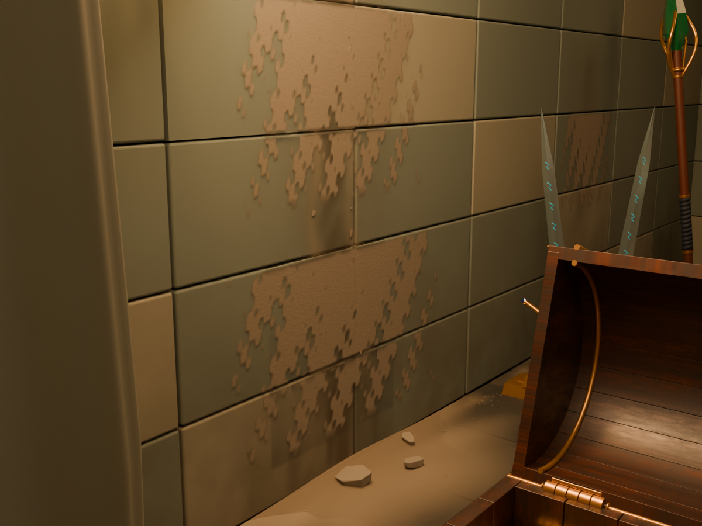
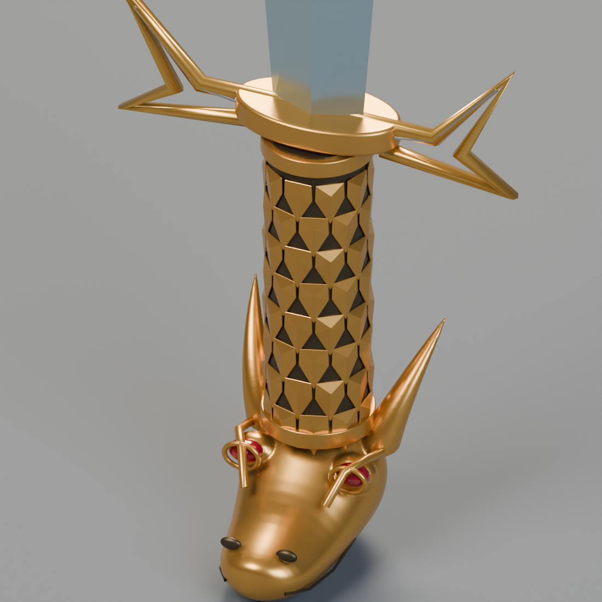
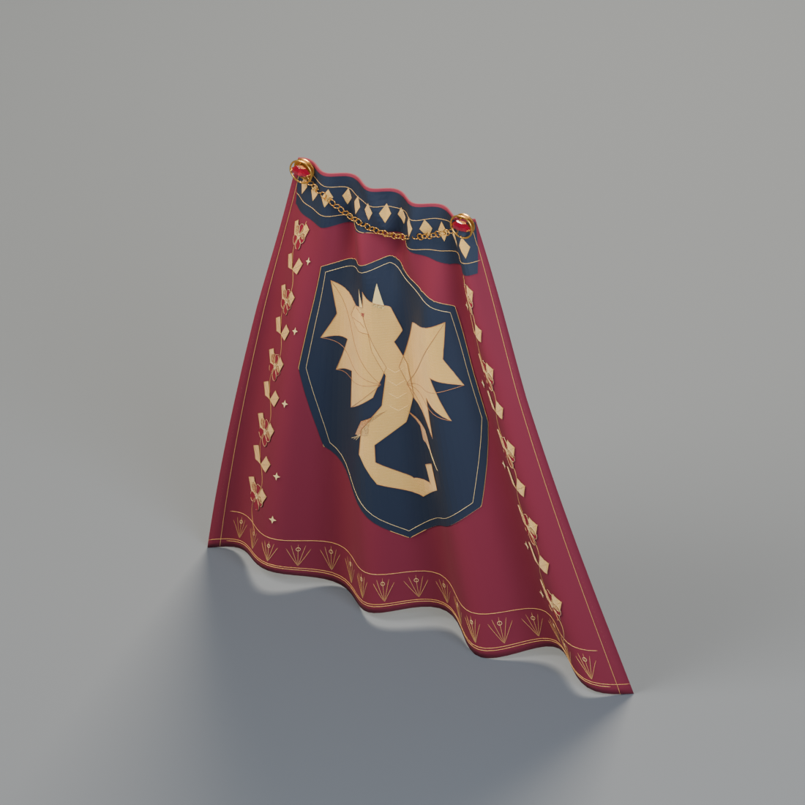
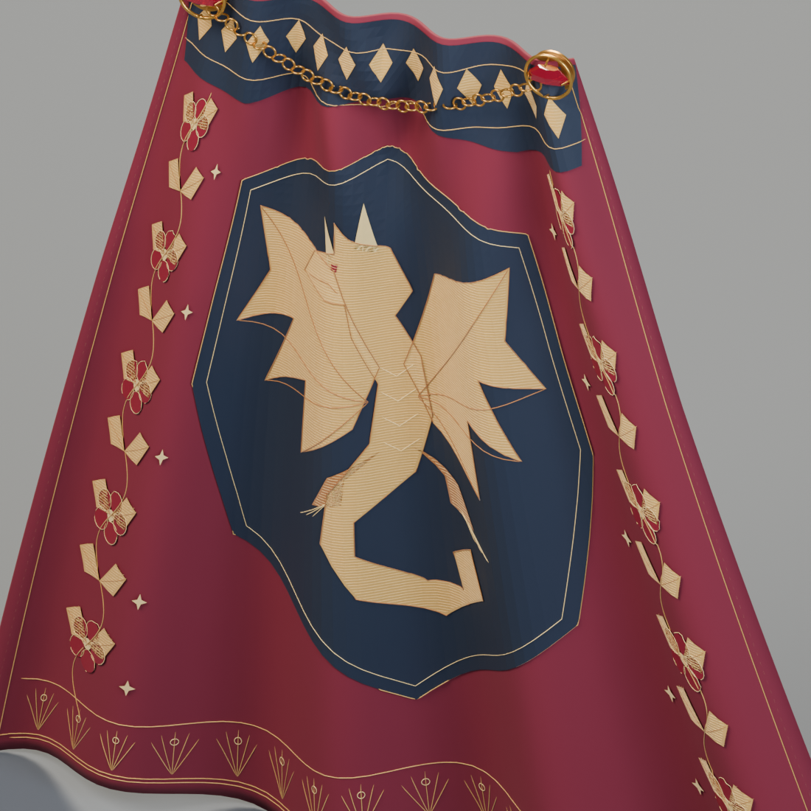
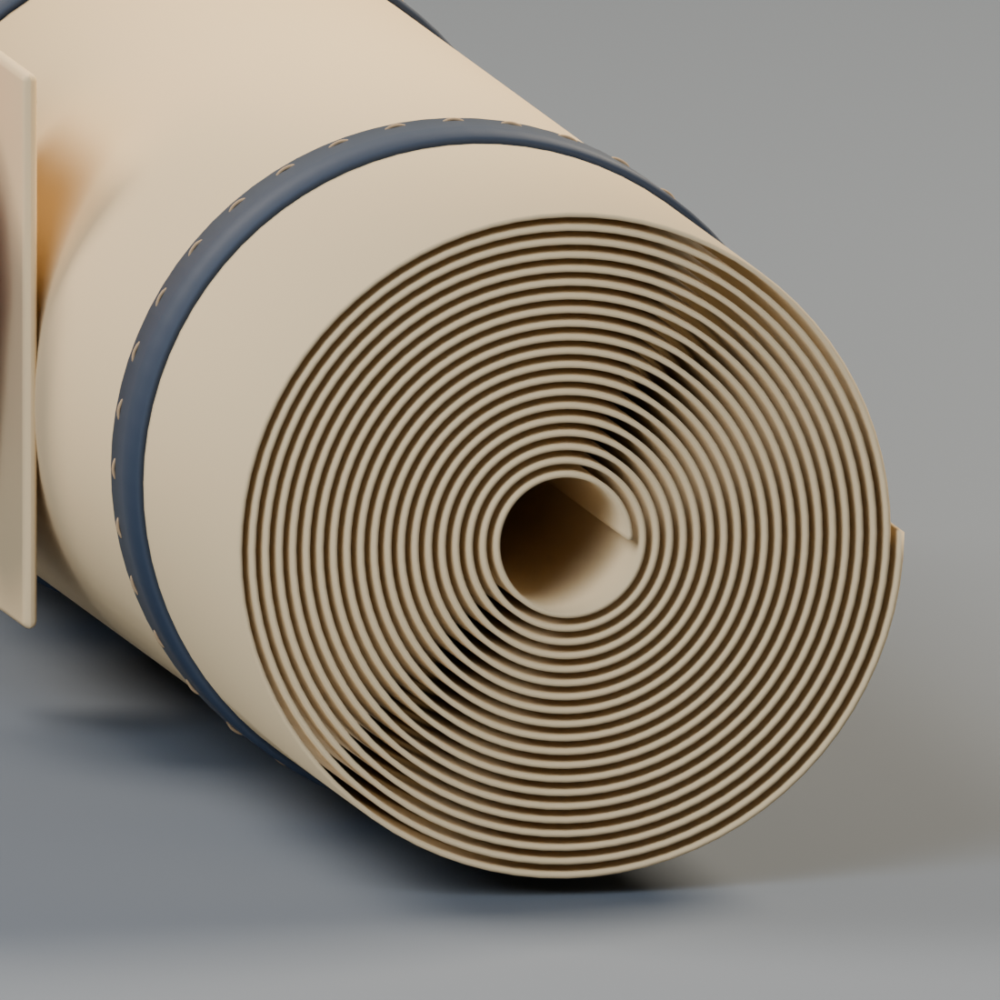
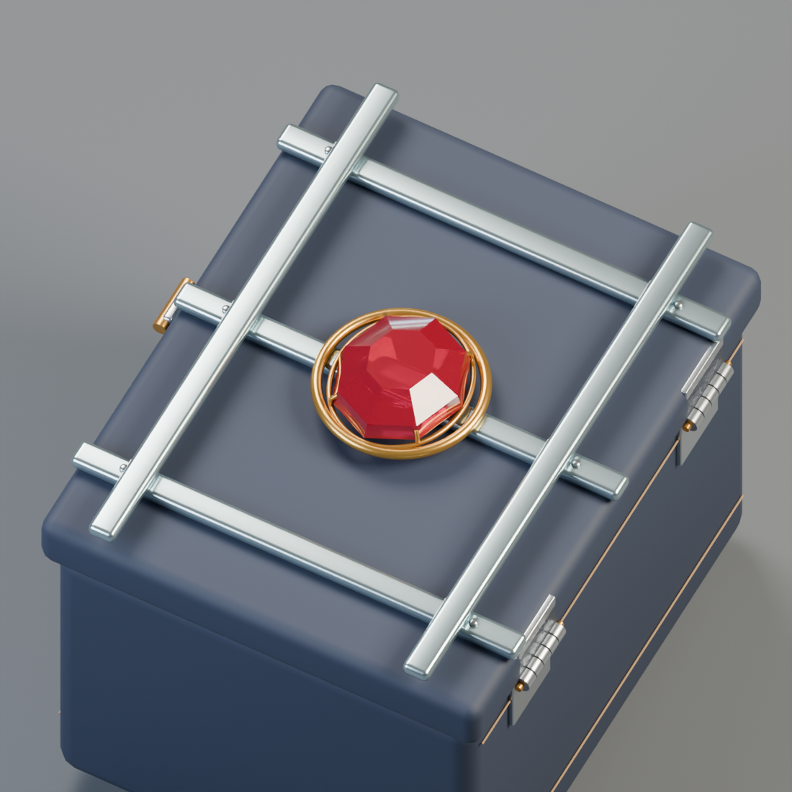
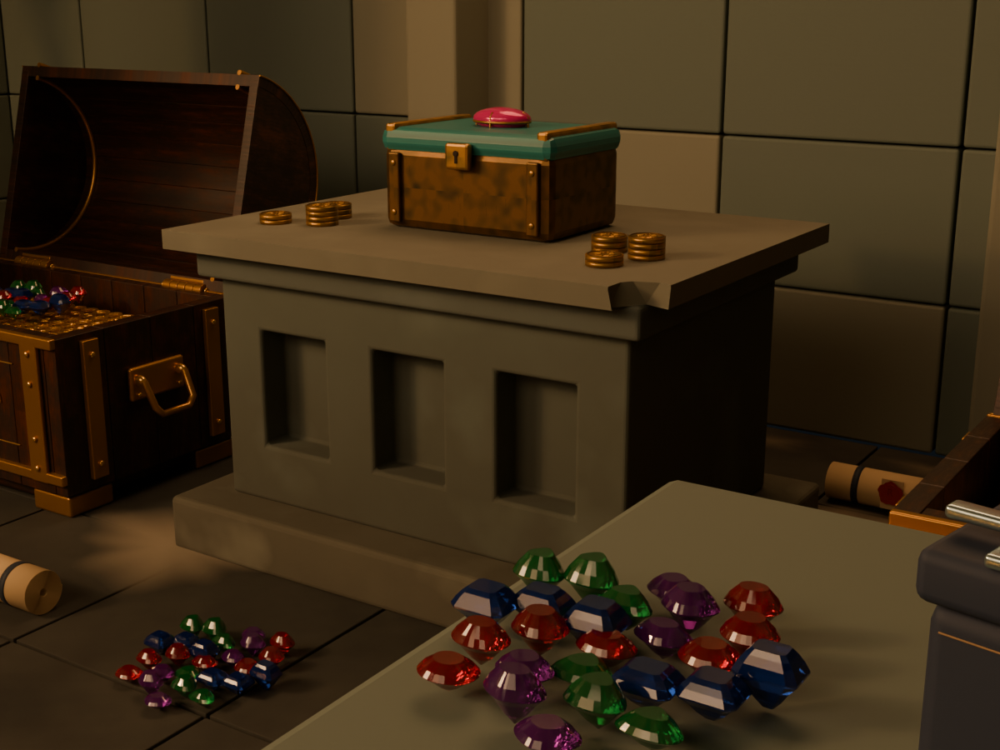

# 一夜致富的巨龙宝库

现有17条素材记录已完成细节修订。这是质量更新，新增种类为0。通过检查的v6模型配合v7建筑场景，以火把暖光照亮财宝。目地附近的矿物痕迹延伸到地面，柱脚和台座角落积下尘土，表现长期无人照料的空间，同时保留财宝的可读性。

龙首短剑的头部、口鼻、下颚与角根连为一体，握柄改为尖形鳞片；披风刺绣贴合布面，并细化了扣件背面。纸卷的皮带与缝线、小匣的铰链及交叠银带也得到修订。

旧版本及25个宝石颜色GLB继续保留，新ZIP收录更新的基准模型。披风约465万三角形，轻量化留待后续，不宣称已经验证轻量游戏性能。

[Catalogue](https://github.com/k3peta/tales-on-a-table/blob/main/catalog/treasury.zh-CN.md)

Models and display materials: CC0-1.0. Articles, images, code and completed layouts are excluded. No completed scene ZIP or BLEND is distributed. Static decorative models; no rigs, collisions or game LOD.
