# 地形91件・ID付き個別画像

公開済みモデルの実レンダーです。画像ごとに縮尺は異なります。モデル・同梱材質はCC0、画像はその対象外です。

## TG001 — ramp half

[TG001 の公開ZIP](https://raw.githubusercontent.com/k3peta/tales-on-a-table/main/distributions/terrain-connectivity-91/zips/TG001_CC0.zip)

## TG002 — ramp full

[TG002 の公開ZIP](https://raw.githubusercontent.com/k3peta/tales-on-a-table/main/distributions/terrain-connectivity-91/zips/TG002_CC0.zip)

## TG003 — ramp inner

[TG003 の公開ZIP](https://raw.githubusercontent.com/k3peta/tales-on-a-table/main/distributions/terrain-connectivity-91/zips/TG003_CC0.zip)

## TG004 — ramp outer

[TG004 の公開ZIP](https://raw.githubusercontent.com/k3peta/tales-on-a-table/main/distributions/terrain-connectivity-91/zips/TG004_CC0.zip)

## TG005 — stairs half

[TG005 の公開ZIP](https://raw.githubusercontent.com/k3peta/tales-on-a-table/main/distributions/terrain-connectivity-91/zips/TG005_CC0.zip)

## TG006 — stairs full

[TG006 の公開ZIP](https://raw.githubusercontent.com/k3peta/tales-on-a-table/main/distributions/terrain-connectivity-91/zips/TG006_CC0.zip)

## TG007 — cliff straight

[TG007 の公開ZIP](https://raw.githubusercontent.com/k3peta/tales-on-a-table/main/distributions/terrain-connectivity-91/zips/TG007_CC0.zip)

## TG008 — cliff outer

[TG008 の公開ZIP](https://raw.githubusercontent.com/k3peta/tales-on-a-table/main/distributions/terrain-connectivity-91/zips/TG008_CC0.zip)

## TG009 — cliff inner

[TG009 の公開ZIP](https://raw.githubusercontent.com/k3peta/tales-on-a-table/main/distributions/terrain-connectivity-91/zips/TG009_CC0.zip)

## TG010 — cliff nose

[TG010 の公開ZIP](https://raw.githubusercontent.com/k3peta/tales-on-a-table/main/distributions/terrain-connectivity-91/zips/TG010_CC0.zip)

## TG011 — overhang straight

[TG011 の公開ZIP](https://raw.githubusercontent.com/k3peta/tales-on-a-table/main/distributions/terrain-connectivity-91/zips/TG011_CC0.zip)

## TG012 — overhang end

[TG012 の公開ZIP](https://raw.githubusercontent.com/k3peta/tales-on-a-table/main/distributions/terrain-connectivity-91/zips/TG012_CC0.zip)

## TG013 — overhang corner

[TG013 の公開ZIP](https://raw.githubusercontent.com/k3peta/tales-on-a-table/main/distributions/terrain-connectivity-91/zips/TG013_CC0.zip)

## TG014 — pit floor

[TG014 の公開ZIP](https://raw.githubusercontent.com/k3peta/tales-on-a-table/main/distributions/terrain-connectivity-91/zips/TG014_CC0.zip)

## TG015 — pit rim

[TG015 の公開ZIP](https://raw.githubusercontent.com/k3peta/tales-on-a-table/main/distributions/terrain-connectivity-91/zips/TG015_CC0.zip)

## TG016 — pit outer

[TG016 の公開ZIP](https://raw.githubusercontent.com/k3peta/tales-on-a-table/main/distributions/terrain-connectivity-91/zips/TG016_CC0.zip)

## TG017 — pit inner

[TG017 の公開ZIP](https://raw.githubusercontent.com/k3peta/tales-on-a-table/main/distributions/terrain-connectivity-91/zips/TG017_CC0.zip)

## TG018 — pit closed

[TG018 の公開ZIP](https://raw.githubusercontent.com/k3peta/tales-on-a-table/main/distributions/terrain-connectivity-91/zips/TG018_CC0.zip)

## TG019 — water full

[TG019 の公開ZIP](https://raw.githubusercontent.com/k3peta/tales-on-a-table/main/distributions/terrain-connectivity-91/zips/TG019_CC0.zip)

## TG020 — shore

[TG020 の公開ZIP](https://raw.githubusercontent.com/k3peta/tales-on-a-table/main/distributions/terrain-connectivity-91/zips/TG020_CC0.zip)

## TG021 — shore outer

[TG021 の公開ZIP](https://raw.githubusercontent.com/k3peta/tales-on-a-table/main/distributions/terrain-connectivity-91/zips/TG021_CC0.zip)

## TG022 — shore inner

[TG022 の公開ZIP](https://raw.githubusercontent.com/k3peta/tales-on-a-table/main/distributions/terrain-connectivity-91/zips/TG022_CC0.zip)

## TG023 — estuary

[TG023 の公開ZIP](https://raw.githubusercontent.com/k3peta/tales-on-a-table/main/distributions/terrain-connectivity-91/zips/TG023_CC0.zip)

## TG024 — beach

[TG024 の公開ZIP](https://raw.githubusercontent.com/k3peta/tales-on-a-table/main/distributions/terrain-connectivity-91/zips/TG024_CC0.zip)

## TG025 — beach outer

[TG025 の公開ZIP](https://raw.githubusercontent.com/k3peta/tales-on-a-table/main/distributions/terrain-connectivity-91/zips/TG025_CC0.zip)

## TG026 — beach inner

[TG026 の公開ZIP](https://raw.githubusercontent.com/k3peta/tales-on-a-table/main/distributions/terrain-connectivity-91/zips/TG026_CC0.zip)

## TG027 — tide pool

[TG027 の公開ZIP](https://raw.githubusercontent.com/k3peta/tales-on-a-table/main/distributions/terrain-connectivity-91/zips/TG027_CC0.zip)

## TG028 — arch

[TG028 の公開ZIP](https://raw.githubusercontent.com/k3peta/tales-on-a-table/main/distributions/terrain-connectivity-91/zips/TG028_CC0.zip)

## TG029 — plateau half

[TG029 の公開ZIP](https://raw.githubusercontent.com/k3peta/tales-on-a-table/main/distributions/terrain-connectivity-91/zips/TG029_CC0.zip)

## TG030 — plateau full

[TG030 の公開ZIP](https://raw.githubusercontent.com/k3peta/tales-on-a-table/main/distributions/terrain-connectivity-91/zips/TG030_CC0.zip)

## TG031 — cliff half to full

[TG031 の公開ZIP](https://raw.githubusercontent.com/k3peta/tales-on-a-table/main/distributions/terrain-connectivity-91/zips/TG031_CC0.zip)

## TG032 — ravine

[TG032 の公開ZIP](https://raw.githubusercontent.com/k3peta/tales-on-a-table/main/distributions/terrain-connectivity-91/zips/TG032_CC0.zip)

## TG033 — ravine bend

[TG033 の公開ZIP](https://raw.githubusercontent.com/k3peta/tales-on-a-table/main/distributions/terrain-connectivity-91/zips/TG033_CC0.zip)

## TG034 — ravine T

[TG034 の公開ZIP](https://raw.githubusercontent.com/k3peta/tales-on-a-table/main/distributions/terrain-connectivity-91/zips/TG034_CC0.zip)

## TV201 — ravine end

[TV201 の公開ZIP](https://raw.githubusercontent.com/k3peta/tales-on-a-table/main/distributions/terrain-connectivity-91/zips/TV201_CC0.zip)

## TV202 — ravine cross

[TV202 の公開ZIP](https://raw.githubusercontent.com/k3peta/tales-on-a-table/main/distributions/terrain-connectivity-91/zips/TV202_CC0.zip)

## TV203 — ravine ramp entry

[TV203 の公開ZIP](https://raw.githubusercontent.com/k3peta/tales-on-a-table/main/distributions/terrain-connectivity-91/zips/TV203_CC0.zip)

## TV204 — ravine stair entry

[TV204 の公開ZIP](https://raw.githubusercontent.com/k3peta/tales-on-a-table/main/distributions/terrain-connectivity-91/zips/TV204_CC0.zip)

## TV205 — cliff double bench

[TV205 の公開ZIP](https://raw.githubusercontent.com/k3peta/tales-on-a-table/main/distributions/terrain-connectivity-91/zips/TV205_CC0.zip)

## TV206 — cliff access slot

[TV206 の公開ZIP](https://raw.githubusercontent.com/k3peta/tales-on-a-table/main/distributions/terrain-connectivity-91/zips/TV206_CC0.zip)

## TV207 — overhang closed

[TV207 の公開ZIP](https://raw.githubusercontent.com/k3peta/tales-on-a-table/main/distributions/terrain-connectivity-91/zips/TV207_CC0.zip)

## TV208 — water ravine sill

[TV208 の公開ZIP](https://raw.githubusercontent.com/k3peta/tales-on-a-table/main/distributions/terrain-connectivity-91/zips/TV208_CC0.zip)

## TV209 — river Y

[TV209 の公開ZIP](https://raw.githubusercontent.com/k3peta/tales-on-a-table/main/distributions/terrain-connectivity-91/zips/TV209_CC0.zip)

## TV210 — ravine widen

[TV210 の公開ZIP](https://raw.githubusercontent.com/k3peta/tales-on-a-table/main/distributions/terrain-connectivity-91/zips/TV210_CC0.zip)

## TX301 — ramp late half

[TX301 の公開ZIP](https://raw.githubusercontent.com/k3peta/tales-on-a-table/main/distributions/terrain-connectivity-91/zips/TX301_CC0.zip)

## TX302 — ramp early half

[TX302 の公開ZIP](https://raw.githubusercontent.com/k3peta/tales-on-a-table/main/distributions/terrain-connectivity-91/zips/TX302_CC0.zip)

## TX303 — ramp S full

[TX303 の公開ZIP](https://raw.githubusercontent.com/k3peta/tales-on-a-table/main/distributions/terrain-connectivity-91/zips/TX303_CC0.zip)

## TX304 — ramp bilinear corner

[TX304 の公開ZIP](https://raw.githubusercontent.com/k3peta/tales-on-a-table/main/distributions/terrain-connectivity-91/zips/TX304_CC0.zip)

## TX305 — ramp diagonal

[TX305 の公開ZIP](https://raw.githubusercontent.com/k3peta/tales-on-a-table/main/distributions/terrain-connectivity-91/zips/TX305_CC0.zip)

## TX306 — cliff double corner

[TX306 の公開ZIP](https://raw.githubusercontent.com/k3peta/tales-on-a-table/main/distributions/terrain-connectivity-91/zips/TX306_CC0.zip)

## TX307 — river width transition

[TX307 の公開ZIP](https://raw.githubusercontent.com/k3peta/tales-on-a-table/main/distributions/terrain-connectivity-91/zips/TX307_CC0.zip)

## TX308 — river narrow bend

[TX308 の公開ZIP](https://raw.githubusercontent.com/k3peta/tales-on-a-table/main/distributions/terrain-connectivity-91/zips/TX308_CC0.zip)

## TX309 — overhang full corner

[TX309 の公開ZIP](https://raw.githubusercontent.com/k3peta/tales-on-a-table/main/distributions/terrain-connectivity-91/zips/TX309_CC0.zip)

## TX310 — river narrow end

[TX310 の公開ZIP](https://raw.githubusercontent.com/k3peta/tales-on-a-table/main/distributions/terrain-connectivity-91/zips/TX310_CC0.zip)

## TW401 — waterfall channel

[TW401 の公開ZIP](https://raw.githubusercontent.com/k3peta/tales-on-a-table/main/distributions/terrain-connectivity-91/zips/TW401_CC0.zip)

## TW402 — cascade channel

[TW402 の公開ZIP](https://raw.githubusercontent.com/k3peta/tales-on-a-table/main/distributions/terrain-connectivity-91/zips/TW402_CC0.zip)

## TW403 — upper straight

[TW403 の公開ZIP](https://raw.githubusercontent.com/k3peta/tales-on-a-table/main/distributions/terrain-connectivity-91/zips/TW403_CC0.zip)

## TW404 — upper bend

[TW404 の公開ZIP](https://raw.githubusercontent.com/k3peta/tales-on-a-table/main/distributions/terrain-connectivity-91/zips/TW404_CC0.zip)

## TW405 — upper T

[TW405 の公開ZIP](https://raw.githubusercontent.com/k3peta/tales-on-a-table/main/distributions/terrain-connectivity-91/zips/TW405_CC0.zip)

## TW406 — upper end

[TW406 の公開ZIP](https://raw.githubusercontent.com/k3peta/tales-on-a-table/main/distributions/terrain-connectivity-91/zips/TW406_CC0.zip)

## TW407 — upper cross

[TW407 の公開ZIP](https://raw.githubusercontent.com/k3peta/tales-on-a-table/main/distributions/terrain-connectivity-91/zips/TW407_CC0.zip)

## TW408 — upper lake

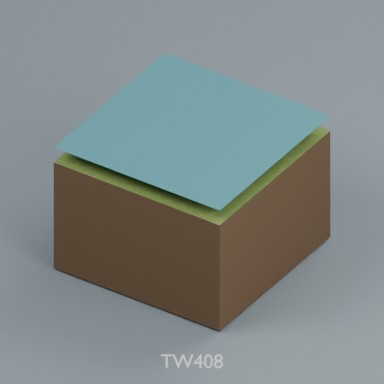

[TW408 の公開ZIP](https://raw.githubusercontent.com/k3peta/tales-on-a-table/main/distributions/terrain-connectivity-91/zips/TW408_CC0.zip)

## TW409 — upper lake outlet

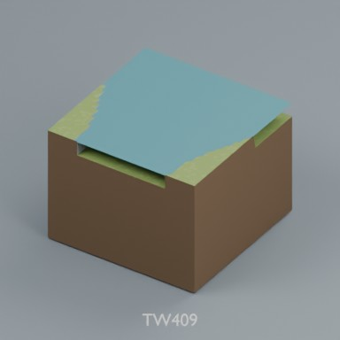

[TW409 の公開ZIP](https://raw.githubusercontent.com/k3peta/tales-on-a-table/main/distributions/terrain-connectivity-91/zips/TW409_CC0.zip)

## TW410 — waterfall lake

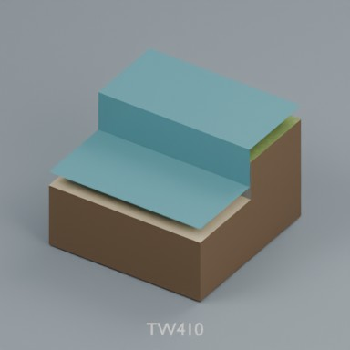

[TW410 の公開ZIP](https://raw.githubusercontent.com/k3peta/tales-on-a-table/main/distributions/terrain-connectivity-91/zips/TW410_CC0.zip)

## TY501 — pit steps

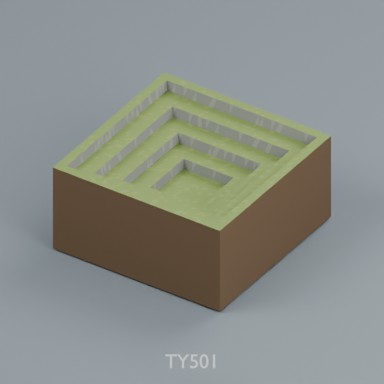

[TY501 の公開ZIP](https://raw.githubusercontent.com/k3peta/tales-on-a-table/main/distributions/terrain-connectivity-91/zips/TY501_CC0.zip)

## TY502 — pit basin NE

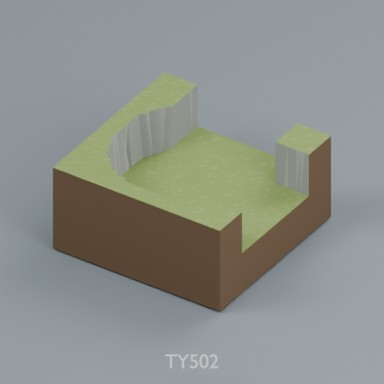

[TY502 の公開ZIP](https://raw.githubusercontent.com/k3peta/tales-on-a-table/main/distributions/terrain-connectivity-91/zips/TY502_CC0.zip)

## TY503 — pit bridge

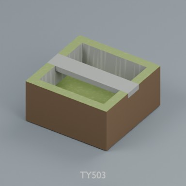

[TY503 の公開ZIP](https://raw.githubusercontent.com/k3peta/tales-on-a-table/main/distributions/terrain-connectivity-91/zips/TY503_CC0.zip)

## TY504 — pit island moat

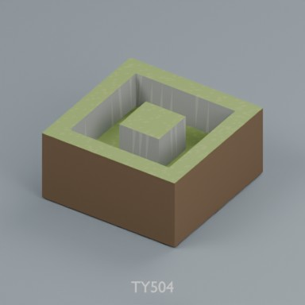

[TY504 の公開ZIP](https://raw.githubusercontent.com/k3peta/tales-on-a-table/main/distributions/terrain-connectivity-91/zips/TY504_CC0.zip)

## TY505 — cliff double inner

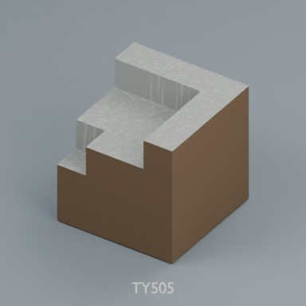

[TY505 の公開ZIP](https://raw.githubusercontent.com/k3peta/tales-on-a-table/main/distributions/terrain-connectivity-91/zips/TY505_CC0.zip)

## TY506 — cliff double nose

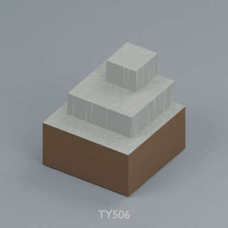

[TY506 の公開ZIP](https://raw.githubusercontent.com/k3peta/tales-on-a-table/main/distributions/terrain-connectivity-91/zips/TY506_CC0.zip)

## TY507 — cave T

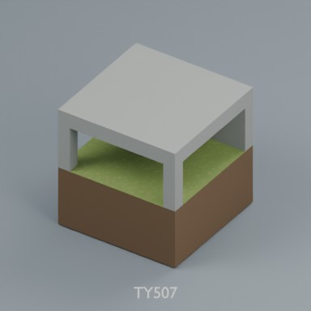

[TY507 の公開ZIP](https://raw.githubusercontent.com/k3peta/tales-on-a-table/main/distributions/terrain-connectivity-91/zips/TY507_CC0.zip)

## TY508 — cave cross

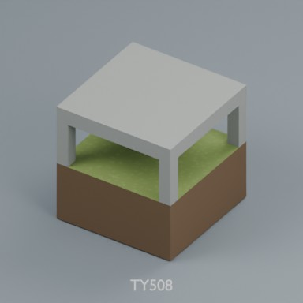

[TY508 の公開ZIP](https://raw.githubusercontent.com/k3peta/tales-on-a-table/main/distributions/terrain-connectivity-91/zips/TY508_CC0.zip)

## TY509 — cave portal

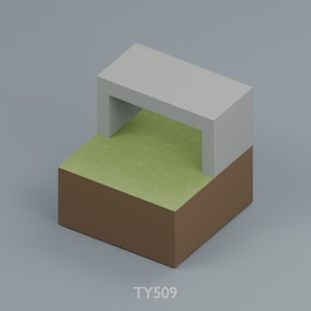

[TY509 の公開ZIP](https://raw.githubusercontent.com/k3peta/tales-on-a-table/main/distributions/terrain-connectivity-91/zips/TY509_CC0.zip)

## TZ601 — river culvert

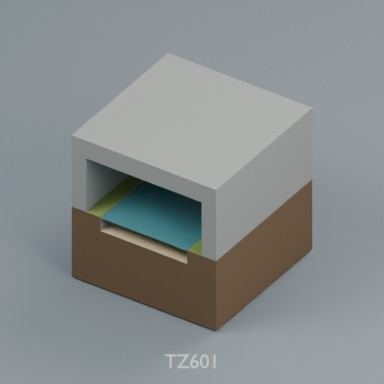

[TZ601 の公開ZIP](https://raw.githubusercontent.com/k3peta/tales-on-a-table/main/distributions/terrain-connectivity-91/zips/TZ601_CC0.zip)

## TZ602 — river portal

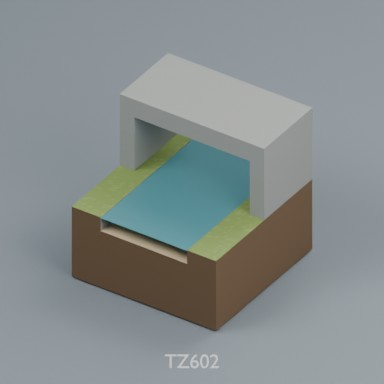

[TZ602 の公開ZIP](https://raw.githubusercontent.com/k3peta/tales-on-a-table/main/distributions/terrain-connectivity-91/zips/TZ602_CC0.zip)

## TU701 — wet bend

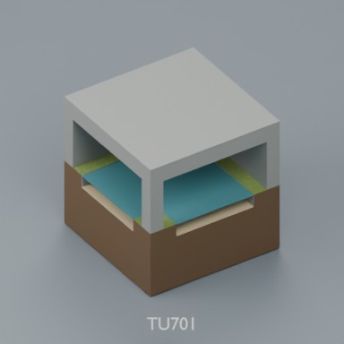

[TU701 の公開ZIP](https://raw.githubusercontent.com/k3peta/tales-on-a-table/main/distributions/terrain-connectivity-91/zips/TU701_CC0.zip)

## TU702 — wet T

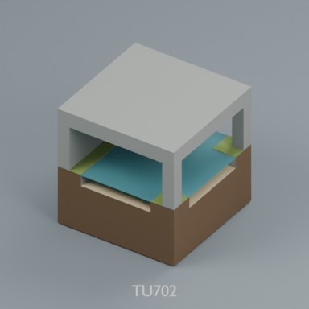

[TU702 の公開ZIP](https://raw.githubusercontent.com/k3peta/tales-on-a-table/main/distributions/terrain-connectivity-91/zips/TU702_CC0.zip)

## TU703 — wet cross

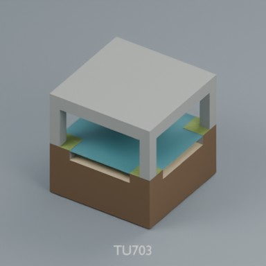

[TU703 の公開ZIP](https://raw.githubusercontent.com/k3peta/tales-on-a-table/main/distributions/terrain-connectivity-91/zips/TU703_CC0.zip)

## TU704 — wet end

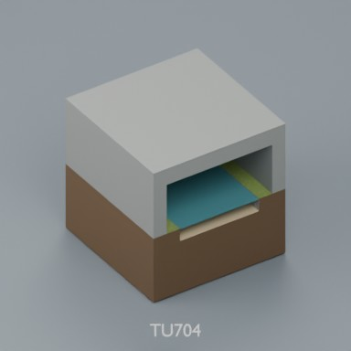

[TU704 の公開ZIP](https://raw.githubusercontent.com/k3peta/tales-on-a-table/main/distributions/terrain-connectivity-91/zips/TU704_CC0.zip)

## TU705 — walk portal

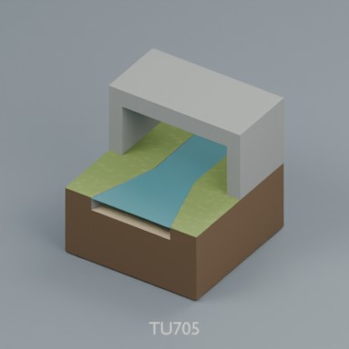

[TU705 の公開ZIP](https://raw.githubusercontent.com/k3peta/tales-on-a-table/main/distributions/terrain-connectivity-91/zips/TU705_CC0.zip)

## TU706 — walk culvert

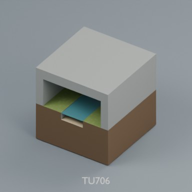

[TU706 の公開ZIP](https://raw.githubusercontent.com/k3peta/tales-on-a-table/main/distributions/terrain-connectivity-91/zips/TU706_CC0.zip)

## UA801 — three level corner

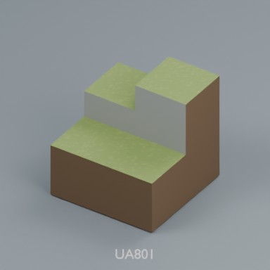

[UA801 の公開ZIP](https://raw.githubusercontent.com/k3peta/tales-on-a-table/main/distributions/terrain-connectivity-91/zips/UA801_CC0.zip)

## UA802 — diagonal supported adapter

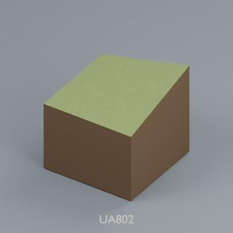

[UA802 の公開ZIP](https://raw.githubusercontent.com/k3peta/tales-on-a-table/main/distributions/terrain-connectivity-91/zips/UA802_CC0.zip)

## UA803 — switchback stair

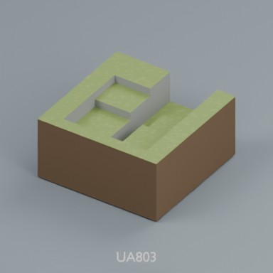

[UA803 の公開ZIP](https://raw.githubusercontent.com/k3peta/tales-on-a-table/main/distributions/terrain-connectivity-91/zips/UA803_CC0.zip)

## UA804 — switchback approach

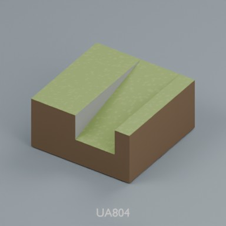

[UA804 の公開ZIP](https://raw.githubusercontent.com/k3peta/tales-on-a-table/main/distributions/terrain-connectivity-91/zips/UA804_CC0.zip)

## UA805 — stacked crossing

[UA805 の公開ZIP](https://raw.githubusercontent.com/k3peta/tales-on-a-table/main/distributions/terrain-connectivity-91/zips/UA805_CC0.zip)

## UA806 — upper cave portal

[UA806 の公開ZIP](https://raw.githubusercontent.com/k3peta/tales-on-a-table/main/distributions/terrain-connectivity-91/zips/UA806_CC0.zip)

## UB901 — beach_shore_transition

[UB901 の公開ZIP](https://raw.githubusercontent.com/k3peta/tales-on-a-table/main/distributions/terrain-connectivity-91/zips/UB901_CC0.zip)

## UB902 — beach_cliff

[UB902 の公開ZIP](https://raw.githubusercontent.com/k3peta/tales-on-a-table/main/distributions/terrain-connectivity-91/zips/UB902_CC0.zip)

## UB903 — beach_cliff_end

[UB903 の公開ZIP](https://raw.githubusercontent.com/k3peta/tales-on-a-table/main/distributions/terrain-connectivity-91/zips/UB903_CC0.zip)

## UB904 — twin_sandbar

[UB904 の公開ZIP](https://raw.githubusercontent.com/k3peta/tales-on-a-table/main/distributions/terrain-connectivity-91/zips/UB904_CC0.zip)
